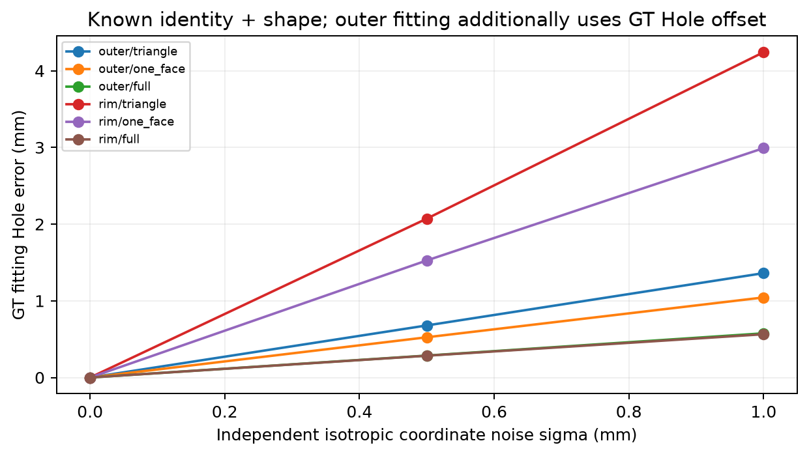
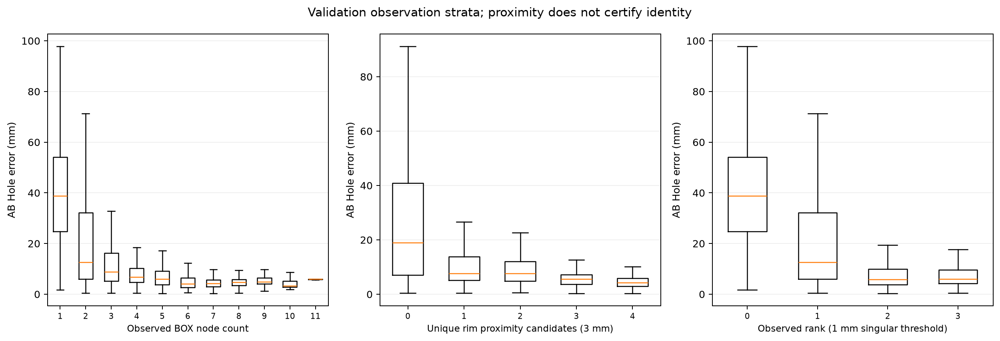
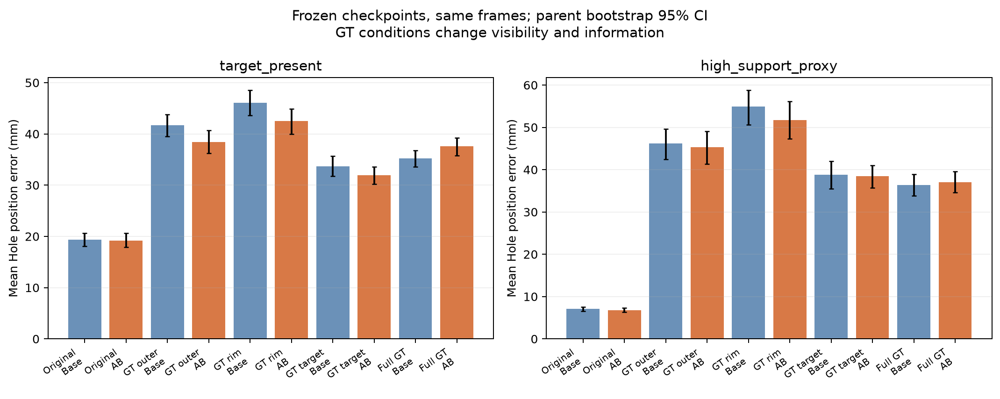
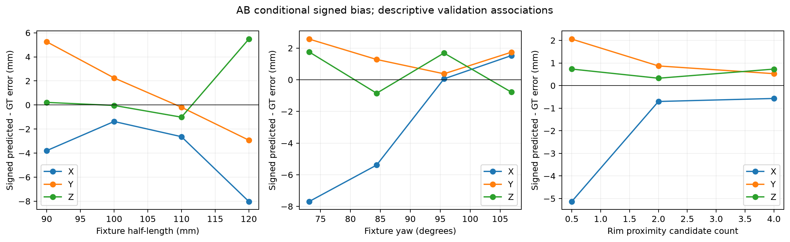
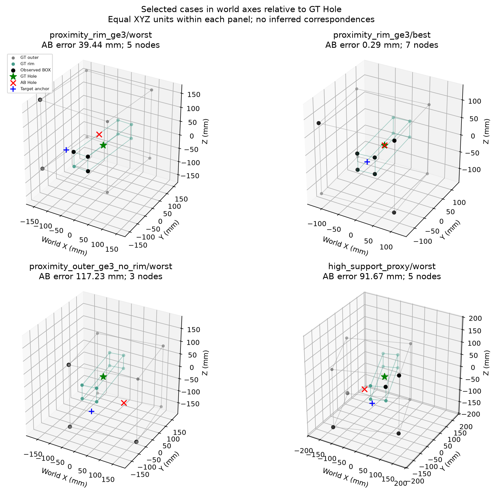

# BOX Vertex에서 Hole Pose 복원 가능성 진단

2026-11-07 KST. 이 문서는 외곽 형상의 식별 가능성, 관측 오차, frozen GNN의 복원 오차를 구분한다.
기존 [Vertex GNN 병목 분석](vertex_gnn_bottlenecks.md)의 Target 없음 상수 예측이나
GT Hole output 대체 실험은 반복하지 않았다. Object21D, GNN/State Head, Recurrent Controller,
Action Head와 기존 checkpoint는 변경하지 않았다.

## 판단의 범위

**외곽 BOX corner만으로 Hole 위치를 유일하게 정할 수 없다.** Simulator가 exterior cube와
독립적인 Hole offset을 샘플링한다. 반면 현재 `BOX` 타입에는 외곽과 aperture rim 후보가 함께
들어간다. 따라서 `HOLE` 타입이 0이라는 사실은 aperture 정보가 없다는 뜻이 아니다.

동일 Validation 18,751프레임 / 180 Parent에서 GT 기하와 frozen 네 모델을 평가했다.
Rim 근접 후보가 3개 이상인 3,388프레임의 AB Hole 오차는 4.997mm다. 이 집합은 GT와의
근접성으로 정의한 **진단 proxy**이며, 물리 identity가 인증된 high-quality 집합은 아니다.
완전한 GT 그래프는 기존 GNN을 개선하지 않았지만, 관측량·양쪽 mouth·분포가 함께 달라졌다.
이를 GNN 표현력의 하한이나 Perception 기여율로 해석하지 않는다.

**Visibility를 고정한 GT coordinate replacement는 실행하지 못했다.** 로컬과 실행 중인
Vast.ai 인스턴스 59441593을 조사했지만, Validation은 cache-only이고 원래 detector candidate
metadata와 물리 corner identity가 없다. 이 공백 때문에 Perception과 Learning의 인과적 비율은
이번 결과로 식별되지 않는다. 최근접 GT를 임의로 붙이는 방식으로 공백을 채우지 않았다.

## 데이터, 실행 및 통계

- Train: 원래 630 Parent / 64,702프레임. 입력 분포 기준 산출에만 사용했다. 새 학습은 없다.
- Validation: 원래 180 Parent / 18,751프레임. 모든 모델·GT 조건은 동일 sample ID로 paired 비교했다.
- Reserved Test: 90 Parent. metadata의 분할 정보만 확인했으며 frame/target은 읽거나 추론하지 않았다.
- GT fixture: 수집 manifest의 **Validation seed만** CPU simulator에서 reset하여 복원했다.
  180 Parent 모두의 모든 저장 frame에서 Hole world pose·peg size·hole radius와 대조했다.
  최대 Hole position 차이는 6.322e-8m, orientation 차이는 3.495e-7rad이고 크기·반경 차이는 0이다.
  BOX는 kinematic이며 수집 policy는 pose teleport를 수행하지 않는다. Collection/policy/factory
  세 파일은 발행 당시 source identity와 hash가 일치한다. 복원은 seed/source 재현 근거이며
  원본 raw `box_pose`를 새로 확보한 것과는 구분한다.
- 설치 ManiSkill 3.0.1 / SAPIEN 3.0.3의 실제 네 collision slab도 확인했다.
  앞의 세 Parent에서 exterior mesh corner와 aperture slab 교차 경계는 계산한 GT와
  최대 1.018e-8m 이내로 일치했다. Aperture의 오목 corner는 개별 slab mesh의 triangulation
  vertex가 아니므로 mesh vertex 순번을 물리 identity로 사용하지 않았다.
- 로컬: CPU eager 추론, `physx_cpu` + `sapien_cpu` simulator reset을 실행했다.
  로컬 CUDA/MPS 및 CUDA simulator/rendering은 실행하지 않았다.
- Vast.ai 59441593: 기존 RTX 3090에서 CUDA eager로 동일 네 checkpoint × 다섯 입력 조건을
  재평가했다. 새로운 인스턴스 생성·학습·게시·기존 checkpoint 쓰기는 없다.
  원격에서는 simulator를 실행하지 않았다. CUDA 결과 및 CPU와의 수치 차이는 아래 실행 기록에 있다.

Position은 좌표별 MAE가 아니라 **3D Euclidean 거리의 frame 평균**이다. Rotation은 wxyz quaternion의
부호 불변 geodesic 각도다. Relative 3D는 Object21[7:10]의 endpoint−hole 벡터 오차이며,
Lateral/Axial은 그 벡터 오차를 **GT Hole 축**에 투영한 값이다. Hole 위치 자체의 lateral/axial
오차와 혼동하지 않는다. 모든 position 단위는 mm, rotation 단위는 degree다.

평균·Median·P90·P95를 저장했다. CI는 Parent 전체를 복원추출하는 2,000회 bootstrap의
**frame-weighted mean 95% CI**다. Parent별 모든 frame을 함께 유지하며, paired 차이도 같은
Parent draw로 계산한다. Quantile은 point estimate다. 여러 조건·bin은 중첩되고 multiple-comparison
보정은 하지 않았으므로 탐색적 Validation 결과다. 독립 Test 성능이나 성공률로 보고하지 않는다.

실행 원본: [summary](../outputs/box_hole_observability/c5eba001023d4e27a41f14d0ba8c3d76/summary.json), [seed/mesh 검증](../outputs/box_hole_observability/c5eba001023d4e27a41f14d0ba8c3d76/simulator_replay.json),
[fixture states](../outputs/box_hole_observability/c5eba001023d4e27a41f14d0ba8c3d76/verified_fixture_states.json), [provenance](../outputs/box_hole_observability/c5eba001023d4e27a41f14d0ba8c3d76/provenance.json).
전체 모델·조건·관측/크기/회전 bin의 다섯 metric과 paired CI는
[CSV](../outputs/box_hole_observability/report/572e42e57e364e8ca249e62bd9771e37/paired_metrics.csv)에 있다.

## A. Observability — 무엇이 관측되어야 하는가?

### BOX와 GT Hole의 실제 관계

설치 task의 `_load_scene`, `_build_box_with_hole`, `box_hole_pose`를 확인하고 실행했다.
`L=peg_half_sizes[0]`는 BOX의 x/y/z 공통 half-extent이고, `r_p=peg_half_sizes[1]`,
`r_h=r_p+0.003`이다. 수집 시 L은 85~125mm, r_p는 15~25mm 범위다.

```text
c_y, c_z ~ Uniform[-0.5 (L-r_p), +0.5 (L-r_p)]
T_world_hole = T_world_box × Translation(0, c_y, c_z)
R_world_hole = R_world_box
outer corners: T_world_box  × (±L, ±L, ±L)
rim corners:   T_world_hole × (±L, ±r_h, ±r_h)
```

Hole origin은 tunnel의 x=0 중앙이다. 카메라에서 보이는 mouth는 x=−L 또는 +L에 있다.
한쪽 rim 네 점의 중심은 **mouth 중심**이고 GT Hole origin과 L(85~125mm)만큼 떨어져 있다.
Exterior corner 평균은 BOX actor 중심이며, `(0,c_y,c_z)`가 0일 때만 Hole과 같다.
두 mouth의 올바른 rim 8점을 모두 갖추면 그 대칭쌍의 중심이 Hole origin과 일치한다.
이는 simulator 구조에서 확인한 관계이며 관측 BOX 점 전체의 평균을 Hole로 정의한 것이 아니다.

**비식별성의 반례:** 동일 L·BOX pose·외곽 identity를 유지한 채 c_y,c_z만 바꾸면
8개 exterior 관측은 완전히 같고 GT Hole은 달라진다. 양 극단 offset의 Hole 간 거리는
`sqrt(2)(L-r_p)`까지 달라질 수 있다. 따라서 완벽한 외곽 pose fitting도 Hole offset을
추가로 제공하지 않으면 위치를 결정할 수 없다. 실제 180 Parent에서 GT BOX 중심을 Hole로
사용하면 평균 32.472mm다.
이 수치는 잘못된 중심 대체의 예시이며, 분포 조건부 Bayes error나 모든 모델의 하한은 아니다.

### 현재 semantic correspondence

`visual.corner_detection`은 world XYZ와 `object_id=0/1`을 반환한다. BOX 검출에는
`box_observed_cube`, face/contour 후보, `box_rgb_quadrants` 등 외곽·rim을 다루는 경로가 있다.
원래 `training.gnn.data.EpisodeGraphDataset`은 `GraphBuilder`에 physical semantic ID나
별도 HOLE label을 전달하지 않았다. 따라서 detector object 1은 모두 BOX로 들어간다.
네 checkpoint 모두 `use_semantic_ids=false`, `use_confidence=false`다.
Semantic embedding은 정의되어 있지만 identity 정보로 사용되지 않는다.
**Object type은 사용되지만, physical corner identity는 사용되지 않는다.**

기존 GNN은 PEG와 BOX node, TCP reference 및 cross-object message를 함께 사용하는 모델이다.
따라서 그 예측 오차를 BOX 좌표만으로 가능한 최적 오차라고 해석하지 않는다.
순수 exterior 비식별성은 다른 물체나 expert trajectory prior 없이 기하적으로 판단했고,
`original PEG` Oracle들은 같은 PEG context를 유지한 frozen-model 비교다.

현재 geometry export는 XYZ, object type, TCP, count, target만 가진다. 원격 원본 cache에도
`semantic_id/valid`와 confidence는 있지만 detector proposal method·UV·contour family·physical ID는
없다. 원격 raw는 Train 630 Parent에만 존재하며 Validation 180 Parent의 raw directory/frame은 없다.
학습·검증 분할을 바꾸거나 Train 결과를 Validation 결과로 대체하지 않았다.

### 관측 조건별 식별 가능성

| 관측 | Fixture pose | Hole position / rotation | 판단 |
| --- | --- | --- | --- |
| BOX 0개 | 결정 불가 | 결정 불가 | Not Identifiable. 다른 물체·expert trajectory prior는 별개 |
| 1개 physical point | 회전 자유도 잔존 | 일반적으로 불가 | Not Identifiable |
| 서로 다른 2개 또는 여러 collinear point | 두 점을 잇는 축 주위 회전이 남음 | 일반적으로 불가 | Not Identifiable |
| 알려진 형상의 labelled non-collinear 3개 | proper rigid transform 식별 가능 | exterior만이면 offset 추가 필요 | 조건부 Identifiable |
| 4개 이상이지만 중복·한 corner 집중 | unique physical point/lever arm에 따름 | 개수만으로 판단 불가 | Inconclusive |
| 알려진 4개 planar corner | non-collinear labelled plane도 rigid fitting 가능 | mouth이면 깊이 L과 mouth sign/축 필요 | planar라는 이유만으로 퇴화가 아님 |
| exterior 8개, identity 없음 | cube의 이산 회전 대칭 | offset은 여전히 관측되지 않음 | 위치 Not Identifiable, 일반 pose 모호 |
| 한쪽 rim, identity/형상 미상 | square 대칭·축 부호·깊이 모호 | mouth와 midplane을 구분해야 함 | 조건부 또는 Inconclusive |
| 양쪽 rim 8개, 올바른 family/대응/shape | fitting 가능 | 중앙 position 복원 가능 | rotation은 square-prism 대칭/실행 prior를 구분 |
| GT shape + exterior identity + GT fixture→hole transform | fitting 가능 | 복원 가능 | 추가 GT를 쓰는 Oracle |

일반적인 cube에는 24개의 proper rotational symmetry가 있다. Simulator의 upright/yaw 범위 prior는
일부 모호성을 줄일 수 있지만, 임의의 3D 관측에서 semantic correspondence가 생긴다는 뜻은 아니다.
회전 quaternion을 유일하게 채점하려면 축/부호 convention 또는 그에 해당하는 추가 정보가 필요하다.

### Labelled GT fitting과 noise sensitivity

각 Validation Parent의 정확한 GT corner를 생성하고 known correspondence Kabsch fitting을 수행했다.
원래 학생 입력을 바꾸거나 관측되지 않은 corner가 보였다고 간주한 실험은 아니다.
Triangle은 같은 face의 3개, one_face는 같은 face의 4개, full은 양쪽을 포함한 8개다.
각 0.5/1mm sigma에서 독립 등방 Gaussian noise 20회를 사용하고 Parent 단위 CI를 계산했다.

| GT fitting | 추가 정보 | sigma 0mm | sigma 0.5mm | sigma 1mm |
| --- | --- | ---: | ---: | ---: |
| Exterior 3개 | L·identity·GT offset | <0.001 | 0.679 | 1.361 |
| Exterior 4개 | L·identity·GT offset | <0.001 | 0.525 | 1.044 |
| Exterior 8개 | L·identity·GT offset | <0.001 | 0.286 | 0.576 |
| 한 mouth rim 3개 | L·r_h·identity/mouth sign | <0.001 | 2.072 | 4.242 |
| 한 mouth rim 4개 | L·r_h·identity/mouth sign | <0.001 | 1.527 | 2.991 |
| 양 mouth rim 8개 | L·r_h·identity | <0.001 | 0.284 | 0.564 |

Noiseless 값은 GT에서 생성한 일관된 좌표를 다시 fitting한 수치 오차다. 실제 검출 정확도나
Student 성능은 아니다. 1mm sigma에서 한 mouth 4점은 2.991 [2.908, 3.073]mm,
양 mouth 8점은 0.564 [0.557, 0.572]mm다.
한쪽의 작은 rim에서 긴 tunnel 중앙으로 외삽할 때 normal 오차의 lever arm이 커진다.
같은 점 개수라도 물리적 배치와 형상 파라미터가 오차 민감도를 바꾼다.



[Fitting 원본](../outputs/box_hole_observability/c5eba001023d4e27a41f14d0ba8c3d76/geometric_fitting.csv), [모든 통계/CI](../outputs/box_hole_observability/report/572e42e57e364e8ca249e62bd9771e37/fitting_summary.json).

### 실제 관측 coverage의 한계

3mm 이내 GT exterior/rim reference가 **하나만** 있는 관측을 proximity candidate로 표시했다.
여러 관측이 같은 reference를 지지해도 한 physical candidate로만 센다. 이 계산은 가까운 점을
모델 입력으로 치환하지 않으며 identity의 정답을 생성하지도 않는다. 3mm는 사전 정의한 진단
반경이고, 이를 넘는 node는 false positive라고 확정하지 않는다. Threshold를 검증 성능에 맞춰
조정하지 않았다. Support가 없는 node는 오검출·좌표 오차·다른 경계일 수 있다.

| 원래 관측 조건 | Frame / Parent | AB Hole mean [95% CI] | Median | P90 | P95 |
| --- | ---: | ---: | ---: | ---: | ---: |
| BOX ≥1 | 16,495 / 180 | 19.198 [17.856, 20.641] | 9.324 | 50.679 | 63.775 |
| PEG ≥4 AND BOX ≥4 | 5,884 / 180 | 6.773 [6.285, 7.341] | 5.196 | 12.303 | 16.838 |
| 서로 다른 rim proximity 후보 ≥3 | 3,388 / 174 | 4.997 [4.639, 5.362] | 4.417 | 8.412 | 10.923 |
| exterior 후보 ≥3 AND rim 후보 0 | 2,224 / 137 | 12.848 [11.073, 14.846] | 7.564 | 30.908 | 44.153 |

High support의 target은 실제로 모두 BOX다. 이 집합에서 unique exterior 후보는 평균 2.643개,
rim 후보는 2.667개다. BOX ≥4의 5,978프레임과 rim 후보 ≥3의 3,388프레임은 동일 집합이 아니다.
Target-present 16,495프레임 중 rim 후보 0은 10,134프레임이고 이때 AB 평균은 26.319mm다.
Rim 후보 1~2는 2,973프레임 / 11.108mm, 3~4는 3,388프레임 / 4.997mm다.
관측 rank는 1mm singular-value threshold로 기술했다. 측정 rank나 GT proximity만으로
실제 physical coverage, 가림, 유일한 pose 복원 가능성이 인증되지는 않는다.



## B. GT Vertex Oracle — 현재 모델은 정확한 좌표를 얼마나 활용하는가?

### 조건 및 정보 예산

| 조건 | PEG | Target 좌표/개수 | Visibility / ID | 해석 |
| --- | --- | --- | --- | --- |
| Original | 원래 관측 | 원래 관측 | 원래 missing / unknown semantic | 기존 paired 결과의 replay |
| Coordinate replacement | 원래 관측 | 인증된 기존 node만 GT로 교체해야 함 | count·missing·type·identity 고정 필요 | **미실행: correspondence 없음** |
| Perfect geometry + original visibility | 원래 관측 | 원래 관측된 physical vertex 집합 필요 | physical membership 필요 | **미실행: physical visibility mapping 없음** |
| GT outer + original PEG | 원래 관측 | exterior 8개 | target visibility 증가, 모두 BOX, semantic unknown | exterior-only Oracle 입력 |
| GT rim + original PEG | 원래 관측 | 양 mouth rim 8개 | 양쪽 모두 관측, 모두 BOX | exterior와 같은 8개지만 다른 family/information |
| GT target + original PEG | 원래 관측 | exterior 8 + rim 8 | target 16개, 모두 BOX | PEG만 유지한 full target Oracle |
| Full GT | GT physical PEG 8개 | exterior 8 + rim 8 | 총 24개, target은 모두 BOX | 입력 정보량이 다른 upper reference |

GT Hole pose를 feature로 concatenate하지 않았다. Oracle physical corner는 GT pose/shape에서 생성했다.
특히 GT rim 좌표 자체가 Hole을 결정하는 privileged information이다. 이 조건을 Student 입력으로
제안하거나, GT 누출이 없는 일반 inference라고 주장하지 않는다. Semantic identity correction은
없으며 기존 checkpoint가 semantic ID를 사용하지 않으므로 on/off 효과도 시험하지 않았다.

새 좌표마다 complete directed edge의 relative XYZ와 distance를 재계산했다. TCP를 뺀 world-aligned
좌표계와 metre 단위는 유지했다. Original replay의 최대 Object21 absolute delta는 네 모델 모두
4.77e-7 이하였고 target anchor도 source forward와 일치했다. Noisy/GT graph 모두 같은 frozen
weights, eval mode, parameter budget을 썼다.

총 parameter 수는 Baseline 234,927 / A 239,135 / B 240,237 / AB 244,445다.
이 수에는 disabled semantic embedding 512개도 포함된다. 추가 학습 parameter는 0이고,
GT fitting은 학습 모델이 아니다. 조건 간 weights와 parameter 수는 바뀌지 않는다.

### Target-present 동일 16,495프레임의 Hole position mean

단위 mm. A=Geometry, B=Multi-seed, AB=결합. CI 및 모든 quantile은 linked CSV에 있다.

| 입력 조건 | Baseline | A | B | AB |
| --- | ---: | ---: | ---: | ---: |
| Original | 19.326 | 19.183 | 19.060 | 19.198 |
| GT outer + original PEG | 41.650 | 40.422 | 42.153 | 38.445 |
| GT rim + original PEG | 46.091 | 53.867 | 51.588 | 42.516 |
| GT target + original PEG | 33.697 | 37.124 | 40.308 | 31.924 |
| Full GT (24 nodes) | 35.192 | 35.689 | 41.441 | 37.549 |

### AB: 전체 조건의 physical error (Target-present, 동일 frame)

| 입력 조건 | Hole position | Hole rotation (deg) | Relative 3D | Lateral | Axial |
| --- | ---: | ---: | ---: | ---: | ---: |
| Original | 19.198 | 4.871 | 19.522 | 17.416 | 6.477 |
| GT outer + original PEG | 38.445 | 10.607 | 36.099 | 34.963 | 6.569 |
| GT rim + original PEG | 42.516 | 13.197 | 51.592 | 41.090 | 25.256 |
| GT target + original PEG | 31.924 | 10.834 | 34.443 | 30.308 | 11.981 |
| Full GT (24 nodes) | 37.549 | 8.515 | 37.639 | 36.964 | 5.359 |

AB Original Hole은 19.198 [17.856, 20.641]mm,
Full GT는 37.549 [35.751, 39.276]mm다.
원래 High-support 5,884프레임으로 평가 frame만 제한해도 Full GT는 37.082mm이고,
Original은 6.773mm다. 이 비교에서 그룹은 **원래 관측 기준**으로 고정되어 있다.
Full GT가 High-support의 실제 visibility를 보존한 것은 아니다.



### 분포 이동 검사와 Perception 해석의 한계

Train target node 수의 최대는 11개다. GT target/full GT의 16개 target은 100% Train range 밖이다.
8개 outer/rim 조건은 개수 range 안이지만 양쪽 mouth/뒤쪽 exterior가 함께 존재하는 공간적 배치가
부분 관측과 다르다. Count range 안이라는 사실만으로 학습 분포 안이라고 판단하지 않는다.

Rim-only 8점의 target anchor는 GT Hole 자체다. 그런데 기존 head가 nonzero offset을 더해
AB Target-present 오차는 42.516mm다. 한쪽 face에서 중앙으로 이동하던 head가 전체 대칭 point set에
그대로 일반화하지 못한다는 **분포 민감성**은 확인됐다. 이것은 Original의 좌표 오차를 제거한
효과도, GNN의 가능한 최적 성능도 아니다. Full target과 Full GT의 차이에는 PEG 관측 변화도 있다.

이번 실험에서 GT coordinate replacement의 Δerror, Perception error 기여율, correspondence correction의
개선폭은 **Inconclusive**다. “GT를 넣어도 나빴다 → Perception이 중요하지 않다”, 또는
“GNN 표현력이 부족하다”는 결론을 내릴 수 없다. 양쪽 full GT의 악화를 noise-free partial Oracle과
섞지 않았다. [입력 분포 통계](../outputs/box_hole_observability/c5eba001023d4e27a41f14d0ba8c3d76/summary.json)의 `input_distributions`를 함께 보아야 한다.

## C. GNN Learning Diagnosis — Anchor와 Offset의 잔여 오차

### Anchor는 Hole의 추정값이 아니다

기존 checkpoint의 confidence 사용은 꺼져 있어 target anchor는 관측 BOX 점의 산술평균이다.
코드의 복원 식은 다음과 같다.

```text
anchor = mean(observed_target_world - tcp_world)
pred_hole = anchor + 0.05 m × raw_hole_xyz
required_offset = GT_hole_relative - anchor
predicted_offset = pred_hole - anchor
hole_error_vector = predicted_offset - required_offset
```

따라서 offset residual이 전체 Hole 오차와 같다는 것은 산술 항등식이다. 이것만으로 encoder,
pooling, head 중 어느 곳이 원인인지 식별하지 않는다. Anchor가 Hole에서 멀다는 사실도 anchor
검출 오차를 뜻하지 않는다. 특히 한 mouth의 관측 중심에서는 중앙까지 약 L만큼 이동해야 한다.

| AB / 원래 관측 집합 | ‖GT Hole − anchor‖ mean | ‖predicted offset‖ mean | Signed X | Signed Y | Signed Z |
| --- | ---: | ---: | ---: | ---: | ---: |
| Target-present | 137.117 | 135.496 | -3.395 | 1.529 | 0.658 |
| High-support proxy | 106.562 | 106.346 | -0.811 | 0.712 | 0.842 |
| Rim ≥3 proximity proxy | 104.295 | 104.384 | -0.570 | 0.527 | 0.730 |

Target-present의 signed world-X bias는 −3.395mm [−5.241, −1.551]이고,
High-support에서는 −0.811mm [−1.416, −0.248]이다. Z bias는 High-support에서
+0.842mm [+0.336, +1.348]이다. Rim ≥3 proxy에서도 평균 residual은 4.997mm지만
평균 signed vector는 (−0.570,+0.527,+0.730)mm에 불과하다. 일정한 전역 translation bias만으로
전체 residual을 설명하기는 어렵다. Validation 평균 bias를 그대로 보정하는 규칙은 학습하거나
Production에 추가하지 않았다.

### 크기·회전·공간적 편중

다음은 Target-present의 조건부 기술 통계다. 크기/회전별 관측 visibility, Parent 및 rim coverage가
매칭된 실험이 아니므로 인과적 크기 효과나 독립적인 orientation 취약성으로 해석하지 않는다.

| Fixture half-length / yaw | Frames | AB Hole mean | Signed X,Y,Z mean |
| --- | ---: | ---: | --- |
| L 85–95mm | 4,179 | 17.088 | -3.795, +5.252, +0.214 |
| L 95–105mm | 5,284 | 17.414 | -1.373, +2.249, -0.038 |
| L 105–115mm | 4,368 | 19.833 | -2.636, -0.189, -1.014 |
| L 115–125mm | 2,664 | 25.005 | -8.021, -2.925, +5.475 |
| Yaw 67.5–78.75° | 5,183 | 20.736 | -7.688, +2.569, +1.753 |
| Yaw 78.75–90° | 3,897 | 18.346 | -5.388, +1.282, -0.851 |
| Yaw 90–101.25° | 4,403 | 18.669 | +0.057, +0.377, +1.689 |
| Yaw 101.25–112.5° | 3,012 | 18.428 | +1.527, +1.741, -0.782 |

L과 Hole error의 Pearson r는 +0.119, yaw는 −0.033이다. 반면 관측 diameter는 −0.476,
두 번째 singular value는 −0.447이다. 넓은 관측 분포/비공선성이 낮은 error와 연관되지만,
관측 수·rim 존재와도 함께 변한다. “4개면 충분하다”거나 “특정 yaw만이 원인”이라는 근거는 아니다.
Hole radius의 r는 +0.001이다. 크기·반경 bin별 통계/CI와 local XYZ signed bias도
[anchor/offset 분석](../outputs/box_hole_observability/c5eba001023d4e27a41f14d0ba8c3d76/anchor_offset.json)에 저장했다.



### 사례별 3D 기하

아래 사례는 (1) rim ≥3 proxy의 최대 error, (2) 같은 집합의 최소 error,
(3) exterior ≥3/rim 0 proxy의 최대 error, (4) High-support 최대 error에서 중복 없이 골랐다.
Best/worst 선택은 설명용이며 대표성이나 확률을 추정하지 않는다. 각 panel은 XYZ 단위가 같고
각 축의 길이를 동일하게 그렸다. Panel 간 표시 범위는 다를 수 있다.
검은 점은 실제 관측, 회색은 GT exterior, 청록색은 GT rim, 별은 GT Hole, 빨간 X는 AB 예측,
파란 +는 anchor다. Plot은 world XYZ를 GT Hole 위치만큼 평행이동했으며 TCP 회전은 적용하지 않았다.



[사례 sample ID·관측/GT/예측 3D 좌표](../outputs/box_hole_observability/report/572e42e57e364e8ca249e62bd9771e37/cases.json).
Rim ≥3 proxy 안에도 최대 39.444mm의 tail이 남는다. 가까운 3점이 있다는 사실만으로
physical family/identity, 깊이/축, 충분한 context 또는 GNN의 정확한 복원이 보장되지는 않는다.

### Probe 학습을 하지 않은 이유

사용자 요청의 순서에 따라 RQ1/RQ2를 먼저 평가했다. Exterior-only의 비식별성은 확인했고,
형상·identity를 추가한 labelled GT fitting의 조건부 식별성도 확인했다. 그러나 실제 검출 노드에
대해 certified physical correspondence가 있는 집합과 visibility-fixed coordinate Oracle은 확보하지
못했다. 이 상태에서 Set Encoder/MLP의 gain을 “Geometry가 충분한데 GNN이 못 배웠다”는
근거로 사용하면 추가 정보·분포·selection과 Learning을 다시 섞는다. 따라서 새 학습을 실행하지 않았다.

동일 정보 Set Encoder, semantic on/off, head-only fitting, frozen representation probe,
loss 재가중/normalization/calibration 학습은 모두 **미실행**이다. 기존 Frozen Encoder Readout
Probe를 새로운 결과로 재인용하거나 반복 실행하지 않았다. Encoder와 head, supervision/loss,
calibration의 인과적 분리는 이번 결과만으로 완료됐다고 주장하지 않는다.

## D. 여섯 질문에 대한 종합 판단

| 질문 | 실험적으로 확인된 사실 | 지지되는 해석 | 아직 검증되지 않은 항목 |
| --- | --- | --- | --- |
| 1. BOX만으로 몇 mm까지 가능한가? | Exterior만으로 offset은 비식별. GT rim/shape/identity가 있으면 noiseless 수치 오차 수준, 한 mouth 4점에 1mm sigma이면 2.991mm | 외곽 count보다 rim family·깊이·축·correspondence가 중요 | 현재 raw 관측만으로 얻을 최선의 mm 수준 |
| 2. 정확한 GT Vertex에서 현재 GNN 정확도는? | Full GT 24개에서 AB 37.549mm, Baseline 35.192mm (원래 Target-present 동일 frame) | 기존 weights는 full two-mouth graph에 일반화하지 못함 | Visibility-fixed GT-coordinate 정확도 |
| 3. 실제 검출 오차 영향은? | GT 근접 rim 후보가 많은 집합은 AB 4.997mm. Coordinate replacement는 미실행 | Perception/coverage의 영향 가능성과 일관됨 | 좌표·identity·누락 각각의 causal Δmm 또는 기여율 |
| 4. Geometry가 충분할 때 잔여 오차는? | 인증된 sufficient-observation 집합은 확보하지 못함. Proxy에서 5mm tail, bias는 약 1mm vector 규모. GT one-mouth fitting도 noise에 민감 | Mouth→midplane의 긴 offset 복원이 관측 noise와 학습 오차를 함께 증폭할 수 있음 | 실제 5~7mm 중 noise와 학습이 차지하는 비율 |
| 5. 가장 유력한 병목은? | 외곽만의 offset 비식별, 외곽/rim 혼합 BOX, identity 비사용, full-graph 분포 민감성 확인 | 우선 병목 후보는 **입력의 물리 의미와 partial geometry→Hole-midplane 복원 관계** | Encoder capacity, pooling, head, loss 중 단일 지배 원인의 확정 |
| 6. 다음 개선은 어느 연산을 겨냥해야 하나? | Anchor에서 Hole까지 평균 104~137mm의 관측 의존 offset을 복원하고 있음 | Corner family/coverage를 구분하고 **관측 face의 방향·형상 scale에서 Hole 기준점으로 옮기는 관계**를 정확히 추정하는 연산을 먼저 검증할 근거가 있음 | 특정 GNN 구조·semantic ID 추가·pooling 교체의 효능 |

다음 실험의 우선순위는 physical correspondence와 원래 visibility를 보존한 partial Oracle을
가능하게 하는 증거 확보다. 필요한 것은 원래 Validation RGB-D/calibration, detector candidate
method/UV/contour family와 독립적으로 검증한 physical corner ID/membership다. 최근접 오차를
작게 만든 association으로 선택한 집합은 큰 detection error를 배제할 수 있으므로 전체 Perception
기여율을 추정하는 실험과도 구분해야 한다. 이 조건이 충족된 후에 같은 입력과 split으로
Geometry-to-Hole/Head probe를 비교해야 한다. 현재 결과만으로 새로운 GNN 구조를 채택하지 않는다.

## 재현, hash 및 보존

필요 패키지: 기존 repo Python 환경의 Torch, NumPy, SciPy, PyYAML, Matplotlib.
CPU seed replay에는 ManiSkill/SAPIEN과 정상적인 Vulkan 환경이 필요하다.
`graph/configs/analyze_box_hole.yaml`에 기존 local cache export/prediction/checkpoint 경로가 들어 있다.
다른 호스트에서는 이 경로만 기존 artifact 위치에 맞춰 바꾼다. 새 run UUID마다 별도 output이 생긴다.

```bash
WANDB_MODE=disabled .venv/bin/python main.py --config graph/configs/analyze_box_hole.yaml
WANDB_MODE=disabled .venv/bin/python main.py --config graph/configs/export_box_hole_report.yaml
.venv/bin/python -m unittest tests.test_box_hole_diagnostics tests.test_vertex_geometry_diagnostics tests.test_vertex_diagnostics tests.test_gated_mpnn -v
.venv/bin/python -m unittest tests.test_experiment_logger tests.test_experiment_artifacts tests.test_box_hole_diagnostics tests.test_gnn_cached_data -v
```

기존 Vast.ai 인스턴스에서는 별도 source directory에 복사한 코드로 아래 명령을 실행했다.
이 명령은 이미 복원·검증된 fixture states의 hash를 확인하며 simulator를 시작하지 않는다.
경로 및 pinned SHA는 실제 실행 config에 보존했다.

```bash
WANDB_MODE=disabled /venv/main/bin/python main.py --config graph/configs/verify_box_hole_cuda.yaml
```

원격 결과는 [CUDA summary](../outputs/box_hole_observability/cuda/7dca4d9f09544640a4da9d7f8a2b67f2/summary.json),
[CUDA provenance](../outputs/box_hole_observability/cuda/7dca4d9f09544640a4da9d7f8a2b67f2/provenance.json),
[CPU–CUDA 비교](../outputs/box_hole_observability/cuda/7dca4d9f09544640a4da9d7f8a2b67f2/cpu_cuda_comparison.json)에 있다.
Torch 2.14.1+cu132 / CUDA 13.2, 동일 checkpoint hash를 확인했고,
20개 model/condition 전체에서 최대 Object21 absolute delta는 7.153e-7이었다.
원격 metadata의 dataset identity는 아래 cache replay identity다.
실제 원격 실행 config는 `/workspace/box_hole_observability/cuda_config.json`이었다.

- [물리 기하 / seed replay 코드](../evaluation/gnn/box_hole_geometry.py)
- [Frozen graph Oracle / 통계 / Anchor 분석](../evaluation/gnn/box_hole_diagnostics.py)
- [CUDA 재검증](../evaluation/gnn/box_hole_cuda_verification.py)
- [그림](../evaluation/gnn/box_hole_plots.py), [표/보고서 export](../evaluation/gnn/box_hole_report.py)
- [기하·graph 계약 테스트](../tests/test_box_hole_diagnostics.py)

공통 `ExperimentLogger`의 UUID/local/offline 기록과 artifact sidecar를 재사용했다. 자동 upload는 없다.
Primary evaluation `c5eba001023d4e27a41f14d0ba8c3d76`, report export
`572e42e57e364e8ca249e62bd9771e37`, CUDA evaluation
`7dca4d9f09544640a4da9d7f8a2b67f2`를 각각 구분한다.
Primary source snapshot과 보고서 export의 최종 snapshot을 모두 보존했다.
기존 working tree는 이미 dirty였으며 이번에도 commit하지 않았다. Commit hash만으로 재현하지 않고
[최종 source snapshot/hash](../outputs/box_hole_observability/report/572e42e57e364e8ca249e62bd9771e37/source_sha256.json)를 사용한다.

| Artifact | SHA256 |
| --- | --- |
| 원래 raw dataset identity | `41fe23fed067f116b6bfc39694e19a5f98714381207802a618ac6ea9545e2dcb` |
| Baseline checkpoint | `8c47f5b26449e427c0cb4b29a6e0470fcf0d8d466b3b83aef7432e499d5f3885` |
| A checkpoint | `5e74a0cce646579bc6b52c44436a2898b63036446fc7c88480b0e9c7e327ae00` |
| B checkpoint | `2c133a17e54ab35fc50b4e269ced18c5131e81d439ce8b4e5927229dea073a39` |
| AB checkpoint | `0df85ac27327b9cff860cde7c9e1fa55bdb0c2925f6c68a0f9e11de0be9a24f9` |
| Validation geometry export | `631390fe9671f3f175bb74b3cb2fce7b2e2434fdfdff3607a07cd83eac49ed97` |
| Train geometry export | `8448ac827e9026cabc9b3934af88e80e2eb11e210d5e268bdeefb5668ffb3f45` |

Checkpoint의 cache replay dataset identity는
`21a03a363ec5d6e1dd391fc014b8e3ad1455c5eaf0489153a9c39eed2d133292`이며 raw dataset identity와
다른 역할이다. Preprocessing namespace는
`39a3bffd833ba5b7ab9199cde711b3bacb766e7867bad96f63360cf0b12bf6f1`이다.
원래 paired prediction과 geometry의 sample ID·target·count가 같음을 검사하고, Original inference
재현도 검증했다. [전체 provenance](../outputs/box_hole_observability/c5eba001023d4e27a41f14d0ba8c3d76/provenance.json)에 네 prediction, parent manifest,
collection manifest, data identity 및 source의 full hash를 기록했다.

관련 기존 진단/모델 15개 테스트, 공통 logger/artifact/cache 및 신규 계약 52개 테스트가 통과했다
(두 명령에 중복되는 신규 6개 테스트 포함). 문서 링크·그림·최종 소스와 checkpoint 보존도 별도로
검사했다. 임시 feature worktree는 만들지 않았고 기존 다른 작업의 worktree는 변경하지 않았다.
