# Recurrent controller 84개 학습 실행과 전체 재평가

7개 모델 × 손상 4단계 × 학습 seed 3개의 학습 결과와, 기존 best checkpoint를 사용한 정책 11,340 episode·CPU expert 60 episode를 정리했다. 새 학습이나 rollout 없이 완료된 기록에서 생성한 리포트다.

## 핵심 결과

- `none`: mamba 63.3% (normal, 관측된 평균 성공률 기준)
- `low`: mlp 42.2% (normal, 관측된 평균 성공률 기준)
- `mid`: stack_mlp 32.2% (normal, 관측된 평균 성공률 기준)
- `high`: stack_mlp 8.9% (normal, 관측된 평균 성공률 기준)

위 순위는 이 seed와 평가 조건에서 관측한 값이다. 모델 구조의 효과를 다른 학습 차이와 분리한 인과적 결론이나, 모집단에서의 확정적인 우열을 뜻하지 않는다.

## 집계와 해석

- 기본 표는 학습 손상과 평가 손상이 같은 조건이다. clean 학습의 교차평가와 high 학습의 blackout은 별도 집계한다.
- 기본 표의 각 칸은 학습 seed 3개 × 동일한 평가 seed 30개다. 평균과 표본 표준편차(ddof=1)를 표시하고, `seed_success.png`에는 학습 seed별 성공률을 점으로 표시한다.
- 동일한 평가 seed가 학습 seed 사이에서도 재사용된다. 기준 모델과의 비교는 학습 seed와 episode seed를 각각 재표집하는 crossed bootstrap 2,000회, 95% 구간이다. 학습 seed가 3개뿐이며 다중 비교 보정은 하지 않았다. 탐색적 비교로 읽어야 한다.
- `summary.csv`의 pooled Wilson 구간은 episode 합계에 대한 기술 통계이며 학습 seed 불확실성을 나타내지 않는다.
- 종합 평균이 필요하면 `equal_weight_success.csv`의 손상 4단계 동일 가중 평균을 쓴다. 교차평가·blackout까지 모든 episode를 합친 값으로 모델 순위를 계산하지 않는다.
- Blackout은 high 학습 모델을 eval corruption none에서 평가한다. 안정적으로 잡고 들어 올린 경우에만 강제 차단되므로 실제 발생 수를 함께 표시한다. 발생한 episode만의 성공률은 선택된 하위집단의 기술 통계다.
- Blackout 0에서도 성공률이 낮아 바닥 효과가 있다. 작은 변화나 비단조 곡선만으로 기억 능력의 우열을 단정하지 않는다.
- 정책은 PhysX CUDA, expert는 PhysX CPU다. 같은 CPU 초기 fixture를 사용하지만 이후 물리·IK 경로는 다르다. expert는 CPU 참고 baseline이며 GPU 정책 성공률의 직접적인 상한으로 해석하지 않는다.
- 산점도는 평가한 best.pt의 validation action MSE를 쓴다. 동률을 평균 순위로 처리한 Spearman 상관은 84개 실행 전체의 기술 통계이며, 모델·손상 조건이 섞인 상관을 인과 효과로 해석하지 않는다.
- 원본 학습 Torch `2.11.0+cu128`, 재평가 Torch `2.14.1+cu130`. RKN은 기존 checkpoint 형식을 유지한 `stable_v1` 분산 갱신을 사용했다.
- 실행 시 Git dirty 상태가 기록돼 있다. 원본 학습 시점의 미커밋 코드와 현재 코드가 동일하다고 보장하지 않는다. 각 실행의 identity·checkpoint hash와 원본 archive를 출처로 보존한다.
- 현재 서버에서 단일 정책 추론 지연을 새로 측정하지 않았다. GPU batch 추론 시간을 episode별 지연으로 나누어 제시하지 않는다.

## 원자료와 재현

- [원본 학습 백업](https://huggingface.co/datasets/Graph-Recurrent-VLA/experiment-backups/tree/9697eb97b10806220722cdb82df4c16893a79ba5/recurrent/main/ed8f549f237e406a93521845d9eb9188) — revision `9697eb97b10806220722cdb82df4c16893a79ba5`
- [전체 재평가 백업](https://huggingface.co/datasets/Graph-Recurrent-VLA/experiment-backups/tree/c8508ba789a7e8863d0bd2966ddcd26bbd6a46b9/recurrent/reevaluation_main_20261023/1db7f7a881cc445098d952f64443ccd6) — revision `c8508ba789a7e8863d0bd2966ddcd26bbd6a46b9`
- HF 백업 열람에는 해당 private 저장소의 읽기 권한이 필요하다. 아래 PNG·CSV는 이 리포트에 포함돼 있다.
- `provenance.json`: 84개 checkpoint·history, 85개 평가 JSONL, fixture·root 완료 기록의 SHA-256과 실행 패키지 버전.
- 입력 검증은 원본 학습 완료, 평가 identity·episode 집합·summary·완료 hash를 모두 검사하며 원본을 수정하지 않는다.

```bash
.venv/bin/python -m recurrent.report \
  --config recurrent/configs/experiment.yaml \
  --source-root /workspace/recovered-main \
  --reevaluation-dir outputs/recurrent/reevaluation_main_20261023 \
  --evaluation-backup-receipt outputs/backups/reevaluation_main_20261023T163639Z/receipt.json \
  --out-dir docs/reports/recurrent_main_20261023
```

다른 위치에 복원했다면 source-root·reevaluation-dir 경로를 바꾸고, 로컬 게시 receipt가 없으면 evaluation-backup-receipt 옵션은 생략한다. 파일 생성만 수행하며 학습·평가·HF 업로드를 시작하지 않는다.

## 실험 설정

- 데모: `outputs/recurrent/data/expert_demos.npz`
- 모델: mlp, stack_mlp, gru, lstm, cfc, rkn, mamba
- 관측 손상 단계: none, low, mid, high (학습과 평가에 같은 단계를 적용)
- 학습 seed: 0, 1, 2
- 실제 학습 device: cuda
- 정책 평가 physics backend: physx_cuda
- Expert 평가 physics backend: physx_cpu (GPU 정책과 CPU expert는 물리 backend가 다를 수 있음)
- 초기 상태 출처 (CPU reset fixture의 SHA-256 또는 legacy reset): c62d0cc9c56706be49e050cfcfd8097693181a684d4a77bcff247ef7066a6a3d (fixture SHA-256 또는 reset 출처)
- Offline 오차: 평가에 사용한 `best.pt`의 validation action MSE
- 평가: 조건마다 seed 2000부터 30 episode, horizon 250 step, 조건 normal, hole_shift
- 성공 판정: rollout 중 `info['success']`가 한 번이라도 참이면 성공 (Graph 팀 v2 이후 평가와 같은 기준)

expert 성공률 (손상 없음, CPU 참고 baseline): normal 100.0%, hole shift 100.0%

## 1. 손상 단계별 성공률

무엇을 보는가: 같은 단계의 손상으로 학습하고 평가했을 때 각 모델의 성공률입니다. 칸마다 seed 평균이고 ± 값은 seed 간 표준편차입니다.

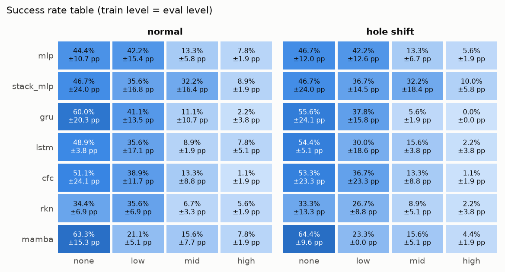

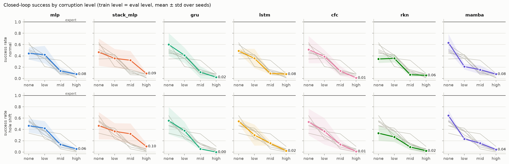

### 학습 seed별 편차

점 하나가 학습 seed 하나의 30 episode 성공률이다. 검은 표시는 세 seed 평균이다.

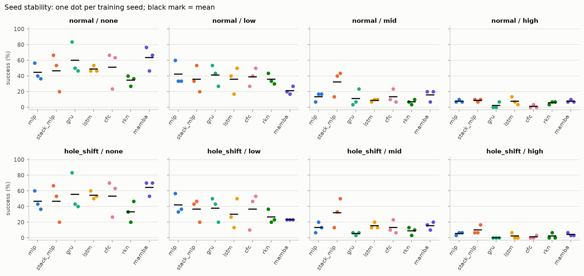

**normal**

| model | none | low | mid | high |
| --- | --- | --- | --- | --- |
| mlp | 44.4% ± 10.7pp (40/90) | 42.2% ± 15.4pp (38/90) | 13.3% ± 5.8pp (12/90) | 7.8% ± 1.9pp (7/90) |
| stack_mlp | 46.7% ± 24.0pp (42/90) | 35.6% ± 16.8pp (32/90) | 32.2% ± 16.4pp (29/90) | 8.9% ± 1.9pp (8/90) |
| gru | 60.0% ± 20.3pp (54/90) | 41.1% ± 13.5pp (37/90) | 11.1% ± 10.7pp (10/90) | 2.2% ± 3.8pp (2/90) |
| lstm | 48.9% ± 3.8pp (44/90) | 35.6% ± 17.1pp (32/90) | 8.9% ± 1.9pp (8/90) | 7.8% ± 5.1pp (7/90) |
| cfc | 51.1% ± 24.1pp (46/90) | 38.9% ± 11.7pp (35/90) | 13.3% ± 8.8pp (12/90) | 1.1% ± 1.9pp (1/90) |
| rkn | 34.4% ± 6.9pp (31/90) | 35.6% ± 6.9pp (32/90) | 6.7% ± 3.3pp (6/90) | 5.6% ± 1.9pp (5/90) |
| mamba | 63.3% ± 15.3pp (57/90) | 21.1% ± 5.1pp (19/90) | 15.6% ± 7.7pp (14/90) | 7.8% ± 1.9pp (7/90) |

- none: 가장 높은 관측 성공률 mamba (63.3%)
- low: 가장 높은 관측 성공률 mlp (42.2%)
- mid: 가장 높은 관측 성공률 stack_mlp (32.2%)
- high: 가장 높은 관측 성공률 stack_mlp (8.9%)

**hole shift**

| model | none | low | mid | high |
| --- | --- | --- | --- | --- |
| mlp | 46.7% ± 12.0pp (42/90) | 42.2% ± 12.6pp (38/90) | 13.3% ± 6.7pp (12/90) | 5.6% ± 1.9pp (5/90) |
| stack_mlp | 46.7% ± 24.0pp (42/90) | 36.7% ± 14.5pp (33/90) | 32.2% ± 18.4pp (29/90) | 10.0% ± 5.8pp (9/90) |
| gru | 55.6% ± 24.1pp (50/90) | 37.8% ± 15.8pp (34/90) | 5.6% ± 1.9pp (5/90) | 0.0% ± 0.0pp (0/90) |
| lstm | 54.4% ± 5.1pp (49/90) | 30.0% ± 18.6pp (27/90) | 15.6% ± 3.8pp (14/90) | 2.2% ± 3.8pp (2/90) |
| cfc | 53.3% ± 23.3pp (48/90) | 36.7% ± 23.3pp (33/90) | 13.3% ± 8.8pp (12/90) | 1.1% ± 1.9pp (1/90) |
| rkn | 33.3% ± 13.3pp (30/90) | 26.7% ± 8.8pp (24/90) | 8.9% ± 5.1pp (8/90) | 2.2% ± 3.8pp (2/90) |
| mamba | 64.4% ± 9.6pp (58/90) | 23.3% ± 0.0pp (21/90) | 15.6% ± 5.1pp (14/90) | 4.4% ± 1.9pp (4/90) |

- none: 가장 높은 관측 성공률 mamba (64.4%)
- low: 가장 높은 관측 성공률 mlp (42.2%)
- mid: 가장 높은 관측 성공률 stack_mlp (32.2%)
- high: 가장 높은 관측 성공률 stack_mlp (10.0%)

### 손상 없이 학습한 모델을 손상 환경에서 평가

무엇을 보는가: 학습 때 손상을 한 번도 보지 않은 모델이 손상된 관측을 받으면 얼마나 무너지는지입니다. 위 표와 비교하면 손상을 학습에 넣는 것의 효과가 보입니다.

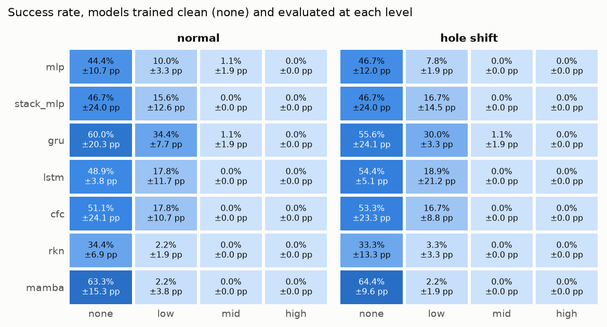

## 2. 과거를 보는 것의 효과 (질문 1)

각 모델의 성공률에서 MLP의 성공률을 뺀 값이다. 같은 학습 seed·episode seed를 짝지어 비교한다. 막대는 학습 seed와 episode seed를 각각 재표집한 bootstrap 95% 구간이다. 세 학습 seed에 대한 탐색적 비교이며, 여러 조건의 동시 검정 보정은 하지 않았다.

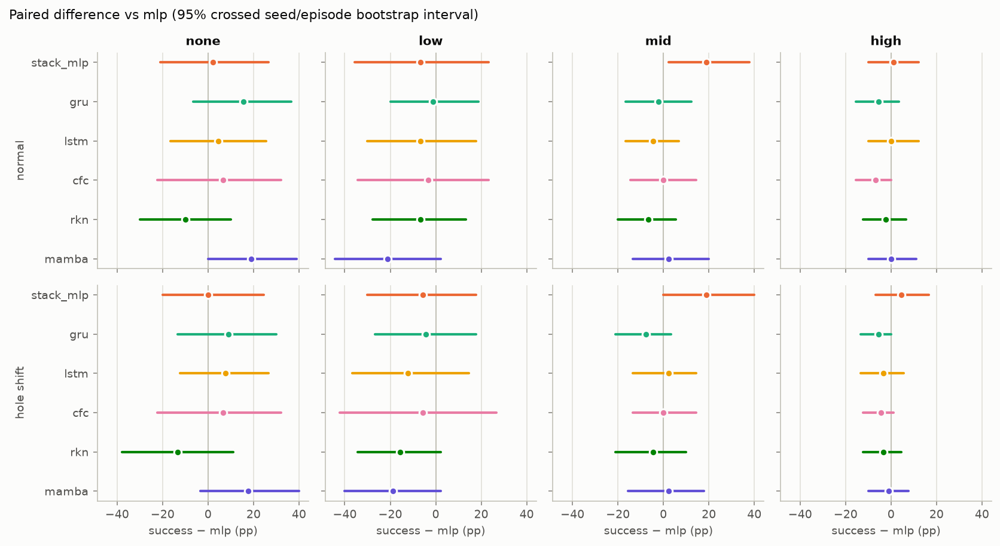

신뢰구간이 0보다 큰 경우 (mlp보다 높음):
- stack_mlp, mid, normal: +19%p [+2, +38]

## 3. 단순히 과거를 보는 것과 recurrent 기억의 차이 (질문 2)

최근 8 step을 이어 붙이는 Stack MLP를 기준으로 한 같은 비교다. 모델 구조·최적화 차이도 함께 존재하므로 차이를 recurrent 기억만의 인과 효과로 해석하지 않는다.

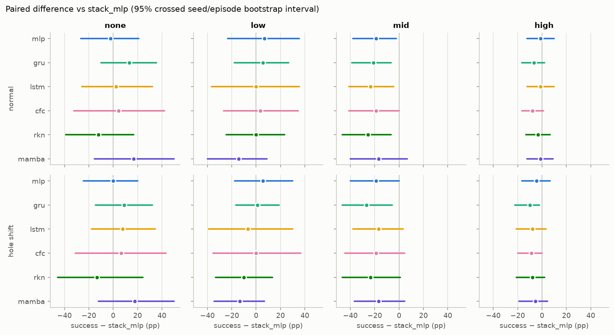

신뢰구간이 0보다 작은 경우 (stack_mlp보다 낮음):
- mlp, mid, normal: -19%p [-38, -2]
- gru, mid, normal: -21%p [-39, -7]
- lstm, mid, normal: -23%p [-41, -4]
- rkn, mid, normal: -26%p [-47, -7]
- gru, mid, hole shift: -27%p [-47, -6]
- gru, high, hole shift: -10%p [-22, -2]

### 기억 스트레스 테스트

무엇을 보는가: peg를 잡아 든 직후부터 peg와 hole 관측을 일정 step 동안 끊고 마지막 값만 유지합니다(다른 손상 없음, 'high' 단계로 학습한 모델). 그동안 peg는 손과 함께 움직이므로, 끊긴 동안의 상태를 기억하거나 추정해야 성공할 수 있습니다. stack MLP의 window는 8 step이므로 그보다 긴 끊김에서 recurrent 계열과 차이가 나는지 봅니다.

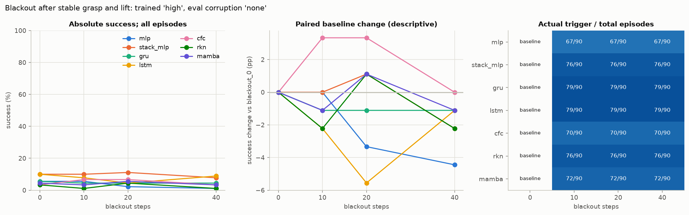

| model | 0 steps | 10 steps | 20 steps | 40 steps |
| --- | --- | --- | --- | --- |
| mlp | 0.06 (5/90) | 0.06 (5/90) | 0.02 (2/90) | 0.01 (1/90) |
| stack_mlp | 0.10 (9/90) | 0.10 (9/90) | 0.11 (10/90) | 0.08 (7/90) |
| gru | 0.06 (5/90) | 0.04 (4/90) | 0.04 (4/90) | 0.04 (4/90) |
| lstm | 0.10 (9/90) | 0.08 (7/90) | 0.04 (4/90) | 0.09 (8/90) |
| cfc | 0.03 (3/90) | 0.07 (6/90) | 0.07 (6/90) | 0.03 (3/90) |
| rkn | 0.03 (3/90) | 0.01 (1/90) | 0.04 (4/90) | 0.01 (1/90) |
| mamba | 0.04 (4/90) | 0.03 (3/90) | 0.06 (5/90) | 0.03 (3/90) |

오른쪽에는 실제 blackout 발생 수를 표시한다. peg를 잡고 들어 올리지 못한 episode에서는 차단이 발생하지 않는다. 기준 대비 변화는 기술 통계이며, 낮은 blackout_0 성공률의 바닥 효과를 함께 봐야 한다.

## 4. 어떤 모델이 어디서 실패하는가 (질문 3)

무엇을 보는가: 가장 약한 손상에서 가장 강한 손상으로 갈 때 잃는 성공률(%p)입니다. 왼쪽은 같은 단계로 학습한 경우, 오른쪽은 손상 없이 학습한 경우입니다.

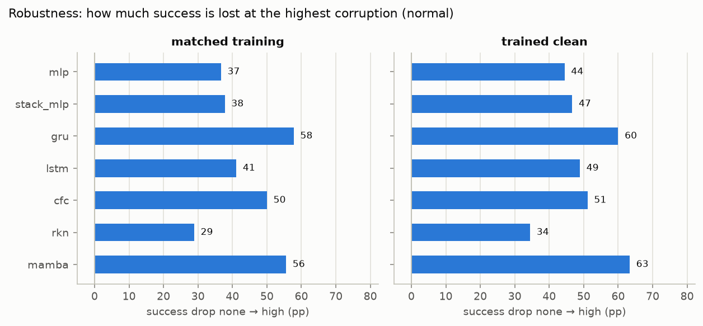

무엇을 보는가: episode가 어느 단계에서 끝났는지의 비율입니다. 단계 정의는 Graph 팀 v2 평가와 같습니다(acquisition: 5 step 연속 grasp 실패, retention: 잡았다가 놓침, transport: 들어 올리지 못함, alignment: hole 입구 정렬 실패, insertion: 정렬 후 삽입 실패).

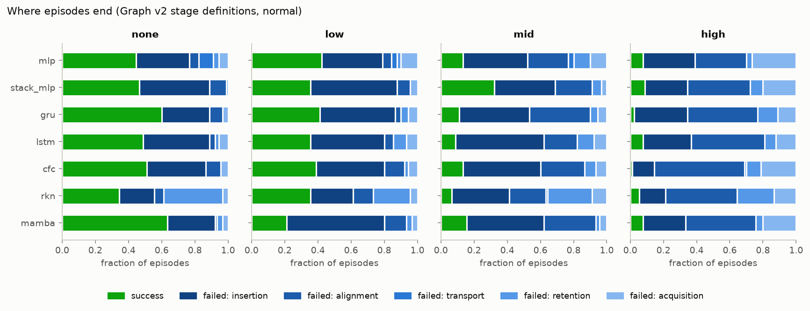

같은 집계를 hole_shift 조건에서도 확인한다.

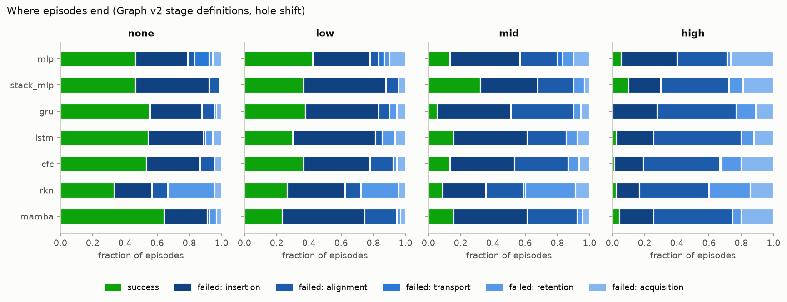

## 5. 학습 과정과 비용

모델×학습 손상 패널마다 seed별 validation action MSE 곡선을 표시한다. 점은 실제 평가에 사용한 checkpoint의 step이며 마지막 step과 다를 수 있다.

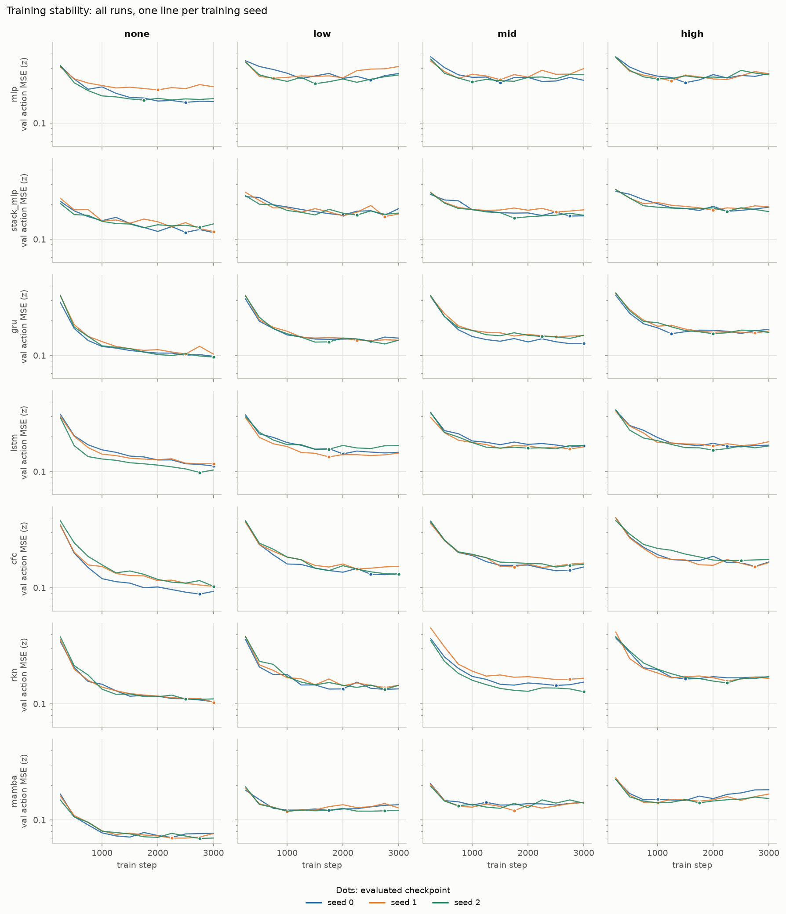

84개 실행 각각의 평가 checkpoint 검증 오차와 normal 성공률의 관계다. 색은 모델, 모양은 학습 손상이다. 동률을 평균 순위로 처리한 Spearman ρ = -0.49. 조건이 섞인 기술 통계이며 checkpoint 선택 규칙은 기존 validation 기준 그대로 유지했다.

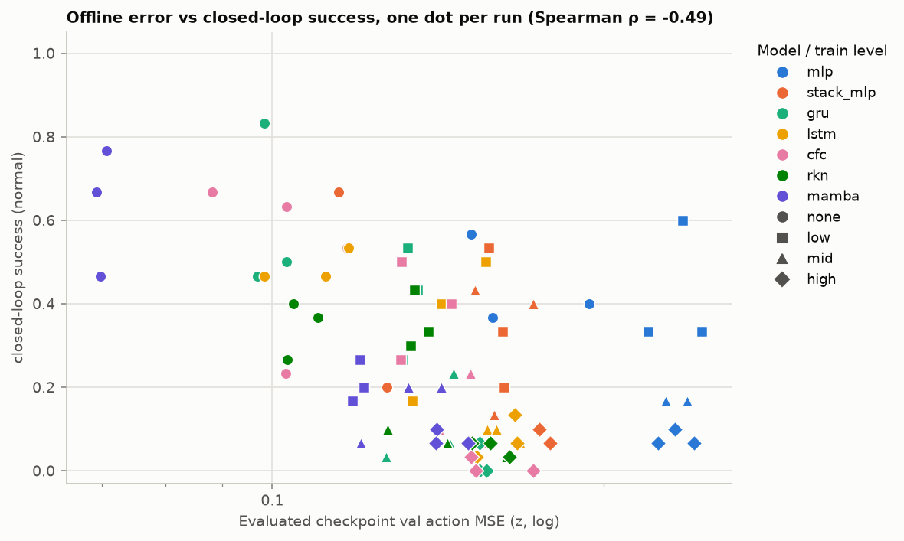

| model | params | train min | CPU ms/step | GPU ms/step | success none | success high | shift high |
| --- | --- | --- | --- | --- | --- | --- | --- |
| mlp | 143367 | 4.0 | – | – | 0.44 | 0.08 | 0.06 |
| stack_mlp | 145671 | 3.9 | – | – | 0.47 | 0.09 | 0.10 |
| gru | 142823 | 4.3 | – | – | 0.60 | 0.02 | 0.00 |
| lstm | 154503 | 4.0 | – | – | 0.49 | 0.08 | 0.02 |
| cfc | 145959 | 14.0 | – | – | 0.51 | 0.01 | 0.01 |
| rkn | 147759 | 20.3 | – | – | 0.34 | 0.06 | 0.02 |
| mamba | 154727 | 15.6 | – | – | 0.63 | 0.08 | 0.04 |

## CSV 표

비율은 CSV에서 0–1 단위이며 `_pp` 필드는 percentage point 단위다.

- [summary.csv](summary.csv): 모델·학습 손상·평가 손상·조건별 집계와 분모, 실제 이벤트 수
- [seed_success.csv](seed_success.csv): 학습 seed별 성공률과 분모
- [training_runs.csv](training_runs.csv): 84개 학습 실행의 선택 checkpoint·검증 오차·성공률·기록된 학습 비용
- [training_curves.csv](training_curves.csv): 학습 step별 train/validation 지표와 평가 checkpoint 표시
- [episodes.csv](episodes.csv): 11,400개 episode 기록; GPU mean_infer_ms의 빈 값은 미측정
- [paired.csv](paired.csv): 기준 모델 대비 차이와 crossed bootstrap 구간
- [blackout.csv](blackout.csv): 차단 길이별 성공·실제 발생 수·발생 하위집단 성공률·기준 대비 변화
- [equal_weight_success.csv](equal_weight_success.csv): 기본 평가 손상 단계의 동일 가중 평균
