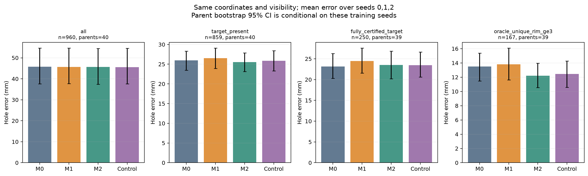
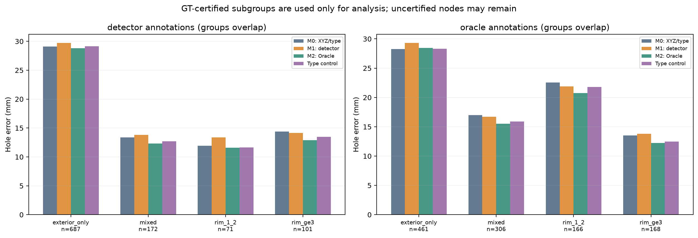
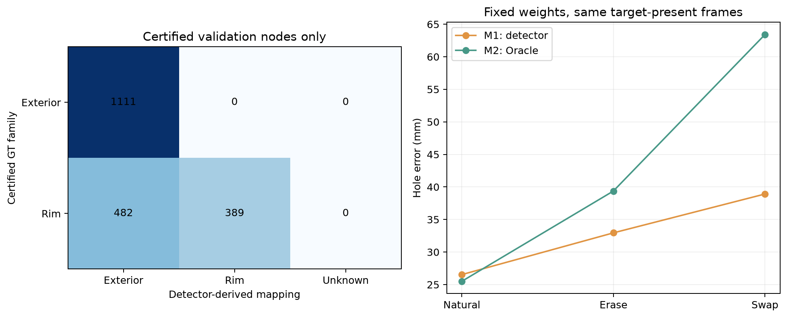
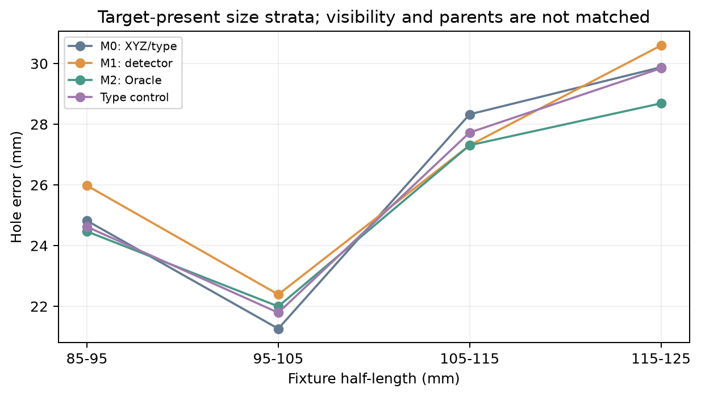
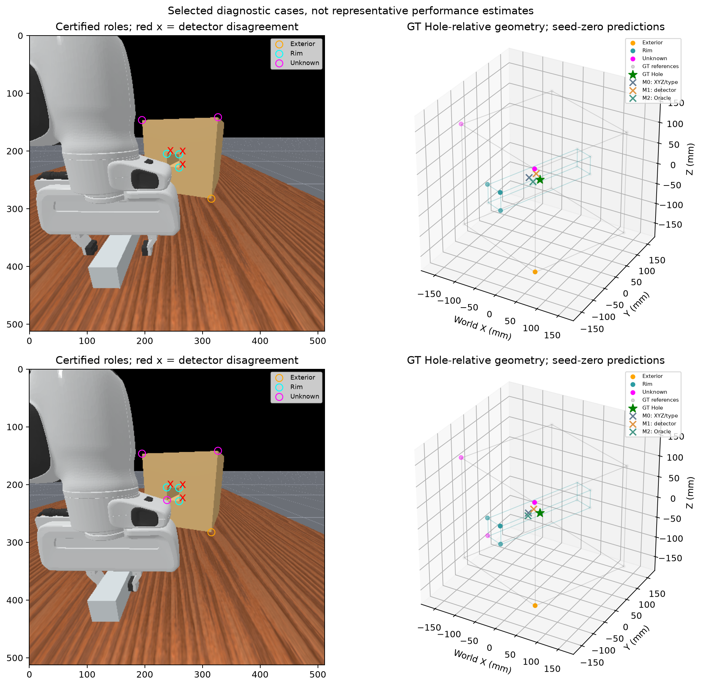
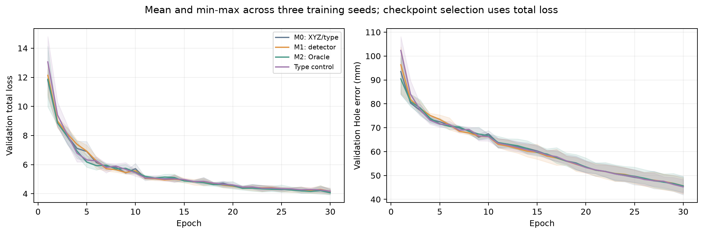

# Vertex의 기하학적 역할 정보와 Hole Pose 예측

2026-11-07 KST. 같은 검출 좌표에 Exterior/Rim 역할 정보를 추가하는 가치를 검증했다.
기존 [BOX/Hole observability](box_hole_observability.md)와
[Vertex GNN 병목 분석](vertex_gnn_bottlenecks.md)의 후속 Development 실험이다.

## 결론과 적용 범위

**이번 30-epoch Development 예산에서는 역할 정보의 실용적 개선을 확인하지 못했다.**
관측 BOX가 있는 동일 859프레임에서 M0 25.960mm, Detector 의미정보 M1 26.533mm,
Oracle 의미정보 M2 25.502mm, 용량 통제 25.858mm였다. M2의 M0 대비 0.458mm 개선은
Parent 95% CI가 −0.395~+1.241mm이며, 용량 통제 대비 개선도 확실하지 않다.

GNN은 추가 label을 실제로 사용했다. M2에서 label만 교환하면 같은 frame의 Hole 오차가
37.910mm 증가했다. 그러나 label 의존성이 같은 정보·용량 조건에서의 일반화 개선을 보장하지는
않았다. XYZ만으로 역할 구분을 완전히 학습했다거나, 역할 정보가 본질적으로 무가치하다고
결론 내리지 않는다. **현재 변환 정책과 예산에서 의미정보 추가를 채택할 근거가 부족하다.**

M1은 기존 detector에 없는 물리 family 분류기를 새로 학습한 모델이 아니다.
기존 `contour_hole` metadata를 사전 고정한 규칙으로 변환했다. 이 변환은 인증된 Validation
노드에서 75.7% 정확도였고, 실제 Rim의 55.3%를 Exterior 후보로 표시했다.
따라서 M1의 결과를 가능한 모든 Detector-derived semantic 방법의 성능으로 일반화하지 않는다.

새 cohort는 원본 Train 안에서 재검출한 **파생 Development 데이터**다. 기존 Validation 18,751프레임
또는 독립 Test 결과가 아니다. 새 모델을 모두 처음부터 학습했고 기존 checkpoint는 재학습하거나
덮어쓰지 않았다. 12개 중 10개 실행은 마지막 epoch가 최적이어서, 결론은 이 예산에 한정된다.
충분히 수렴한 대규모 학습의 semantic 효능을 확정한 실험은 아니다.

## 1. 데이터 확보와 Parent 분리

로컬에는 기존 Validation의 raw RGB-D와 candidate metadata가 없었다. 사용자 지시에 따라 기존
Vast.ai RTX 3090 인스턴스 59441593을 사용했다. 원격에 원본 Train 630 Parent의 raw가 있어
그 안에서 별도 cohort를 구성했다. Hugging Face 추가 조회·다운로드는 필요하지 않았다.
새 simulator rollout이나 신규 유료 인스턴스 생성, 외부 게시를 수행하지 않았다.

Parent ID에 `SHA256(JSON([91374, parent_id]))`를 적용해 정렬하고 앞의 120 Parent를 Train,
다음 40 Parent를 Development Validation으로 고정했다. 각 Parent에서 원래 frame ID의 시간 순서에
균등 간격으로 24프레임을 선택했다. Label, GT error 또는 모델 성능을 보고 Parent/frame을 고르지 않았다.
원래 Train/Validation/Test Parent의 교집합이 없음을 확인한 뒤 **원래 Train만** 읽었다.

| 새 cohort | Parent | Frame | BOX 노드 | 인증 Exterior | 인증 Rim | Oracle UNKNOWN |
| --- | ---: | ---: | ---: | ---: | ---: | ---: |
| Development Train | 120 | 2,880 | 7,582 | 3,145 | 2,260 | 2,177 |
| Development Validation | 40 | 960 | 2,843 | 1,111 | 871 | 861 |
| 합계 | 160 | 3,840 | 10,425 | 4,256 | 3,131 | 3,038 |

기존 Validation 180 Parent와 Reserved Test 90 Parent의 frame/target은 이 파이프라인에서 읽지 않았다.
그 split의 ID/hash metadata는 제외 검사에만 사용했다. Development Validation은 원본 Train의
일부이지만, 이 연구의 12개 모델은 모두 새 초기화이며 Development Train과 Parent가 겹치지 않는다.
기존 학습 checkpoint를 이 새 Validation에 적용한 성능으로 보고하지 않는다.

각 frame에 다음을 함께 보존했다.

- 원본 NPZ 전체: Main/Wrist RGB-D, calibration, raw GT, robot 및 기존 action/info 필드.
  RGB uint8, depth signed int16, 원래 shape·단위·값을 그대로 복사하고 source SHA256과 일치시켰다.
- 실제 detector의 XYZ/UV/object ID, retained candidate metadata·진단값, graph와 Object21 target.
- GT exterior/rim reference, physical ID, 인증 결과·실패 사유, episode/Parent ID와 split.

Detector는 Main `base_camera`만 사용했다. Graph의 float32 world XYZ, TCP 원점, confidence,
complete directed edge 및 relative XYZ/distance를 보존했다. Wrist나 GT actor mask를 Student
검출에 제공하지 않았다. Metadata는 detector가 반환한 **최종 retained proposal**의 출처다.
병합 과정에서 버려진 모든 proposal의 상세 이력을 복원했다고 주장하지 않는다.

Frame 단위 subset이므로 원본 episode의 연속 trajectory 전체를 새로 수집한 형식은 아니다.
이 데이터는 current-frame GNN 연구용이며 Recurrent Controller를 학습하지 않았다.

[Dataset manifest](../outputs/vertex_family/4f97338a378b4cffbcb55750fa6ec9ff/development_data/df3405c1fafb40859178964271731ad8/manifest.json), [선택/split](../outputs/vertex_family/4f97338a378b4cffbcb55750fa6ec9ff/development_data/df3405c1fafb40859178964271731ad8/selection.json),
[실제 준비 config](../outputs/vertex_family/4f97338a378b4cffbcb55750fa6ec9ff/prepare_development.json).
Raw 3,840개, graph 3,840개, label archive 3,840개의 local 복사본을 모두 원본 hash와 대조했다.

## 2. 역할 label의 정의와 신뢰도

### Detector-derived label: M1

`detector_families(object_ids, metadata)`는 GT 인자를 받지 않는다.
BOX에 대해 boolean `contour_hole=true`를 Rim 후보(ID 1), `false`를 Exterior 후보(ID 0),
flag가 없으면 UNKNOWN(−1)으로 바꾼다. PEG는 이 family vocabulary에서 UNKNOWN이다.
이는 **contour 기반의 물리 family 추정 정책**이며, flag 자체가 물리적 identity의 정답은 아니다.
관측 plane mask의 내부 contour 여부와 실제 aperture rim의 역할은 다를 수 있다.

정책은 main 데이터의 label 정확도나 모델 오차를 확인하기 전에 고정했다. 이후 Validation에서
발견한 오류를 이용해 이 규칙을 바꾸거나 threshold를 조정하지 않았다.
이 cohort의 BOX metadata에는 모두 flag가 있어 M1 UNKNOWN은 0개다.
이 사실을 높은 신뢰도 또는 모든 노드의 올바른 분류로 해석하지 않는다.

### GT-certified label: M2

GT Hole/BOX pose, L 및 hole half-width에서 physical reference를 계산했다.
Exterior는 BOX local `(±L,±L,±L)`, rim은 Hole local `(±L,±r_h,±r_h)`이며,
Hole frame의 원점은 한쪽 mouth가 아닌 tunnel 중앙이다.
관측 node에 아래 조건이 모두 성립할 때만 physical ID와 family를 인증했다.

1. GT local corner cell에서 각 축 잔차가 3mm 이내인 reference가 정확히 하나여야 한다.
   대응이 없거나 여러 개면 UNKNOWN이다. 최근접 reference로 강제 할당하지 않는다.
2. GT reference와 실제 detector UV의 calibrated projection 차이가 2px 이하여야 한다.
3. GT mouth plane의 local yz 방향으로 4mm·6mm 두 거리에서 네 quadrant씩 확인한다.
   GT solid/aperture geometry의 1개 occupied(exterior) 또는 3개 occupied(rim) 패턴이
   실제 RGB material 및 raw depth와 일치해야 한다. Face depth 허용 오차는 1.5mm다.
   가려진 back mouth, 유효하지 않은 depth 또는 불확실한 support는 UNKNOWN이다.

Detector의 `contour_hole`이나 method를 Oracle의 정답 판정에 사용하지 않았다.
GT 근접성과 projection만 통과해도 raw topology가 맞지 않으면 label을 주지 않는다.
단위 테스트에서 GT corner와 좌표가 정확히 같더라도 raw aperture를 메워 놓으면 UNKNOWN이 된다.

이것은 simulator GT 형상과 원본 영상에 근거한 **유한 허용 오차의 운영상 인증**이다.
모든 노드의 identity를 독립 수동 annotation으로 입증했거나, 인증 절차의 오류율을 별도로
측정했다는 뜻은 아니다. 인증하지 못한 노드의 실제 family는 알 수 없다고 유지한다.
물리 ID는 분석용 archive에만 저장하며 M2에도 개별 corner ID나 GT pose/size를 입력하지 않는다.

### Label 정확도와 누락

Validation BOX 2,843개 중 1,982개(69.7%, Parent CI 67.3~72.0%)가 인증됐다.
나머지 861개는 GT family를 확정하지 않았다. 아래 정확도는 **인증된 subset에 한정**된다.
좌표 오차가 크거나 가림/색상/투영 근거가 부족한 노드가 제외되는 selection을 포함한다.

| 인증 GT family | Detector Exterior 후보 | Detector Rim 후보 | Detector UNKNOWN |
| --- | ---: | ---: | ---: |
| Exterior | 1,111 | 0 | 0 |
| Rim | 482 | 389 | 0 |

인증 subset 정확도는 75.681% [72.107,79.116], Rim recall은
44.661% [37.905,51.285]다. Exterior recall은 관측 subset에서 100%였지만,
GT UNKNOWN 노드까지 포함한 전체 precision/recall을 100%라고 보고하지 않는다.
CI는 노드를 독립 표본으로 삼지 않고 Parent 전체의 모든 frame/node를 함께 resample한
**node-weighted 비율**이다.

| Retained method | BOX 노드 | 인증 노드 | 인증 GT Rim | 올바른 family 변환 |
| --- | ---: | ---: | ---: | ---: |
| `v2_core` | 2487 | 1820 | 811 | 1395 |
| `box_observed_cube` | 159 | 54 | 0 | 54 |
| `box_rgb_quadrants` | 16 | 3 | 3 | 3 |
| `short_boundary` | 100 | 71 | 57 | 14 |
| `local_boundary` | 56 | 31 | 0 | 31 |
| `boundary` | 25 | 3 | 0 | 3 |

`v2_core`와 `short_boundary`에서 실제 rim인데 non-hole contour로 남은 노드가 많았다.
따라서 이 결과는 XYZ가 틀렸다는 주장과 다르다. 인증된 정확한 위치 근처의 corner에도
retained contour metadata의 의미와 물리 family 사이의 불일치가 있었다.
이는 이번 M1 변환의 한계이며 detector 전체의 물리 family 분류 정확도라고 일반화하지 않는다.

## 3. 모델과 정보·Parameter Budget

네 조건은 같은 관측 node 수, XYZ, object type, visibility, TCP, confidence, edge,
GT Object21D를 사용했다. 실제 전체 Train/Validation에서 semantic ID/validity를 제외한
GraphBatch 필드와 target의 동일성을 검사했다. GT 좌표 대체, node 추가/제거, 새 HOLE type,
전용 Rim GNN/Head 또는 task-specific hole 보정은 없다.

공통 모델은 기존 AB의 `VertexEdgeGatedMPNN` 설정이다. Hidden 64, message passing 2층,
edge embedding 16, global geometry 16, multi-seed pooling 4 seeds / dim 16 / 4 heads,
기존 Peg/Hole/endpoint head와 Object21D 출력 계약을 유지했다.
기존 AB checkpoint에서 **설정만** 읽었으며 weights는 모든 조건에서 새로 초기화했다.

| 조건 | semantic flag | BOX token | PEG token | 추가 정보 |
| --- | --- | --- | --- | --- |
| M0 | false | 사용 안 함 | 사용 안 함 | XYZ/type만 |
| M1 | true | detector의 Exterior/Rim 후보 | UNKNOWN | RGB-D proposal에서 얻는 contour 정보 |
| M2 | true | 인증 Exterior/Rim, 나머지 UNKNOWN | UNKNOWN | GT role와 인증 가능성; Oracle 전용 |
| 용량 통제 | true | 0 고정 | 1 고정 | 이미 제공된 object type의 중복 인코딩 |

모든 모델은 기존 `semantic_embed(16,32)`를 그대로 갖는다. Family vocabulary는
0=Exterior, 1=Rim, −1=UNKNOWN이며, 기존 개별 physical corner ID와 다르다.
UNKNOWN과 padding은 embedding을 0으로 mask한다. Padding의 node validity와 object type은
UNKNOWN인 관측 node와 구분된다. 용량 통제의 token 의미는 역할이 아니라 중복 object type이다.

| 조건 | 총 parameter | 128 Train frame probe의 nonzero-gradient union | 사용 semantic row |
| --- | ---: | ---: | --- |
| M0 XYZ/type | 244,445 | 241,861 | [] |
| M1 Detector | 244,445 | 243,973 | [0, 1] |
| M2 Oracle | 244,445 | 243,956 | [0, 1] |
| 용량 통제 | 244,445 | 243,956 | [0, 1] |

Probe는 seed 0의 학습된 모델에서 optimizer step 없이 같은 Train 128프레임의 gradient를 확인했다.
이 수는 probe에서 관측된 기능적 사용의 하한이며 전체 학습의 update 이력이나 통계적 자유도는 아니다.
M0의 disabled embedding 512개와 semantic 입력의 첫 linear weight 2,048개는 사용되지 않는다.
같은 저장 parameter 수만으로 완전히 같은 유효 용량이라고 주장하지 않고 용량 통제를 함께 평가했다.
M2와 용량 통제의 probe 사용량은 같았다. 17개 수준의 probe 차이로 성능 원인을 단정하지 않는다.

모든 조건은 같은 core dataset hash를 갖는다. Checkpoint의 `dataset_sha256`은
`SHA256(JSON([core_dataset_sha256, family_mode]))`로 view까지 구분하므로 네 값이 다르다.
이 차이는 다른 좌표 데이터를 뜻하지 않으며, 잘못된 semantic view로 resume하는 것을 막는다.

M2는 GT로 확인한 role뿐 아니라 어떤 node가 인증 가능한지에 대한 UNKNOWN mask도 얻는다.
이를 실제 Student inference 정보로 취급하지 않는다. M1/M2의 validity가 같은 완전 인증 frame
250개를 별도로 비교하고, validity를 유지하는 label swap도 수행했다.
그럼에도 두 모델의 Train 전체 정보 분포 차이까지 완전히 제거한 효과 분해는 아니다.

## 4. 학습·평가 프로토콜

- 고정 Development Train/Validation split, seed 0·1·2, 모델별 30 epoch / 2,700 update.
- Batch 32, AdamW lr 0.001 / weight decay 0.0001, StepLR 10 epoch마다 0.5,
  gradient clip 1.0, dropout 0. CUDA eager이며 compile 설정도 공통이다.
- 기존 Object21 loss 및 가중치, coord scale 0.05m, position loss unit 0.01m,
  기존 size scale/unit를 공유한다. Validation에서 normalization을 fit하지 않았다.
  이 실험은 학습한 z-score 대신 기존의 고정 물리 scale을 사용한다.
- Best checkpoint는 기존과 같은 **minimum total Validation loss**로 선택했다.
  Hole error 최적 epoch로 바꾸거나 subgroup에 맞춰 checkpoint를 재선택하지 않았다.
- 같은 seed에서 네 조건의 초기 weight/buffer SHA256이 일치했고, 동일 DataLoader generator와
  sample order를 썼다. Feature cache는 한 번 생성해 재사용했다.

처음 4 Parent / 16프레임에서 graph/label 연결과 2-epoch smoke를 확인했다.
공통 recipe 연결 smoke와 실제 AB recipe smoke를 분리했고, 이 weights는 본 실험에 이어 쓰지 않았다.
파일럿 Parent는 모두 본 Development Train pool에 있으며 본 Validation을 smoke에 쓰지 않았다.

GPU 사용률을 높이기 위해 seed별 독립 process 세 개를 같은 기존 3090에서 실행했다.
처음 launcher는 seed 0의 네 child가 30 epoch를 모두 마친 경계에서 중지했고, seed 1·2는
별도 launcher의 완료 child를 합쳤다. 다음 seed의 CPU 초기화 중 중지됐으며 중복 optimizer
학습을 수행한 child는 없다. 완료 12개는 모두 30 epoch·2,700 update다.
Launcher의 의도적 중지와 child 학습 완료 상태를 구분하고 boundary audit를 보존했다.

모든 metric은 동일한 Validation frame에서 paired로 비교했다. Position은 Euclidean 3D norm의
frame 평균, rotation은 quaternion 부호 불변 geodesic degree다. Relative 3D는 Object21[7:10]의
endpoint−hole 벡터 오차다. Lateral/Axial은 이 relative-vector 오차를 GT Hole 축에 투영한 값이며
Hole position 자체의 성분 오차와 다르다. Peg Size X는 GT **half-extent**의 절대 오차다.

아래 주 표의 mean과 CI는 frame별 error를 seed 0·1·2에 대해 평균한 뒤 Parent 2,000회
bootstrap으로 계산했다. Paired gain은 reference error−candidate error이며 양수가 개선이다.
이 CI는 고정된 세 trained model과 Train cohort에 조건부인 Parent 불확실성이다.
Training seed를 새 독립 frame으로 계산하지 않았고, 세 seed의 재학습 불확실성까지 포함하는
joint 95% CI라고 주장하지 않는다. Seed별 결과도 함께 제시한다.

여러 subgroup은 중첩되고 다중 비교 보정은 하지 않았다. 모든 결과는 checkpoint 선택에 사용한
Development Validation의 탐색적 결과이며 독립 Test 성능이나 controller 성공률은 아니다.

[완료 matrix](../outputs/vertex_family/4f97338a378b4cffbcb55750fa6ec9ff/evaluation/e12abdeb091645e79eeb767a2d50f0af/matrix.json), [summary](../outputs/vertex_family/4f97338a378b4cffbcb55750fa6ec9ff/evaluation/e12abdeb091645e79eeb767a2d50f0af/summary.json),
[모든 seed/metric/group의 mean·Median·P90·P95·CI CSV](../outputs/vertex_family/4f97338a378b4cffbcb55750fa6ec9ff/evaluation/e12abdeb091645e79eeb767a2d50f0af/metrics.csv),
[실행 분할 audit](../outputs/vertex_family/4f97338a378b4cffbcb55750fa6ec9ff/seed_partition_boundary.json).

## 5. 동일 frame의 주 평가 결과

### Target-present 859프레임 / 40 Parent

단위 mm, rotation만 degree. 세 seed의 mean error 평균이다.

| 모델 | Hole Position | Hole Rotation | Relative 3D | Lateral | Axial | Peg Size X |
| --- | ---: | ---: | ---: | ---: | ---: | ---: |
| M0 XYZ/type | 25.960 | 8.792 | 25.169 | 21.241 | 9.955 | 10.465 |
| M1 Detector | 26.533 | 8.625 | 25.778 | 22.146 | 9.743 | 10.202 |
| M2 Oracle | 25.502 | 8.537 | 24.844 | 21.485 | 9.240 | 9.688 |
| 용량 통제 | 25.858 | 9.097 | 25.350 | 21.656 | 9.553 | 9.925 |

| Paired Hole gain (양수=오른쪽 모델 개선) | Mean [Parent 95% CI], mm |
| --- | ---: |
| M0 − M1 | -0.573 [-1.312, 0.145] |
| M0 − M2 | 0.458 [-0.395, 1.241] |
| M0 − 용량 통제 | 0.102 [-0.601, 0.765] |
| 용량 통제 − M1 | -0.675 [-1.244, -0.092] |
| 용량 통제 − M2 | 0.357 [-0.435, 1.088] |
| M1 − M2 | 1.031 [0.073, 1.940] |

M1의 M0 대비 이득은 확인되지 않았고, 용량 통제 대비로는 오히려 나빴다.
M2는 M0보다 0.458mm 작지만 CI가 0을 포함한다. Oracle의 별도 의미정보가
중복 type feature보다 확실한 성능 이득을 냈다는 근거도 없다.

### 반복 seed와 Hole error 분포

같은 Target-present frame 집합이다. 아래 quantile은 각 trained model의 실제 error 분포다.

| 모델 | Seed | Mean [Parent 95% CI] | Median | P90 | P95 |
| --- | ---: | ---: | ---: | ---: | ---: |
| M0 XYZ/type | 0 | 26.938 [24.279, 29.370] | 20.596 | 55.525 | 68.156 |
| M0 XYZ/type | 1 | 25.410 [22.957, 27.792] | 19.138 | 51.826 | 68.264 |
| M0 XYZ/type | 2 | 25.532 [23.037, 28.015] | 19.731 | 49.808 | 62.818 |
| M1 Detector | 0 | 27.016 [24.484, 29.507] | 21.191 | 52.999 | 65.979 |
| M1 Detector | 1 | 26.787 [23.935, 29.475] | 20.814 | 53.628 | 66.812 |
| M1 Detector | 2 | 25.796 [23.153, 28.414] | 19.860 | 53.630 | 63.788 |
| M2 Oracle | 0 | 25.955 [23.541, 28.312] | 20.042 | 53.917 | 64.210 |
| M2 Oracle | 1 | 25.233 [22.975, 27.605] | 19.258 | 51.913 | 64.596 |
| M2 Oracle | 2 | 25.317 [22.789, 28.090] | 18.322 | 51.592 | 68.538 |
| 용량 통제 | 0 | 26.723 [24.241, 29.253] | 19.711 | 55.420 | 65.249 |
| 용량 통제 | 1 | 25.713 [22.978, 28.606] | 18.697 | 52.468 | 66.021 |
| 용량 통제 | 2 | 25.138 [22.483, 27.808] | 18.147 | 51.425 | 64.169 |

M1은 세 seed 모두 Target-present mean에서 M0보다 나빴다. M2는 세 seed 모두 M0보다
작았지만 gain은 제한적이고 Parent CI가 넓다. CSV의 `seed=mean_errors` quantile은
**frame별 seed 평균 error의 quantile**이며, seed별 quantile의 평균이나 prediction ensemble 성능이 아니다.

### 전체 frame과 Target 없음

| 집합 | Frame / Parent | M0 | M1 | M2 | 용량 통제 |
| --- | ---: | ---: | ---: | ---: | ---: |
| 전체 | 960 / 40 | 45.745 | 45.651 | 45.640 | 45.608 |
| Target 없음 | 101 / 24 | 214.020 | 208.247 | 216.919 | 213.575 |
| Target 있음 | 859 / 40 | 25.960 | 26.533 | 25.502 | 25.858 |

전체 mean의 작은 차이를 역할 정보의 효과로 읽으면 안 된다. M1은 Target-present에서
0.573mm 나빴지만 Target 없는 frame의 learned prior 차이 5.773mm가 이를 상쇄했다.
Target가 없으면 추가할 target family label 자체가 없다. 기존에 알려진 상수 head 현상을
새로운 발견으로 제시하지 않으며, 여기서는 요청된 subgroup 점수만 보고한다.

새 M0와 기존 18,751-frame AB의 19.198mm를 직접 비교하지 않는다. 새 cohort·재검출·새 초기화·
2,880 Train frame의 30-epoch 예산이며, 기존 full-data 학습의 재현 실험이 아니다.
본 실험의 2,700 update는 기존 64,702-frame × 30 epoch보다 훨씬 적다.



## 6. 관측 family 분포와 Oracle의 조건부 효과

`detector_*`는 실제 추론에서 얻는 변환 label로 정의했다. `oracle_*`는 인증 GT family로 정의한
분석용 subgroup이다. Oracle UNKNOWN이 남아 있는 집합에서 “인증 Rim 0”을 “실제 Rim이 없음”으로
바꾸지 않는다. Rim node 수와 unique physical corner 수도 구분했다.

| 집합 | Frame / Parent | M0 | M1 | M2 | 용량 통제 |
| --- | ---: | ---: | ---: | ---: | ---: |
| Detector Exterior 후보만 | 687 / 40 | 29.112 | 29.714 | 28.799 | 29.149 |
| Detector Exterior/Rim 혼합 | 172 / 40 | 13.370 | 13.827 | 12.332 | 12.713 |
| Detector Rim 후보 1~2 | 71 / 20 | 11.904 | 13.376 | 11.567 | 11.618 |
| Detector Rim 후보 ≥3 | 101 / 26 | 14.400 | 14.144 | 12.869 | 13.482 |
| 인증 Exterior만 존재 | 461 / 40 | 28.286 | 29.299 | 28.457 | 28.301 |
| 인증 Rim만 존재 | 28 / 10 | 29.243 | 29.919 | 26.944 | 30.569 |
| 인증 Exterior/Rim 혼합 | 306 / 40 | 16.985 | 16.720 | 15.500 | 15.876 |
| 인증 Rim node 1~2 | 166 / 39 | 22.575 | 21.904 | 20.728 | 21.793 |
| 인증 Rim node ≥3 | 168 / 39 | 13.505 | 13.798 | 12.242 | 12.477 |
| 서로 다른 인증 Rim corner ≥3 | 167 / 39 | 13.499 | 13.794 | 12.218 | 12.457 |
| Oracle UNKNOWN 포함 | 609 / 40 | 27.123 | 27.373 | 26.324 | 26.840 |
| 인증 노드 중 오분류 포함 | 312 / 40 | 18.159 | 17.944 | 16.623 | 17.247 |
| Target 전체 인증 | 250 / 39 | 23.126 | 24.486 | 23.499 | 23.467 |

Detector Rim-only와 Detector UNKNOWN subgroup은 0프레임이다. 성능이 0mm인 집합으로 처리하지 않았다.
서로 다른 인증 Rim ≥3의 167프레임에서 M2의 M0 대비 gain은
1.281 [0.089, 2.437]mm다. 그러나 용량 통제 대비로는
0.239 [-0.809, 1.201]mm여서 role 고유의 gain을 확정하지 못한다.

M1과 M2는 Target 전체가 인증되고 M1 label도 존재하는 동일 250프레임 / 39 Parent에서
24.486→23.499mm였다. M1−M2 gain은
0.987 [-1.192, 2.870]mm다. 이 frame들에서는 M1/M2의
semantic validity가 같지만, Train 전체의 GT 인증 mask 차이까지 제거한 비교는 아니다.
전체 target이 인증된 조건에서도 M2가 M0보다 확실히 좋아졌다는 근거는 없다.



## 7. Label을 실제로 사용하는가?

같은 trained weights와 같은 frame에서 label만 제거하거나 0↔1로 바꿨다.
Swap은 UNKNOWN과 validity를 그대로 유지한다. XYZ, visibility, edge, confidence, TCP 및 target은
바꾸지 않았다. 이 실험은 입력 분포를 바꾸는 진단이며 자연 관측 성능으로 보고하지 않는다.

| 모델 | Natural Hole | Erase Hole | Erase−Natural [95% CI] | Swap Hole | Swap−Natural [95% CI] |
| --- | ---: | ---: | ---: | ---: | ---: |
| M1 Detector | 26.533 | 32.945 | 6.412 [5.362, 7.453] | 38.914 | 12.381 [9.703, 15.044] |
| M2 Oracle | 25.502 | 39.372 | 13.870 [11.930, 15.779] | 63.411 | 37.910 [34.347, 41.633] |

Label 값이 예측에 영향을 준다는 근거는 강하다. M2의 swap은 GT 인증 validity를 유지하므로,
인증 여부만 바뀌어서 생긴 변화는 아니다. 다만 swap/erase에 취약한 모델이 M0보다 좋은 것은
별개다. 이번 결과는 **학습된 label 의존성**과 **추가 정보의 검증 성능 이득**을 구분한다.



[Intervention 전체 subgroup 통계](../outputs/vertex_family/4f97338a378b4cffbcb55750fa6ec9ff/evaluation/e12abdeb091645e79eeb767a2d50f0af/interventions.json).

## 8. 역할 정보 뒤에 남는 기하학적 오차

서로 다른 인증 Rim ≥3인 167프레임은 2D 분포가 작은 한 점 근처에 몰린 집합은 아니었다.
Rim의 두 번째 centered singular value 중앙값은 42.974mm였고, local yz span은 평균적으로
GT opening 폭의 약 1.008 / 1.004였다. 하지만 양쪽 mouth를 동시에 인증한 frame은 0개였다.
원래 관측 좌표를 고치지 않아 인증 Rim의 frame별 평균 GT 좌표 오차도 평균 1.479mm 남았다.

이 집합에서 M2는 여전히 12.218mm 오차를 냈다. Family label은 GT 길이 L, 어느 mouth/physical
corner인지, 축의 부호 또는 GT pose를 제공하지 않는다. 한쪽 mouth에서 tunnel 중앙으로 이동하는
긴 외삽과 원래 좌표 오차가 남는다. 이전 observability 연구의 noise sensitivity와 일관되지만,
이번 실험만으로 남은 오차를 Perception·shape ambiguity·encoder·head·loss로 수치 분해하지 않는다.

### Target Anchor와 Head Offset

Confidence는 기존과 같이 사용하지 않아 anchor는 관측 target XYZ의 산술평균이다.
모델별로 geometry를 바꾸지 않았으므로 anchor도 같다.

```text
required_offset = GT_hole_relative - target_anchor
predicted_offset = predicted_hole_relative - target_anchor
error_vector = predicted_offset - required_offset
```

아래는 seed 평균이다. Offset norm은 seed별 norm을 평균했고 signed error는 XYZ의 부호를 유지했다.

| 집합 / 모델 | Required offset norm | Predicted offset norm | Signed X | Signed Y | Signed Z | Hole error |
| --- | ---: | ---: | ---: | ---: | ---: | ---: |
| Target-present / M0 XYZ/type | 136.376 | 133.918 | -0.731 | -2.129 | 1.080 | 25.960 |
| Target-present / M1 Detector | 136.376 | 134.918 | -0.111 | -1.139 | 1.723 | 26.533 |
| Target-present / M2 Oracle | 136.376 | 134.268 | -1.547 | -0.824 | 1.835 | 25.502 |
| Target-present / 용량 통제 | 136.376 | 134.307 | 0.066 | -1.051 | 2.113 | 25.858 |
| Unique Rim ≥3 / M0 XYZ/type | 106.744 | 105.019 | -2.741 | -2.120 | -0.689 | 13.499 |
| Unique Rim ≥3 / M1 Detector | 106.744 | 104.122 | -0.919 | -3.073 | -0.162 | 13.794 |
| Unique Rim ≥3 / M2 Oracle | 106.744 | 105.564 | -2.649 | -1.301 | 0.547 | 12.218 |
| Unique Rim ≥3 / 용량 통제 | 106.744 | 105.192 | -1.396 | -1.750 | 0.537 | 12.457 |

M2의 Rim ≥3 집합은 약 106.7mm의 관측 의존 offset을 복원한다. 평균 signed bias는
(−2.649,−1.301,+0.547)mm로 전체 12.218mm residual보다 작다. 일정한 전역 보정만으로 해결된다는
근거는 없다. Offset residual이 Hole error와 같다는 것은 산술 항등식이며 Hole Head 자체가
유일한 병목이라는 증거가 아니다. Encoder/pooling이 전달하는 정보와 regression은 함께 작용한다.

### 크기와 관측 분포

| Fixture half-length, Target-present | Frame | M0 | M1 | M2 | 용량 통제 |
| --- | ---: | ---: | ---: | ---: | ---: |
| 85_95 | 304 | 24.821 | 25.978 | 24.466 | 24.621 |
| 95_105 | 178 | 21.262 | 22.389 | 21.996 | 21.789 |
| 105_115 | 190 | 28.327 | 27.305 | 27.308 | 27.727 |
| 115_125.001 | 187 | 29.878 | 30.595 | 28.688 | 29.845 |

M2의 Hole error와 half-length의 Pearson r는 +0.098, hole half-width는 −0.108,
unique certified Rim count는 −0.382였다. 크기 bin별 Parent·visibility·노드 수가 맞춰진 실험은
아니므로 크기의 인과 효과라고 해석하지 않는다. 인증된 Rim 수가 많아도 role token만으로
중앙까지의 scale/offset 복원을 완성한 것은 아니다. Rim ≥3에서 Peg half-size X error도
M2 10.672mm, M0 11.002mm 남았다. 이것만으로 size error가 Hole error의 원인이라고 단정하지 않는다.



[모든 signed/offset 통계](../outputs/vertex_family/4f97338a378b4cffbcb55750fa6ec9ff/report/3804f5391df74abdaa42bc294ed0a638/residual_diagnostics.json),
[실제 Rim 분포와 좌표 오차](../outputs/vertex_family/4f97338a378b4cffbcb55750fa6ec9ff/report/3804f5391df74abdaa42bc294ed0a638/observed_rim_geometry.json).

### 사례별 검토

최대 인증 오분류 node 수를 가진 frame과, unique certified Rim ≥3 중 M2의 seed 평균 position
error가 가장 큰 frame을 중복 없이 선택했다. 좌측은 실제 RGB와 인증 role, 붉은 x는 M1 불일치다.
우측은 GT Hole을 원점으로 평행이동한 world XYZ이며 각 panel의 XYZ 단위/범위를 같게 그렸다.
회색 GT reference는 설명용이고 모델에 추가한 node가 아니다. 예측 표시는 seed 0 모델이다.
사례는 tail의 설명용이며 대표성이나 전체 확률을 추정하지 않는다.



[사례 ID·label·UV·3D 좌표](../outputs/vertex_family/4f97338a378b4cffbcb55750fa6ec9ff/report/3804f5391df74abdaa42bc294ed0a638/cases.json).

### 학습 예산의 한계

12개 중 10개 모델에서 최종 epoch 30의 total Validation loss가 최적이었다.
곡선의 마지막이 최적이라는 사실만으로 수렴 여부를 확정하지는 못하지만, 충분히 최적화된
표현의 능력을 평가했다고 주장할 근거도 부족하다. Dataset/step 규모가 기존 full-data 연구보다
작으므로 M0≈M2를 “XYZ가 이미 완벽히 role을 복원한다”는 증거로 삼지 않는다.
새 loss·normalization·보정 규칙·GNN 구조를 추가해 이 Validation 결과에 맞추지 않았다.



## 9. 질문별 판정

| 질문 | 확인된 사실 | 지지되는 해석 | 미검증 항목 |
| --- | --- | --- | --- |
| Q1. XYZ만으로 role 차이를 충분히 학습했는가? | M2−M0의 전체 Target-present 이득 CI는 0 포함. Unique Rim ≥3에서 일부 개선이 있으나 용량 통제 대비는 불확실 | 이번 예산에서 독립적인 role 고유 gain을 확인하지 못함 | M0 내부 representation이 role을 완전히 분리했는지, 수렴 후의 효과 |
  | Q2. 실제 Detector 의미정보가 도움이 되는가? | M1 26.533 vs M0 25.960mm. 세 seed 모두 M1이 높고 용량 통제보다도 나쁨 | 이번 고정 contour→family 변환의 실용적 개선 근거 없음 | 더 정확한 GT-free family 추출기·병합 provenance의 효능 |
| Q3. 정확한 role이면 얼마나 좋아지는가? | Target-present M1→M2 1.031mm; 완전 인증 250 frame에서는 0.987mm지만 CI가 0 포함 | 라벨 정확도 차이와 일관된 일부 경향이 있으나 M0/control 대비 robust gain은 아님 | GT 인증 mask와 role 값 각각의 학습 기여율, 더 큰 예산의 효과 |
| Q4. 오차가 남는 이유는? | 한 mouth, 원래 좌표 오차, 약 107mm offset, scale 추정 오차와 제한된 학습 예산이 남음 | role category만 더하는 것으로 기하 복원이 완성되지는 않음 | 이들 원인의 causal Δmm 및 encoder/pool/head/loss 사이의 분리 |

현재 결과에 근거해 Production GNN에 이 의미정보 변환을 추가하지 않았다.
정확한 역할 정보의 효과를 더 판단하려면 metadata가 물리 role을 의미하는지부터 구분하고,
더 큰 학습/데이터 예산에서 같은 그래프·용량 통제 비교를 재검증해야 한다.
이는 새로운 GNN architecture의 채택을 뒷받침하는 결과가 아니다.

## 10. 구현, 재현 및 Artifact Identity

데이터 선택·저장은 `data_collection/`, token view는 `graph/`, 학습은 `training/gnn/`,
평가는 `evaluation/gnn/`에 분리했다. 공통 simulator, 기존 GNN forward/Head, loss/trainer,
Recurrent Controller, Action Head, Object21D 및 Robot15D+Freshness2D 계약은 수정하지 않았다.
공통 `ExperimentLogger`의 UUID/local 기록·sidecar를 재사용했고 게시 코드는 실행하지 않았다.

필요 패키지: Torch, NumPy, SciPy, OpenCV, PyYAML, Matplotlib.
데이터 준비에는 원본 Train raw와 원래 frame hash/parent manifest가 필요하다.
학습/평가는 준비된 그래프와 label만 읽으며 simulator나 RGB-D detector를 다시 실행하지 않는다.
원격 detector와 학습/추론은 RTX 3090 / Torch 2.14.1+cu132 / CUDA 13.2에서 실행했다.
로컬에서는 CPU unit·artifact 검증 및 그림 export를 수행했고, 로컬 MPS/CUDA나 새 simulator
backend는 실행하지 않았다. 본 작업은 simulator rollout을 새로 수행하지 않았다.

```bash
WANDB_MODE=disabled python main.py --config data_collection/configs/vertex_family.yaml
WANDB_MODE=disabled python main.py --config graph/configs/train_vertex_family.yaml
WANDB_MODE=disabled python main.py --config graph/configs/evaluate_vertex_family.yaml
WANDB_MODE=disabled .venv/bin/python main.py --config graph/configs/export_vertex_family_report.yaml
.venv/bin/python -m unittest tests.test_vertex_family -v
.venv/bin/python -m unittest tests.test_experiment_logger tests.test_experiment_artifacts tests.test_vertex_family tests.test_gnn_training -v
```

경로는 config에서 해당 호스트의 artifact 위치에 맞춘다. 새 준비/학습 run에는 새 UUID가 생기므로
다음 config의 dataset/matrix 경로를 갱신한다. 단일 training config로 네 조건×세 seed를 순차
재현할 수 있고, 실제 병행 실행 config와 completed child는 아래 artifact에 보존했다.

- [데이터 선택/보존](../data_collection/vertex_family.py), [GT-free/Oracle label](../data_collection/vertex_family_labels.py)
- [기존 semantic field 연결](../graph/vertex_family.py)
- [공통 trainer를 재사용하는 학습](../training/gnn/vertex_family.py), [동일 graph의 data view](../training/gnn/vertex_family_data.py)
- [paired 평가/개입/검증](../evaluation/gnn/vertex_family.py), [그림·head·coverage 분석](../evaluation/gnn/vertex_family_report.py)
- [계약 테스트](../tests/test_vertex_family.py)

[실제 seed 0 launcher config](../outputs/vertex_family/4f97338a378b4cffbcb55750fa6ec9ff/train_development.json),
[seed 1](../outputs/vertex_family/4f97338a378b4cffbcb55750fa6ec9ff/train_seed_1.json), [seed 2](../outputs/vertex_family/4f97338a378b4cffbcb55750fa6ec9ff/train_seed_2.json),
[평가 config](../outputs/vertex_family/4f97338a378b4cffbcb55750fa6ec9ff/evaluation/e12abdeb091645e79eeb767a2d50f0af/effective_config.json), [최종 report config](../outputs/vertex_family/4f97338a378b4cffbcb55750fa6ec9ff/report/3804f5391df74abdaa42bc294ed0a638/effective_config.json).

| Identity | SHA256 |
| --- | --- |
| 원본 raw dataset | `41fe23fed067f116b6bfc39694e19a5f98714381207802a618ac6ea9545e2dcb` |
| 새 Development dataset | `b71ba1eb19a2f331815c801a37a20b5fb7003bd44ff7be05cd3ee35db44251f9` |
| 원본 frame identity 파일 | `6f26a767c874c75f18a5037d65a9a22da0314d2f56e5dd5254a50c5e74e6d2ad` |
| 원본 Parent manifest | `e590532b2eb3485aaeef50f80bf43f8b0d899f300d9c5056e00c6df99e6034c5` |

| 모델 | Seed | Best epoch | Checkpoint SHA256 |
| --- | ---: | ---: | --- |
| M0 XYZ/type | 0 | 28 | `105386529492f90fa4cf558e5e19087c3a688df5c362b40346a83fd9ead0711e` |
| M1 Detector | 0 | 30 | `5bf1f0ed011706e60ce6d2a8d4c379acb5b13e24a6179bd2616a96869a87837b` |
| M2 Oracle | 0 | 30 | `a87ea43057ce7c252f50b31ddb7e05a8602cc771ed862eff8639343f8d8c6701` |
| 용량 통제 | 0 | 28 | `9e2a0db099229af3bb1c390a58a5482804f87566180d139c934fed224abeaf00` |
| M0 XYZ/type | 1 | 30 | `9e7cebfcc5f676a6a9ad4cd504c5c69815d8f231c6bda77238e6713c89df6ad9` |
| M1 Detector | 1 | 30 | `89ee9e0a5ec5ec045bd0b3f18e8e05d206905a8c1b3bb5660c604d51d75b33ab` |
| M2 Oracle | 1 | 30 | `b5664902fb1d518916a6e63fd931f5b02f35d9df1d1c4b5ff3d78ed6a57aa3ba` |
| 용량 통제 | 1 | 30 | `ea489de94a76602ba81ee9f06f5f55d971d9199ba2c6d7fc0349b7798f27f1e0` |
| M0 XYZ/type | 2 | 30 | `cfc2c6454dce36db945b2073c7eb31e032477a654beeb68d4236f55c8df418bf` |
| M1 Detector | 2 | 30 | `2ca96b36b1fdf850577f6ad232efb43ee273a1201a11a3ab8a8242d69eba2c96` |
| M2 Oracle | 2 | 30 | `b66d3861a439784e2dd64a2437209b9573142f1fa76573a487f3397133e69c87` |
| 용량 통제 | 2 | 30 | `275b384fe5d9117eeb16208a938f2637837d0910be21a97b01e0f590a201dc4a` |

[전체 provenance](../outputs/vertex_family/4f97338a378b4cffbcb55750fa6ec9ff/evaluation/e12abdeb091645e79eeb767a2d50f0af/provenance.json), [최종 source snapshot/hash](../outputs/vertex_family/4f97338a378b4cffbcb55750fa6ec9ff/report/3804f5391df74abdaa42bc294ed0a638/source_sha256.json).
Source는 base commit `7f1441e3902067dee7d150d94f3a6fac5ba4d299`의 기존 dirty working tree다.
이전 작업의 미커밋 변경을 보존했으며 commit만으로 재현된다고 주장하지 않는다.
Source hash와 snapshot, 실제 config, dataset/graph/label/raw hash를 함께 사용한다.

로컬 family 계약 10개와 원격 CPU 계약 10개가 통과했다. 공통 logger/artifact/training 및 family
검사는 59개 중 58개 통과, training-host opt-in optimizer/resume 계약 1개 skip이었다.
실제 GPU 검증은 위 12개 학습·paired 추론과
개입 실행으로 별도 수행했다. GT 근접성만으로 인증하지 않는 negative control, padding/UNKNOWN,
label-only graph 보존, 입력 hash 변경 거부, 초기화 일치, original split 제외를 검사했다.
기존 Baseline/A/B/AB checkpoint hash, 최종 신규 checkpoint hash와 raw 보존도 완료 audit에서 확인했다.
임시 feature worktree를 만들지 않았으며 사용자와 다른 작업의 branch/worktree는 변경하지 않았다.

[완료 audit](../outputs/vertex_family_preflight/completion_audit.json)에 12개 완료 budget,
초기화·prediction/anchor/target 일치, 기존/신규 checkpoint 보존 및 문서 hash를 기록했다.
관련 모델·진단을 함께 실행한 최종 통합 19개 테스트도 통과했다.

## M0 Rim-only 입력 실험 설정

기존 파생 Development 데이터의 graph/label archive를 사용해 PEG는 유지하고 BOX 중
Rim으로 선택된 노드만 남기는 M0 학습 설정을 추가했다. 기본
`target_filter: detector_rim`은 GT 없이 저장된 detector family가 Rim(1)인 노드만
남긴다. Exterior(0)와 UNKNOWN(-1)은 제외한다. 이 detector 판정은 물리 정답이 아니며,
위에서 확인한 Rim 오분류 때문에 실제 Rim도 빠질 수 있다. 대안
`target_filter: oracle_rim`은 GT 인증 Rim만 남기는 분석용 상한 조건이다. 인증되지 않은
UNKNOWN도 제외하며, GT가 노드 선택에 사용되므로 실제 추론 가능 성능이 아니다. 둘 다
기존 BOX 타입을 그대로 유지하고 semantic ID는 M0처럼 사용하지 않는다. 노드 선택 자체는
역할 정보를 입력 구성에 반영한다. 필터 후 남은 node가 없으면 padding을 유지하고
해당 frame을 버리지 않는다. Edge는 기존 edge의 induced subset이며 kNN을 새로 계산하지
않는다. 기존 설정은 `none`으로 원래 데이터 identity와 입력을 유지한다.

```bash
# GPU와 기존 development dataset 경로가 준비된 환경에서 실행
WANDB_MODE=disabled python main.py --config graph/configs/train_rim_only.yaml
# 평가 config에 생성된 matrix 경로와 비교할 원래 M0 matrix 경로를 지정
WANDB_MODE=disabled python main.py --config graph/configs/evaluate_rim_only.yaml
```

새 M0는 동일 모델과 60 epoch recipe로 처음부터 학습한다. 평가는 필터 입력의
프레임별 Object21·물리 오차와 retained target count를 저장한다. 선택적 원래 M0 비교는
동일 seed와 모델·loss·optimizer·scheduler·epoch 설정을 검사하고 같은 frame에서
`filtered − original` 오차를 저장한다. 단, target-present 집합이 필터 전후 달라지므로
비교 집단 정의에 주의해야 한다.

2026-11-08 KST에 RTX 3090 원격 호스트에서 detector_rim M0를 seed 0·1·2 각각
30 epoch 학습하고 기존 30-epoch M0와 같은 Development Validation frame에서 비교했다.
모델·loss·optimizer·scheduler·epoch 설정과 seed를 대조했다. 체크포인트는 total
Validation loss 최솟값이며, 새 모델의 best epoch는 순서대로 29·30·28이다.
표는 seed별 frame 평균의 산술평균이며 position은 3D 거리(mm)다.

| 공통 프레임 집단 | 프레임 | 기존 M0 Hole | Rim-only M0 Hole | 기존 M0 상대 위치 | Rim-only 상대 위치 |
| --- | ---: | ---: | ---: | ---: | ---: |
| 전체 | 960 | 45.745 | 82.788 | 30.246 | 67.266 |
| 원래 Target 존재 | 859 | 25.960 | 80.256 | 25.169 | 62.502 |
| 필터 후 Rim 후보 존재 | 172 | 13.370 | 14.466 | 12.045 | 13.632 |
| 필터 후 Target 없음 | 788 | 52.812 | 97.701 | 34.219 | 78.972 |

필터 후 Target 없음에는 원래 Target이 없던 101개도 포함된다. Detector 후보가 남은
172개는 선택된 하위집합이며 이 비교만으로 외곽점 자체의 순수 인과 효과를 분리할 수 없다.
검출기 Rim 오분류와 제거된 UNKNOWN, 학습량의 한계, 대량의 Target 부재가 함께 영향을
줄 수 있다. 기존 결과와 동일하게 checkpoint 선택에 사용한 Development Validation이며
독립 Test나 closed-loop 성공률은 측정하지 않았다. 추가 학습 여부는 이 결과로 확정하지 않는다.

[학습 config](../outputs/rim_only_experiment/train_config.yaml),
[학습 matrix](../outputs/rim_only_experiment/training/1794b7d5bcb841d8a1abbbe489b6f495/matrix.json),
[평가 summary](../outputs/rim_only_experiment/evaluation/ef864771775547c0bce9e1ddaf39838a/summary.json),
[학습 로그](../outputs/rim_only_experiment/training.log). 산출물 경로는 서버 기준이며 로컬 복사본도
보존했다. 전체 RGB-D 원본은 새 서버로 전송하지 않았다.

## 확장 학습 설정

기존 Development Validation 40 Parent를 보존하고 원본 Train의 나머지 590 Parent를
학습에 사용한다. Parent마다 24프레임을 선택하며 원래 Validation/Test는 읽지 않는다.
`data_collection/configs/vertex_family_expanded.yaml`로 데이터를 준비하고
`graph/configs/train_vertex_family_expanded.yaml`에서 생성된 dataset 경로를 설정한다.
최대 60 epoch, 최소 15 epoch 후 total validation loss가 직전 유의 개선값보다
0.001 이상 줄지 않는 epoch가 8회 연속이면 해당 run을 중단한다. 정확한 최저 loss의
checkpoint를 따로 보존한다. 이는 과적합을 확정하는 검사가 아니라 개선 정체에 대한
조기 종료이며 모델별 실제 학습량이 달라질 수 있다. 원래 Test는 사용하지 않는다.

## Physical-coverage-selected M0 training

This experiment selects `both_pass` from the 590-parent GT-assisted physical
vertex coverage audit documented in [data collection](data_collection.md).
The selected 8,093 train frames come from 558 parents; validation is the same
960 frames from 40 distinct development-validation parents. The full Peg and
BOX graph is used, with M0 semantic IDs disabled. GT determines frame selection,
but no GT physical corner IDs are given to the model as inputs.

A graph-only dataset is created with `data_collection.selected_vertex_dataset`
using checked original cached graphs and checked validation graph/label bytes.
Use `data_collection/configs/selected_vertex_dataset.yaml` on the source host;
then set its output as the dataset in `graph/configs/train_selected_vertex_m0.yaml`:

```bash
WANDB_MODE=disabled python main.py --config data_collection/configs/selected_vertex_dataset.yaml
WANDB_MODE=disabled python main.py --config graph/configs/train_selected_vertex_m0.yaml
# Fill selected_matrix, reference_matrix and dataset paths before evaluation.
WANDB_MODE=disabled python main.py --config graph/configs/evaluate_selected_vertex_m0.yaml
```

The M0 recipe is 30 epochs, batch 32 and seeds 0/1/2. The selected dataset uses
253 updates per epoch (7,590 per seed), whereas the prior M0 trained on 2,880
frames used 90 per epoch (2,700 per seed). Therefore a held-out validation
comparison also changes training sample count, distribution, and update budget;
it is not an isolated causal test of physical filtering. Validation contains
unfiltered frames, including cases without a visible target. The evaluator
reports all frames and target-present/missing subgroups, with identical graph
hashes and frame IDs checked across candidates and references. The results are
not independent test or closed-loop results.

### Selected M0: 30-epoch results

RTX 3090 CUDA training completed for all three seeds at 30 epochs / 7,590
updates each. Best checkpoints use the minimum total loss over **all 960**
development-validation frames; selected epochs were 3, 5, and 30. Reference M0
uses 30 epochs on the original 2,880-frame development train cohort. The
frame-wise error averages below are then averaged over seeds. Physical-condition
subgroups use GT-certified diagnostic membership, not an inference-time gate.

| Same validation frames | Frames / parents | Metric | Reference M0 | Selected M0 |
| --- | ---: | --- | ---: | ---: |
| Both physical rules pass | 151 / 39 | Hole position (mm) | 13.018 | 5.502 |
| Both physical rules pass | 151 / 39 | Peg position (mm) | 5.072 | 3.137 |
| Both physical rules pass | 151 / 39 | Endpoint−Hole relative 3D (mm) | 10.630 | 6.415 |
| Target present | 859 / 40 | Hole position (mm) | 25.960 | 86.481 |
| Target missing | 101 / 24 | Hole position (mm) | 214.020 | 410.603 |
| All | 960 / 40 | Hole position (mm) | 45.745 | 120.581 |
| All | 960 / 40 | Endpoint−Hole relative 3D (mm) | 30.246 | 121.466 |

For both physical rules, paired selected−reference Hole error is −7.517 mm,
parent bootstrap 95% CI [−8.966, −5.982]. This interval is conditional on the
three trained seeds and does not capture independent retraining variability.
Physical membership is a conservative finite-tolerance certificate; frame and
parent distributions are not matched to the other groups. Training loss at
30 epochs was 0.017–0.018, while full validation loss was 16.662–18.914; this
large distribution gap and the early best checkpoints for two seeds warrant
further investigation but do not isolate a single cause. The selection also
changes the data, number of parents and optimizer updates versus the reference.
No independent test or rollout was performed.

[Evaluation summary](../outputs/selected_vertex_m0/evaluation/840b377c9d584bdaac4d43771e58f6f7/summary.json),
[training matrix](../outputs/selected_vertex_m0/combined_matrix/matrix.json),
[dataset manifest](../outputs/selected_vertex_m0/data/manifest.json), and
[validation physical selection](../outputs/physical_vertex_selection/validation/bf962dc0bb414286a31657507d466d54/summary.json).
Artifacts were copied locally and the evaluation summary SHA256 matched the
remote copy. The new graph-only dataset remains on the remote host; the local
manifest and source references are retained for identification.

### Selected M0: continued to 60 epochs

The three original selected-data M0 runs were resumed from their epoch-30
`last.pt`, preserving model, optimizer, scheduler, best-model state and CUDA/
shuffle RNG. The resumed run uses four Torch CPU threads, matching the original
matrix. A first attempt used the server default thread setting; it was stopped
and preserved separately, then all seeds were restarted from the original
checkpoint with the matched setting. Epochs 31–60 ran on RTX 3090. Each seed
has 15,180 total optimizer updates; LR was 0.000125 at epoch 31 and 0.00003125
at epoch 60.

All comparisons below use exactly the same 960 validation frames and the same
three seeds. Physical-group membership remains an offline GT-assisted diagnostic.
The first table compares **epoch-30 last weights with epoch-60 last weights**;
the means are frame averages, then seed averages.

| Validation group | Frames | Metric | Epoch 30 last | Epoch 60 last |
| --- | ---: | --- | ---: | ---: |
| Both physical rules pass | 151 | Hole position (mm) | 1.524 | 1.049 |
| Both physical rules pass | 151 | Endpoint−Hole relative 3D (mm) | 2.362 | 1.600 |
| Target present | 859 | Hole position (mm) | 98.438 | 96.824 |
| Target missing | 101 | Hole position (mm) | 408.083 | 407.991 |
| All | 960 | Hole position (mm) | 131.016 | 129.561 |

The second table compares the checkpoints selected by minimum **full-validation
total loss** over epochs 1–30 and 1–60, respectively. The best epochs over
1–60 are 3, 5, and 50 for seeds 0, 1, and 2; thus the first two models do not
change under this checkpoint selection. Epoch 30 last is not the epoch 1–30 best.

| Validation group | Frames | Metric | Best through 30 | Best through 60 |
| --- | ---: | --- | ---: | ---: |
| Both physical rules pass | 151 | Hole position (mm) | 5.502 | 5.244 |
| Both physical rules pass | 151 | Endpoint−Hole relative 3D (mm) | 6.415 | 6.158 |
| All | 960 | Hole position (mm) | 120.581 | 120.178 |

The final epoch improves the well-observed subgroup relative to the prior final
epoch, but full-validation and missing-target errors remain large; this does not
establish generalization outside the selected observation conditions. The
validation split also selects the best checkpoint, and no independent test or
closed-loop evaluation was run. The 151 frames come from 39 parents.

[Last-vs-last evaluation](../outputs/selected_vertex_continuation/evaluation_final_vs_final/657659bf8dca47b6a86e9ac66dfba844/summary.json),
[best-vs-best evaluation](../outputs/selected_vertex_continuation/evaluation_best/fadf9805ef1d45f1bc6cf6f6a0542f76/summary.json),
[training matrices](../outputs/selected_vertex_continuation/best_matrix/matrix.json),
[resume recipe](../graph/configs/train_selected_vertex_continuation.yaml). The
local results and checkpoint copies preserve remote paths in metadata; the
last-vs-last summary matched the remote SHA256 after transfer.

## 전체 프레임 학습의 후속 평가

2026-11-08 KST. Vast.ai 59441593에서 학습 590 Parent / 60,600프레임,
기존 Development Validation 40 Parent / 4,102프레임을 사용했다. 네 조건×세 seed를
새로 초기화해 CUDA compile로 학습했고, 최대 60 epoch 및 동일 early-stopping
규칙을 적용했다. 실제 종료 epoch는 15~24로 달랐다. 최저 total validation loss의
체크포인트 12개에 대해 eager 추론과 label erase/swap 평가가 정상 완료됐다.

| 모델 | 전체 Hole 위치 (mm) | Target-present Hole 위치 (mm) | Target-present 상대 위치 (mm) | Target-present Peg half-size X (mm) |
| --- | ---: | ---: | ---: | ---: |
| M0 XYZ/type | 24.468 | 18.836 | 18.703 | 4.334 |
| M1 Detector | 24.551 | 18.930 | 18.943 | 4.021 |
| M2 Oracle | 24.308 | 18.651 | 18.624 | 3.968 |
| 용량 통제 | 24.111 | 18.434 | 18.703 | 4.216 |

전체는 4,102프레임, Target-present는 3,645프레임이다. 표는 frame별 error를
세 seed에 대해 평균한 뒤 구한 frame 평균이며 prediction ensemble이 아니다.
Target-present M0−M2 Hole gain은 0.185mm, Parent bootstrap 95% CI
[-0.603, +0.942]mm다. 용량 통제−M2는 -0.217mm, CI [-1.009, +0.517]mm다.
이번 학습 조건에서도 역할 정보가 Hole 위치를 확실하게 개선했다는 근거는 부족하다.
이 판단은 해당 metric과 평가 집합에 한정하며 다른 21D 항목의 개선 여부와 구분한다.

같은 검증 집합을 체크포인트 선택에 사용했다. CI는 고정된 세 seed 결과에 조건부인
Parent 불확실성이며 모델별 조기 종료에 따른 학습량 차이도 있다. 원래 Validation
180 Parent와 Reserved Test 90 Parent의 프레임은 읽지 않았다. 기존 960프레임 실험과는
검증 프레임 구성이 달라 숫자를 그대로 데이터 확대의 인과 효과로 비교하지 않는다.

[전체 21D 항목·seed·관측 그룹 CSV](../outputs/vertex_family_full_training/evaluation/15b2cfa92d7a474ca68ff178e14f8fe6/metrics.csv),
[summary와 paired CI](../outputs/vertex_family_full_training/evaluation/15b2cfa92d7a474ca68ff178e14f8fe6/summary.json),
[실행·체크포인트 provenance](../outputs/vertex_family_full_training/evaluation/15b2cfa92d7a474ca68ff178e14f8fe6/provenance.json).
설정은 `graph/configs/evaluate_vertex_family_all_frames.yaml`이다.

### 전체 Object21 및 관측 Vertex 개수별 비교

같은 저장 예측 12개를 재집계했다. 아래는 전체 4,102프레임에서 세 seed의 per-frame
오차를 평균한 결과이며, 회전만 degree이고 나머지는 mm다. Position/relative는 3D
Euclidean norm, rotation은 quaternion 부호에 불변인 geodesic angle, 크기는 절대 오차다.

| 구성 항목 | M0 | M1 Detector | M2 Oracle | 용량 통제 |
| --- | ---: | ---: | ---: | ---: |
| Peg 위치 | 4.679 | 4.304 | 4.092 | 4.518 |
| Peg 회전 (degree) | 2.706 | 2.451 | 2.418 | 2.612 |
| 끝점−Hole 상대 벡터 | 24.625 | 24.846 | 24.419 | 24.534 |
| Hole 위치 | 24.468 | 24.551 | 24.308 | 24.111 |
| Hole 회전 (degree) | 5.843 | 5.505 | 5.834 | 5.580 |
| Peg half-size X | 5.472 | 5.491 | 5.297 | 5.168 |
| Peg half-size Y | 0.910 | 0.877 | 0.921 | 0.838 |
| Peg half-size Z | 0.917 | 0.880 | 0.924 | 0.829 |
| Hole 반경 | 2.359 | 2.371 | 2.379 | 2.372 |

Target 노드 수에 따른 Hole 위치 오차(mm):

| 관측 수 | Frames | M0 | M1 | M2 | 용량 통제 |
| ---: | ---: | ---: | ---: | ---: | ---: |
| 0 | 457 | 69.388 | 69.381 | 69.424 | 69.392 |
| 1 | 733 | 33.773 | 33.945 | 34.551 | 33.394 |
| 2 | 1061 | 24.197 | 24.186 | 23.867 | 23.538 |
| 3 | 544 | 14.534 | 14.753 | 13.877 | 14.203 |
| 4 | 360 | 11.233 | 10.776 | 9.999 | 10.603 |
| 5 | 218 | 9.162 | 9.576 | 9.015 | 9.852 |
| 6 | 354 | 6.922 | 6.938 | 6.613 | 6.601 |
| 7 | 216 | 5.005 | 5.400 | 4.935 | 4.560 |
| 8 | 131 | 4.487 | 5.169 | 4.861 | 4.161 |
| 9 | 24 | 5.781 | 5.720 | 5.794 | 6.483 |
| 10 | 4 | 5.816 | 6.982 | 9.529 | 6.869 |

Peg 노드 수에 따른 Hole 위치 오차(mm):

| 관측 수 | Frames | M0 | M1 | M2 | 용량 통제 |
| ---: | ---: | ---: | ---: | ---: | ---: |
| 3 | 1 | 5.740 | 10.037 | 4.575 | 7.515 |
| 4 | 2092 | 32.203 | 32.715 | 32.540 | 31.971 |
| 5 | 620 | 17.008 | 16.926 | 16.128 | 16.093 |
| 6 | 740 | 16.230 | 16.014 | 15.896 | 15.735 |
| 7 | 591 | 15.804 | 15.192 | 14.903 | 15.701 |
| 8 | 54 | 18.669 | 15.859 | 18.463 | 18.993 |
| 9 | 4 | 22.164 | 19.575 | 16.496 | 22.102 |

Target=BOX+HOLE이며 이 평가에서는 HOLE 타입이 모두 0이라 Target은 BOX 검출 수다.
검출 수가 서로 다른 물리 corner의 수라는 보장은 없다. Target=10은 4프레임,
Peg=3은 1프레임, Peg=9는 4프레임이므로 그 평균을 일반화하지 않는다.
수치별로 장면·형상·가림·반대편 물체 관측 수가 함께 달라지는 관찰 집계다. Joint
Peg×Target 셀도 저장했지만 count를 맞췄다는 사실만으로 geometry/quality를 통제한 것은 아니다.
그림에는 20프레임 미만 집단을 제외하며 CSV에는 전부 보존했다. Parent가 2개 미만인
셀에는 신뢰구간을 제시하지 않았다. Bootstrap CI는 고정된 세 학습 seed에 조건부다.

[개수별 전체 Object21 CSV](../outputs/vertex_family_count_analysis/d29c6e924fa440168f2b452147b70d2e/count_metrics.csv),
[동일 count 집단의 paired gain/CI](../outputs/vertex_family_count_analysis/d29c6e924fa440168f2b452147b70d2e/paired_count_gains.csv),
[Target 수별 Object21 그림](../outputs/vertex_family_count_analysis/d29c6e924fa440168f2b452147b70d2e/target_object21_errors.png),
[Peg 수별 Object21 그림](../outputs/vertex_family_count_analysis/d29c6e924fa440168f2b452147b70d2e/peg_object21_errors.png).

재현: `WANDB_MODE=disabled python main.py --config graph/configs/analyze_vertex_family_counts.yaml`.
기존 예측/GT/sample ID의 일치와 원래 전체 metric의 복원을 검사하며 새 추론이나 학습을 하지 않는다.
