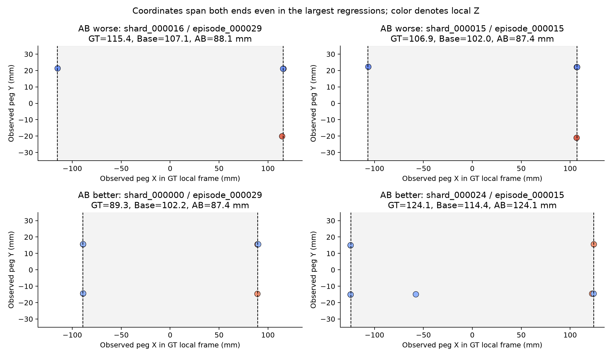
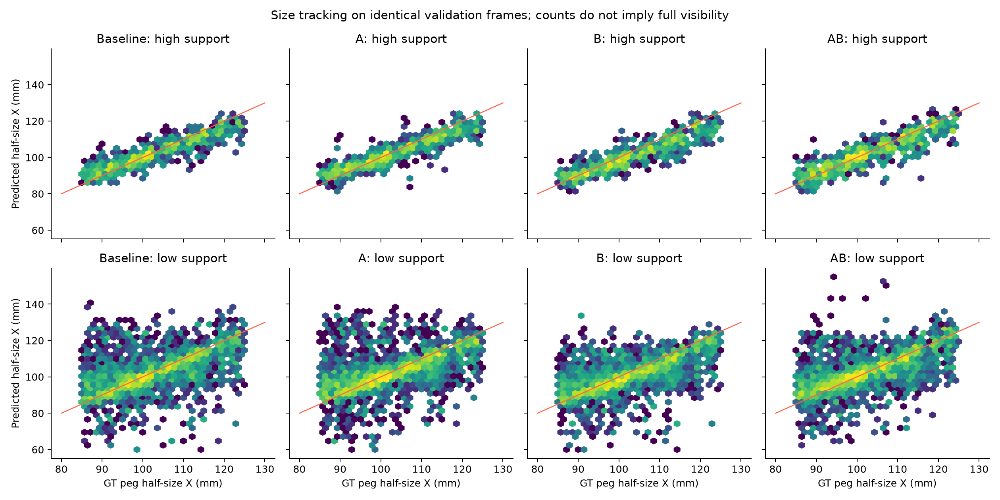
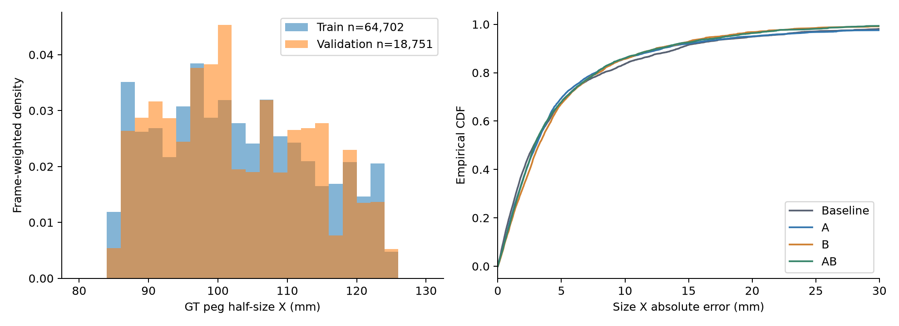
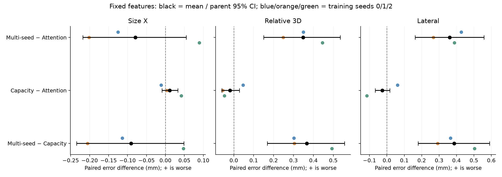
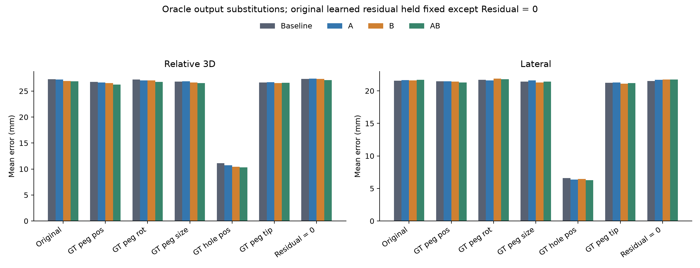

# Vertex GNN 성능 병목 원인 분석

분석일: 2026-11-07. 기존 네 모델의 validation 재분석, 입력 perturbation,
frozen-encoder readout probe를 구분한다. 아래 Size X는 **Peg half-size X**이며,
길이/오차는 mm, 회전 오차는 degree다. GT는 진단·loss·평가에만 사용했다.

주요 결과는 **고관측 회귀를 단순 prior/입력 부족만으로 설명할 수 없고,
frozen Multi-seed의 이점은 작고 불확실하며, Relative/Lateral의 큰 잔여 성분은
Hole position이라는 것**이다. 각 결론의 실험 범위와 한계는 아래에 구분했다.

## 연구 범위와 식별 정보

기존 Baseline/A/B/AB의 새 학습 결과를 대상으로 한다. 원래 published GNN과
이번 Baseline 재학습 checkpoint를 혼동하지 않는다. 기존 architecture,
Object21 인터페이스, metric, checkpoint, Recurrent controller는 수정하지 않았다.

- 기존 네 모델: source snapshot commit `4432d99e5d28b55e27aefb25b3e3fe2a08613d53`,
  archive SHA256 `13bf3b32abe882addf7caa99fb48b9e9a5fc25f7591df82e4c6111e4057118a8`.
- 기존 paired evaluation: `b1bc1a57bb494f4aadb43d91c8eedbc5`, 18,751 frames,
  180 validation episodes. 모든 NPZ를 sample ID의 episode/frame으로 join한 뒤
  ID 집합, GT, PEG/BOX/HOLE count의 완전 일치를 다시 확인했다.
- Cache-only dataset SHA256:
  `21a03a363ec5d6e1dd391fc014b8e3ad1455c5eaf0489153a9c39eed2d133292`.
  Inventory SHA256: `67bf98da88b3aca65e7e1c069afa906fc59078318e92f62af844d9d69a61733a`.
- Train: 64,702 frames / 630 episodes / 630 parents.
  Validation: 18,751 / 180 / 180. Reserved test: 90 episodes, frame를 읽지 않았다.
  Source parent manifest에서 세 split의 parent 교집합은 모두 비어 있다.
- 본 작업의 로컬 Git은 `7f1441e3902067dee7d150d94f3a6fac5ba4d299` + dirty 상태였다.
  작업 전부터 존재한 변경을 보존했다. Readout 학습에 실행한 snapshot은
  [source hashes](../outputs/vertex_gnn_diagnostics/08c9f60da5ed43e8bf64b30de2b95253/compiled_source_hashes.json)와 snapshot archive로 식별한다. 최종 분석·정리 코드의
  [hash manifest](../outputs/vertex_gnn_diagnostics/08c9f60da5ed43e8bf64b30de2b95253/final_source_hashes.json)도 별도로 보존했다.
- 원본 네 모델의 checkpoint hash·선택 epoch·실험 ID는
  [기존 completion audit](../outputs/vertex_gnn_ablation/launch_e89855513f8647a4a47b1955650ce977/completion_audit.json)에 있다.
  Frozen source는 새 Baseline best.pt, SHA256
  `8c47f5b26449e427c0cb4b29a6e0470fcf0d8d466b3b83aef7432e499d5f3885`다.

| 기존 모델 | Parameters | Training seed |
| --- | --- | --- |
| Baseline | 234927 | 0 |
| A | 239135 | 0 |
| B | 240237 | 0 |
| AB | 244445 | 0 |

신뢰구간은 **parent 전체를 복원추출하는 2,000회 cluster bootstrap**이다.
선택된 parent의 모든 frame를 유지하고 sum/count로 frame-weighted paired mean을
계산했다. 이 데이터에서는 parent와 episode가 1:1이므로 두 단위의 CI가 같다.
학습 seed 불확실성이나 새 데이터셋으로의 일반화를 포괄하는 CI는 아니다.

## RQ1 — High-Observation Regression

### Vertex Count별 비교와 paired uncertainty

기존 정의 `PEG ≥4 AND (BOX+HOLE) ≥4`를 유지했다. High support는 관측 개수의
proxy다. Validation의 PEG count는 3–10, BOX는 0–11이며 HOLE은 전부 0이다.
8보다 큰 detection count를 실제 physical corner coverage로 취급하지 않았다.

| 조건 | Frames | Episodes | Parents | Baseline | A | B | AB |
| --- | --- | --- | --- | --- | --- | --- | --- |
| 전체 | 18,751 | 180 | 180 | 5.439 | 5.348 | 5.199 | 5.067 |
| High support | 5,884 | 180 | 180 | 3.026 | 3.001 | 3.602 | 3.318 |
| Low support | 12,867 | 180 | 180 | 6.542 | 6.421 | 5.929 | 5.866 |
| BOX/HOLE 없음 | 2,256 | 115 | 115 | 17.315 | 17.317 | 13.325 | 14.441 |
| Target 있음 | 16,495 | 180 | 180 | 3.814 | 3.710 | 4.087 | 3.785 |
| PEG ≤4 | 10,352 | 177 | 177 | 6.349 | 6.420 | 5.723 | 5.798 |
| PEG 5–6 | 6,056 | 180 | 180 | 4.462 | 4.053 | 4.677 | 4.274 |
| PEG ≥7 | 2,343 | 118 | 118 | 3.942 | 3.955 | 4.228 | 3.887 |

표의 수치는 Size X MAE다. 각 exact PEG/BOX/HOLE/target/**total** count의
Frames/Episodes/Parents, Mean/Median/P90/P95와 A/B/AB paired statistics는
[전체 CSV](../outputs/vertex_gnn_diagnostics/758ecd72af804e2bbb9852a49acc32fc/count_metrics.csv)와
[JSON](../outputs/vertex_gnn_diagnostics/758ecd72af804e2bbb9852a49acc32fc/size_diagnostics.json)에 있다. 구간은 중첩될 수 있으며 조건 사이의 크기·자세가 매칭된 것은 아니다.

| 조건 | 모델 | Mean | Median | P90 | P95 |
| --- | --- | --- | --- | --- | --- |
| High | Baseline | 3.026 | 2.292 | 6.638 | 8.220 |
| High | A | 3.001 | 2.399 | 6.366 | 7.959 |
| High | B | 3.602 | 2.817 | 8.042 | 9.516 |
| High | AB | 3.318 | 2.498 | 7.600 | 9.062 |
| Low | Baseline | 6.542 | 3.299 | 16.757 | 23.522 |
| Low | A | 6.421 | 3.426 | 16.228 | 24.251 |
| Low | B | 5.929 | 3.483 | 15.082 | 19.487 |
| Low | AB | 5.866 | 3.141 | 15.531 | 20.492 |

Paired difference의 부호는 **candidate − Baseline**이다. 양수는 악화다.

| 조건 | 모델 | Paired mean (mm) | Parent 95% CI |
| --- | --- | --- | --- |
| 전체 | A | -0.091 | [-0.295, +0.104] |
| 전체 | B | -0.240 | [-0.578, +0.082] |
| 전체 | AB | -0.372 | [-0.611, -0.116] |
| High | A | -0.025 | [-0.286, +0.225] |
| High | B | +0.576 | [+0.208, +0.950] |
| High | AB | +0.293 | [-0.080, +0.677] |
| Low | A | -0.121 | [-0.365, +0.115] |
| Low | B | -0.613 | [-1.023, -0.189] |
| Low | AB | -0.676 | [-0.985, -0.378] |
| Target 없음 | A | +0.003 | [-1.056, +1.009] |
| Target 없음 | B | -3.990 | [-5.754, -2.230] |
| Target 없음 | AB | -2.873 | [-4.104, -1.644] |

**확인된 사실:** AB의 High support 악화 +0.293mm는 해당 seed에서 관측됐지만
parent CI가 0을 포함한다. B의 High support 악화 +0.576mm는 이 bootstrap에서
0을 제외한다. 반면 AB의 전체·Low support 개선은 이 CI에서 0을 제외한다.
AB의 고관측 악화를 반복 seed에서도 확정된 architecture 효과로 말할 수 없다.

### 실제 관측 범위와 같은 frame의 예측

GT Peg pose로 관측 좌표를 물체 local frame에 투영했다. 이는 **진단 전용**이다.
Axial span fraction은 `observed local-X range / (2 × GT half-size X)`다.
양 끝 band는 X ≤ −0.8×half-size와 X ≥ +0.8×half-size에 모두 관측이 있는 조건이다.
이 조건도 전체 표면 관측의 증명은 아니다.

- High support 5,884개 중 양 끝 band를 포함하는 frame는 **4,348개 (73.90%)**다.
  1,536개는 count 기준을 통과해도 양 끝을 확인할 수 없다.
- 전체 Validation에서 양 끝 band를 포함하는 비율은 **38.51%**,
  Low support는 **22.33%**, Target 없음은 **20.79%**다.
- High + 양 끝 band 4,348개에서 MAE는
  **2.945 / 2.846 / 3.729 / 3.309mm** (Baseline/A/B/AB)다.
  AB − Baseline = +0.365mm, parent 95% CI [−0.077, +0.847].
- GT axial span이 실제 길이의 98–102%인 High 4,268개에서도
  **2.949 / 2.844 / 3.757 / 3.334mm**다.
  입력 길이 범위가 부족한 frame만으로 AB의 고관측 회귀를 설명할 수 없다.
- GT axis의 half-span 자체를 진단값으로 사용하면 High의 median half-size
  오차는 **0.260mm**다. Mean은 **23.051mm**로 크다. 한쪽 단면 관측과
  양 끝 관측이 섞여 있기 때문이다. GT orientation을 사용하는 이 값은
  합법적인 Student 성능으로 제시한 것이 아니다.

[Coverage와 크기 구간별 paired 결과](../outputs/vertex_gnn_diagnostics/local_geometry/5084e5e4f98544629227ca70120bf3df/coverage_conditioned_errors.json)에는
GT size 85–95, 95–105, 105–115, 115–125mm 조건도 따로 기록했다.
High에서 AB는 작은 크기·매우 큰 크기의 평균 오차는 개선하지만,
95–105와 105–115mm에서는 악화한다. 한 가지 일정 크기로 수렴한 패턴이 아니다.

아래 사례는 변화량 극단에서 **episode당 한 frame**씩 뽑았다.
연속된 유사 frame를 여러 독립 사례로 제시하지 않는다.

| 방향 | Sample ID | PEG,BOX,HOLE | GT | Baseline | A | B | AB | Axial span / GT |
| --- | --- | --- | --- | --- | --- | --- | --- | --- |
| worse | shard_000016/episode_000029/frame_000059.npz | 4,7,0 | 115.442 | 107.080 | 92.891 | 99.432 | 88.143 | 1.000 |
| worse | shard_000015/episode_000015/frame_000062.npz | 4,9,0 | 106.858 | 102.020 | 88.500 | 96.728 | 87.377 | 0.999 |
| worse | shard_000024/episode_000010/frame_000052.npz | 6,5,0 | 101.512 | 101.402 | 99.006 | 91.161 | 90.690 | 1.001 |
| worse | shard_000021/episode_000018/frame_000005.npz | 6,4,0 | 116.967 | 115.859 | 113.883 | 108.566 | 106.475 | 1.000 |
| worse | shard_000002/episode_000009/frame_000087.npz | 5,4,0 | 111.627 | 108.918 | 95.768 | 97.266 | 99.639 | 0.789 |
| better | shard_000000/episode_000029/frame_000009.npz | 7,5,0 | 89.293 | 102.199 | 95.009 | 92.546 | 87.420 | 1.002 |
| better | shard_000024/episode_000015/frame_000060.npz | 8,4,0 | 124.094 | 114.420 | 117.588 | 118.689 | 124.109 | 1.002 |
| better | shard_000008/episode_000023/frame_000061.npz | 5,7,0 | 118.438 | 106.159 | 110.997 | 113.908 | 115.548 | 0.993 |
| better | shard_000002/episode_000018/frame_000000.npz | 7,8,0 | 86.359 | 96.373 | 89.756 | 88.676 | 87.055 | 1.008 |
| better | shard_000010/episode_000004/frame_000073.npz | 5,6,0 | 119.339 | 107.248 | 111.254 | 111.605 | 116.563 | 1.000 |



가장 악화된 frame에서 GT half-size는 115.442mm, Baseline은 107.080mm,
AB는 88.143mm다. AB가 **과소 추정**한다. 실제 관측 PEG local-X는
약 +115.875, +115.519, −114.996, +114.500mm로 양 끝을 포함한다.
세 점은 +X 끝에, 한 점은 −X 끝에 있어 분포는 균등하지 않지만,
길이 범위 자체는 GT의 99.995%다. A=92.891, B=99.432mm도 과소 추정하므로
이 사례가 AB에만 나타나는 현상은 아니다. 이 frame의 Peg rotation error는
Baseline 4.256°→AB 1.642°로 좋아졌지만 Peg position은 11.111→18.896mm로
나빠졌다. Size 회귀를 이 사례의 orientation 악화만으로 설명할 수도 없다. 반대 극단에는 124.094mm 물체를
AB가 124.109mm로 맞추는 사례도 있다.

[사례 원본](../outputs/vertex_gnn_diagnostics/local_geometry/5084e5e4f98544629227ca70120bf3df/cases.json)에 모든 관측의 world XYZ,
object type, PEG local XYZ, TCP world 위치, GT와 각 모델의 Peg/Hole TCP-relative pose/wxyz quaternion,
예측 크기와 frame ID를 보존했다. 실제 physical corner 근접도는 GT 8 corners의
5mm 이내 matching으로 따로 계산했으며 detection ID를 corner identity로 가정하지 않았다.

추가로 가장 악화된 두 사례의 PEG readout을 실제 checkpoint로 replay했다.
관측이 하나뿐인 −X 끝점에 대한 attention mass는 Baseline **0.252/0.254**,
AB **0.409/0.402**였다. Multi의 값은 heads/seeds 평균이다.
끝점을 단순히 attention에서 버렸다는 설명은 이 두 사례와 맞지 않는다.
Attention mass는 value/projection/head의 signed 기여나 causal attribution이 아니다.
[Attention과 replay 결과](../outputs/vertex_gnn_diagnostics/local_geometry/5084e5e4f98544629227ca70120bf3df/case_attention.json)를 보존했다.

### Prior 검사와 입력 sensitivity

| 분포 | Frames | Mean | Median | Std | Min–Max |
| --- | --- | --- | --- | --- | --- |
| Train | 64702 | 102.885 | 101.944 | 10.905 | 85.050–124.925 |
| Validation | 18751 | 102.944 | 101.427 | 10.426 | 85.436–124.310 |

| Predictor | 전체 MAE | High | Low | Target 없음 |
| --- | --- | --- | --- | --- |
| Train mean constant | 8.846 | 8.773 | 8.880 | 8.468 |
| Train median constant | 8.766 | 8.696 | 8.798 | 8.187 |
| Baseline | 5.439 | 3.026 | 6.542 | 17.315 |
| A | 5.348 | 3.001 | 6.421 | 17.317 |
| B | 5.199 | 3.602 | 5.929 | 13.325 |
| AB | 5.067 | 3.318 | 5.866 | 14.441 |

Train에서만 fit한 constant다. 네 모델은 전체에서 constant보다 낫다.
그러나 Target 없음에서는 **모든 모델이 constant보다 나쁘다**.
AB의 이 구간 예측 std는 15.167mm, GT std는 9.345mm이고,
GT와 prediction Pearson r은 0.081이다. Baseline std 18.044mm보다 줄었지만
train 평균으로의 단순한 collapse는 아니다. AB가 평균 개선을 얻은 상당 부분은
관측 부족 구간의 큰 오차/예측 변동을 줄인 데 있으며, 이 구간의 크기 추정이
정확해졌다고 일반화할 수 없다.

High support에서 GT에 대한 예측 회귀 기울기는 Baseline **0.757**, AB **0.815**,
Pearson r은 **0.928 → 0.907**다. AB는 GT 크기 변화에 더 가깝게 반응하지만
조건부 산포가 더 크다. Signed bias는 −0.626 → −0.927mm이고,
양 끝이 있는 High 조건에서는 −0.655 → −1.646mm다.
단순한 prior 의존 증가 하나로 전체 결과를 설명하기 어렵다.




원래 입력에서 분류한 High 256 + Low 256 frame을 고정하고, 제거 후 재분류하지 않았다.
이 frame들에 대해 같은 PEG 제거 mask와 noise draw를
모든 모델에 적용했다. PEG 제거 시 연결 edge도 제거하고,
좌표 noise 시 relative XYZ/distance를 다시 계산했다.
제거 개수는 `max(1, floor(n_PEG × nominal_fraction))`이므로 작은 vertex 수에서
실제 비율은 명목 25%/50%와 다를 수 있다. TCP·target-side 입력·GT·weights는
고정했다. Noise는 PEG 각 좌표의 독립 Gaussian σ다. 아래 표는 **High 표본**이며
전체 High의 평균과 다르다.

| 모델 | 원래 MAE | PEG 25% 제거 | 50% 제거 | σ=0.5mm | σ=1mm | 50% 제거 시 예측변화 |
| --- | --- | --- | --- | --- | --- | --- |
| Baseline | 3.116 | 3.626 | 4.505 | 3.117 | 3.119 | 3.242 |
| A | 3.125 | 3.622 | 5.243 | 3.139 | 3.156 | 3.933 |
| B | 3.634 | 4.056 | 5.531 | 3.657 | 3.673 | 3.903 |
| AB | 3.270 | 3.947 | 6.010 | 3.286 | 3.307 | 4.700 |

AB도 입력을 사용하며, 제거에 대한 반응이 작지 않다. 작은 noise에 반응하지 않는
상수 출력과도 다르다. 하지만 입력에 반응한다는 사실은 필요한 기하를 올바르게
이용한다는 증거가 아니다. 이 검사는 고정 sample와 한 perturbation seed의 국소
반응이며, 모든 occlusion/noise 분포에 대한 robustness 실험은 아니다.
[512-frame predictions와 설정](../outputs/vertex_gnn_diagnostics/08c9f60da5ed43e8bf64b30de2b95253/geometry_diagnostics/d10241b68c7f4977868a2615db26ef9c)을 보존했다.

**RQ1 판단:** 입력의 길이 정보 부족은 많은 Low frame에 실제로 존재한다.
그러나 양 끝이 있는 고관측 frame의 회귀는 입력 부족만의 문제가 아니다.
Constant prior만의 설명도 지지되지 않는다. 관측 분포에 따른 learned mapping,
encoder/readout/공동 loss의 정보 활용 문제가 남으며, 그중 readout의 기여는
아래 frozen 실험 범위에서만 판단한다.

## RQ2 — Frozen Encoder Readout Probe

### 구성, feature 추출 지점과 실행 조건

새 Baseline의 node encoder, semantic/object/edge embeddings, PEG/target intra-object
MPNN, cross-object MPNN을 모두 freeze했다. 마지막 cross-object layer 뒤,
`peg_pool`/`hole_pool` 호출 직전의 **같은 [B,N,64] h**를 hook으로 추출했다.
Baseline에는 global geometry module이 없다. 두 pool에 전달된 h/confidence가
완전히 같음을 확인했다. 새로운 GNN 구조는 추가하지 않았다.

Feature와 함께 원래 confidence, object masks, PEG/Hole anchors를 보존했다.
[`ReadoutProbe`](../graph/readout_probe.py)는 기존 pool/head modules와 동일한
Object21 decoding을 사용한다. GT·pretrained Object21 prediction은 probe input에
들어가지 않으며, 입력 key를 whitelist로 제한했다.

- 한 번 추출한 feature cache SHA256:
  `6f10208ccd75f82387edb716cc1cbeedbdeab314c6f854d93081a57bbb0dff28`.
- 원래 pretrained pool/head를 캐시에서 replay한 출력과 원래 forward의 최대 차이는
  **0**이다. 기존 원본 paired NPZ와의 전체 validation 최대 차이는
  **2.384×10⁻⁷** (Object21 원래 단위)로, extraction/evaluation batch shape의 수치 차이 범위다.
- Frozen encoder는 **208,024 parameters**다. Source GNN 전체 hash와 모든 gradient의
  부재를 학습 전후 검사했다. Optimizer에는 새 pool/head만 포함된다.
- 모든 readout/head는 매번 새로 초기화했다. 같은 training seed의 PEG/Hole/residual
  head 초기 weight SHA256가 Attention/Multi/Capacity/seed-count control 사이에서 일치했다.
- Train/Validation split, 21D 출력 순서, 고정 normalization, loss는 source 그대로다.
  Coord scale=0.05m, Size scales=[0.04,0.01,0.01,0.02]m,
  loss pos unit=0.01m, consistency weight=0.05다.
- AdamW lr=0.001, weight decay=0.0001, StepLR(10,0.5), gradient clip norm=1.0.
  Training seed **0/1/2**, **batch 256, 30 epochs, 7,590 updates**를 동일하게 적용했다.
  실제 optimizer step counter도 모든 parameter에서 7,590이었다.
- 이 통제 실험의 batch/update 예산은 기존 end-to-end의 batch 32/60,660 updates와
  별개다. 새 두 방식끼리의 비교가 통제 대상이다. 기존 pretrained head 결과와의
  차이를 readout 구조 효과로 해석하지 않는다.
- CUDA compiled forward/loss/backward, eager validation/inference다. Eager/compiled
  loss 차이는 0, 최대 gradient 차이는 2.981×10⁻⁷였다.
  실제 환경은 Vast **59441593 / RTX 3090**, Python **3.12.15**,
  Torch **2.14.1+cu132**, CUDA **13.2**, FP32/TF32 off다.
- Best checkpoint는 원래와 같이 **minimum total validation loss**로 선택했다.
  Validation은 선택과 최종 평가에 재사용되므로 독립 test 성능이 아니다.

Attention/Multi의 3-seed 비교 **6개를 먼저 완료한 뒤** capacity control 3개를 실행했다.
Original attention MLP의 intermediate width만 64→104로 바꾼 control이다.
Multi는 기존 4 seeds × attention width 16, 4 heads다.

| Probe | Trainable pool/head parameters | Training seeds |
| --- | --- | --- |
| Fresh original Attention | 26903 | 0,1,2 |
| Fresh Multi-seed (4) | 32213 | 0,1,2 |
| Capacity Attention | 32183 | 0,1,2 |
| Multi-seed (1) | 25973 | 0 |
| Multi-seed (8) | 40533 | 0 |

Capacity Attention과 Multi의 차이는 **30 parameters (0.093%)**다.
이는 거의 같은 용량의 통제이며 완전히 같은 함수족은 아니다.

### 동일 feature에서의 state error

각 cell은 training seed별 frame-weighted mean의 **평균 ± sample SD**다.

| Metric (mm unless degree) | Fresh Attention | Fresh Multi-seed (4) | Capacity Attention |
| --- | --- | --- | --- |
| Peg half-size X | 4.964 ± 0.089 | 4.884 ± 0.062 | 4.975 ± 0.066 |
| Peg half-size Y | 0.822 ± 0.060 | 0.954 ± 0.062 | 0.840 ± 0.067 |
| Peg half-size Z | 0.828 ± 0.063 | 0.954 ± 0.060 | 0.847 ± 0.069 |
| Peg position | 4.421 ± 0.093 | 4.667 ± 0.061 | 4.406 ± 0.108 |
| Peg rotation (degree) | 3.653 ± 0.117 | 3.476 ± 0.275 | 3.663 ± 0.091 |
| Hole position | 26.257 ± 0.055 | 26.503 ± 0.078 | 26.252 ± 0.035 |
| Hole rotation (degree) | 5.724 ± 0.105 | 6.464 ± 0.221 | 5.731 ± 0.108 |
| Hole radius | 2.629 ± 0.016 | 2.697 ± 0.026 | 2.631 ± 0.013 |
| Geometric physical tip | 10.526 ± 0.174 | 10.567 ± 0.247 | 10.523 ± 0.120 |
| Corrected physical tip | 10.887 ± 0.136 | 11.005 ± 0.328 | 10.854 ± 0.168 |
| Final relative 3D | 26.780 ± 0.148 | 27.128 ± 0.136 | 26.761 ± 0.098 |
| Lateral | 21.149 ± 0.155 | 21.510 ± 0.113 | 21.123 ± 0.093 |
| Axial | 12.463 ± 0.115 | 12.564 ± 0.113 | 12.498 ± 0.018 |

원래 pretrained Baseline pool/head의 Size X / Relative / Lateral은
**5.439 / 27.295 / 21.561mm**다. 위 Fresh Attention 결과는 이 pretrained
pool/head를 그대로 사용한 결과가 아니다. 같은 encoder 위에서 새로 학습한 결과다.
그 차이에는 추가 학습과 checkpoint selection이 있으므로 architecture gain으로 세지 않는다.

| Paired contrast | Metric | 3-seed mean Δ (mm) | Seed SD of Δ | Parent 95% CI |
| --- | --- | --- | --- | --- |
| Multi − Attention | Size X | -0.079 | 0.151 | [-0.218, +0.055] |
| Multi − Attention | Relative 3D | +0.348 | 0.099 | [+0.150, +0.535] |
| Multi − Attention | Lateral | +0.361 | 0.084 | [+0.163, +0.558] |
| Capacity − Attention | Size X | +0.011 | 0.027 | [-0.009, +0.032] |
| Capacity − Attention | Relative 3D | -0.019 | 0.057 | [-0.060, +0.029] |
| Capacity − Attention | Lateral | -0.026 | 0.088 | [-0.067, +0.017] |
| Multi − Capacity | Size X | -0.091 | 0.128 | [-0.234, +0.049] |
| Multi − Capacity | Relative 3D | +0.366 | 0.110 | [+0.169, +0.556] |
| Multi − Capacity | Lateral | +0.387 | 0.107 | [+0.180, +0.590] |

위 CI는 **3개 training seed의 frame별 paired delta를 평균한 뒤** parent를 복원추출했다.
고정된 이 세 seed와 하나의 frozen encoder에 조건부인 CI다. Seed 모집단에 대한
95% CI로 제시하지 않는다. 각 seed의 parent CI는 [전체 결과](../outputs/vertex_gnn_diagnostics/08c9f60da5ed43e8bf64b30de2b95253/probe_comparison/6300446f2b9048d0918e0e0fd2767469/summary.json)에 있다.



**확인된 사실:** Multi의 Size X 이점은 **0.079mm (1.59%)**이며 CI가 0을 포함한다.
Seed 0/1/2의 paired 변화는 **−0.125 / −0.202 / +0.090mm**로 방향도 완전히 같지 않다.
Capacity를 맞춰도 **−0.091mm**, CI [−0.234,+0.049]로 0을 포함한다.
반면 Multi의 Relative/Lateral과 Peg/Hole position은 Attention보다 악화하며,
Relative와 Lateral 악화는 세 seed 모두 같은 방향이다. Size Y/Z, Hole rotation도 악화한다.
Peg rotation 평균은 일부 좋아지지만 seed마다 방향이 달라 pose 전체 개선은 아니다.

### 관측 수, training seed와 pooling seed 개수

| 조건 | Attention | Multi (4) | Capacity | Multi−Attn s0 | s1 | s2 |
| --- | --- | --- | --- | --- | --- | --- |
| High | 3.043 | 2.958 | 3.087 | -0.166 | -0.057 | -0.031 |
| Low | 5.842 | 5.765 | 5.838 | -0.107 | -0.268 | +0.145 |
| Target 없음 | 13.480 | 13.846 | 13.423 | -0.055 | -0.069 | +1.222 |

Frozen 조건에서 High의 Multi 변화는 −0.166/−0.057/−0.031mm로 작고,
각 parent CI는 모두 0을 포함한다. 기존 end-to-end B의 High 악화 +0.576mm가
같은 feature에서 재현되지 않는다. 따라서 기존 High 회귀가 Multi pooling의
필연적인 성질이라는 해석은 지지되지 않는다. 특히 이 probe는 Baseline h를
사용하므로 AB의 geometry module 이후 h에 대한 직접 통제 실험은 아니다.

같은 frame의 Size X prediction을 training seed 사이에서 비교한 표준편차 평균은
Attention **1.028mm**, Multi **1.532mm**다. High에서는 **0.918 / 1.120mm**,
Low에서는 **1.078 / 1.720mm**다. 이 세 seed에서는 Multi의 저관측 출력 변동이 더 크다.

Pooling seed 수 1/4/8은 **training seed 0 한 번씩** 비교했다.

| Pooling seeds | Parameters | 전체 Size X | High | Low | Target 없음 |
| --- | --- | --- | --- | --- | --- |
| 1 | 25973 | 4.793 | 3.090 | 5.573 | 11.829 |
| 4 | 32213 | 4.868 | 2.978 | 5.732 | 13.122 |
| 8 | 40533 | 4.968 | 2.905 | 5.911 | 14.770 |

Seed를 늘리면 High의 Size X는 줄지만 Low/Target 없음에서는 악화한다.
모든 출력·gradient는 finite였고 학습 실패는 없었다. 따라서 이를 수치 폭주로 부르지 않는다.
Pooling seed 수와 parameter count가 함께 바뀌고 반복 training seed가 하나이므로,
seed redundancy 자체가 원인이라고 확정할 수도 없다. “더 많은 seed가 항상 낫다”는
주장은 이 조건의 결과와 맞지 않는다.

**RQ2 판단:** 이 고정 Baseline representation과 현재 loss/예산에서는
원래 readout이 주요 geometry 병목이라는 강한 증거가 없다.
Multi의 작은 Size X 평균 이점은 parameter-matched control에서도 불확실하며,
position·relative·lateral tradeoff가 더 분명하다. 단순 용량 증가가 기존 B의 이점을
전부 설명한다는 증거도 없다. 원래 end-to-end 개선에는 representation의 공동 학습,
head 최적화, calibration, seed/selection 효과가 함께 작용했을 가능성이 남는다.
하나의 frozen Baseline encoder에 대한 결과이며, baseline readout과 공동 학습된 h의
편향과 readout별 optimizer 적합성까지 분리한 정보이론적 증명은 아니다.

### 새 checkpoint/prediction provenance

| Readout | Training seed | Run / best.pt | Selected epoch | Best val loss | Checkpoint SHA256 prefix |
| --- | --- | --- | --- | --- | --- |
| attention | 0 | [328218114f3248f191a6fa8303060a23](../outputs/vertex_gnn_diagnostics/08c9f60da5ed43e8bf64b30de2b95253/completed_runs/compiled_primary_seed_0_attention/attention/seed_0/328218114f3248f191a6fa8303060a23/best.pt) | 14 | 3.007251 | 3005d9a5f2f2 |
| attention | 1 | [a0618785c4a246b88c740de80c1a5cb0](../outputs/vertex_gnn_diagnostics/08c9f60da5ed43e8bf64b30de2b95253/completed_runs/compiled_primary_seed_1_attention/attention/seed_1/a0618785c4a246b88c740de80c1a5cb0/best.pt) | 23 | 3.043153 | 6b27974b9c34 |
| attention | 2 | [a0014e7d4e4749269d70c4d423f032a8](../outputs/vertex_gnn_diagnostics/08c9f60da5ed43e8bf64b30de2b95253/completed_runs/compiled_primary_seed_2_attention/attention/seed_2/a0014e7d4e4749269d70c4d423f032a8/best.pt) | 15 | 3.025475 | e0765974c222 |
| multiseed | 0 | [62961068eaa3496e96bad43999c39be8](../outputs/vertex_gnn_diagnostics/08c9f60da5ed43e8bf64b30de2b95253/completed_runs/compiled_primary_seed_0_attention/multiseed/seed_0/62961068eaa3496e96bad43999c39be8/best.pt) | 14 | 3.041785 | 72af1a4f7f5a |
| multiseed | 1 | [b1f0aed6de40451fabbb2bbe14e7aaec](../outputs/vertex_gnn_diagnostics/08c9f60da5ed43e8bf64b30de2b95253/completed_runs/compiled_primary_seed_1_attention/multiseed/seed_1/b1f0aed6de40451fabbb2bbe14e7aaec/best.pt) | 18 | 3.045524 | b974b44fb19d |
| multiseed | 2 | [1e2b294e3e8648c6a639178e026fdeab](../outputs/vertex_gnn_diagnostics/08c9f60da5ed43e8bf64b30de2b95253/completed_runs/compiled_primary_seed_2_attention/multiseed/seed_2/1e2b294e3e8648c6a639178e026fdeab/best.pt) | 15 | 3.051063 | 820c61b74855 |
| attention_capacity | 0 | [6e9a713cb104427ab1e98e59a7f7ed39](../outputs/vertex_gnn_diagnostics/08c9f60da5ed43e8bf64b30de2b95253/completed_runs/compiled_capacity_seed_0_attention_capacity/attention_capacity/seed_0/6e9a713cb104427ab1e98e59a7f7ed39/best.pt) | 14 | 3.011626 | 4ea90999b58c |
| attention_capacity | 1 | [cfea5794b3de470c86ab84b641d60b4b](../outputs/vertex_gnn_diagnostics/08c9f60da5ed43e8bf64b30de2b95253/completed_runs/compiled_capacity_seed_1_attention_capacity/attention_capacity/seed_1/cfea5794b3de470c86ab84b641d60b4b/best.pt) | 23 | 3.036123 | 11afbd2e990a |
| attention_capacity | 2 | [3efca2144c764f7995f92a5e3faa5bb4](../outputs/vertex_gnn_diagnostics/08c9f60da5ed43e8bf64b30de2b95253/completed_runs/compiled_capacity_seed_2_attention_capacity/attention_capacity/seed_2/3efca2144c764f7995f92a5e3faa5bb4/best.pt) | 13 | 3.023931 | c76f092d7bd2 |
| multiseed_one | 0 | [a38833086f4a4260b7f866b3ae6d20f4](../outputs/vertex_gnn_diagnostics/08c9f60da5ed43e8bf64b30de2b95253/completed_runs/compiled_seed_count_seed_0_multiseed_one/multiseed_one/seed_0/a38833086f4a4260b7f866b3ae6d20f4/best.pt) | 13 | 3.046624 | 115ef27dc4aa |
| multiseed_eight | 0 | [b5f4eea3a7c449e5bcdc276c78d9a473](../outputs/vertex_gnn_diagnostics/08c9f60da5ed43e8bf64b30de2b95253/completed_runs/compiled_seed_count_seed_0_multiseed_eight/multiseed_eight/seed_0/b5f4eea3a7c449e5bcdc276c78d9a473/best.pt) | 14 | 3.065063 | 836213700aad |

Full hashes, 실제 optimizer states, head 초기화와 shuffle hash, 원본 checkpoint 보존,
capacity 실행 순서는 [completion audit](../outputs/vertex_gnn_diagnostics/08c9f60da5ed43e8bf64b30de2b95253/remote_receipts/completion_audit.json)에 있다.
각 run의 predictions.npz와 best.pt/last.pt는 로컬 `completed_runs/`에도 복사했다.
Batch-32 eager 초기 실행은 속도 검증 후 중단·보존했으며 위 비교에 포함하지 않았다.
실행 source snapshot은 보존했다. 이후 decoder wrapper를 `graph/readout_probe.py`로
옮겨 모델 정의와 orchestration을 분리했고 동일 decoding parity 테스트를 다시 통과했다.


## RQ3 — Relative Geometry Error Decomposition

### 변수와 좌표계

[`gated_mpnn.py`](../graph/gated_mpnn.py),
[`object21_targets.py`](../graph/utils/object21_targets.py),
[`vertex_metrics.py`](../evaluation/gnn/vertex_metrics.py)를 대조했다.

- Peg/Hole position은 TCP-relative, world-aligned axes다. World position이 필요하면
  같은 관측 TCP world XYZ를 더한다. 아래 위치 오차는 같은 TCP가 상쇄된다.
- 실제 geometric tip: `pₑ = p_peg + R(q_peg)[half_size_x,0,0]`.
- Predicted geometric tip도 예측 pose/size로 같은 식을 사용한다.
- `endpoint_geom = p̂ₑ − p̂ₕ`이며, absolute tip이 아니다.
- `endpoint_residual = d`는 기존 learned correction이다.
- `Object21[7:10] = endpoint_geom + d`는 **tip−hole relative vector**다.
- 보고서의 Endpoint Position Error는
  `‖(Object21[7:10] + predicted_hole) − (GT_relative + GT_hole)‖`다.
  즉 residual을 포함한 corrected physical tip의 오차다.
  Geometric physical tip 오차와 구분해야 한다.

따라서 `eₑ = p̂ₑ−pₑ`, `eₕ=p̂ₕ−pₕ`, `eᵣ=eₑ−eₕ`이고
최종 relative error는 `eᵣ+d`다. Hole을 두 번 빼지 않았다.
모든 frame에서 저장된 `endpoint_geom`, 최종 relative, GT geometry의 항등식을 검사했다.

### Vector 분해와 방향 상쇄

항등식 `‖eᵣ‖² = ‖eₑ‖² + ‖eₕ‖² − 2 eₑᵀeₕ`를 frame마다 확인했다.
아래는 **평균 제곱오차 mm²**이며 평균 norm(mm)과 혼동하지 않는다.

| 항 (mm²) | Baseline | A | B | AB |
| --- | --- | --- | --- | --- |
| E‖eₑ‖² | 239.116 | 237.605 | 207.010 | 201.218 |
| E‖eₕ‖² | 1587.029 | 1587.885 | 1586.963 | 1611.054 |
| −2E[eₑ·eₕ] | -167.404 | -156.942 | -126.621 | -155.018 |
| E‖eᵣ‖² | 1658.740 | 1668.548 | 1667.351 | 1657.255 |
| E‖d‖² | 16.808 | 20.238 | 25.283 | 15.905 |
| 2E[eᵣ·d] | 10.710 | 9.753 | -19.410 | 2.664 |
| E‖eᵣ+d‖² | 1686.257 | 1698.539 | 1673.225 | 1675.824 |

Baseline → AB에서 Peg geometric endpoint 항은 **−37.897mm²** 개선됐다.
그러나 Hole 항 **+24.026mm²**, 상쇄 항 **+12.387mm²** 변화가 그 개선의
약 **96.1%**를 상쇄한다. 결과적으로 geometric relative MSE는
1658.740 → 1657.255mm²로 거의 같다.

이는 “Hole mean error가 26.468 → 26.427mm로 조금 줄었으니 Hole은 무관하다”는
해석이 성립하지 않는 이유다. Mean norm, 제곱오차 tail, 벡터 교차항은 다르다.
평균 cosine은 0.159 → 0.190, 두 오차의 dot product가 양수인 비율은
61.83% → 63.65%다. 각도만 일률적으로 악화됐다는 증거가 아니며,
위 교차항은 방향과 크기를 함께 가중한 실제 측정치다.
[전체 per-frame error vector](../outputs/vertex_gnn_diagnostics/758ecd72af804e2bbb9852a49acc32fc/error_vectors.npz)를 보존했다.

| Metric (mean mm) | Baseline | AB | AB − Baseline |
| --- | --- | --- | --- |
| Peg position | 4.527 | 4.321 | −0.206 |
| Peg rotation (degree) | 3.173 | 2.702 | −0.471 |
| Peg half-size X | 5.439 | 5.067 | −0.372 |
| Geometric physical tip | 10.756 | 10.078 | −0.678 |
| Hole position | 26.468 | 26.427 | −0.041 |
| Geometric relative 3D | 27.340 | 27.128 | −0.212 |
| Residual magnitude | 3.142 | 2.819 | −0.323 |
| Corrected physical tip | 11.107 | 10.297 | −0.810 |
| Final relative 3D | 27.295 | 26.870 | −0.425 |
| Lateral | 21.561 | 21.702 | +0.142 |
| Axial | 12.904 | 11.909 | −0.995 |

Target 없음의 AB Hole/relative/lateral mean은 **79.285/80.596/53.044mm**다.
Target 있음에서는 **19.198/19.522/17.416mm**, High에서는
**6.773/7.806/6.940mm**다. 관측 조건의 차이가 크다.
Target이 있어도 Hole 위치의 lateral 불확실성이 남으므로 missing-target만의 문제도 아니다.

**추가로 직접 확인한 제약:** Target가 없으면 원래 GNN의 target anchor와 pool/summary가
모두 0이다. 따라서 Hole head의 입력은 0으로 고정된다. 네 모델 각각에서 이 2,256개
frame의 predicted Hole position은 **정확히 하나의 TCP-relative 벡터**였으며,
세 축의 range가 모두 0이었다. AB의 값은 [−4.892,414.109,21.731]mm다.
GT Hole TCP-relative XYZ의 표준편차는 [38.226,62.081,40.301]mm다.
이 구간은 AB 전체 Hole absolute-error sum의 **36.10%**, Hole squared-error sum의
**55.46%**를 차지한다. Peg 개선만으로 이 Hole 불확실성이 사라지지 않으며,
RQ2에서도 같은 anchor/mask/빈-group 규칙을 유지했으므로 readout 교체로
관측되지 않은 target의 frame별 위치 정보가 새로 생기지는 않는다.

기존 AB − Baseline의 paired parent 95% CI도 확인했다.
Physical tip −0.810mm [−1.137,−0.487], Relative −0.425mm [−0.899,+0.071],
Lateral +0.142mm [−0.323,+0.628], Hole position −0.041mm [−0.439,+0.367]다.
Physical tip 개선과 relative/lateral 개선의 증거 강도가 다르다.
[전체 paired metric CI](../outputs/vertex_gnn_diagnostics/758ecd72af804e2bbb9852a49acc32fc/paired_metrics.json)에 pose 항도 있다.

### Residual과 oracle component replacement

각 cell은 **Relative 3D / Lateral mm**다. Oracle은 saved output component의
대체이며 Student 성능이 아니다. 원래 residual을 **고정**하고 geometry를 재계산한다.
마지막 행만 residual을 0으로 만든다. GT component를 넣어 residual head를 재실행하는
별도의 개입은 실시하지 않았다. 이 두 개입을 혼동하지 않는다.

| Output-space intervention | Baseline | A | B | AB |
| --- | --- | --- | --- | --- |
| 원래 출력 | 27.295 / 21.561 | 27.213 / 21.641 | 26.961 / 21.600 | 26.870 / 21.702 |
| GT Peg position | 26.750 / 21.464 | 26.652 / 21.450 | 26.540 / 21.436 | 26.225 / 21.286 |
| GT Peg rotation | 27.213 / 21.709 | 27.064 / 21.592 | 27.065 / 21.886 | 26.790 / 21.790 |
| GT Peg size | 26.828 / 21.441 | 26.882 / 21.601 | 26.649 / 21.299 | 26.533 / 21.444 |
| GT Hole position | 11.107 / 6.576 | 10.710 / 6.373 | 10.427 / 6.480 | 10.297 / 6.279 |
| GT Peg geometric endpoint | 26.669 / 21.264 | 26.697 / 21.283 | 26.563 / 21.110 | 26.576 / 21.213 |
| Residual = 0 | 27.340 / 21.517 | 27.403 / 21.690 | 27.338 / 21.736 | 27.128 / 21.740 |



AB에서 GT Hole position은 Relative **26.870 → 10.297mm**, Lateral
**21.702 → 6.279mm**로 줄인다. 반면 GT Peg geometric tip만 제공하면
Relative **26.576mm**, GT Peg size는 **26.533mm**다.
이 고정-output 개입에서는 **Hole position이 지배적인 잔여 오차 성분**이다.
상호작용이 있으므로 각 oracle gain을 더해 비율의 causal contribution으로 취급하지 않는다.

Residual을 없애면 AB Relative가 **27.128mm**로 악화한다.
따라서 residual이 평균 relative 개선을 막은 주원인이라는 설명은 지지되지 않는다.
다만 physical tip은 residual 전 **10.078mm**, 후 **10.297mm**로 나빠지며,
relative MSE에도 residual 관련 항 +18.569mm²가 추가된다. Mean norm을 소폭
줄이는 것과 tail의 제곱오차를 줄이는 것은 다르다. Residual은 metric별 tradeoff를 보인다.

**RQ3 판단:** Peg size/pose 개선은 physical endpoint를 개선했지만,
Hole 위치 오차와 벡터 교차항 변화 때문에 relative geometry에 거의 전달되지 않았다.
현재 관측/모델에서 Peg size만 더 정확하게 만들어도 relative/lateral 문제가 해결되지는 않는다.
이 결론은 frozen saved-output oracle에 대한 것이며, Hole 예측 개선 학습의 실제 성능을
예측한 실험은 아니다.

## 종합 결론

### 확인된 사실

1. **가장 큰 상대 위치 병목은 Hole position이다.** AB의 GT Hole position 개입은
   Relative 26.870→10.297mm, Lateral 21.702→6.279mm다. Target가 없으면 기존
   인터페이스 안에서 Hole head 입력이 상수가 되는 제약도 실제 prediction으로 확인됐다.
2. **Peg size의 고관측 회귀는 입력 부족만으로 설명되지 않는다.** 양 끝이 실제로 있는
   frame에도 남으며, constant collapse나 끝점의 attention 무시만으로도 설명되지 않는다.
   다만 AB의 High 악화 CI는 0을 포함하므로 반복 seed에서의 확정된 효과는 아니다.
3. **Readout을 바꾸는 것만으로 전반적 개선이 확인되지 않았다.** Frozen Multi의
   Size X 차이는 작고 불확실하며 Relative/Lateral은 악화했다. Capacity control도
   주요 결론을 바꾸지 않는다.

### 실험이 지지하는 해석과 다음 확인 사항

- **Geometry Encoder와 Readout 중 선택:** Readout 확대를 우선할 근거는 약하다.
  다음 진단은 원본 geometry→frozen h→state head 과정에서 크기 정보가 어디서
  사라지거나 잘못 calibration되는지와 joint loss/selection의 영향을 확인하는 쪽이
  더 근거 있다. 이 연구가 특정 Encoder 변경의 개선 효과를 입증한 것은 아니다.
- **Peg Size X:** 실제 axial coverage를 count와 분리하고, size/pose/관측 분포별 bias를
  검증해야 한다. Low 조건의 불필요한 예측 변동, High에서의 conditional scatter,
  충분한 geometry를 가진 사례의 head fitting을 구분해야 한다. Train constant에도
  못 미치는 Target-absent 결과를 형상 복원 성공으로 해석하면 안 된다.
- **Relative/Lateral:** Hole position과 target 관측의 정보·calibration을 우선 진단해야 한다.
  Peg size만 개선하거나 residual을 무조건 제거하는 것으로 해결된다는 근거는 없다.
  Hole oracle gain은 실제 새 학습으로 달성할 성능을 보장하지 않는다.
- **AB의 전반적 우수성:** 근거가 충분하지 않다. 기존 seed에서 전체 Size X/physical tip
  mean은 좋아졌지만 median·High·Y/Z·Hole rotation·lateral은 상충한다.
  Relative mean의 paired parent CI [−0.899,+0.071]mm도 0을 포함한다.
- **다음 architecture ablation 전:** 같은 parent/frame, 실제 coverage, source representation,
  head 초기화, parameter budget, 반복 seed, loss/정규화, checkpoint selection을 통제해야 한다.
  Source Baseline/A/B/AB는 total loss로 epoch 12/12/11/11을 선택했지만, 기존 history의
  최소 Size X epoch는 13/17/14/8이다. 이 연구에서는 post-hoc로 checkpoint를 바꾸지 않았다.
  Size metric과 선택 기준의 차이, pose-size loss tradeoff를 architecture 효과와 분리해야 한다.

### 아직 검증하지 못한 가설

AB의 회귀를 특정 layer의 정보 손실, learned conditional prior, joint-loss gradient
경쟁 중 하나로 완전히 귀속하지 못했다. 독립적인 end-to-end training seed 반복,
AB encoder 자체의 frozen probe, 실제 제어 rollout, 독립 reserved test는 수행하지 않았다.
새 GNN 구조나 Controller 학습 없이 수행한 이 연구의 결론 범위를 넘겨 일반화하지 않는다.


## 분석 코드와 재현

- [Saved-output join·count 통계·parent bootstrap·vector/oracle](../evaluation/gnn/vertex_diagnostics.py)
- [원본 좌표 coverage·train constant·입력 perturbation](../evaluation/gnn/vertex_geometry_diagnostics.py)
- [기존 readout/head decoder wrapper](../graph/readout_probe.py)
- [Frozen feature 추출과 통제 학습](../training/gnn/readout_probe.py)
- [Frozen probe paired 평가](../evaluation/gnn/readout_probe.py)
- [정적 export figure 생성](../evaluation/gnn/vertex_diagnostic_plots.py)

로컬 재현은 Python 3.11, Torch, NumPy, PyYAML, Matplotlib를 사용했다. 원격 실제 Python은 위의 3.12.15다. 기존 graph cache와
네 checkpoint, 원본 paired predictions, 실제 parent manifest를 사용한다.
새 모델 설치나 simulator 실행은 필요 없다. Feature extraction은 source Baseline을
한 번만 통과시키며, 새 학습은 readout/head에 한정한다.

```bash
WANDB_MODE=disabled .venv/bin/python main.py --config graph/configs/analyze_vertex_diagnostics.yaml
WANDB_MODE=disabled .venv/bin/python main.py --config outputs/vertex_gnn_diagnostics/08c9f60da5ed43e8bf64b30de2b95253/local_geometry.yaml
WANDB_MODE=disabled .venv/bin/python main.py --config outputs/vertex_gnn_diagnostics/08c9f60da5ed43e8bf64b30de2b95253/compare.yaml
.venv/bin/python main.py --config outputs/vertex_gnn_diagnostics/08c9f60da5ed43e8bf64b30de2b95253/plots.yaml
```

원격 실험의 정확한 config·launcher·source snapshot·preflight·feature audit는
[실행 디렉터리](../outputs/vertex_gnn_diagnostics/08c9f60da5ed43e8bf64b30de2b95253)에 보존했다.
`graph/configs/train_readout_probe.yaml`의 checkpoint/cache/parent path와 고유 output
경로를 채운 후 root `main.py`로 실행한다. 기존 feature cache 재사용 시
`feature_path`와 `prepared_feature_sha256`를 명시한다. Hash가 다르면 거부하며,
기존 cache 또는 checkpoint를 덮어쓰지 않는다. `prepare_only: true`로 추출만 수행할 수 있다.

```bash
WANDB_MODE=disabled python main.py --config graph/configs/train_readout_probe.yaml
WANDB_MODE=disabled .venv/bin/python -m unittest \
  tests.test_vertex_diagnostics tests.test_vertex_geometry_diagnostics \
  tests.test_readout_probe tests.test_vertex_ablation \
  tests.test_gated_mpnn tests.test_graph_builder -q
```

검증 결과: **CPU 78 tests 통과**, 실제 CUDA에서 frozen extraction,
512-frame sensitivity, 11개 readout/head 학습 및 전체 validation 평가를 완료했다.
이후 추가한 saved-output 통계와 case replay도 실제 데이터에서 확인했다.
공통 인프라는 `ExperimentLogger`를 재사용했다. 별도 W&B logger/publisher는 추가하지 않았다.

이 작업에서 MPS 학습, simulator backend/device 실행, controller rollout,
reserved-test frame 평가, Hugging Face publishing은 하지 않았다.
기존 결과를 덮어쓰지 않았고 인스턴스를 자동 정지하지 않았다. 새 임시 worktree는 만들지 않았다.
Raw/cache/feature/기존·신규 prediction은 ignored operational artifacts이며 자동 게시하지 않았다.
