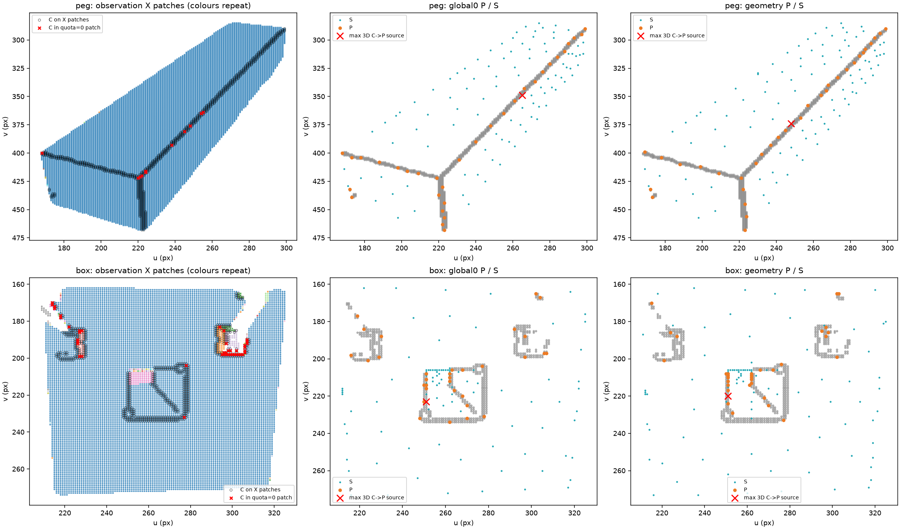
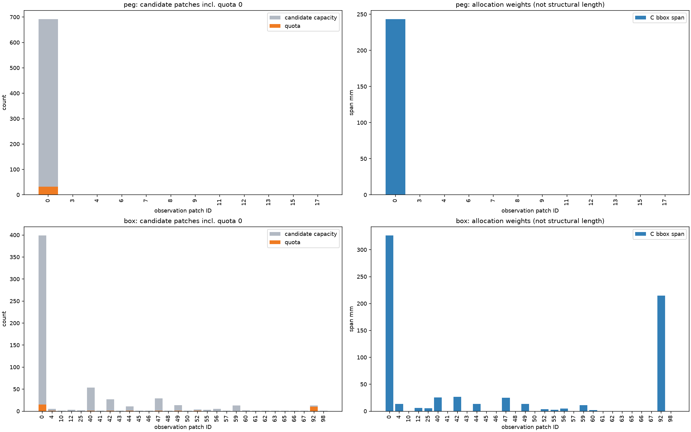
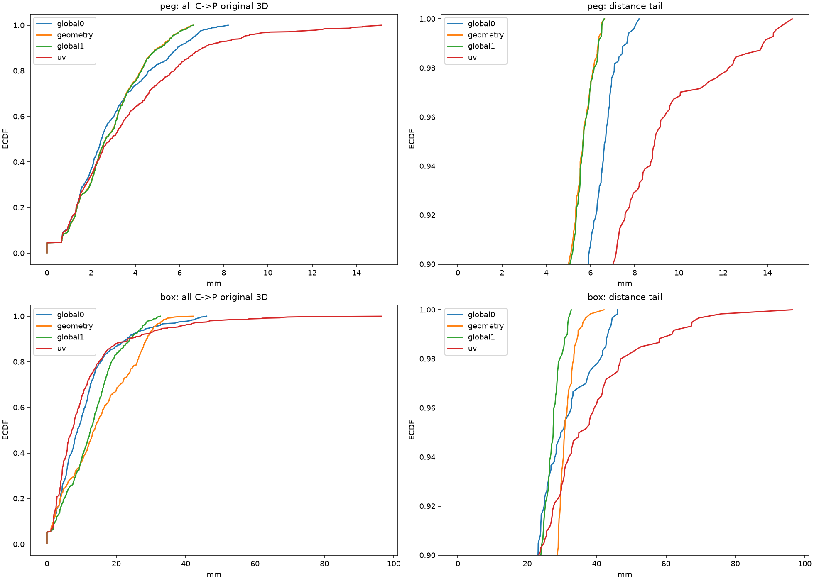
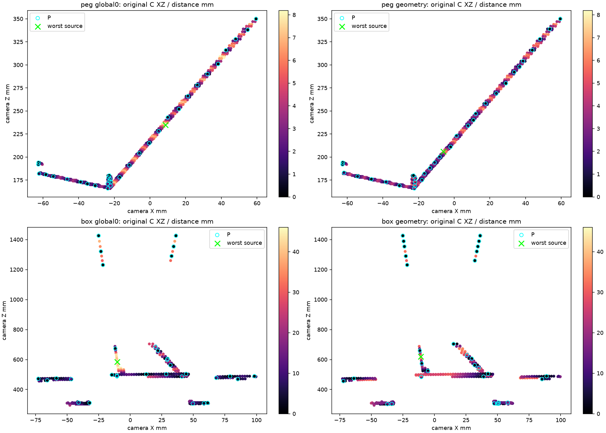
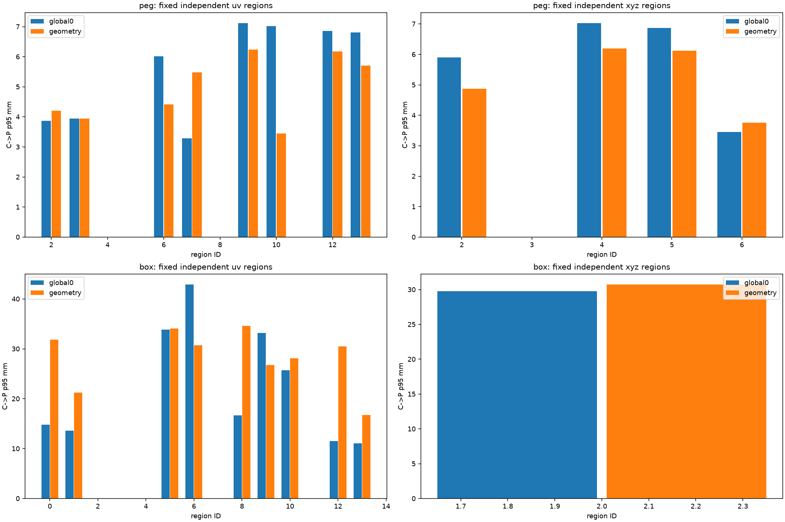
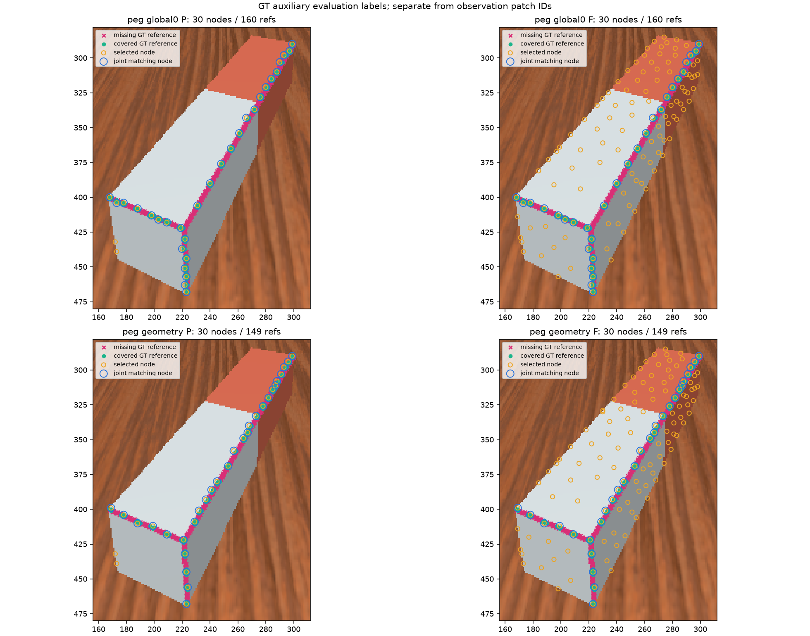
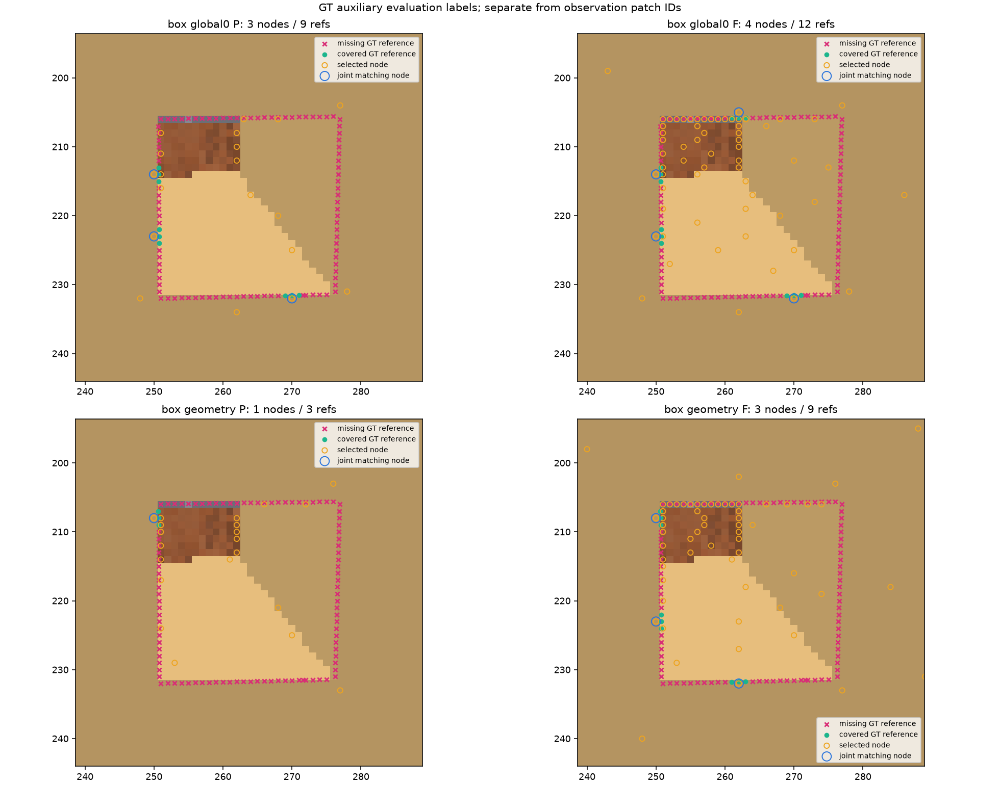
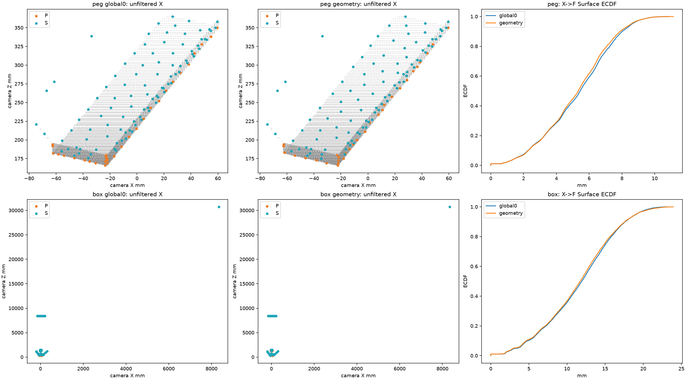

# Task03-G — Geometry-Aware Structural Sampling, Phase 1 Feasibility

Frame0 결과: Peg C→P p95는 6.662→5.664mm로 개선됐고 Box는 29.779→30.710mm로 악화됐다. X→F Surface mean/p95는 두 물체에서 소폭 개선됐지만 Final GT reference는 Peg 160→149, Box 12→9로 줄었다. Fallback은 양쪽 0점이며, 관측 patch의 유용성은 제한적이다. 일반화 성공이나 정책 채택을 주장하지 않는다.

수치 선택 UUID는 2c3d733de35c4532b2b81a0a751b7ebf다. 해당 실행은 수치·문서 생성 후 최종 artifact 등록에서 종료 후 전용 API를 실행 중 호출해 failed로 남았다. 이번 보고 UUID는 저장 수치 NPZ와 pre-GT 선택을 byte-identical 복사한 문서 후처리이며 새 FPS/평가 실행은 0회다. 실패 실행과 모든 원본 산출물은 보존했다.

## 결과 범위와 재현 정보

새 ExperimentLogger UUID: 495a67210c5c4cbfab91d013239f7ce9. ep000 Frame 0 / base_camera / S3(PCA5), N=256, structural_ratio=.25, threshold=20°, seed=0. Peg P/F=32/129, Box P/F=32/127. CPU NumPy/SciPy offline 실행만 수행했다. 일반화 알고리즘 채택 근거가 아닌 관측 patch 단위의 첫 feasibility 실험이다.

주 비교는 Task03-E 7f657cf88baf4f1f89e594252e243e1c 저장 Global λ=0이다. Task03 2551448b0fae4c6bbce3caf48774275f Global λ=1과 Task03-F 1f7ad262dd2e4b2fb0ac805a4eda5278 UV는 참고 비교다. F 최종 UUID는 기존 수치 실행의 문서 후처리이며 독립 반복 실험으로 세지 않는다.

선택 규칙은 same-object X의 right/down pair를 기존 4-neighbour 무방향 연결로 복원하고, 양 끝 support·overlap 없음·depth_jump=False·finite angle≤20°로 고정했다. C의 각 source는 정확히 하나의 X patch에 귀속한다. C-free patch도 X와 Surface에서 보존한다. Weight는 C bbox의 3D 대각선이다. 전체 C의 seeded anchor 1점을 보존한 뒤 남은 31점을 capacity-capped largest remainder로 배분하고, patch 내부 원본 3D FPS와 전체 X의 Surface FPS를 사용한다.

## Evidence compatibility 관문

Task01 dense XYZ·validity·mask·overlap·camera·intrinsic·cam2world와 E의 C/X, Task02-C pair source/index/support를 대조했다. Right pair는 같은 행의 +1, down은 +width이며 각 pair는 한 번만 저장된다. Depth jump는 두 depth가 유효할 때 |z₂−z₁| > .01 + .02×min(z₁,z₂)이다. Equality는 jump가 아니다. Normal orientation 후보는 >20°, patch 연결은 finite ≤20°다. NaN angle은 연결하지 않는다. Normal-invalid X는 삭제하지 않는다.

| object | pairs | right | down | candidate/support/threshold | optimized pair identity |
| --- | --- | --- | --- | --- | --- |
| peg | 23876 | 11964 | 11912 | PASS | N/A |
| box | 23645 | 11835 | 11810 | PASS | N/A |

Reference PCA5 pair angle은 저장 Task02-B normal에서 직접 재계산해 exact equality를 확인했다. 저장 orientation endpoint 및 normal variation의 >20° membership은 Task03 optimized PCA5의 저장 C와 일치했고, 저장 선택 행의 validity/candidate membership도 일치했다. 하지만 optimized PCA5 전체 pair angle은 저장되지 않았다. Candidate endpoint 집합의 일치가 low-angle pair별 연결 gate의 일치를 보장하지 않는다. 따라서 이번 patch는 Task02-C reference PCA5 evidence에서 구성했고 optimized PCA5와 bit-exact라고 주장하지 않는다. Normal estimator/candidate detector는 재실행하지 않았다.

## 선택 전 patch 분절과 allocation

아래 patch ID는 GT-free 관측상 매끄럽게 연결된 표면 성분이다. Structural edge, physical component, 평가용 seam/rim label 또는 최종 graph edge를 뜻하지 않는다. Weight=0인 후보 patch에는 anchor 외 minimum quota가 없다. 실패를 보정하기 위한 병합·gate 변경·후보 삭제는 하지 않았다.

| object | X patches | C patches | X singleton | 0-span C patches | 0-span candidates / C | quota=0 C patches | quota=0 candidates | anchor patch/quota | fallback |
| --- | --- | --- | --- | --- | --- | --- | --- | --- | --- |
| peg | 20 | 12 | 19 | 11 | 11 / 703 (1.565%) | 11 | 11 | 0 / 32 | 0 |
| box | 105 | 30 | 87 | 15 | 15 / 599 (2.504%) | 21 | 43 | 52 / 1 | 0 |

peg: singleton 또는 candidate 0-span patch 19개, 그 안의 후보 11개 (1.565%). Candidate가 1개인 patch 11개, X singleton에 속한 후보 11개. 실제 fallback=0점.

box: singleton 또는 candidate 0-span patch 88개, 그 안의 후보 15개 (2.504%). Candidate가 1개인 patch 15개, X singleton에 속한 후보 14개. 실제 fallback=0점.

peg 전체 X patch (C=0 포함): span은 bbox proxy이며 구조 길이가 아니다. Capacity는 전체 C 수, additional은 anchor 제외 배분이다.

| patch | min source | X | C/capacity | X span m | C span/weight m | anchor | additional | quota | actual P | fallback P |
| --- | --- | --- | --- | --- | --- | --- | --- | --- | --- | --- |
| 0 | 146191 | 11761 | 692 | 0.259619 | 0.243348 | 1 | 31 | 32 | 32 | 0 |
| 1 | 168678 | 1 | 0 | 0 | 0 | 0 | 0 | 0 | 0 | 0 |
| 2 | 186567 | 1 | 0 | 0 | 0 | 0 | 0 | 0 | 0 | 0 |
| 3 | 186623 | 1 | 1 | 0 | 0 | 0 | 0 | 0 | 0 | 0 |
| 4 | 187134 | 1 | 1 | 0 | 0 | 0 | 0 | 0 | 0 | 0 |
| 5 | 191167 | 1 | 0 | 0 | 0 | 0 | 0 | 0 | 0 | 0 |
| 6 | 192760 | 1 | 1 | 0 | 0 | 0 | 0 | 0 | 0 | 0 |
| 7 | 195317 | 1 | 1 | 0 | 0 | 0 | 0 | 0 | 0 | 0 |
| 8 | 201454 | 1 | 1 | 0 | 0 | 0 | 0 | 0 | 0 | 0 |
| 9 | 204968 | 1 | 1 | 0 | 0 | 0 | 0 | 0 | 0 | 0 |
| 10 | 212137 | 1 | 0 | 0 | 0 | 0 | 0 | 0 | 0 | 0 |
| 11 | 213216 | 1 | 1 | 0 | 0 | 0 | 0 | 0 | 0 | 0 |
| 12 | 213728 | 1 | 1 | 0 | 0 | 0 | 0 | 0 | 0 | 0 |
| 13 | 215262 | 1 | 1 | 0 | 0 | 0 | 0 | 0 | 0 | 0 |
| 14 | 215722 | 1 | 0 | 0 | 0 | 0 | 0 | 0 | 0 | 0 |
| 15 | 215773 | 1 | 1 | 0 | 0 | 0 | 0 | 0 | 0 | 0 |
| 16 | 216234 | 1 | 0 | 0 | 0 | 0 | 0 | 0 | 0 | 0 |
| 17 | 216284 | 1 | 1 | 0 | 0 | 0 | 0 | 0 | 0 | 0 |
| 18 | 219307 | 1 | 0 | 0 | 0 | 0 | 0 | 0 | 0 | 0 |
| 19 | 219819 | 1 | 0 | 0 | 0 | 0 | 0 | 0 | 0 | 0 |

box 전체 X patch (C=0 포함): span은 bbox proxy이며 구조 길이가 아니다. Capacity는 전체 C 수, additional은 anchor 제외 배분이다.

| patch | min source | X | C/capacity | X span m | C span/weight m | anchor | additional | quota | actual P | fallback P |
| --- | --- | --- | --- | --- | --- | --- | --- | --- | --- | --- |
| 0 | 83165 | 11112 | 399 | 0.389164 | 0.326477 | 0 | 15 | 15 | 15 | 0 |
| 1 | 84271 | 1 | 0 | 0 | 0 | 0 | 0 | 0 | 0 | 0 |
| 2 | 84285 | 1 | 0 | 0 | 0 | 0 | 0 | 0 | 0 | 0 |
| 3 | 84698 | 1 | 0 | 0 | 0 | 0 | 0 | 0 | 0 | 0 |
| 4 | 84783 | 7 | 5 | 0.0135329 | 0.0135329 | 0 | 1 | 1 | 1 | 0 |
| 5 | 84796 | 10 | 0 | 0.00471966 | 0 | 0 | 0 | 0 | 0 | 0 |
| 6 | 85210 | 1 | 0 | 0 | 0 | 0 | 0 | 0 | 0 | 0 |
| 7 | 85722 | 1 | 0 | 0 | 0 | 0 | 0 | 0 | 0 | 0 |
| 8 | 86234 | 1 | 0 | 0 | 0 | 0 | 0 | 0 | 0 | 0 |
| 9 | 86746 | 1 | 0 | 0 | 0 | 0 | 0 | 0 | 0 | 0 |
| 10 | 87254 | 1 | 1 | 0 | 0 | 0 | 0 | 0 | 0 | 0 |
| 11 | 87356 | 1 | 0 | 0 | 0 | 0 | 0 | 0 | 0 | 0 |
| 12 | 87765 | 7 | 3 | 0.0170659 | 0.00605605 | 0 | 0 | 0 | 0 | 0 |
| 13 | 87858 | 1 | 0 | 0 | 0 | 0 | 0 | 0 | 0 | 0 |
| 14 | 88273 | 14 | 0 | 0.0071225 | 0 | 0 | 0 | 0 | 0 | 0 |
| 15 | 88369 | 1 | 0 | 0 | 0 | 0 | 0 | 0 | 0 | 0 |
| 16 | 88379 | 1 | 0 | 0 | 0 | 0 | 0 | 0 | 0 | 0 |
| 17 | 88881 | 1 | 0 | 0 | 0 | 0 | 0 | 0 | 0 | 0 |
| 18 | 89304 | 1 | 0 | 0 | 0 | 0 | 0 | 0 | 0 | 0 |
| 19 | 89392 | 1 | 0 | 0 | 0 | 0 | 0 | 0 | 0 | 0 |
| 20 | 89393 | 1 | 0 | 0 | 0 | 0 | 0 | 0 | 0 | 0 |
| 21 | 89817 | 1 | 0 | 0 | 0 | 0 | 0 | 0 | 0 | 0 |
| 22 | 89904 | 1 | 0 | 0 | 0 | 0 | 0 | 0 | 0 | 0 |
| 23 | 89913 | 1 | 0 | 0 | 0 | 0 | 0 | 0 | 0 | 0 |
| 24 | 90329 | 1 | 0 | 0 | 0 | 0 | 0 | 0 | 0 | 0 |
| 25 | 90841 | 3 | 2 | 0.00848839 | 0.00574664 | 0 | 0 | 0 | 0 | 0 |
| 26 | 90936 | 1 | 0 | 0 | 0 | 0 | 0 | 0 | 0 | 0 |
| 27 | 91438 | 1 | 0 | 0 | 0 | 0 | 0 | 0 | 0 | 0 |
| 28 | 91866 | 1 | 0 | 0 | 0 | 0 | 0 | 0 | 0 | 0 |
| 29 | 91867 | 1 | 0 | 0 | 0 | 0 | 0 | 0 | 0 | 0 |
| 30 | 91949 | 1 | 0 | 0 | 0 | 0 | 0 | 0 | 0 | 0 |
| 31 | 92372 | 1 | 0 | 0 | 0 | 0 | 0 | 0 | 0 | 0 |
| 32 | 92380 | 1 | 0 | 0 | 0 | 0 | 0 | 0 | 0 | 0 |
| 33 | 92485 | 1 | 0 | 0 | 0 | 0 | 0 | 0 | 0 | 0 |
| 34 | 92884 | 1 | 0 | 0 | 0 | 0 | 0 | 0 | 0 | 0 |
| 35 | 92885 | 1 | 0 | 0 | 0 | 0 | 0 | 0 | 0 | 0 |
| 36 | 92892 | 1 | 0 | 0 | 0 | 0 | 0 | 0 | 0 | 0 |
| 37 | 93397 | 1 | 0 | 0 | 0 | 0 | 0 | 0 | 0 | 0 |
| 38 | 93405 | 1 | 0 | 0 | 0 | 0 | 0 | 0 | 0 | 0 |
| 39 | 93493 | 1 | 0 | 0 | 0 | 0 | 0 | 0 | 0 | 0 |
| 40 | 93910 | 158 | 54 | 0.0271379 | 0.0255804 | 0 | 1 | 1 | 1 | 0 |
| 41 | 93917 | 2 | 1 | 0.0103938 | 0 | 0 | 0 | 0 | 0 | 0 |
| 42 | 93989 | 50 | 27 | 0.0268233 | 0.0268233 | 0 | 1 | 1 | 1 | 0 |
| 43 | 93990 | 1 | 1 | 0 | 0 | 0 | 0 | 0 | 0 | 0 |
| 44 | 93991 | 15 | 11 | 0.0136232 | 0.0136232 | 0 | 1 | 1 | 1 | 0 |
| 45 | 94947 | 1 | 1 | 0 | 0 | 0 | 0 | 0 | 0 | 0 |
| 46 | 94948 | 1 | 1 | 0 | 0 | 0 | 0 | 0 | 0 | 0 |
| 47 | 94949 | 40 | 29 | 0.0249794 | 0.0249794 | 0 | 1 | 1 | 1 | 0 |
| 48 | 95016 | 1 | 1 | 0 | 0 | 0 | 0 | 0 | 0 | 0 |
| 49 | 95022 | 49 | 14 | 0.0142764 | 0.0136464 | 0 | 1 | 1 | 1 | 0 |
| 50 | 95459 | 1 | 1 | 0 | 0 | 0 | 0 | 0 | 0 | 0 |
| 51 | 96051 | 1 | 0 | 0 | 0 | 0 | 0 | 0 | 0 | 0 |
| 52 | 96553 | 4 | 4 | 0.0034845 | 0.0034845 | 1 | 0 | 1 | 1 | 0 |
| 53 | 96563 | 1 | 0 | 0 | 0 | 0 | 0 | 0 | 0 | 0 |
| 54 | 97075 | 1 | 0 | 0 | 0 | 0 | 0 | 0 | 0 | 0 |
| 55 | 97506 | 3 | 3 | 0.00235313 | 0.00235313 | 0 | 0 | 0 | 0 | 0 |
| 56 | 97587 | 6 | 5 | 0.00487074 | 0.00481773 | 0 | 0 | 0 | 0 | 0 |
| 57 | 98601 | 1 | 1 | 0 | 0 | 0 | 0 | 0 | 0 | 0 |
| 58 | 100146 | 1 | 0 | 0 | 0 | 0 | 0 | 0 | 0 | 0 |
| 59 | 100650 | 19 | 13 | 0.0111558 | 0.0111558 | 0 | 0 | 0 | 0 | 0 |
| 60 | 100658 | 2 | 2 | 0.00217214 | 0.00217214 | 0 | 0 | 0 | 0 | 0 |
| 61 | 101160 | 1 | 1 | 0 | 0 | 0 | 0 | 0 | 0 | 0 |
| 62 | 101671 | 1 | 1 | 0 | 0 | 0 | 0 | 0 | 0 | 0 |
| 63 | 101672 | 1 | 1 | 0 | 0 | 0 | 0 | 0 | 0 | 0 |
| 64 | 101682 | 1 | 0 | 0 | 0 | 0 | 0 | 0 | 0 | 0 |
| 65 | 102115 | 1 | 1 | 0 | 0 | 0 | 0 | 0 | 0 | 0 |
| 66 | 102116 | 1 | 1 | 0 | 0 | 0 | 0 | 0 | 0 | 0 |
| 67 | 104726 | 1 | 1 | 0 | 0 | 0 | 0 | 0 | 0 | 0 |
| 68 | 105723 | 1 | 0 | 0 | 0 | 0 | 0 | 0 | 0 | 0 |
| 69 | 105724 | 1 | 0 | 0 | 0 | 0 | 0 | 0 | 0 | 0 |
| 70 | 105725 | 1 | 0 | 0 | 0 | 0 | 0 | 0 | 0 | 0 |
| 71 | 105726 | 1 | 0 | 0 | 0 | 0 | 0 | 0 | 0 | 0 |
| 72 | 105727 | 1 | 0 | 0 | 0 | 0 | 0 | 0 | 0 | 0 |
| 73 | 105728 | 1 | 0 | 0 | 0 | 0 | 0 | 0 | 0 | 0 |
| 74 | 105729 | 1 | 0 | 0 | 0 | 0 | 0 | 0 | 0 | 0 |
| 75 | 105730 | 1 | 0 | 0 | 0 | 0 | 0 | 0 | 0 | 0 |
| 76 | 105731 | 1 | 0 | 0 | 0 | 0 | 0 | 0 | 0 | 0 |
| 77 | 105732 | 1 | 0 | 0 | 0 | 0 | 0 | 0 | 0 | 0 |
| 78 | 105733 | 1 | 0 | 0 | 0 | 0 | 0 | 0 | 0 | 0 |
| 79 | 105734 | 1 | 0 | 0 | 0 | 0 | 0 | 0 | 0 | 0 |
| 80 | 106235 | 1 | 0 | 0 | 0 | 0 | 0 | 0 | 0 | 0 |
| 81 | 106236 | 1 | 0 | 0 | 0 | 0 | 0 | 0 | 0 | 0 |
| 82 | 106237 | 1 | 0 | 0 | 0 | 0 | 0 | 0 | 0 | 0 |
| 83 | 106238 | 1 | 0 | 0 | 0 | 0 | 0 | 0 | 0 | 0 |
| 84 | 106239 | 1 | 0 | 0 | 0 | 0 | 0 | 0 | 0 | 0 |
| 85 | 106240 | 1 | 0 | 0 | 0 | 0 | 0 | 0 | 0 | 0 |
| 86 | 106241 | 1 | 0 | 0 | 0 | 0 | 0 | 0 | 0 | 0 |
| 87 | 106242 | 1 | 0 | 0 | 0 | 0 | 0 | 0 | 0 | 0 |
| 88 | 106243 | 1 | 0 | 0 | 0 | 0 | 0 | 0 | 0 | 0 |
| 89 | 106244 | 1 | 0 | 0 | 0 | 0 | 0 | 0 | 0 | 0 |
| 90 | 106245 | 1 | 0 | 0 | 0 | 0 | 0 | 0 | 0 | 0 |
| 91 | 106246 | 1 | 0 | 0 | 0 | 0 | 0 | 0 | 0 | 0 |
| 92 | 106747 | 77 | 13 | 0.214497 | 0.214497 | 0 | 10 | 10 | 10 | 0 |
| 93 | 110914 | 1 | 0 | 0 | 0 | 0 | 0 | 0 | 0 | 0 |
| 94 | 111316 | 1 | 0 | 0 | 0 | 0 | 0 | 0 | 0 | 0 |
| 95 | 111828 | 1 | 0 | 0 | 0 | 0 | 0 | 0 | 0 | 0 |
| 96 | 112340 | 1 | 0 | 0 | 0 | 0 | 0 | 0 | 0 | 0 |
| 97 | 117057 | 1 | 0 | 0 | 0 | 0 | 0 | 0 | 0 | 0 |
| 98 | 119061 | 1 | 1 | 0 | 0 | 0 | 0 | 0 | 0 | 0 |
| 99 | 120533 | 1 | 0 | 0 | 0 | 0 | 0 | 0 | 0 | 0 |
| 100 | 121045 | 1 | 0 | 0 | 0 | 0 | 0 | 0 | 0 | 0 |
| 101 | 129855 | 1 | 0 | 0 | 0 | 0 | 0 | 0 | 0 | 0 |
| 102 | 130262 | 1 | 0 | 0 | 0 | 0 | 0 | 0 | 0 | 0 |
| 103 | 135998 | 1 | 0 | 0 | 0 | 0 | 0 | 0 | 0 | 0 |
| 104 | 136510 | 1 | 0 | 0 | 0 | 0 | 0 | 0 | 0 | 0 |

## Primary — 원본 3D candidate·surface 보존

모든 거리는 변환하지 않은 CV-camera XYZ의 Euclidean 최근접 거리(mm)다. P의 patch 내부 선택 metric과 독립적으로 평가했다. Grouping·span allocation·patch별 초기화·patch 내부 3D와 Global λ=0 metric 차이가 묶여 있다. 아래 차이는 선택 규칙 전체의 차이이며 개별 요소의 인과 효과가 아니다.

| object | method | C→P mean | p50 | p95 | max | X→F mean | p95 | max |
| --- | --- | --- | --- | --- | --- | --- | --- | --- |
| peg | global0 | 2.94515 | 2.46875 | 6.66215 | 8.19795 | 5.28368 | 8.60946 | 10.8408 |
| peg | geometry | 2.83494 | 2.66592 | 5.66392 | 6.63788 | 5.1986 | 8.56355 | 11.1341 |
| peg | global1 | 2.84805 | 2.66592 | 5.66544 | 6.61867 | 5.17004 | 8.54994 | 11.0471 |
| peg | uv | 3.62105 | 2.89099 | 8.90441 | 15.1258 | 5.27668 | 8.62629 | 11.5683 |
| box | global0 | 10.8746 | 8.84305 | 29.7788 | 46.0516 | 11.5801 | 19.0768 | 23.1584 |
| box | geometry | 14.7286 | 13.6098 | 30.7101 | 42.1494 | 11.4499 | 19.0144 | 23.9357 |
| box | global1 | 12.7793 | 12.5895 | 27.4828 | 32.7114 | 11.2533 | 18.7511 | 22.8926 |
| box | uv | 10.768 | 7.19952 | 35.0932 | 96.3886 | 11.6761 | 19.5611 | 23.9004 |

| object | Δ mean | Δ p50 | Δ p95 | Δ max | Δ Surface mean | Δ Surface p95 |
| --- | --- | --- | --- | --- | --- | --- |
| peg | -0.110212 | 0.197166 | -0.998228 | -1.56007 | -0.0850846 | -0.0459049 |
| box | 3.85401 | 4.76673 | 0.931283 | -3.90217 | -0.130226 | -0.0623638 |

| object | method | worst source | UV | XYZ m |
| --- | --- | --- | --- | --- |
| peg | global0 | 178953 | [265, 349] | [0.008720703423023224, 0.08583007752895355, 0.23499999940395355] |
| peg | geometry | 191736 | [248, 374] | [-0.006035156082361937, 0.09535546600818634, 0.20600000023841858] |
| box | global0 | 114427 | [251, 223] | [-0.010265625081956387, -0.07414062321186066, 0.5839999914169312] |
| box | geometry | 112891 | [251, 220] | [-0.010880859568715096, -0.08583789318799973, 0.6190000176429749] |

## 독립 평가 구역과 후보 밀도

Task03-F의 X bbox 기반 UV 4×4 및 XYZ 최대 2×2×2 경계와 helper를 그대로 사용했다. Candidate count, 선택률과 거리 분포를 함께 본다. Box X의 30.726m depth outlier 때문에 XYZ grid의 후보가 한 구역에 들어가는 한계를 보정하지 않았다. 전체 분위수는 후보 밀도의 영향을 받으며 구역 동등 가중 p95도 함께 기록한다. XYZ 공간 밀도의 공통 helper 값은 N/A이며 UV 밀도는 px²당 후보 수다.

| object | method | grid | C occupied | P=0 regions | equal-region mean p95 mm |
| --- | --- | --- | --- | --- | --- |
| peg | global0 | uv | 8 | [] | 5.61617 |
| peg | global0 | xyz | 4 | [6] | 5.81242 |
| peg | geometry | uv | 8 | [] | 4.95252 |
| peg | geometry | xyz | 4 | [6] | 5.23625 |
| box | global0 | uv | 9 | [] | 22.5887 |
| box | global0 | xyz | 1 | [] | 29.7788 |
| box | geometry | uv | 9 | [] | 28.2865 |
| box | geometry | xyz | 1 | [] | 30.7101 |

peg / uv independent regions:

| method | region | C | P | C density/px² | P/C | C→P mean mm | p95 | max |
| --- | --- | --- | --- | --- | --- | --- | --- | --- |
| global0 | 0 | 0 | 0 | 0 | N/A | N/A | N/A | N/A |
| global0 | 1 | 0 | 0 | 0 | N/A | N/A | N/A | N/A |
| global0 | 2 | 98 | 5 | 0.0654069 | 0.0510204 | 1.90722 | 3.87439 | 3.9925 |
| global0 | 3 | 11 | 2 | 0.00734159 | 0.181818 | 1.8892 | 3.94895 | 4.1479 |
| global0 | 4 | 0 | 0 | 0 | N/A | N/A | N/A | N/A |
| global0 | 5 | 0 | 0 | 0 | N/A | N/A | N/A | N/A |
| global0 | 6 | 125 | 4 | 0.0834272 | 0.032 | 2.75116 | 6.01855 | 7.0785 |
| global0 | 7 | 149 | 7 | 0.0994452 | 0.0469799 | 1.93745 | 3.28836 | 4.08921 |
| global0 | 8 | 0 | 0 | 0 | N/A | N/A | N/A | N/A |
| global0 | 9 | 94 | 4 | 0.0627372 | 0.0425532 | 3.88951 | 7.11593 | 8.19795 |
| global0 | 10 | 70 | 1 | 0.0467192 | 0.0142857 | 4.06496 | 7.02078 | 7.44417 |
| global0 | 11 | 0 | 0 | 0 | N/A | N/A | N/A | N/A |
| global0 | 12 | 115 | 8 | 0.076753 | 0.0695652 | 3.69792 | 6.86018 | 8.10343 |
| global0 | 13 | 41 | 1 | 0.0273641 | 0.0243902 | 3.7745 | 6.80221 | 7.74202 |
| global0 | 14 | 0 | 0 | 0 | N/A | N/A | N/A | N/A |
| global0 | 15 | 0 | 0 | 0 | N/A | N/A | N/A | N/A |
| geometry | 0 | 0 | 0 | 0 | N/A | N/A | N/A | N/A |
| geometry | 1 | 0 | 0 | 0 | N/A | N/A | N/A | N/A |
| geometry | 2 | 98 | 4 | 0.0654069 | 0.0408163 | 2.29913 | 4.20056 | 4.7016 |
| geometry | 3 | 11 | 2 | 0.00734159 | 0.181818 | 1.8892 | 3.94895 | 4.1479 |
| geometry | 4 | 0 | 0 | 0 | N/A | N/A | N/A | N/A |
| geometry | 5 | 0 | 0 | 0 | N/A | N/A | N/A | N/A |
| geometry | 6 | 125 | 4 | 0.0834272 | 0.032 | 2.49335 | 4.4182 | 5.21059 |
| geometry | 7 | 149 | 4 | 0.0994452 | 0.0268456 | 3.057 | 5.48384 | 6.09783 |
| geometry | 8 | 0 | 0 | 0 | N/A | N/A | N/A | N/A |
| geometry | 9 | 94 | 3 | 0.0627372 | 0.0319149 | 3.41058 | 6.24105 | 6.63788 |
| geometry | 10 | 70 | 3 | 0.0467192 | 0.0428571 | 2.13202 | 3.44828 | 3.8646 |
| geometry | 11 | 0 | 0 | 0 | N/A | N/A | N/A | N/A |
| geometry | 12 | 115 | 9 | 0.076753 | 0.0782609 | 3.39673 | 6.18012 | 6.51205 |
| geometry | 13 | 41 | 3 | 0.0273641 | 0.0731707 | 2.90839 | 5.69918 | 6.51487 |
| geometry | 14 | 0 | 0 | 0 | N/A | N/A | N/A | N/A |
| geometry | 15 | 0 | 0 | 0 | N/A | N/A | N/A | N/A |

peg / xyz independent regions:

| method | region | C | P | C density/px² | P/C | C→P mean mm | p95 | max |
| --- | --- | --- | --- | --- | --- | --- | --- | --- |
| global0 | 0 | 0 | 0 | N/A | N/A | N/A | N/A | N/A |
| global0 | 1 | 0 | 0 | N/A | N/A | N/A | N/A | N/A |
| global0 | 2 | 447 | 19 | N/A | 0.0425056 | 2.48632 | 5.90636 | 7.44417 |
| global0 | 3 | 0 | 0 | N/A | N/A | N/A | N/A | N/A |
| global0 | 4 | 141 | 5 | N/A | 0.035461 | 3.82657 | 7.02556 | 8.19795 |
| global0 | 5 | 109 | 8 | N/A | 0.0733945 | 3.72553 | 6.86357 | 8.10343 |
| global0 | 6 | 6 | 0 | N/A | 0 | 2.23751 | 3.45418 | 3.53184 |
| global0 | 7 | 0 | 0 | N/A | N/A | N/A | N/A | N/A |
| geometry | 0 | 0 | 0 | N/A | N/A | N/A | N/A | N/A |
| geometry | 1 | 0 | 0 | N/A | N/A | N/A | N/A | N/A |
| geometry | 2 | 447 | 17 | N/A | 0.0380313 | 2.56323 | 4.87173 | 6.09783 |
| geometry | 3 | 0 | 0 | N/A | N/A | N/A | N/A | N/A |
| geometry | 4 | 141 | 6 | N/A | 0.0425532 | 3.34643 | 6.18969 | 6.63788 |
| geometry | 5 | 109 | 9 | N/A | 0.0825688 | 3.29005 | 6.11959 | 6.51205 |
| geometry | 6 | 6 | 0 | N/A | 0 | 2.78927 | 3.76398 | 3.8646 |
| geometry | 7 | 0 | 0 | N/A | N/A | N/A | N/A | N/A |

box / uv independent regions:

| method | region | C | P | C density/px² | P/C | C→P mean mm | p95 | max |
| --- | --- | --- | --- | --- | --- | --- | --- | --- |
| global0 | 0 | 66 | 3 | 0.0812808 | 0.0454545 | 10.3462 | 14.7998 | 22.2359 |
| global0 | 1 | 78 | 3 | 0.0960591 | 0.0384615 | 7.90347 | 13.5986 | 14.6165 |
| global0 | 2 | 0 | 0 | 0 | N/A | N/A | N/A | N/A |
| global0 | 3 | 0 | 0 | 0 | N/A | N/A | N/A | N/A |
| global0 | 4 | 0 | 0 | 0 | N/A | N/A | N/A | N/A |
| global0 | 5 | 50 | 10 | 0.0615764 | 0.2 | 14.7896 | 33.8833 | 38.9934 |
| global0 | 6 | 100 | 3 | 0.123153 | 0.03 | 13.2174 | 42.8725 | 46.0516 |
| global0 | 7 | 0 | 0 | 0 | N/A | N/A | N/A | N/A |
| global0 | 8 | 22 | 1 | 0.0270936 | 0.0454545 | 9.07644 | 16.6948 | 17.3864 |
| global0 | 9 | 94 | 2 | 0.115764 | 0.0212766 | 14.4096 | 33.1814 | 44.4893 |
| global0 | 10 | 98 | 4 | 0.12069 | 0.0408163 | 11.1689 | 25.7114 | 30.9242 |
| global0 | 11 | 0 | 0 | 0 | N/A | N/A | N/A | N/A |
| global0 | 12 | 40 | 3 | 0.0492611 | 0.075 | 4.99843 | 11.5026 | 13.5933 |
| global0 | 13 | 51 | 3 | 0.0628079 | 0.0588235 | 5.97387 | 11.0541 | 13.0251 |
| global0 | 14 | 0 | 0 | 0 | N/A | N/A | N/A | N/A |
| global0 | 15 | 0 | 0 | 0 | N/A | N/A | N/A | N/A |
| geometry | 0 | 66 | 3 | 0.0812808 | 0.0454545 | 11.7534 | 31.8331 | 34.0837 |
| geometry | 1 | 78 | 1 | 0.0960591 | 0.0128205 | 11.488 | 21.2376 | 26.1019 |
| geometry | 2 | 0 | 0 | 0 | N/A | N/A | N/A | N/A |
| geometry | 3 | 0 | 0 | 0 | N/A | N/A | N/A | N/A |
| geometry | 4 | 0 | 0 | 0 | N/A | N/A | N/A | N/A |
| geometry | 5 | 50 | 14 | 0.0615764 | 0.28 | 14.5807 | 34.0494 | 36.8557 |
| geometry | 6 | 100 | 2 | 0.123153 | 0.02 | 24.6182 | 30.7025 | 42.1494 |
| geometry | 7 | 0 | 0 | 0 | N/A | N/A | N/A | N/A |
| geometry | 8 | 22 | 1 | 0.0270936 | 0.0454545 | 17.8174 | 34.6258 | 36.0874 |
| geometry | 9 | 94 | 2 | 0.115764 | 0.0212766 | 15.0542 | 26.7266 | 38.2396 |
| geometry | 10 | 98 | 3 | 0.12069 | 0.0306122 | 14.6248 | 28.1132 | 30.9242 |
| geometry | 11 | 0 | 0 | 0 | N/A | N/A | N/A | N/A |
| geometry | 12 | 40 | 5 | 0.0492611 | 0.125 | 5.41378 | 30.5286 | 31.4366 |
| geometry | 13 | 51 | 1 | 0.0628079 | 0.0196078 | 9.86141 | 16.7622 | 19.7643 |
| geometry | 14 | 0 | 0 | 0 | N/A | N/A | N/A | N/A |
| geometry | 15 | 0 | 0 | 0 | N/A | N/A | N/A | N/A |

box / xyz independent regions:

| method | region | C | P | C density/px² | P/C | C→P mean mm | p95 | max |
| --- | --- | --- | --- | --- | --- | --- | --- | --- |
| global0 | 0 | 0 | 0 | N/A | N/A | N/A | N/A | N/A |
| global0 | 1 | 0 | 0 | N/A | N/A | N/A | N/A | N/A |
| global0 | 2 | 599 | 32 | N/A | 0.0534224 | 10.8746 | 29.7788 | 46.0516 |
| global0 | 3 | 0 | 0 | N/A | N/A | N/A | N/A | N/A |
| global0 | 4 | 0 | 0 | N/A | N/A | N/A | N/A | N/A |
| global0 | 5 | 0 | 0 | N/A | N/A | N/A | N/A | N/A |
| global0 | 6 | 0 | 0 | N/A | N/A | N/A | N/A | N/A |
| global0 | 7 | 0 | 0 | N/A | N/A | N/A | N/A | N/A |
| geometry | 0 | 0 | 0 | N/A | N/A | N/A | N/A | N/A |
| geometry | 1 | 0 | 0 | N/A | N/A | N/A | N/A | N/A |
| geometry | 2 | 599 | 32 | N/A | 0.0534224 | 14.7286 | 30.7101 | 42.1494 |
| geometry | 3 | 0 | 0 | N/A | N/A | N/A | N/A | N/A |
| geometry | 4 | 0 | 0 | N/A | N/A | N/A | N/A | N/A |
| geometry | 5 | 0 | 0 | N/A | N/A | N/A | N/A | N/A |
| geometry | 6 | 0 | 0 | N/A | N/A | N/A | N/A | N/A |
| geometry | 7 | 0 | 0 | N/A | N/A | N/A | N/A | N/A |

## Secondary — GT 기반 보조 진단

선택 및 selection_before_gt.npz 저장·hash 후 GT reference/pose/ROI를 평가에만 적용했다. 동일 point/reference pair가 2px AND 3mm를 만족해야 한다. Peg GT-visible 464개 중 관측 가능 462개, Box 103개 중 103개가 분모다. Matching node 수와 unique reference 수는 서로 다른 수량이다. 특정 Box rim 선분 개선은 성공 조건이 아니다.

| object | method | stage | nodes | matching nodes | unique refs |
| --- | --- | --- | --- | --- | --- |
| peg | global0 | C | 703 | 692 | 462 |
| peg | global0 | P | 32 | 30 | 160 |
| peg | global0 | S | 97 | 0 | 0 |
| peg | global0 | F | 129 | 30 | 160 |
| peg | geometry | C | 703 | 692 | 462 |
| peg | geometry | P | 32 | 30 | 149 |
| peg | geometry | S | 97 | 0 | 0 |
| peg | geometry | F | 129 | 30 | 149 |
| peg | global1 | C | 703 | 692 | 462 |
| peg | global1 | P | 32 | 30 | 151 |
| peg | global1 | S | 97 | 0 | 0 |
| peg | global1 | F | 129 | 30 | 151 |
| peg | uv | C | 703 | 692 | 462 |
| peg | uv | P | 32 | 31 | 140 |
| peg | uv | S | 97 | 0 | 0 |
| peg | uv | F | 129 | 31 | 140 |
| box | global0 | C | 599 | 127 | 91 |
| box | global0 | P | 32 | 3 | 9 |
| box | global0 | S | 95 | 1 | 3 |
| box | global0 | F | 127 | 4 | 12 |
| box | geometry | C | 599 | 127 | 91 |
| box | geometry | P | 32 | 1 | 3 |
| box | geometry | S | 95 | 2 | 6 |
| box | geometry | F | 127 | 3 | 9 |
| box | global1 | C | 599 | 127 | 91 |
| box | global1 | P | 32 | 1 | 3 |
| box | global1 | S | 95 | 0 | 0 |
| box | global1 | F | 127 | 1 | 3 |
| box | uv | C | 599 | 127 | 91 |
| box | uv | P | 32 | 1 | 3 |
| box | uv | S | 95 | 0 | 0 |
| box | uv | F | 127 | 1 | 3 |

| object | method | P refs | S refs | F refs | S added refs | P/S overlap refs |
| --- | --- | --- | --- | --- | --- | --- |
| peg | global0 | 160 | 0 | 160 | 0 | 0 |
| peg | geometry | 149 | 0 | 149 | 0 | 0 |
| box | global0 | 9 | 3 | 12 | 3 | 0 |
| box | geometry | 3 | 6 | 9 | 6 | 0 |

| object | method | stage | GT face-pair/rim segment | observed refs | covered refs | matching nodes |
| --- | --- | --- | --- | --- | --- | --- |
| peg | global0 | C | ambiguous | 2 | 2 | 17 |
| peg | global0 | C | face_0_2 | 91 | 91 | 140 |
| peg | global0 | C | face_0_5 | 106 | 106 | 154 |
| peg | global0 | C | face_2_5 | 263 | 263 | 381 |
| peg | global0 | P | ambiguous | 2 | 1 | 1 |
| peg | global0 | P | face_0_2 | 91 | 44 | 7 |
| peg | global0 | P | face_0_5 | 106 | 49 | 7 |
| peg | global0 | P | face_2_5 | 263 | 66 | 15 |
| peg | global0 | S | ambiguous | 2 | 0 | 0 |
| peg | global0 | S | face_0_2 | 91 | 0 | 0 |
| peg | global0 | S | face_0_5 | 106 | 0 | 0 |
| peg | global0 | S | face_2_5 | 263 | 0 | 0 |
| peg | global0 | F | ambiguous | 2 | 1 | 1 |
| peg | global0 | F | face_0_2 | 91 | 44 | 7 |
| peg | global0 | F | face_0_5 | 106 | 49 | 7 |
| peg | global0 | F | face_2_5 | 263 | 66 | 15 |
| peg | geometry | C | ambiguous | 2 | 2 | 17 |
| peg | geometry | C | face_0_2 | 91 | 91 | 140 |
| peg | geometry | C | face_0_5 | 106 | 106 | 154 |
| peg | geometry | C | face_2_5 | 263 | 263 | 381 |
| peg | geometry | P | ambiguous | 2 | 2 | 1 |
| peg | geometry | P | face_0_2 | 91 | 29 | 4 |
| peg | geometry | P | face_0_5 | 106 | 30 | 5 |
| peg | geometry | P | face_2_5 | 263 | 88 | 20 |
| peg | geometry | S | ambiguous | 2 | 0 | 0 |
| peg | geometry | S | face_0_2 | 91 | 0 | 0 |
| peg | geometry | S | face_0_5 | 106 | 0 | 0 |
| peg | geometry | S | face_2_5 | 263 | 0 | 0 |
| peg | geometry | F | ambiguous | 2 | 2 | 1 |
| peg | geometry | F | face_0_2 | 91 | 29 | 4 |
| peg | geometry | F | face_0_5 | 106 | 30 | 5 |
| peg | geometry | F | face_2_5 | 263 | 88 | 20 |
| box | global0 | C | rim_axis1_+1 | 25 | 24 | 21 |
| box | global0 | C | rim_axis1_-1 | 26 | 26 | 43 |
| box | global0 | C | rim_axis2_+1 | 26 | 15 | 12 |
| box | global0 | C | rim_axis2_-1 | 26 | 26 | 46 |
| box | global0 | P | rim_axis1_+1 | 25 | 6 | 2 |
| box | global0 | P | rim_axis1_-1 | 26 | 0 | 0 |
| box | global0 | P | rim_axis2_+1 | 26 | 0 | 0 |
| box | global0 | P | rim_axis2_-1 | 26 | 3 | 1 |
| box | global0 | S | rim_axis1_+1 | 25 | 0 | 0 |
| box | global0 | S | rim_axis1_-1 | 26 | 0 | 0 |
| box | global0 | S | rim_axis2_+1 | 26 | 3 | 1 |
| box | global0 | S | rim_axis2_-1 | 26 | 0 | 0 |
| box | global0 | F | rim_axis1_+1 | 25 | 6 | 2 |
| box | global0 | F | rim_axis1_-1 | 26 | 0 | 0 |
| box | global0 | F | rim_axis2_+1 | 26 | 3 | 1 |
| box | global0 | F | rim_axis2_-1 | 26 | 3 | 1 |
| box | geometry | C | rim_axis1_+1 | 25 | 24 | 21 |
| box | geometry | C | rim_axis1_-1 | 26 | 26 | 43 |
| box | geometry | C | rim_axis2_+1 | 26 | 15 | 12 |
| box | geometry | C | rim_axis2_-1 | 26 | 26 | 46 |
| box | geometry | P | rim_axis1_+1 | 25 | 3 | 1 |
| box | geometry | P | rim_axis1_-1 | 26 | 0 | 0 |
| box | geometry | P | rim_axis2_+1 | 26 | 0 | 0 |
| box | geometry | P | rim_axis2_-1 | 26 | 0 | 0 |
| box | geometry | S | rim_axis1_+1 | 25 | 3 | 1 |
| box | geometry | S | rim_axis1_-1 | 26 | 0 | 0 |
| box | geometry | S | rim_axis2_+1 | 26 | 0 | 0 |
| box | geometry | S | rim_axis2_-1 | 26 | 3 | 1 |
| box | geometry | F | rim_axis1_+1 | 25 | 6 | 2 |
| box | geometry | F | rim_axis1_-1 | 26 | 0 | 0 |
| box | geometry | F | rim_axis2_+1 | 26 | 0 | 0 |
| box | geometry | F | rim_axis2_-1 | 26 | 3 | 1 |

Box의 verified line projection 간격과 missing-reference run은 JSON/NPZ에 기존 helper 정의로 저장했다. Peg face-pair 및 ambiguous reference의 물리적 선분 순서는 N/A다. Array 순서를 곡선 길이나 실제 연속 미보존 길이로 해석하지 않는다.

## 일반 Surface·negative ROI·depth·outlier trade-off

일반 Surface는 전체 X→F로 평가한다. S만 따로 평가하거나 far point를 제거하지 않았다. Known-negative ROI union은 평가용이며 평면 Surface 점유를 자동 오선택이라고 분류하지 않는다. 원본 outlier·depth tail은 그대로 남긴다.

| object | method | negative P / 32 | negative S | negative F | F exact feature rows | unavailable rows |
| --- | --- | --- | --- | --- | --- | --- |
| peg | global0 | 2 | 90 | 92 | 26 | 103 |
| peg | geometry | 2 | 91 | 93 | 97 | 32 |
| box | global0 | 14 | 61 | 75 | 45 | 82 |
| box | geometry | 12 | 68 | 80 | 49 | 78 |

| object | method | stage | depth min m | median | p95 | max |
| --- | --- | --- | --- | --- | --- | --- |
| peg | global0 | X | 0.166 | 0.206 | 0.32705 | 0.365 |
| peg | global0 | C | 0.166 | 0.181 | 0.316 | 0.35 |
| peg | global0 | P | 0.166 | 0.1865 | 0.3325 | 0.35 |
| peg | global0 | S | 0.176 | 0.266 | 0.3506 | 0.365 |
| peg | global0 | F | 0.166 | 0.255 | 0.3492 | 0.365 |
| peg | geometry | X | 0.166 | 0.206 | 0.32705 | 0.365 |
| peg | geometry | C | 0.166 | 0.181 | 0.316 | 0.35 |
| peg | geometry | P | 0.166 | 0.197 | 0.33295 | 0.35 |
| peg | geometry | S | 0.175 | 0.266 | 0.3506 | 0.365 |
| peg | geometry | F | 0.166 | 0.252 | 0.3492 | 0.365 |
| box | global0 | X | 0.295 | 0.496 | 0.535 | 30.726 |
| box | global0 | C | 0.295 | 0.488 | 0.6665 | 1.426 |
| box | global0 | P | 0.306 | 0.4955 | 1.3864 | 1.426 |
| box | global0 | S | 0.453 | 0.536 | 8.431 | 30.726 |
| box | global0 | F | 0.306 | 0.531 | 8.431 | 30.726 |
| box | geometry | X | 0.295 | 0.496 | 0.535 | 30.726 |
| box | geometry | C | 0.295 | 0.488 | 0.6665 | 1.426 |
| box | geometry | P | 0.303 | 0.5525 | 1.40565 | 1.426 |
| box | geometry | S | 0.306 | 0.523 | 8.431 | 30.726 |
| box | geometry | F | 0.303 | 0.524 | 8.431 | 30.726 |

Feature는 같은 S3 조건에서 저장된 23개 field의 exact available 행만 compact gather하고 availability mask/positions를 저장했다. Missing feature는 근사 복원하지 않았다. 완전한 production Vision Tensor 검증을 주장하지 않는다.

| object | patch | extreme source | original C span m | span without one point m | drop m | quota |
| --- | --- | --- | --- | --- | --- | --- |
| peg | 0 | 148779 | 0.243348 | 0.240427 | 0.0029204 | 32 |
| peg | 0 | 216283 | 0.243348 | 0.243348 | 0 | 32 |
| peg | 0 | 221356 | 0.243348 | 0.243348 | 0 | 32 |

| object | patch | extreme source | original C span m | span without one point m | drop m | quota |
| --- | --- | --- | --- | --- | --- | --- |
| box | 92 | 109819 | 0.214497 | 0.18542 | 0.0290762 | 10 |
| box | 4 | 85809 | 0.0135329 | 0.00731415 | 0.00621877 | 1 |
| box | 25 | 90842 | 0.00574664 | 0 | 0.00574664 | 0 |

각 patch의 C/X bbox min/max XYZ와 C extrema source별 leave-one-out span을 저장했다. 위 표는 한 극단점에 민감한 상위 사례다. 한 점 제거 span은 진단일 뿐 선택에 적용하지 않았다. Bbox span은 실제 구조 길이가 아니며 camera 축과 outlier에 민감하다.

## Synthetic 경계와 fallback 계약

기존 Task03-F 7개 fixture에는 dense X 및 PairEvidence가 없어 새 full-rule performance는 전부 N/A다. 구조 label로 patch를 만들거나 새 detector/normal/fixture를 생성하지 않았다. 기존 Global/UV 결과를 새 방법의 검증 결과로 표시하지 않는다.

| existing fixture | new full-rule performance | reason |
| --- | --- | --- |
| line_uniform | N/A | existing sparse C has no dense X or PairEvidence |
| line_dense | N/A | existing sparse C has no dense X or PairEvidence |
| separated_clean | N/A | existing sparse C has no dense X or PairEvidence |
| separated_noise | N/A | existing sparse C has no dense X or PairEvidence |
| camera_near | N/A | existing sparse C has no dense X or PairEvidence |
| camera_far | N/A | existing sparse C has no dense X or PairEvidence |
| camera_occluded | N/A | existing sparse C has no dense X or PairEvidence |

일반 fallback은 현재 C만으로 기존 fps_indices()의 Global λ=0 순서를 만들고 이미 선택된 point를 제외해 부족분을 채운다. 이번 고정 입력에서는 E의 기존 검증과 저장 순서를 재사용할 수 있으며 NPZ는 fallback 규칙의 필수 입력이 아니다. 두 실제 물체의 fallback은 0점이어서 새 결과가 fallback으로 Global FPS를 복제한 경우는 아니다. 작은 synthetic 계약 테스트는 입력 C만으로 fallback을 재현하고 depth/normal veto·분리·0-span·capacity·anchor·정렬·결정성·GT 독립성을 확인한다. 이 테스트는 실제 형상 또는 sensor noise에 대한 일반화 성능 검증이 아니다.

## 완료 판단 — 여섯 질문

1. 실제 C의 분리: Peg는 X patch 20개 중 C patch 12개, Box는 105개 중 30개다. 이는 관측 normal/depth gate로 연결된 표면이지 실제 구조의 독립 분해가 아니다.

2. 3D span quota: peg: patch 0=32; box: patch 0=15, patch 4=1, patch 40=1, patch 42=1, patch 44=1, patch 47=1, patch 49=1, patch 52=1, patch 92=10. Peg의 대부분 C는 하나의 큰 surface patch에 연결되어 독립 구조별 예산을 만들지 못했다. Box는 여러 patch에 배분되었지만 넓은 bbox를 가진 patch에 예산이 집중된다.

3. Global λ=0 대비 3D 보존: peg C→P mean/p95/max 2.945/6.662/8.198→2.835/5.664/6.638mm; X→F mean/p95 5.284/8.609→5.199/8.564mm; box C→P mean/p95/max 10.875/29.779/46.052→14.729/30.710/42.149mm; X→F mean/p95 11.580/19.077→11.450/19.014mm. 손익은 지표별로 해석하며 GT 보존으로 primary 손실을 상쇄하지 않는다.

4. 국소 구조·negative ROI: peg P/F refs 160/160→149/149; negative P/F 2/92→2/93; box P/F refs 9/12→3/9; negative P/F 14/75→12/80. Face-pair/rim 전체 구간과 Surface 추가분·overlap은 위 표에 제시했다. 구간별 개선·손실을 합쳐 특정 Box 선분을 성공 기준으로 삼지 않았다.

5. 제한 요인: Peg/Box의 0-span 후보 11/15개는 span quota를 받지 못하며 quota=0 후보 patch는 11/21개다. Normal 불연속 주변 후보가 작은 patch로 분절되면 중요한 구조라도 quota에서 사라질 수 있는 설계 취약성이다. 실제 fallback은 양쪽 0점이다. Bbox 극단점 민감도와 depth outlier는 제거하지 않았고 span을 구조 길이로 해석하지 않는다.

6. 추가 검증 판단: Frame0에서 관측 patch가 어떻게 분리·배분되는지는 재현 가능하게 설명했지만, Peg의 단일 큰 patch, Box의 fragmentation/zero-quota, reference와 optimized PCA5 pair 차이의 미확인, 7개 full-rule synthetic N/A가 남는다. 현재 결과만으로 일반 geometry preservation 후보의 유용성·안정성을 확립하거나 production 채택을 정당화하지 않는다. 관측 patch의 유용성에는 제한된 근거만 있으며, 독립 관측·형상·camera에서 같은 고정 규칙의 별도 evidence가 필요하다. 이번에는 추가 검증을 시작하지 않는다.

## 검증과 미실행 범위

Ran 93 tests in 0.704s; OK

Source/input/artifact hash 불변, 모든 C의 단일 patch 귀속, quota/capacity, P=32, F=129/127, P⊆C⊆X·F⊆X, pixel/XYZ/object/role 정렬, P/S 중복 없음, NPZ exact readback, saved baseline 평가 exact equality를 확인했다. GT annotation 변경에 따른 전체 선택 불변은 annotation-free 입력/함수 및 작은 full-rule 계약 테스트로 확인하고 실제 선택 전후 archive hash도 유지했다. 실제 Frame0 선택을 GT 변경 후 다시 실행하지 않았다. Optimized pair-level 동일성은 N/A다.

공통 ExperimentLogger와 experiment_artifacts의 digests/register_existing_output 및 link_output 로컬 API를 재사용했다. 실행 소스 snapshot, 시작 dirty diff, 입력 hash, 구현 diff와 tests.log를 새 UUID에 보존했다. Simulator/renderer·GPU/CUDA/MPS/PCL·추가 frame/episode·normal/candidate 재계산·sweep·production·Graph/GNN/BC·외부 업로드·dependency 설치·commit은 실행하지 않았다. Adaptive Budget 결합, Task-Relevance, 다른 grouping과 다음 단계는 시작하지 않고 여기서 종료한다.

재현 명령: WANDB_MODE=disabled .venv/bin/python -m visual.runtime.test.run_geometry_aware_sampling --original-state STATE_DIR. STATE_DIR에는 사전 파일 hash mapping인 hashes.json과 git_start.diff, git_status.txt를 둔다. 선택 규칙·입력 경로/hash는 preregistered_config.json, 실행 소스는 source_snapshot 또는 selection_source_snapshot에 있다. 보고서가 이미 존재하면 덮어쓰기를 거부하므로 별도 checkout/복제 경로에서 재현한다. 현재 결과의 문서만 재생성하려면 --render-saved SELECTION_RUN_DIR을 추가한다. 원본을 수정하지 않고 새로운 보고 UUID를 생성한다.

## 산출물과 원본 링크

[geometry_aware_sampling.html](../../experiments/495a67210c5c4cbfab91d013239f7ce9/geometry_aware_sampling.html)

[geometry_aware_sampling.json](../../experiments/495a67210c5c4cbfab91d013239f7ce9/geometry_aware_sampling.json)

[geometry_aware_sampling.npz](../../experiments/495a67210c5c4cbfab91d013239f7ce9/geometry_aware_sampling.npz)

[selection_before_gt.npz](../../experiments/495a67210c5c4cbfab91d013239f7ce9/selection_before_gt.npz)

[patch_diagnostics_before_selection.json](../../experiments/495a67210c5c4cbfab91d013239f7ce9/patch_diagnostics_before_selection.json)

[verification.json](../../visual/results/diagnostic_previews/03g/verification.json)

[tests.log](../../experiments/495a67210c5c4cbfab91d013239f7ce9/tests.log)

[source_hashes.json](../../experiments/495a67210c5c4cbfab91d013239f7ce9/source_hashes.json)

[original_hashes.json](../../experiments/495a67210c5c4cbfab91d013239f7ce9/original_hashes.json)

[preregistered_config.json](../../visual/results/diagnostic_previews/03g/preregistered_config.json)

[implementation.patch](../../experiments/495a67210c5c4cbfab91d013239f7ce9/implementation.patch)

[Task03-E saved baseline](../../experiments/7f657cf88baf4f1f89e594252e243e1c/priority_fps_metric_control.html)

[Task03-F reference / existing synthetic evidence](../../experiments/1f7ad262dd2e4b2fb0ac805a4eda5278/local_structural_sampling.html)

[approved plan](03g_geometry_aware_sampling_plan.md)
