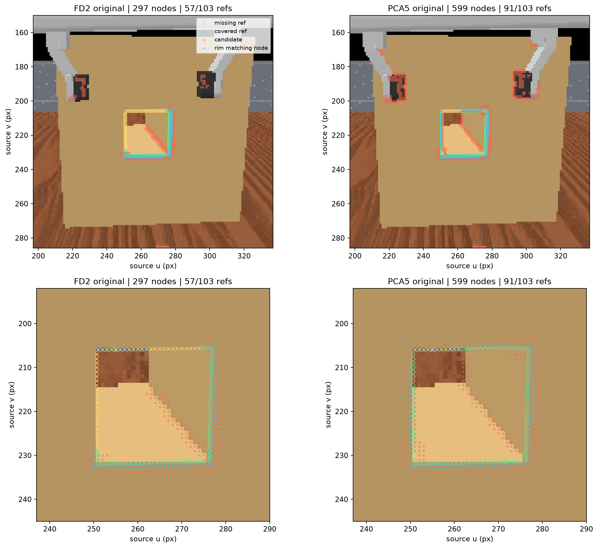
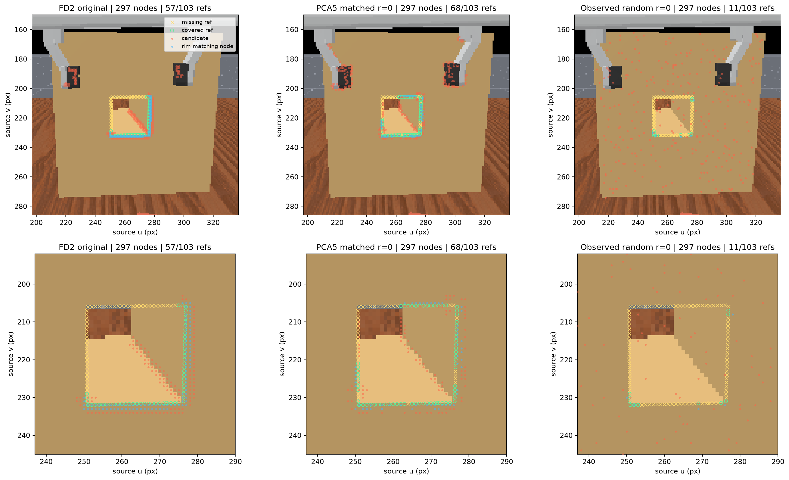
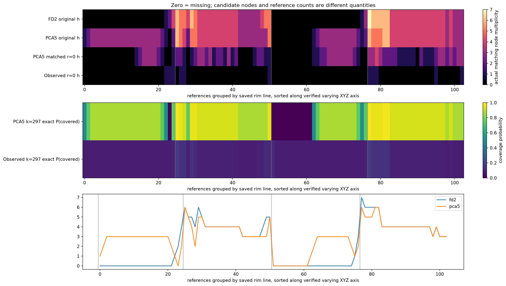
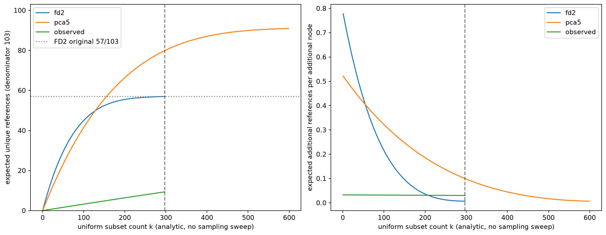
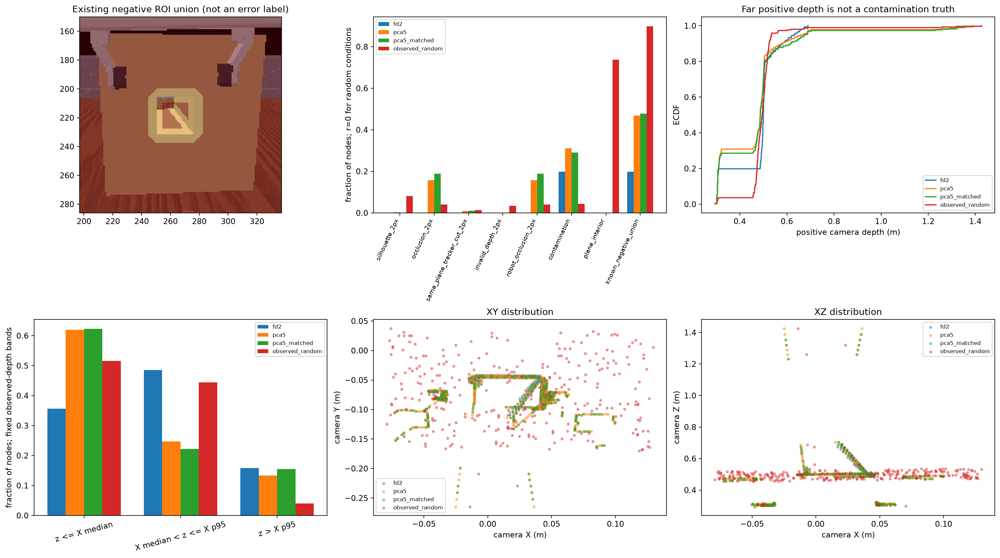

# Task03-H — Candidate Count-Matched Structural Evidence Analysis

실행 UUID: `79358cfd00bd409f837b713972fba2ca`. 동일 후보 수에서도 PCA5의 기대 rim coverage가 FD2보다 높다. 후보 수 증가만으로 원래 coverage 차이를 설명할 수 없다.

Primary: PCA5 297개 정확한 expected unique reference는 **79.898700/103 (77.57%)**, FD2 original은 **57/103**이며 차이는 **+22.898700 reference**다.

| 조건 | 후보 node 수 | rim matching node | rim matching fraction | unique rim reference /103 |
| --- | ---: | ---: | ---: | ---: |
| fd2 original | 297 | 101 | 34.01% | 57/103 |
| pca5 original | 599 | 127 | 21.20% | 91/103 |
| pca5_matched exact expectation | 297 | 62.9699 | 21.20% | 79.898700/103 |
| observed_random exact expectation | 297 | 3.8955 | 1.31% | 9.342834/103 |

정확한 기대값 행의 matching node/reference 수는 비정수 기대값이다. 실제 subset의 정수 count 및 16회 표본 평균과 구분한다. Rim matching fraction은 이 특정 rim에 대한 후보 집중도이며 일반적인 detector precision이 아니다.

## 고정 조건과 선택 독립성

ep000 Frame 0 Box, base_camera, 동일 관측 11,665개, 저장 FD2/PCA5 orientation-only 20° 후보 297/599개, 같은 103개 reference, 동일 pair의 ≤2px AND ≤3mm다. 원본 source index·XYZ·reference를 그대로 사용했으며 normal/candidate/backprojection/FPS를 재실행하지 않았다.

GT·ROI·score·XYZ를 받지 않는 uniform_rows(N,k,seed,stream)으로 비복원 선택했다. PCG64 + SeedSequence([seed,stream]), seed 20261024–20261039, PCA5 stream=0/observed stream=1, 조건별 16회, 대표 overlay는 사전 고정 r=0이다. 선택 배열은 GT matching annotation 전에 저장했다. 전체 관측 control은 candidate/normal-valid filtering을 하지 않았다.

## 후보 수 효과와 공간 분포

PCA5 original 91개와 FD2 original 57개의 차이는 34 reference다. 같은 PCA5 모집단을 297개로 줄일 때 기대 coverage 감소는 **11.101300 reference**이고, 줄인 뒤 FD2와의 차이는 **+22.898700 reference**다. 이는 고정 모집단에서의 기술적 비교이며 독립적인 인과 기여율이나 estimator 효과의 비율 분해가 아니다.

동일 297개에서 PCA5의 기대 rim matching node는 62.9699개로 FD2의 실제 101개보다 적지만, 덮는 reference는 더 많다. 따라서 높은 coverage를 rim matching node가 더 많아서 얻은 것으로도 설명할 수 없다. FD2는 특정 rim 위치에 더 집중되고 PCA5는 더 넓은 reference 위치를 포함한다. 이 차이는 특정 rim에 대한 집중도와 rim 전체의 위치 분포가 서로 다른 지표임을 보여준다.

Observed random 297개의 기대값은 **9.342834/103**, 기대 matching node는 **3.8955/297**다. 두 estimator의 rim 집중도와 임의 관측점 선택의 차이를 보는 대조군이다.

Expected unique coverage는 reference별 multiplicity h에 대한 1−C(N−h,k)/C(N,k)를 합산했다. 짧은 유한곱의 log1p, math.fsum 및 −expm1을 사용했다. Reference 간 독립성을 가정하지 않는다. 정확한 분산은 계산하지 않았고, 아래 변동은 고정 후보 집합의 부분추출 변동이다. Curve는 고정 후보의 analytic rarefaction으로 추가 실험/threshold sweep이 아니다.

| 조건 | 16회 실제 unique refs mean | sample SD | min–max | matching nodes mean |
| --- | ---: | ---: | ---: | ---: |
| pca5_matched | 79.0625 | 4.8093 | 68–86 | 62.8125 |
| observed_random | 8.8125 | 3.9870 | 1–18 | 3.8125 |

## 중복·누락과 reference 집합

| 모집단 | h=0 refs | h=1 refs | h≥2 refs | joint pairs | matching nodes |
| --- | ---: | ---: | ---: | ---: | ---: |
| fd2 | 46 | 2 | 55 | 231 | 101 |
| pca5 | 12 | 4 | 87 | 312 | 127 |
| observed | 0 | 0 | 103 | 381 | 153 |

한 node가 여러 reference를 덮을 수 있고 여러 node가 같은 reference에 집중될 수 있다. Pair 수를 node 수나 unique reference 수로 읽지 않는다. h가 높은 reference는 작은 k에서 포화되고, h=0인 위치는 원래 후보 전체를 사용해도 누락된다.

Original reference 교집합 56개, FD2-only 1개, PCA5-only 35개를 ID까지 재확인했다. Candidate source index 집합 관계는 252개 공통, FD2-only 45개, PCA5-only 347개다. 두 종류의 집합 관계는 서로 다르다.

| 원래 reference 그룹 | reference 수 | PCA5 matched의 기대 보존 수 |
| --- | ---: | ---: |
| 공통 | 56 | 50.620339 |
| FD2-only | 1 | 0 |
| PCA5-only | 35 | 29.278361 |

PCA5가 추가로 덮던 35개 위치 중 기대 29.278361개는 후보 수를 맞춰도 유지된다. 공통 reference의 일부 손실과 FD2-only 1개의 미검출을 함께 반영한 순차이가 primary의 +22.898700개다. 아래 구간별 결과에서도 `rim_axis1_+1`과 `rim_axis2_+1`의 추가 위치가 남는 것을 확인할 수 있다.

| 기존 rim 구간 | 구간 reference 수 | FD2 original covered | PCA5 original covered | PCA5 297 expected covered | Observed 297 expected covered |
| --- | ---: | ---: | ---: | ---: | ---: |
| rim_axis1_+1 | 25 | 3/103 | 24/103 | 19.8074/103 | 1.8851/103 |
| rim_axis1_-1 | 26 | 26/103 | 26/103 | 23.8141/103 | 2.7031/103 |
| rim_axis2_+1 | 26 | 2/103 | 15/103 | 11.9551/103 | 2.0061/103 |
| rim_axis2_-1 | 26 | 26/103 | 26/103 | 24.3221/103 | 2.7485/103 |

구간 크기는 별도 count이며 모든 coverage 비율의 분모는 103이다. 원래 56/1/35 reference 그룹별 기대 보존과 16회 실제 보존, reference 103행별 multiplicity/확률/누락 ID는 JSON/NPZ에 보존했다.

## 기존 ROI와 depth

| 조건 | negative union nodes / 전체 | depth median m | depth p95 m | max m |
| --- | ---: | ---: | ---: | ---: |
| fd2 original | 59/297 | 0.5000 | 0.6320 | 0.6900 |
| pca5 original | 281/599 | 0.4880 | 0.6665 | 1.4260 |
| pca5_matched 16회 mean | 139.8125/297 | 0.4874 | 0.6595 | 1.4191 |
| observed_random 16회 mean | 268.1250/297 | 0.4956 | 0.5411 | 3.5001 |

개별 ROI는 중첩되므로 합계와 union을 구분한다. ROI 점유는 오검출 정답이 아니며, 원거리 positive depth 자체도 오염 정답이 아니다. X의 median/p95로 고정한 depth bands, 개별 ROI count/fraction과 camera XY/XZ/source UV 분포를 별도 저장·시각화했다.

## 확인된 사실과 미확인 범위

동일 후보 수에서도 PCA5의 기대 rim coverage가 FD2보다 높다. 후보 수 증가만으로 원래 coverage 차이를 설명할 수 없다.
이 결과는 고정 Frame 0 Box에서 후보 수를 통제한 rim coverage와 후보 위치·중복 분포의 근거다. PCA5의 모든 구조/형상에 대한 우월성, 모든 edge의 precision, 추가 후보가 noise인지 여부, 독립 episode 일반화, Graph/GNN/BC 효용은 검증하지 않았다. 후속 sampling 정책이나 Voxel 설계는 채택하지 않는다.

## 검증·재현성·산출물

작은 N 전수열거·exact rational 대조, same-pair tolerance·중복/집합·GT 독립성 계약 테스트를 통과했다. 입력 support/camera/XYZ와 저장 pair, 원래 103/57/91 coverage 및 56/1/35 집합을 재확인했다. 기존 source/input/artifact/sidecar와 초기 dirty 파일의 SHA-256 불변을 확인했다. 상세 PASS와 테스트 목록은 verification.json/tests.log를 따른다.

필수 계약 테스트는 **24개 PASS**다. 보호 대상 1,202개 파일의 SHA-256 불변, 결과 NPZ readback, Markdown↔HTML 및 결과 상대 링크, PNG 5개 decode와 Chrome headless의 이미지 5개 로드를 확인했다. 실제 검증 전 hash 목록 병합 코드의 초기화 오류가 한 번 있었으며 UUID·subset·coverage 생성 전 수정했다. [초기화 오류 기록](../../experiments/79358cfd00bd409f837b713972fba2ca/task03h_preflight_failure.json)에 남겼다. 실제 입력 gate 실패나 tolerance/source 조정은 없었다.

ExperimentLogger(team=visual, job_type=evaluate), WANDB_MODE=disabled와 기존 로컬 artifact 등록을 재사용했다. UUID/project/group 규칙은 유지했다. Git dirty 상태는 source snapshot/input hashes/implementation diff와 함께 보존했다. CPU NumPy/SciPy offline 분석이며 simulator·renderer·CUDA/MPS/GPU, 외부 업로드·dependency 설치·Git commit은 실행하지 않았다.

[승인된 계획](03h_candidate_count_matched_plan.md) · [정적 HTML](../../experiments/79358cfd00bd409f837b713972fba2ca/candidate_count_matched.html) · [결과 JSON](../../experiments/79358cfd00bd409f837b713972fba2ca/candidate_count_matched.json) · [결과 NPZ](../../experiments/79358cfd00bd409f837b713972fba2ca/candidate_count_matched.npz) · [검증](../../visual/results/diagnostic_previews/03h/verification.json) · [테스트](../../experiments/79358cfd00bd409f837b713972fba2ca/tests.log) · [hash](../../experiments/79358cfd00bd409f837b713972fba2ca/source_hashes.json) · [implementation diff](../../experiments/79358cfd00bd409f837b713972fba2ca/implementation.patch)

구현·진단·검증·보고를 완료했으며 추가 알고리즘 변경 없이 중단한다.
