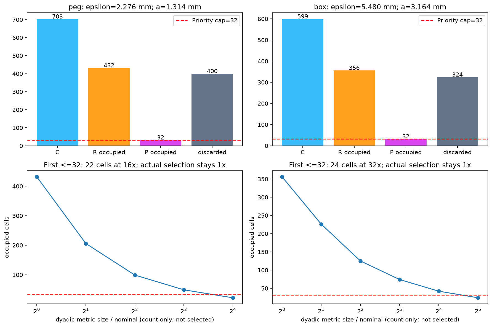
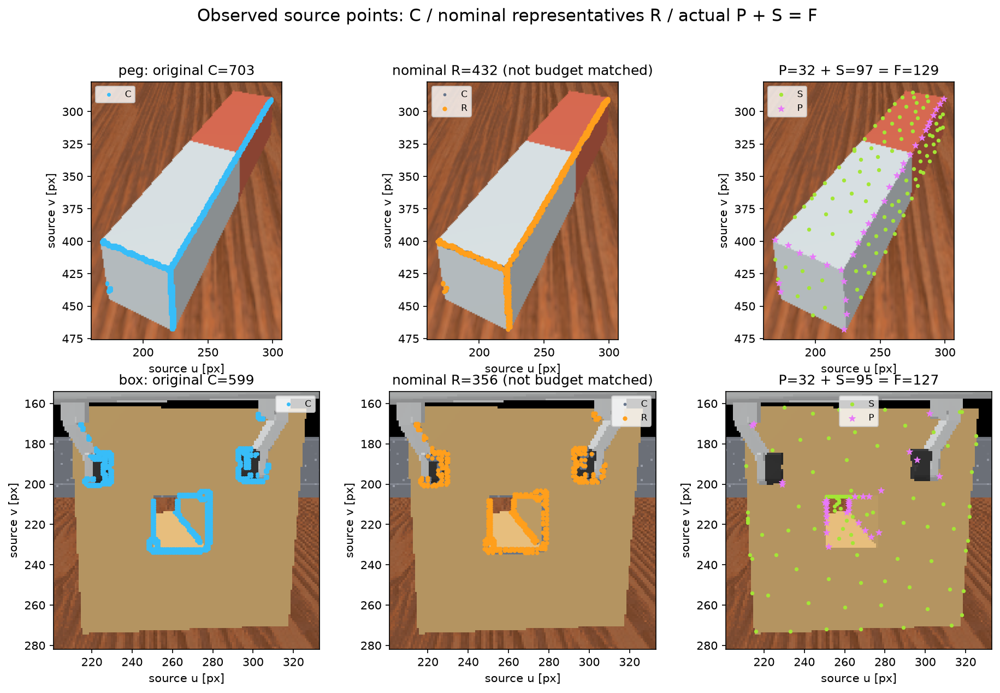
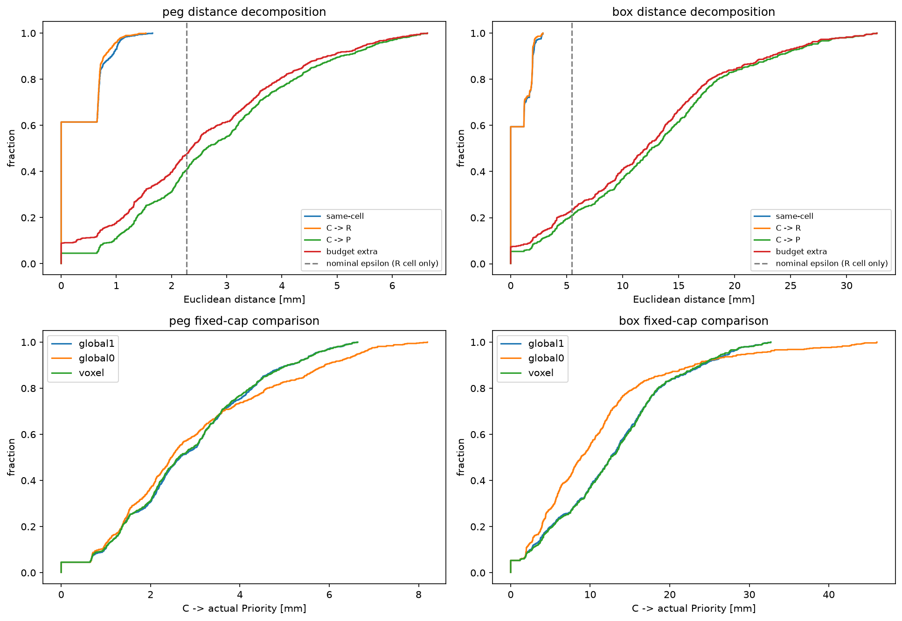
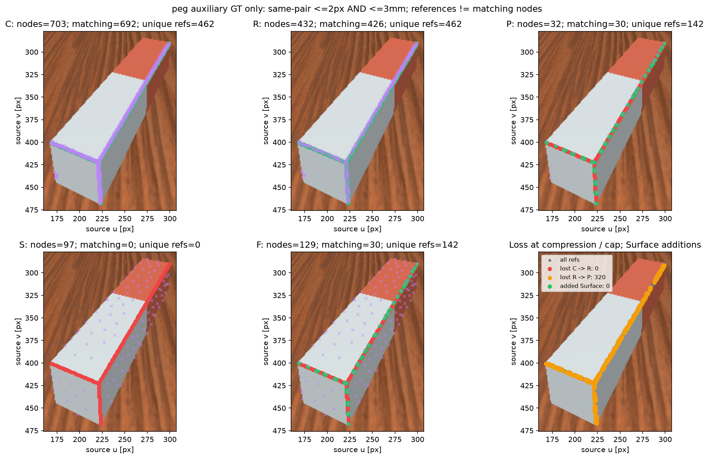
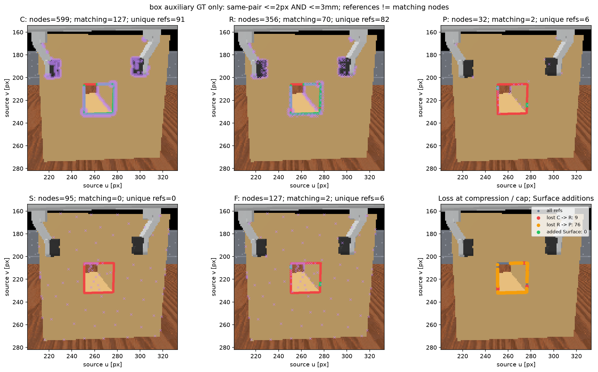
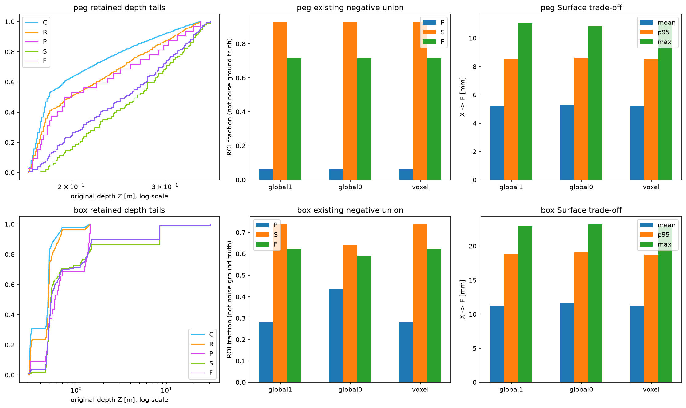
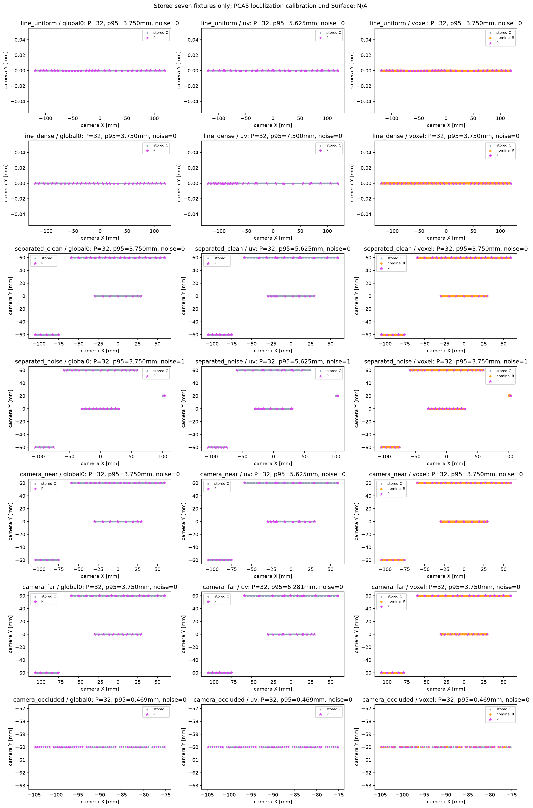

# Task03-I — Shape-First Voxel Precompression + 3D FPS Cap

[voxel_structural_sampling.html](../../experiments/92f29716e76f4b998fe924f08e80357d/voxel_structural_sampling.html) · [voxel_structural_sampling.json](../../experiments/92f29716e76f4b998fe924f08e80357d/voxel_structural_sampling.json) · [voxel_structural_sampling.npz](../../experiments/92f29716e76f4b998fe924f08e80357d/voxel_structural_sampling.npz) · [selection_before_gt.npz](../../experiments/92f29716e76f4b998fe924f08e80357d/selection_before_gt.npz) · [selection_before_gt.json](../../experiments/92f29716e76f4b998fe924f08e80357d/selection_before_gt.json) · [verification.json](../../visual/results/diagnostic_previews/03i/verification.json) · [tests.log](../../experiments/92f29716e76f4b998fe924f08e80357d/tests.log) · [source_hashes.json](../../experiments/92f29716e76f4b998fe924f08e80357d/source_hashes.json) · [preregistered_config.json](../../visual/results/diagnostic_previews/03i/preregistered_config.json) · [implementation.patch](../../experiments/92f29716e76f4b998fe924f08e80357d/implementation.patch) · [git_start.diff](../../experiments/92f29716e76f4b998fe924f08e80357d/git_start.diff)

[승인 계획](03i_voxel_structural_sampling_plan.md) · [Task03-H](03h_candidate_count_matched.md) · [Task03-F](03f_local_structural_sampling.md) · [Task03-G](03g_geometry_aware_sampling.md)

## 두 연구 질문에 대한 판단

peg: C=703 → nominal R=432 → P=32. Nominal occupied/cap=13.500배이며 400개 cell이 cap에서 제거됐다. C→P p95는 voxel 5.6831mm, 저장 Global λ=1 5.6654mm, λ=0 6.6621mm다. GT unique refs C/R/P/F=462/462/142/142다.

box: C=599 → nominal R=356 → P=32. Nominal occupied/cap=11.125배이며 324개 cell이 cap에서 제거됐다. C→P p95는 voxel 26.8639mm, 저장 Global λ=1 27.4828mm, λ=0 29.7788mm다. GT unique refs C/R/P/F=91/82/6/6다.

이번 결과는 Voxel precompression + 3D FPS cap의 첫 feasibility 평가다. 순수 Voxel Sampling이나 일반적으로 유효한 Shape-First Sampling의 검증이 아니다. Nominal R 전체는 cap 없는 해상도 진단 집합이므로 32점 기준선과 동등 budget 성능으로 비교하지 않는다. 32점 cap 뒤의 거리·local coverage와 Surface/GT trade-off를 함께 해석한다.

A — 전반적 우월성을 지지하지 않는다. Peg는 λ=0보다 C→P tail이 개선됐지만 λ=1보다 p95/max가 소폭 악화했고, Final seam은 151/160(λ=1/0)에서 142로 줄었다. Box는 p95가 두 기준선보다 작지만 mean은 두 기준선보다 크고, Final rim은 3(λ=1)보다 많은 6이지만 12(λ=0)보다 적다. Surface p95는 개선됐으나 λ=1 대비 Surface mean은 두 물체 모두 소폭 악화했다. Box 한 지표의 개선만으로 형상 보존에 유리하다고 채택하지 않는다.

B — nominal 해상도와 32점은 양립하지 않았다. Peg/Box의 R은 432/356개로 cap의 13.5/11.125배다. C→R의 GT 손실은 0/9 reference였고 R→P에서 320/76개가 추가로 소실됐다. 따라서 이 고정 경로에서는 cap 단계의 손실이 압축 단계보다 훨씬 컸다. 다만 cap 수 자체의 효과와 그 32개를 고른 FPS 정책의 효과를 분리한 budget sweep은 하지 않았다.

N_occupied>32인 물체는 원래 해상도의 모든 voxel을 최종 보존하지 못했다. R 단계의 작은 오차와 R→P 추가 손실은 이 관측에서 예산 충돌의 크기를 보여주지만, 32점이 유일한 인과적 병목이거나 더 큰 budget이 일반적인 최적값임을 증명하지 않는다. 후보 오염, FPS 거리 경쟁과 anchor 이동이 남아 있다. 결과에 따른 재선택·파라미터 변경은 하지 않았다.

## 고정 조건·scale·실제 PCA5 지원 범위

ep000 Frame 0 / base_camera / S3 optimized PCA5 / orientation-only >20° / seed0. Final Peg129/Box127, 총256; Priority 상한 각32/총64, structural_ratio=.25는 현재 조건이다. 전체 원본 X의 camera Z median, 저장 fx=fy=256px, multiplier=1로 epsilon=z_ref*sqrt((2/fx)^2+(2/fy)^2), a=epsilon/sqrt(3)를 정했다.

PCA5 normal은 중심 ±2px 5×5 내부의 same-object 4-connected support를 사용한다. Depth jump >.01+.02*min(z1,z2)에서 연결을 끊고, 최소6점·rank2·unique smallest eigenvector를 요구한다. 불완전 patch를 허용하며 부족한 normal은 invalid다. Pair는 인접 normal을 비교해 >20°일 때 양 끝을 후보로 표시한다. 두 normal support 합집합은 6×5 또는 5×6, 한 endpoint의 모든 비교 footprint는 7×7 bbox의 네 모서리를 제외한다. 단순 5×5 window와 전체 반응 띠를 혼동하지 않는다.

Spatial support, 실제 edge localization error, voxel approximation error는 서로 다르다. Nominal epsilon은 동일 depth 평면의 half-window 근사에서 정한 compression scale이며 edge 오차의 추정값·상한이 아니다. 경사·깊이 불연속에서는 근사가 깨진다. Same-cell 후보→대표점 bound sqrt(3)*a는 R 단계에서만 보장된다. Cell을 버린 P와 2px AND 3mm matcher 통과에는 보장되지 않는다. 새 normal/score/GT calibration은 없다.

| object | X median m | epsilon mm | a nominal=used mm | R occupied | R/32 | P cells | removed | P>epsilon count/fraction | dyadic a mm / ratio / cells |
| --- | --- | --- | --- | --- | --- | --- | --- | --- | --- |
| peg | 0.2060 | 2.2760 | 1.3140 | 432 | 13.5000 | 32 | 400 | 416/703 (59.17%) | 21.0248 / 16x / 22 |
| box | 0.4960 | 5.4801 | 3.1639 | 356 | 11.1250 | 32 | 324 | 473/599 (78.96%) | 101.2456 / 32x / 24 |

실제 used/nominal ratio는 1이다. Dyadic은 nominal integer key를 음수에도 floor_divide(2)하여 만든 nested count-only 진단이다. 최초 occupied≤32에서 멈췄고 그 크기를 선택에 사용하지 않았다. 임의 크기 grid의 단조성이나 정확히32 cell 존재를 가정하지 않았다. 이 dyadic family의 첫 크기를 전역 최소·물리적 최적 해상도로 읽지 않는다.

## 선택 규칙·anchor 이동·원본 provenance

Camera origin=(0,0,0), 원본 CV XYZ(m)의 float64 floor(XYZ/a) int64 key, half-open cell을 사용했다. BBox 최소점으로 이동하지 않았다. Cell centroid에 가장 가까운 원본 C 하나, exact squared-distance tie는 최소 source다. R은 source ascending, original anchor cell의 대표점을 initial로 기존 Euclidean 3D FPS cap32를 수행했다. R≤32면 전부 사용하고 남는 예산은 전체 X의 기존 3D Surface FPS로 넘긴다. Padding·복제·좌표 평균 node는 없다.

| object | original anchor | mapped R source | 3D shift mm | delta(u,v) px | pixel shift px |
| --- | --- | --- | --- | --- | --- |
| peg | 214225 | 214225 | 0.0000 | [0, 0] | 0.0000 |
| box | 96553 | 96552 | 1.1953 | [-1, 0] | 1.0000 |

Anchor source가 바뀌면 grouping/precompression과 FPS 시작점 효과가 함께 달라진다. 추가 anchor-only arm은 실행하지 않았으므로 두 효과를 인과적으로 분해하지 않는다. C 전체 optimized score가 저장돼 있지 않아 score-free만 사용했다. Task02 reference PCA5 angle을 optimized score로 대체하지 않았다.

## Primary: 압축 오차와 budget 추가 손실

| object | distance (mm) | mean | p50 | p95 | max | worst source |
| --- | --- | --- | --- | --- | --- | --- |
| peg | same_cell_m | 0.3086 | 0.0000 | 1.0234 | 1.6562 | 207536 |
| peg | C_to_R_m | 0.2951 | 0.0000 | 0.9528 | 1.5352 | 167702 |
| peg | C_to_P_m | 2.8315 | 2.6333 | 5.6831 | 6.6379 | 191736 |
| peg | budget_extra_m | 2.5364 | 2.3578 | 5.5340 | 6.6379 | 191736 |
| box | same_cell_m | 0.7221 | 0.0000 | 2.1275 | 2.8811 | 120063 |
| box | C_to_R_m | 0.7019 | 0.0000 | 2.0492 | 2.8784 | 120067 |
| box | C_to_P_m | 12.8141 | 12.5871 | 26.8639 | 32.7114 | 108283 |
| box | budget_extra_m | 12.1123 | 12.1460 | 26.4149 | 32.7114 | 108283 |

same_cell은 자기 cell의 대표점 거리, C→R은 모든 대표점 중 최근접 거리다. Budget extra=C→P−C→R≥0이며 same_cell을 빼지 않았다. 네 raw 배열, ECDF와 worst source/XYZ/pixel을 NPZ/JSON에 저장했다. Same-cell bound 확인과 성능 개선은 별개다.

| object | method | P | C→P mean/p50/p95/max mm | X→F mean/p95/max mm | Final unique GT refs |
| --- | --- | --- | --- | --- | --- |
| peg | global1 | 32 | 2.8481 / 2.6659 / 5.6654 / 6.6187 | 5.1700 / 8.5499 / 11.0471 | 151 |
| peg | global0 | 32 | 2.9452 / 2.4687 / 6.6621 / 8.1979 | 5.2837 / 8.6095 / 10.8408 | 160 |
| peg | voxel | 32 | 2.8315 / 2.6333 / 5.6831 / 6.6379 | 5.1826 / 8.5255 / 11.1341 | 142 |
| box | global1 | 32 | 12.7793 / 12.5895 / 27.4828 / 32.7114 | 11.2533 / 18.7511 / 22.8926 | 3 |
| box | global0 | 32 | 10.8746 / 8.8430 / 29.7788 / 46.0516 | 11.5801 / 19.0768 / 23.1584 | 12 |
| box | voxel | 32 | 12.8141 / 12.5871 / 26.8639 / 32.7114 | 11.2707 / 18.6901 / 22.8926 | 6 |

| object | method | UV selected/occupied; P=0 IDs | XYZ selected/occupied; P=0 IDs | UV equal-region mean p95 mm |
| --- | --- | --- | --- | --- |
| peg | global1 | 8/8; [] | 3/4; [6] | 5.2254 |
| peg | global0 | 8/8; [] | 3/4; [6] | 5.6162 |
| peg | voxel | 8/8; [] | 3/4; [6] | 4.9291 |
| box | global1 | 9/9; [] | 1/1; [] | 24.6447 |
| box | global0 | 9/9; [] | 1/1; [] | 22.5887 |
| box | voxel | 9/9; [] | 1/1; [] | 24.4979 |

독립 UV4×4/XYZ 최대2×2×2 구역은 같은 X bbox로 고정했다. 구역별 후보 밀도·선택률·거리 tail과 R 단계 구역 통계는 JSON/NPZ에 있다. Box의 30.726m outlier는 그대로 남아 coarse XYZ 구역과 bbox 정규화를 왜곡하므로 raw mm와 UV를 함께 본다. 단순 구역 점유가 같아도 국소 geometry가 같다는 뜻은 아니다.

## Secondary: 선택 후 GT, C/R/P/S/F reference 손실

Same-pair ≤2px AND ≤3mm를 유지했다. Peg observed462/visible464, Box observed103/visible103이다. 한 node는 여러 reference를 덮고 한 reference는 여러 node에 매칭될 수 있다. Pair count·matching node·unique reference는 서로 다르다.

| object | voxel stage | nodes | matching nodes | unique refs | available/unavailable feature rows |
| --- | --- | --- | --- | --- | --- |
| peg | C | 703 | 692 | 462 | 32/671 |
| peg | P | 32 | 30 | 142 | 20/12 |
| peg | S | 97 | 0 | 0 | 49/48 |
| peg | F | 129 | 30 | 142 | 69/60 |
| peg | R | 432 | 426 | 462 | 21/411 |
| box | C | 599 | 127 | 91 | 35/564 |
| box | P | 32 | 2 | 6 | 28/4 |
| box | S | 95 | 0 | 0 | 80/15 |
| box | F | 127 | 2 | 6 | 108/19 |
| box | R | 356 | 70 | 82 | 31/325 |

| object | C→R lost refs | R→P additional lost refs | Surface added refs | P/S overlapping refs |
| --- | --- | --- | --- | --- |
| peg | 0 | 320 | 0 | 0 |
| box | 9 | 76 | 0 | 0 |

| Box segment | reference count | C | R | P | S | F | Global λ1 P/F | Global λ0 P/F |
| --- | --- | --- | --- | --- | --- | --- | --- | --- |
| rim_axis1_+1 | 25 | 24 | 21 | 3 | 0 | 3 | 3 / 3 | 6 / 6 |
| rim_axis1_-1 | 26 | 26 | 23 | 3 | 0 | 3 | 0 / 0 | 0 / 0 |
| rim_axis2_+1 | 26 | 15 | 12 | 0 | 0 | 0 | 0 / 0 | 0 / 3 |
| rim_axis2_-1 | 26 | 26 | 26 | 0 | 0 | 0 | 0 / 0 | 3 / 3 |

각 단계 reference ID 집합·joint pairs·matching source·구간별 matching node/reference·Box line spacing을 저장했다. Surface 추가분은 refs(F)−refs(P)이며 S 전체 hit 수와 다르다. C→R과 R→P 손실은 P⊆R⊆C에서 구분했다. Peg 물리적 line 순서/간격은 N/A다. GT 후보→reference 거리에는 depth noise, reference 이산화, 가시성·matcher 정의가 섞여 순수 detector localization error가 아니다. 이를 epsilon calibration에 사용하지 않았다.

## Depth·ROI·일반 Surface trade-off

| object | stage | depth median/p95/max m | negative union count / nodes |
| --- | --- | --- | --- |
| peg | X | 0.2060 / 0.3271 / 0.3650 | 7800 / 11780 |
| peg | C | 0.1810 / 0.3160 / 0.3500 | 11 / 703 |
| peg | R | 0.1990 / 0.3280 / 0.3500 | 6 / 432 |
| peg | P | 0.1970 / 0.3329 / 0.3500 | 2 / 32 |
| peg | S | 0.2660 / 0.3506 / 0.3650 | 90 / 97 |
| peg | F | 0.2520 / 0.3492 / 0.3650 | 92 / 129 |
| box | X | 0.4960 / 0.5350 / 30.7260 | 10506 / 11665 |
| box | C | 0.4880 / 0.6665 / 1.4260 | 281 / 599 |
| box | R | 0.4905 / 0.6880 / 1.4260 | 150 / 356 |
| box | P | 0.5805 / 1.4057 / 1.4260 | 9 / 32 |
| box | S | 0.5220 / 8.4310 / 30.7260 | 70 / 95 |
| box | F | 0.5250 / 8.4310 / 30.7260 | 79 / 127 |

원거리 positive depth를 제거하지 않았다. ROI는 중첩되므로 union을 별도 집계했다. ROI/far는 실제 noise 정답이 아니며 일반 Surface 점유를 자동 오선택으로 분류하지 않는다. X median/p95 기반 depth bands와 candidate별 P 선택률도 저장했다. Median은 단일 extreme max 영향은 줄이지만 mask 오염과 물체 내 depth 차이를 해결하지 않는다. Peg/Box는 같은 공식으로 서로 다른 metric a를 사용하며 동일 절대 해상도 비교가 아니다.

## 기존 7개 synthetic의 저장 입력 재사용

| fixture | C/R/P | a mm | dyadic ratio | Global/UV/Voxel C→P p95 mm | Global/UV/Voxel ref→P p95 mm | noise P G/UV/V |
| --- | --- | --- | --- | --- | --- | --- |
| line_uniform | 128/128/32 | 0.8165 | 16 | 3.7500 / 5.6250 / 3.7500 | 3.7500 / 5.6250 / 3.7500 | 0 / 0 / 0 |
| line_dense | 216/169/32 | 0.8165 | 16 | 3.7500 / 7.5000 / 3.7500 | 3.7500 / 7.5000 / 3.7500 | 0 / 0 / 0 |
| separated_clean | 188/164/32 | 0.8165 | 16 | 3.7500 / 5.6250 / 3.7500 | 3.9844 / 6.0937 / 3.9844 | 0 / 0 / 0 |
| separated_noise | 196/172/32 | 0.8165 | 16 | 3.7500 / 5.6250 / 3.7500 | 4.2188 / 6.0938 / 4.2188 | 1 / 1 / 1 |
| camera_near | 188/164/32 | 0.8165 | 16 | 3.7500 / 5.6250 / 3.7500 | 3.9844 / 6.0937 / 3.9844 | 0 / 0 / 0 |
| camera_far | 154/120/32 | 1.6330 | 8 | 3.7500 / 6.2812 / 3.7500 | 3.8320 / 6.0938 / 4.1836 | 0 / 0 / 0 |
| camera_occluded | 60/36/32 | 0.8165 | 2 | 0.4688 / 0.4688 / 0.4688 | 0.5859 / 0.5859 / 0.5859 | 0 / 0 / 0 |

Task03-F 저장 C/source/XYZ와 Global/UV 선택을 읽었으며 새 fixture·기준선 FPS를 만들지 않았다. Dense X가 없는 stress test에서 관측 C median과 기존 focal1600px로 같은 scale 공식을 적용했다. Annotation은 모든 선택 저장 후에만 noise/reference/구조별 평가에 사용했다. 실제 PCA5 5×5 localization uncertainty calibration과 Synthetic Surface는 N/A다. 계약/geometry stress test 통과가 uncertainty calibration 타당성을 뜻하지 않는다.

## 검증·재현·한계·완료 범위

실행 UUID 92f29716e76f4b998fe924f08e80357d. 필수 계약 테스트: Ran 86 tests in 0.677s; OK. 성능 개선을 PASS 조건으로 두지 않았다. selection_before_gt.npz를 real/synthetic 선택 전체의 저장·readback·hash 이후에만 GT evaluator/annotation에 연결했다. 평가 후 선택 hash 불변, 원본 C/X·baseline exact alignment, 원본 feature available-only exact gather를 확인했다.

기존 ExperimentLogger(team=visual, job_type=evaluate), WANDB_MODE=disabled 및 로컬 artifact inventory를 재사용했다. 기존 UUID/project/group 규칙을 바꾸지 않았다. Git 시작 상태는 dirty이며 source snapshot·input/artifact hashes·시작 diff·implementation diff를 함께 보존했다. Production sampling/normal/tracking/shared simulator와 기존 dirty/untracked 파일은 변경하지 않았다. 같은 S3 조건에서 저장된 feature가 없는 source는 unavailable로 남겼으며 feature를 추정하지 않았다.

보호 대상 기존 파일 3,092개의 SHA-256와 HEAD 불변을 확인했다. Markdown↔HTML 및 JSON/NPZ/PNG 상대 링크, PNG 7개 decode는 PASS다. 실제 브라우저 로딩은 computer-use 권한이 없어 진행하지 못했고, 사용자의 후속 지시에 따라 생략했다. 이 미실행 항목을 검증 PASS로 계산하지 않는다. 수치 실행 source_snapshot과 선택·JSON/NPZ는 유지하고 최종 해석 문구/검증 상태를 보완한 보고 source는 report_source_snapshot과 report_generation_sources로 구분한다.

CPU NumPy/SciPy offline 실행이다. 단계별 wall time은 JSON에 기록했으며 Graph/GNN 20Hz 성능을 주장하지 않는다. Simulator/renderer/CUDA/MPS/GPU/PCL, 새 episode/fixture/score/normal, threshold/scale sweep, 두 번째 selection arm, GT calibration/quota, depth filtering, ratio/Adaptive Budget, Graph/GNN/BC, dependency 설치·외부 업로드·Git commit은 미실행이다. Task03-H의 동일 count 기대 coverage는 후보 해석 근거, Task03-F/G는 기존 실패 비교군으로만 유지했다. 보고서 제출 후 추가 알고리즘 실행 없이 중단한다.
