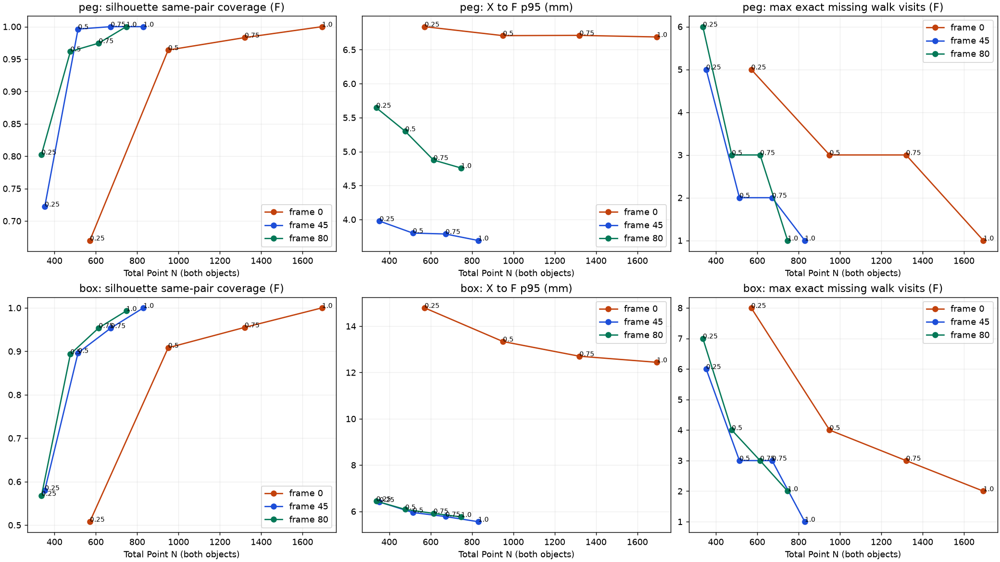
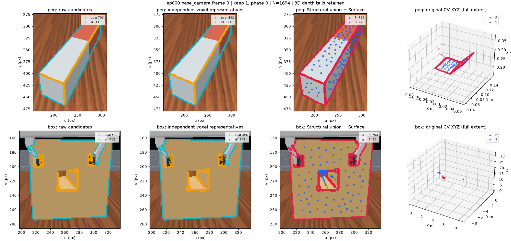
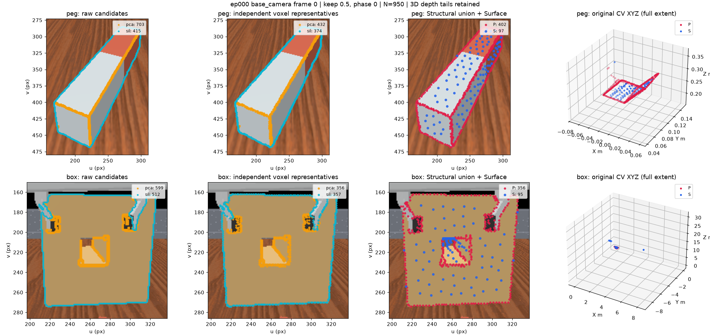
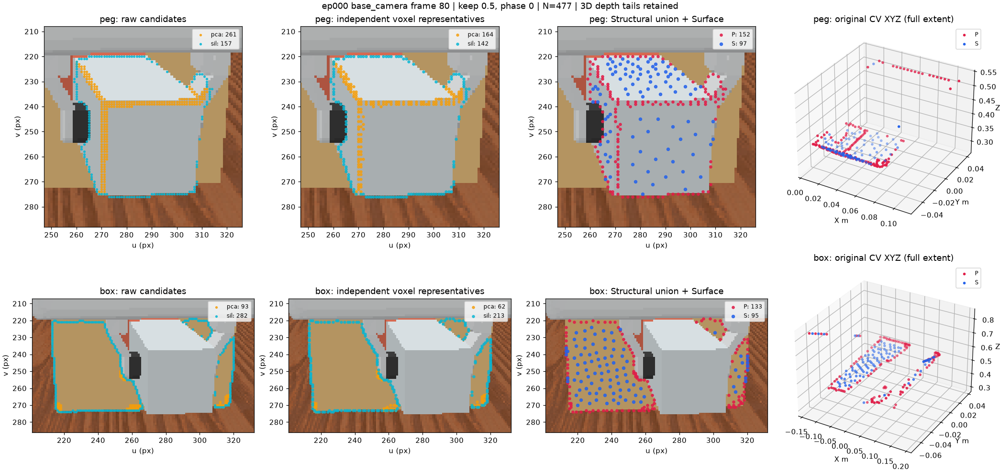

# Task03-J — Variable-Rate Shape-First Sampling

[variable_rate_shape_first.html](../../experiments/15efc476f735491a828f5b84f352f858/variable_rate_shape_first.html) · [variable_rate_shape_first.json](../../experiments/15efc476f735491a828f5b84f352f858/variable_rate_shape_first.json) · [variable_rate_shape_first.npz](../../experiments/15efc476f735491a828f5b84f352f858/variable_rate_shape_first.npz) · [preregistered_config.json](../../visual/results/diagnostic_previews/03j/preregistered_config.json) · [selection_before_gt.npz](../../experiments/15efc476f735491a828f5b84f352f858/selection_before_gt.npz) · [selection_before_gt.json](../../experiments/15efc476f735491a828f5b84f352f858/selection_before_gt.json) · [verification.json](../../visual/results/diagnostic_previews/03j/verification.json) · [tests.log](../../experiments/15efc476f735491a828f5b84f352f858/tests.log) · [source_hashes.json](../../experiments/15efc476f735491a828f5b84f352f858/source_hashes.json) · [protected_baseline.json](../../experiments/15efc476f735491a828f5b84f352f858/protected_baseline.json) · [implementation.patch](../../experiments/15efc476f735491a828f5b84f352f858/implementation.patch) · [git_start.diff](../../experiments/15efc476f735491a828f5b84f352f858/git_start.diff)

[승인 계획](03j_variable_rate_shape_first_plan.md) · [Task03-I historical reference](03i_voxel_structural_sampling.md)

## 실행 범위와 고정 조건

Run 15efc476f735491a828f5b84f352f858. 승인 계획의 최소 구현과 CPU offline 평가를 완료했다. ep000/base_camera source frame 0,45,80 전체에서 main ratio 1/.75/.5/.25 phase0와 .5 phase1 진단을 전부 실행했다. 결과에 따른 frame/ratio/phase 추가·교체·선택은 없다. Surface 추가 요청은 Peg97/Box95로 고정했으며 이번 비교의 실험 설정이다. 새로운 최종 정책으로 채택하지 않았다.

PCA5는 저장 optimized orientation-only strict >20° 후보·원본 source/XYZ를 사용한다. Raw tracker mask의 RETR_EXTERNAL/CHAIN_APPROX_NONE 외부 contour만 추출하고 canonical 시작점·방향·component·walk position·observed segment·invalid/overlap exclusion을 보존했다. Internal hole과 invalid-depth hole을 새 외부 contour로 만들지 않는다. Silhouette는 관측 mask 외곽이며 occlusion 외곽을 포함할 수 있다. Physical edge/crease 정답이 아니다. 추가 outlier 제거는 0개다.

두 경로는 물체별 동일 nominal metric grid에서 centroid-nearest 원본 대표점을 독립적으로 고른다. 동일 voxel의 서로 다른 source는 유지한다. Nominal scale은 PCA5 spatial support의 설계 proxy이며 silhouette localization uncertainty를 실측·보정한 값이 아니다. Representatives helper는 기존 Task03-I의 pure helper를 import했다. Same-cell bound는 voxel 압축에만 적용되며 thinning 이후 localization 상한이 아니다.

Thinning은 p/q rational floor(kq/p), count ceil(Mp/q) 규칙이다. PCA는 ascending 대표 source, silhouette는 canonical component walk의 대표 순서다. 독립 component 사이에도 전역 목록 규칙을 이어 적용하며 quota는 없다. 이는 index 규칙으로 3D 거리·물리적 contour 길이 등간격을 보장하지 않는다. Phase1은 .5의 odd indices이며 wrap/refill하지 않는다. 홀수 M에서 count 차이를 그대로 보고한다.

P는 T_pca 먼저, 이어 새 T_sil source의 안정 합집합이다. 전체 X에 기존 3D Euclidean FPS를 P initial, count=len(P)+Surface_added로 호출한다. P가 비면 최소 X source를 첫 Surface로 세어 요청 개수 안에 포함한다. 256 전체 cap, 물체별 32 cap, structural_ratio=.25, Structural FPS는 실행하지 않았다. 물체 0→1, 물체별 P→S 순서를 유지한다. Capacity 부족은 shortfall이며 padding·중복 source·새 좌표 생성은 없다.

## 관측된 trade-off

| source frame | Point N: ratio 1 / .75 / .5 / .25 | ratio .5 silhouette tol F: Peg / Box | ratio .25 silhouette tol F: Peg / Box |
| --- | --- | --- | --- |
| 0 | 1694 / 1320 / 950 / 571 | 0.9639 / 0.9082 | 0.6699 / 0.5078 |
| 45 | 830 / 672 / 514 / 353 | 0.9963 / 0.8964 | 0.7222 / 0.5803 |
| 80 | 747 / 614 / 477 / 337 | 0.9618 / 0.8936 | 0.8025 / 0.5674 |

이 세 관측에서는 ratio가 작아질수록 Point N이 줄고 silhouette tolerance coverage와 최대 연속 누락이 악화되는 경향을 보였다. X→F p95 변화는 frame·물체마다 다르며 후보 coverage와 같은 비율로 변하지 않는다. .5의 phase 변화도 coverage와 최종 Surface 집합을 바꾼다. 어느 ratio/phase도 최종 정책으로 선택하지 않았다. 아래에 모든 개별 결과와 고정 phase 진단을 함께 공개한다.

## 가변 Node 수와 GT-free coverage — 모든 frame/arm/object

표 거리 단위는 mm이며 p95는 NumPy linear다. Silhouette exact/tolerance 분모는 관측 가능한 원본 unique contour source다. Tolerance는 같은 reference-node pair에서 ≤2px AND ≤3mm를 만족한 비율이다. P와 F를 나누며 Surface가 후보를 다시 선택할 수 있다. Empty query는 분모0/N/A, nonempty query→empty target은 coverage0·distance unavailable로 저장한다. Undefined distance는 0으로 평균하지 않는다.

| frame | ratio | phase | object | C pca/sil/both | R pca/sil | T pca/sil | P | S | F | Point N / expected N+3 | C→F p95 | X→F mean/p95/max | sil exact P/F | sil tol P/F | max missing P/F (visits) |
| --- | --- | --- | --- | --- | --- | --- | --- | --- | --- | --- | --- | --- | --- | --- | --- |
| 0 | 1.0 | 0 | peg | 703/415/12 | 432/374 | 432/374 | 799 | 97 | 896 | 1694 / 1697 | 0.9219 | 3.642/6.688/8.679 | 0.906/0.906 | 1/1 | 1/1 |
| 0 | 1.0 | 0 | box | 599/512/23 | 356/357 | 356/357 | 703 | 95 | 798 | 1694 / 1697 | 2.069 | 6.66/12.44/15.7 | 0.7031/0.7031 | 1/1 | 2/2 |
| 0 | 0.75 | 0 | peg | 703/415/12 | 432/374 | 324/281 | 601 | 97 | 698 | 1320 / 1323 | 1.462 | 3.694/6.711/8.626 | 0.6843/0.6843 | 0.9831/0.9831 | 3/3 |
| 0 | 0.75 | 0 | box | 599/512/23 | 356/357 | 267/268 | 527 | 95 | 622 | 1320 / 1323 | 3.216 | 6.897/12.7/16.35 | 0.5312/0.5332 | 0.9531/0.9551 | 3/3 |
| 0 | 0.5 | 0 | peg | 703/415/12 | 432/374 | 216/187 | 402 | 97 | 499 | 950 / 953 | 1.848 | 3.757/6.707/8.628 | 0.4554/0.4578 | 0.9614/0.9639 | 3/3 |
| 0 | 0.5 | 0 | box | 599/512/23 | 356/357 | 178/179 | 356 | 95 | 451 | 950 / 953 | 4.203 | 7.336/13.34/17.09 | 0.3594/0.3672 | 0.9004/0.9082 | 4/4 |
| 0 | 0.25 | 0 | peg | 703/415/12 | 432/374 | 108/94 | 201 | 97 | 298 | 571 / 574 | 3.392 | 3.991/6.839/8.944 | 0.2289/0.2361 | 0.6627/0.6699 | 5/5 |
| 0 | 0.25 | 0 | box | 599/512/23 | 356/357 | 89/90 | 178 | 95 | 273 | 571 / 574 | 10.66 | 8.368/14.79/19.16 | 0.1777/0.1914 | 0.4941/0.5078 | 8/8 |
| 0 | 0.5 | 1 | peg | 703/415/12 | 432/374 | 216/187 | 402 | 97 | 499 | 948 / 951 | 1.831 | 3.751/6.639/8.957 | 0.4627/0.4675 | 0.9759/0.9807 | 3/3 |
| 0 | 0.5 | 1 | box | 599/512/23 | 356/357 | 178/178 | 354 | 95 | 449 | 948 / 951 | 4.058 | 7.292/13.35/17.32 | 0.3574/0.3652 | 0.8965/0.9043 | 5/5 |
| 45 | 1.0 | 0 | peg | 447/270/11 | 280/226 | 280/226 | 496 | 97 | 593 | 830 / 833 | 0.792 | 2.02/3.691/4.456 | 0.837/0.837 | 1/1 | 1/1 |
| 45 | 1.0 | 0 | box | 0/193/0 | 0/142 | 0/142 | 142 | 95 | 237 | 830 / 833 | 1.962 | 3.143/5.556/6.501 | 0.7358/0.7358 | 1/1 | 1/1 |
| 45 | 0.75 | 0 | peg | 447/270/11 | 280/226 | 210/170 | 373 | 97 | 470 | 672 / 675 | 1.252 | 2.084/3.787/4.568 | 0.6333/0.6407 | 0.9926/1 | 2/2 |
| 45 | 0.75 | 0 | box | 0/193/0 | 0/142 | 0/107 | 107 | 95 | 202 | 672 / 675 | 2.9 | 3.311/5.778/6.859 | 0.5544/0.5907 | 0.9171/0.9534 | 3/3 |
| 45 | 0.5 | 0 | peg | 447/270/11 | 280/226 | 140/113 | 251 | 97 | 348 | 514 / 517 | 1.442 | 2.152/3.8/4.646 | 0.4222/0.4333 | 0.9852/0.9963 | 2/2 |
| 45 | 0.5 | 0 | box | 0/193/0 | 0/142 | 0/71 | 71 | 95 | 166 | 514 / 517 | 3.642 | 3.506/5.954/7.25 | 0.3679/0.4404 | 0.8238/0.8964 | 3/3 |
| 45 | 0.25 | 0 | peg | 447/270/11 | 280/226 | 70/57 | 125 | 97 | 222 | 353 / 356 | 2.342 | 2.315/3.977/4.807 | 0.2111/0.2259 | 0.7037/0.7222 | 5/5 |
| 45 | 0.25 | 0 | box | 0/193/0 | 0/142 | 0/36 | 36 | 95 | 131 | 353 / 356 | 5.772 | 3.923/6.406/7.782 | 0.1865/0.3109 | 0.4456/0.5803 | 6/6 |
| 45 | 0.5 | 1 | peg | 447/270/11 | 280/226 | 140/113 | 250 | 97 | 347 | 513 / 516 | 1.48 | 2.129/3.748/4.617 | 0.4333/0.4333 | 0.9815/0.9852 | 3/3 |
| 45 | 0.5 | 1 | box | 0/193/0 | 0/142 | 0/71 | 71 | 95 | 166 | 513 / 516 | 3.377 | 3.523/5.96/7.444 | 0.3679/0.4508 | 0.8446/0.9275 | 3/3 |
| 80 | 1.0 | 0 | peg | 261/157/7 | 164/142 | 164/142 | 301 | 97 | 398 | 747 / 750 | 1.232 | 2.352/4.759/6.119 | 0.9045/0.9045 | 1/1 | 1/1 |
| 80 | 1.0 | 0 | box | 93/282/29 | 62/213 | 62/213 | 254 | 95 | 349 | 747 / 750 | 2.102 | 3.084/5.762/6.532 | 0.7624/0.7624 | 0.9929/0.9929 | 2/2 |
| 80 | 0.75 | 0 | peg | 261/157/7 | 164/142 | 123/107 | 227 | 97 | 324 | 614 / 617 | 1.988 | 2.473/4.875/6.002 | 0.6879/0.6943 | 0.9682/0.9745 | 3/3 |
| 80 | 0.75 | 0 | box | 93/282/29 | 62/213 | 47/160 | 195 | 95 | 290 | 614 / 617 | 2.86 | 3.241/5.914/6.781 | 0.5816/0.6028 | 0.9326/0.9539 | 3/3 |
| 80 | 0.5 | 0 | peg | 261/157/7 | 164/142 | 82/71 | 152 | 97 | 249 | 477 / 480 | 2.447 | 2.629/5.299/6.377 | 0.465/0.4904 | 0.9299/0.9618 | 3/3 |
| 80 | 0.5 | 0 | box | 93/282/29 | 62/213 | 31/107 | 133 | 95 | 228 | 477 / 480 | 4.034 | 3.462/6.087/7.32 | 0.3936/0.4397 | 0.8475/0.8936 | 4/4 |
| 80 | 0.25 | 0 | peg | 261/157/7 | 164/142 | 41/36 | 77 | 97 | 174 | 337 / 340 | 4.288 | 3.004/5.646/6.704 | 0.242/0.3057 | 0.7006/0.8025 | 6/6 |
| 80 | 0.25 | 0 | box | 93/282/29 | 62/213 | 16/54 | 68 | 95 | 163 | 337 / 340 | 6.243 | 3.909/6.442/7.902 | 0.1986/0.266 | 0.4929/0.5674 | 7/7 |
| 80 | 0.5 | 1 | peg | 261/157/7 | 164/142 | 82/71 | 152 | 97 | 249 | 472 / 475 | 2.582 | 2.622/5.287/6.375 | 0.4586/0.4904 | 0.9236/0.9682 | 2/2 |
| 80 | 0.5 | 1 | box | 93/282/29 | 62/213 | 31/106 | 128 | 95 | 223 | 472 / 475 | 4.123 | 3.49/6.152/7.36 | 0.3936/0.4397 | 0.8546/0.9078 | 4/4 |

## 독립 Voxel 예산 효율 진단

| frame | ratio | phase | object | PCA cells | sil cells | common cells | R source intersection | R source union | P unique | P points in multi-source cells | multi-source cells | a (mm) | keep pca/sil | P/C union | P/R union |
| --- | --- | --- | --- | --- | --- | --- | --- | --- | --- | --- | --- | --- | --- | --- | --- |
| 0 | 1.0 | 0 | peg | 432 | 374 | 9 | 7 | 799 | 799 | 4 | 2 | 1.314 | 1/1 | 0.7224 | 1 |
| 0 | 1.0 | 0 | box | 356 | 357 | 22 | 10 | 703 | 703 | 24 | 12 | 3.164 | 1/1 | 0.6461 | 1 |
| 0 | 0.75 | 0 | peg | 432 | 374 | 9 | 7 | 799 | 601 | 2 | 1 | 1.314 | 0.75/0.7513 | 0.5434 | 0.7522 |
| 0 | 0.75 | 0 | box | 356 | 357 | 22 | 10 | 703 | 527 | 14 | 7 | 3.164 | 0.75/0.7507 | 0.4844 | 0.7496 |
| 0 | 0.5 | 0 | peg | 432 | 374 | 9 | 7 | 799 | 402 | 2 | 1 | 1.314 | 0.5/0.5 | 0.3635 | 0.5031 |
| 0 | 0.5 | 0 | box | 356 | 357 | 22 | 10 | 703 | 356 | 6 | 3 | 3.164 | 0.5/0.5014 | 0.3272 | 0.5064 |
| 0 | 0.25 | 0 | peg | 432 | 374 | 9 | 7 | 799 | 201 | 0 | 0 | 1.314 | 0.25/0.2513 | 0.1817 | 0.2516 |
| 0 | 0.25 | 0 | box | 356 | 357 | 22 | 10 | 703 | 178 | 4 | 2 | 3.164 | 0.25/0.2521 | 0.1636 | 0.2532 |
| 0 | 0.5 | 1 | peg | 432 | 374 | 9 | 7 | 799 | 402 | 2 | 1 | 1.314 | 0.5/0.5 | 0.3635 | 0.5031 |
| 0 | 0.5 | 1 | box | 356 | 357 | 22 | 10 | 703 | 354 | 4 | 2 | 3.164 | 0.5/0.4986 | 0.3254 | 0.5036 |
| 45 | 1.0 | 0 | peg | 280 | 226 | 12 | 10 | 496 | 496 | 4 | 2 | 1.18 | 1/1 | 0.7025 | 1 |
| 45 | 1.0 | 0 | box | 0 | 142 | 0 | 0 | 142 | 142 | 0 | 0 | 3.087 | N/A/1 | 0.7358 | 1 |
| 45 | 0.75 | 0 | peg | 280 | 226 | 12 | 10 | 496 | 373 | 4 | 2 | 1.18 | 0.75/0.7522 | 0.5283 | 0.752 |
| 45 | 0.75 | 0 | box | 0 | 142 | 0 | 0 | 142 | 107 | 0 | 0 | 3.087 | N/A/0.7535 | 0.5544 | 0.7535 |
| 45 | 0.5 | 0 | peg | 280 | 226 | 12 | 10 | 496 | 251 | 2 | 1 | 1.18 | 0.5/0.5 | 0.3555 | 0.506 |
| 45 | 0.5 | 0 | box | 0 | 142 | 0 | 0 | 142 | 71 | 0 | 0 | 3.087 | N/A/0.5 | 0.3679 | 0.5 |
| 45 | 0.25 | 0 | peg | 280 | 226 | 12 | 10 | 496 | 125 | 0 | 0 | 1.18 | 0.25/0.2522 | 0.1771 | 0.252 |
| 45 | 0.25 | 0 | box | 0 | 142 | 0 | 0 | 142 | 36 | 0 | 0 | 3.087 | N/A/0.2535 | 0.1865 | 0.2535 |
| 45 | 0.5 | 1 | peg | 280 | 226 | 12 | 10 | 496 | 250 | 0 | 0 | 1.18 | 0.5/0.5 | 0.3541 | 0.504 |
| 45 | 0.5 | 1 | box | 0 | 142 | 0 | 0 | 142 | 71 | 0 | 0 | 3.087 | N/A/0.5 | 0.3679 | 0.5 |
| 80 | 1.0 | 0 | peg | 164 | 142 | 6 | 5 | 301 | 301 | 2 | 1 | 1.831 | 1/1 | 0.7324 | 1 |
| 80 | 1.0 | 0 | box | 62 | 213 | 26 | 21 | 254 | 254 | 10 | 5 | 3.247 | 1/1 | 0.7341 | 1 |
| 80 | 0.75 | 0 | peg | 164 | 142 | 6 | 5 | 301 | 227 | 0 | 0 | 1.831 | 0.75/0.7535 | 0.5523 | 0.7542 |
| 80 | 0.75 | 0 | box | 62 | 213 | 26 | 21 | 254 | 195 | 10 | 5 | 3.247 | 0.7581/0.7512 | 0.5636 | 0.7677 |
| 80 | 0.5 | 0 | peg | 164 | 142 | 6 | 5 | 301 | 152 | 0 | 0 | 1.831 | 0.5/0.5 | 0.3698 | 0.505 |
| 80 | 0.5 | 0 | box | 62 | 213 | 26 | 21 | 254 | 133 | 8 | 4 | 3.247 | 0.5/0.5023 | 0.3844 | 0.5236 |
| 80 | 0.25 | 0 | peg | 164 | 142 | 6 | 5 | 301 | 77 | 0 | 0 | 1.831 | 0.25/0.2535 | 0.1873 | 0.2558 |
| 80 | 0.25 | 0 | box | 62 | 213 | 26 | 21 | 254 | 68 | 2 | 1 | 3.247 | 0.2581/0.2535 | 0.1965 | 0.2677 |
| 80 | 0.5 | 1 | peg | 164 | 142 | 6 | 5 | 301 | 152 | 0 | 0 | 1.831 | 0.5/0.5 | 0.3698 | 0.505 |
| 80 | 0.5 | 1 | box | 62 | 213 | 26 | 21 | 254 | 128 | 2 | 1 | 3.247 | 0.5/0.4977 | 0.3699 | 0.5039 |

공통 cell/대표 source 교집합과 최종 multi-source cell 수는 예산 효율 진단이다. 추가 voxel 병합이나 ratio/phase 선택 입력으로 사용하지 않았다. 각 source의 candidate→cell→representative, capacity, same-cell distance, contour/representative 순서를 NPZ에 저장했다.

## 동일 가중 frame aggregate와 phase 민감도

각 frame을 동일 가중치로 평균한다. 각 metric에 defined_frame_count/total_frame_count=3과 per_frame 원값을 JSON에 저장했다. 객체·frame의 점 수를 합쳐 분모를 바꾸지 않는다. 아래 평균은 phase 진단을 포함해 모든 사전 고정 arm을 공개한다.

| arm | object | mean Point N | mean P | mean F | mean X→F p95 | mean silhouette tol F | defined frames |
| --- | --- | --- | --- | --- | --- | --- | --- |
| r1_phase0 | peg | 1090 | 532 | 629 | 5.046 | 1 | 3 |
| r1_phase0 | box | 1090 | 366.3 | 461.3 | 7.92 | 0.9976 | 3 |
| r0.75_phase0 | peg | 868.7 | 400.3 | 497.3 | 5.124 | 0.9859 | 3 |
| r0.75_phase0 | box | 868.7 | 276.3 | 371.3 | 8.132 | 0.9541 | 3 |
| r0.5_phase0 | peg | 647 | 268.3 | 365.3 | 5.269 | 0.974 | 3 |
| r0.5_phase0 | box | 647 | 186.7 | 281.7 | 8.46 | 0.8994 | 3 |
| r0.25_phase0 | peg | 420.3 | 134.3 | 231.3 | 5.487 | 0.7315 | 3 |
| r0.25_phase0 | box | 420.3 | 94 | 189 | 9.213 | 0.5518 | 3 |
| r0.5_phase1 | peg | 644.3 | 268 | 365 | 5.225 | 0.978 | 3 |
| r0.5_phase1 | box | 644.3 | 184.3 | 279.3 | 8.489 | 0.9132 | 3 |

| frame | object | T_pca Jaccard | T_sil Jaccard | P Jaccard | S Jaccard | F Jaccard | Δ exact F | Δ tol F | Δ max exact missing |
| --- | --- | --- | --- | --- | --- | --- | --- | --- | --- |
| 0 | peg | 0 | 0 | 0.006258 | 0.02646 | 0.0132 | 0.009639 | 0.01687 | 0 |
| 0 | box | 0 | 0 | 0.009957 | 0.1585 | 0.05634 | -0.001953 | -0.003906 | 1 |
| 45 | peg | 0 | 0 | 0.01008 | 0.1149 | 0.04198 | 0 | -0.01111 | 1 |
| 45 | box | N/A | 0 | 0 | 0.1446 | 0.1942 | 0.01036 | 0.03109 | 0 |
| 80 | peg | 0 | 0 | 0.009967 | 0.07778 | 0.05508 | 0 | 0.006369 | -1 |
| 80 | box | 0 | 0 | 0.02756 | 0.02703 | 0.09201 | 0 | 0.01418 | 0 |

## Contour 누락·관측 제외·깊이 tail

연속 누락은 원본 canonical walk의 유효 관측 run별로 계산한다. Pixel 수는 missing walk visit 수이며 반복 source 재방문은 유지한다. 길이(mm)는 연속 누락 관측점 사이 원본 CV XYZ 인접 거리 합이다. 보존 endpoint까지의 거리는 넣지 않는다. 완전 관측 closed loop만 closure를 잇고, component/invalid/overlap 틈은 합산하지 않는다. 각 gap의 source/position·분포·최대값과 tolerance-missing도 JSON/NPZ에 보존했다. 이 길이는 물체의 실제 둘레가 아니다. Raw contour 내부 hole은 후보에서 제외되며 경계 truncation flag는 유지한다.

| frame | object | raw unique / walk | observed | excluded unique | invalid / overlap / both | components / revisits | border visits | X depth median/p95/max m |
| --- | --- | --- | --- | --- | --- | --- | --- | --- |
| 0 | peg | 415 / 415 | 415 | 0 | 0 / 0 / 0 | 1 / 0 | 0 | 0.206/0.3271/0.365 |
| 0 | box | 512 / 512 | 512 | 0 | 0 / 0 / 0 | 2 / 0 | 0 | 0.496/0.535/30.73 |
| 45 | peg | 270 / 270 | 270 | 0 | 0 / 0 / 0 | 1 / 0 | 0 | 0.185/0.208/0.222 |
| 45 | box | 195 / 195 | 193 | 2 | 2 / 0 / 0 | 1 / 0 | 0 | 0.484/0.504/30.73 |
| 80 | peg | 191 / 191 | 157 | 34 | 0 / 34 / 0 | 1 / 0 | 0 | 0.287/0.362/0.537 |
| 80 | box | 316 / 316 | 282 | 34 | 0 / 34 / 0 | 3 / 0 | 0 | 0.509/0.531/0.832 |

큰 finite-positive depth는 임의 제거하지 않았다. 전체 X→F raw distance tail/max와 X 고정 median/p95 bands의 각 단계 점유를 JSON/NPZ에 공개한다. ROI 점유는 기존 occupancy 함수를 선택 완료 후에만 적용했다. 후보/대표/선택의 source별 및 union, P/S/F를 구분한다.

## Peg seam / Box rim 보조 GT 평가

모든 arm을 freeze한 뒤 기존 physical reference evaluator를 호출했다. 세 frame의 reference UV/XYZ가 기존 Task03 저장 reference와 exact 일치했다. Same-pair ≤2px AND ≤3mm의 visible/observed/unique reference 수, matching node 수와 pair 수를 구분한다. C_pca/C_sil/both/union, source별 R/T, P/S/F의 reference ID와 손실·Surface 복구·중복을 저장했다. GT는 선택 목적함수로 사용하지 않았다.

| frame | ratio | phase | object | visible / observed | P refs | F refs | F matching nodes / pairs | Surface restored refs |
| --- | --- | --- | --- | --- | --- | --- | --- | --- |
| 0 | 1.0 | 0 | peg | 464 / 462 | 462 | 462 | 434 / 2137 | 0 |
| 0 | 1.0 | 0 | box | 103 / 103 | 82 | 82 | 70 / 172 | 0 |
| 0 | 0.75 | 0 | peg | 464 / 462 | 460 | 460 | 326 / 1612 | 0 |
| 0 | 0.75 | 0 | box | 103 / 103 | 76 | 76 | 56 / 135 | 0 |
| 0 | 0.5 | 0 | peg | 464 / 462 | 453 | 453 | 218 / 1099 | 0 |
| 0 | 0.5 | 0 | box | 103 / 103 | 67 | 67 | 38 / 93 | 0 |
| 0 | 0.25 | 0 | peg | 464 / 462 | 380 | 380 | 108 / 558 | 0 |
| 0 | 0.25 | 0 | box | 103 / 103 | 39 | 39 | 17 / 43 | 0 |
| 0 | 0.5 | 1 | peg | 464 / 462 | 439 | 439 | 220 / 1050 | 0 |
| 0 | 0.5 | 1 | box | 103 / 103 | 61 | 61 | 32 / 79 | 0 |
| 45 | 1.0 | 0 | peg | 287 / 287 | 287 | 287 | 280 / 1603 | 0 |
| 45 | 1.0 | 0 | box | 0 / 0 | 0 | 0 | 0 / 0 | 0 |
| 45 | 0.75 | 0 | peg | 287 / 287 | 286 | 286 | 209 / 1203 | 0 |
| 45 | 0.75 | 0 | box | 0 / 0 | 0 | 0 | 0 / 0 | 0 |
| 45 | 0.5 | 0 | peg | 287 / 287 | 285 | 285 | 144 / 836 | 0 |
| 45 | 0.5 | 0 | box | 0 / 0 | 0 | 0 | 0 / 0 | 0 |
| 45 | 0.25 | 0 | peg | 287 / 287 | 250 | 250 | 71 / 423 | 0 |
| 45 | 0.25 | 0 | box | 0 / 0 | 0 | 0 | 0 / 0 | 0 |
| 45 | 0.5 | 1 | peg | 287 / 287 | 282 | 282 | 140 / 782 | 0 |
| 45 | 0.5 | 1 | box | 0 / 0 | 0 | 0 | 0 / 0 | 0 |
| 80 | 1.0 | 0 | peg | 188 / 184 | 158 | 158 | 150 / 588 | 0 |
| 80 | 1.0 | 0 | box | 0 / 0 | 0 | 0 | 0 / 0 | 0 |
| 80 | 0.75 | 0 | peg | 188 / 184 | 149 | 149 | 112 / 429 | 0 |
| 80 | 0.75 | 0 | box | 0 / 0 | 0 | 0 | 0 / 0 | 0 |
| 80 | 0.5 | 0 | peg | 188 / 184 | 143 | 143 | 75 / 274 | 0 |
| 80 | 0.5 | 0 | box | 0 / 0 | 0 | 0 | 0 / 0 | 0 |
| 80 | 0.25 | 0 | peg | 188 / 184 | 120 | 120 | 39 / 143 | 0 |
| 80 | 0.25 | 0 | box | 0 / 0 | 0 | 0 | 0 / 0 | 0 |
| 80 | 0.5 | 1 | peg | 188 / 184 | 149 | 149 | 77 / 322 | 0 |
| 80 | 0.5 | 1 | box | 0 / 0 | 0 | 0 | 0 / 0 | 0 |

## Provenance와 opt-in Graph 수신 계약

graph/vision_input.py의 receive_vision_packet은 points/object_id/geometric_features/edge/provenance를 검증하고 row를 그대로 복사한다. packet identity는 episode/camera/source_frame/coordinate_frame이다. provenance는 source_index:int64[N], object_id:int64[N], candidate_evidence:bool[N,2] 열 순서 PCA,sil, both_evidence:bool[N], selected_by_structural_source:bool[N,2], selection_stage:uint8[N] 값 0 Structural/1 Surface, surface_selected:bool[N], feature_available:bool[N], feature_field_available:bool[N,23]이다. Evidence는 원본 후보 membership이고 selection role과 독립이다. 다른 voxel member의 evidence를 대표 node에 합성하지 않는다.

원본 S3 조건에 저장된 23 metadata field만 source exact join했다. compact values+positions+원본 dtype와 명시적 schema의 float64[N,F] audit view를 함께 보존한다. Unavailable은 NaN/false mask이며 저장 field 자체의 invalid normal/score NaN과 구분한다. Availability는 저장 row의 존재이지 feature validity 보장이 아니다. 완성된 GNN encoding이 아니며 provenance를 기존 GNN x에 concatenate하지 않는다. 실제 audit packet은 edge [2,0], edge_status=not_implemented다.

| frame | ratio | phase | object | stored feature rows / unavailable | packet array bytes | Point N | expected N+3 |
| --- | --- | --- | --- | --- | --- | --- | --- |
| 0 | 1.0 | 0 | peg | 51 / 845 | 479992 | 1694 | 1697 |
| 0 | 1.0 | 0 | box | 71 / 727 | 479992 | 1694 | 1697 |
| 0 | 0.75 | 0 | peg | 43 / 655 | 374005 | 1320 | 1323 |
| 0 | 0.75 | 0 | box | 52 / 570 | 374005 | 1320 | 1323 |
| 0 | 0.5 | 0 | peg | 28 / 471 | 269994 | 950 | 953 |
| 0 | 0.5 | 0 | box | 44 / 407 | 269994 | 950 | 953 |
| 0 | 0.25 | 0 | peg | 21 / 277 | 166304 | 571 | 574 |
| 0 | 0.25 | 0 | box | 40 / 233 | 166304 | 571 | 574 |
| 0 | 0.5 | 1 | peg | 30 / 469 | 271730 | 948 | 951 |
| 0 | 0.5 | 1 | box | 52 / 397 | 271730 | 948 | 951 |
| 45 | 1.0 | 0 | peg | 66 / 527 | 246353 | 830 | 833 |
| 45 | 1.0 | 0 | box | 43 / 194 | 246353 | 830 | 833 |
| 45 | 0.75 | 0 | peg | 47 / 423 | 198719 | 672 | 675 |
| 45 | 0.75 | 0 | box | 38 / 164 | 198719 | 672 | 675 |
| 45 | 0.5 | 0 | peg | 41 / 307 | 154717 | 514 | 517 |
| 45 | 0.5 | 0 | box | 36 / 130 | 154717 | 514 | 517 |
| 45 | 0.25 | 0 | peg | 26 / 196 | 107417 | 353 | 356 |
| 45 | 0.25 | 0 | box | 32 / 99 | 107417 | 353 | 356 |
| 45 | 0.5 | 1 | peg | 35 / 312 | 153088 | 513 | 516 |
| 45 | 0.5 | 1 | box | 36 / 130 | 153088 | 513 | 516 |
| 80 | 1.0 | 0 | peg | 58 / 340 | 226916 | 747 | 750 |
| 80 | 1.0 | 0 | box | 63 / 286 | 226916 | 747 | 750 |
| 80 | 0.75 | 0 | peg | 44 / 280 | 186638 | 614 | 617 |
| 80 | 0.75 | 0 | box | 56 / 234 | 186638 | 614 | 617 |
| 80 | 0.5 | 0 | peg | 36 / 213 | 146654 | 477 | 480 |
| 80 | 0.5 | 0 | box | 49 / 179 | 146654 | 477 | 480 |
| 80 | 0.25 | 0 | peg | 32 / 142 | 104734 | 337 | 340 |
| 80 | 0.25 | 0 | box | 33 / 130 | 104734 | 337 | 340 |
| 80 | 0.5 | 1 | peg | 46 / 203 | 144865 | 472 | 475 |
| 80 | 0.5 | 1 | box | 37 / 186 | 144865 | 472 | 475 |

Robot-first 테스트에서는 supplied TCP/left/right를 0/1/2, point i를 3+i로 보존한다. point_node_index/node_kind/robot_mask를 제공하고 robot source=-1/evidence=false다. Supplied edge만 +3 remap하며 입력 edge는 바꾸지 않는다. 실관측 robot 좌표는 수집하지 않았다. N+3은 계약상 예상 node 수다. 실제 topology/EE 좌표 결합/GNN end-to-end/BC/stale cache는 미구현이며 수신 container 통과와 구분한다.

## 시간·메모리·검증·재현

필수 CPU 테스트: Ran 127 tests in 3.992s; OK. 선택 전 관측 alignment, source/XYZ, independent voxel, rational thinning, cap 부재, Surface initial/count/shortfall, provenance/feature join, 가변N/N=0 수신·supplied edge offset, GT-reader sentinel을 검증했다. 성능 우월성이나 ratio 채택은 PASS 조건이 아니다. JSON/NPZ exact readback·PNG decode·Markdown↔HTML 상대 링크를 검증했다. 실제 browser 표시 여부는 verification.json의 별도 항목을 따른다.

선택 전 freeze SHA-256 78348d234cb54e7f7115cd07dcb17387934b8e5ce70cbe38095e2be34919b382. 선택 후 selector 재호출 없이 GT 평가했고 종료 해시 불변을 확인했다. 기존 파일 5911개의 SHA-256와 HEAD를 보호했다. 시작 dirty 상태·diff·소스 snapshot/hash·실제 dependency version·입력 hash를 같은 UUID에 저장했다. ExperimentLogger(team=visual, job_type=evaluate, seed=0), disabled W&B와 기존 artifact manifest/link_output을 재사용했다. 온라인 sync/publisher/upload/commit은 실행하지 않았다.

보호 manifest의 OS 메타데이터 예외는 experiments/.DS_Store 한 개다. Finder 변경을 UUID/선택 실행 전에 발견했고 초기·변경 해시와 제외 사유를 보존했다. 기존 source/run/sidecar를 이 예외로 제외하지 않았다. 수치 평가 후 최초 보고서 링크 검증은 shape 표기가 링크로 해석되어 실패했다. 같은 UUID의 freeze·수치 JSON/NPZ·PNG·test log를 유지한 report-only 복구에서 표기를 수정하고 링크·readback·보호 해시를 재검증했다. 원래 실행 source_snapshot과 보고용 report_source_snapshot을 구분한다. attempt_failure.json에 최초 실패를 보존하며 새 선택·GT 평가·UUID는 만들지 않았다.

| frame | object | contour ms | nominal ms | voxel ms |
| --- | --- | --- | --- | --- |
| 0 | peg | 1.006 | 0.1086 | 4.318 |
| 0 | box | 0.2954 | 0.04725 | 3.793 |
| 45 | peg | 0.2734 | 0.05696 | 2.746 |
| 45 | box | 0.182 | 0.03067 | 0.8224 |
| 80 | peg | 0.2027 | 0.03883 | 1.645 |
| 80 | box | 0.2541 | 0.03621 | 1.475 |

| frame | ratio | phase | object | thinning ms | union ms | Surface FPS ms | packet + receiver ms (both objects) | N² float32 bytes (theory) |
| --- | --- | --- | --- | --- | --- | --- | --- | --- |
| 0 | 1.0 | 0 | peg | 0.09429 | 0.07775 | 17.67 | 2.356 | 11478544 |
| 0 | 1.0 | 0 | box | 0.03892 | 0.05108 | 15.58 | 2.356 | 11478544 |
| 0 | 0.75 | 0 | peg | 0.04238 | 0.04196 | 13.9 | 1.933 | 6969600 |
| 0 | 0.75 | 0 | box | 0.03821 | 0.03704 | 12.68 | 1.933 | 6969600 |
| 0 | 0.5 | 0 | peg | 0.03229 | 0.03046 | 10.16 | 1.668 | 3610000 |
| 0 | 0.5 | 0 | box | 0.02292 | 0.02671 | 9.144 | 1.668 | 3610000 |
| 0 | 0.25 | 0 | peg | 0.01892 | 0.01717 | 6.324 | 1.465 | 1304164 |
| 0 | 0.25 | 0 | box | 0.01971 | 0.01633 | 5.797 | 1.465 | 1304164 |
| 0 | 0.5 | 1 | peg | 0.03208 | 0.02992 | 10.23 | 1.654 | 3594816 |
| 0 | 0.5 | 1 | box | 0.02271 | 0.02642 | 9.168 | 1.654 | 3594816 |
| 45 | 1.0 | 0 | peg | 0.02733 | 0.03446 | 7.286 | 1.537 | 2755600 |
| 45 | 1.0 | 0 | box | 0.01425 | 0.01258 | 1.413 | 1.537 | 2755600 |
| 45 | 0.75 | 0 | peg | 0.02362 | 0.0275 | 5.838 | 1.463 | 1806336 |
| 45 | 0.75 | 0 | box | 0.01246 | 0.01046 | 1.207 | 1.463 | 1806336 |
| 45 | 0.5 | 0 | peg | 0.01883 | 0.01921 | 4.389 | 1.362 | 1056784 |
| 45 | 0.5 | 0 | box | 0.01046 | 0.008125 | 1.024 | 1.362 | 1056784 |
| 45 | 0.25 | 0 | peg | 0.01558 | 0.01196 | 2.945 | 1.255 | 498436 |
| 45 | 0.25 | 0 | box | 0.009292 | 0.006208 | 0.8328 | 1.255 | 498436 |
| 45 | 0.5 | 1 | peg | 0.02058 | 0.01963 | 4.38 | 1.324 | 1052676 |
| 45 | 0.5 | 1 | box | 0.01263 | 0.008541 | 1.011 | 1.324 | 1052676 |
| 80 | 1.0 | 0 | peg | 0.02225 | 0.02467 | 2.208 | 1.524 | 2232036 |
| 80 | 1.0 | 0 | box | 0.01963 | 0.01992 | 2.22 | 1.524 | 2232036 |
| 80 | 0.75 | 0 | peg | 0.01812 | 0.01779 | 1.891 | 1.448 | 1507984 |
| 80 | 0.75 | 0 | box | 0.01546 | 0.01696 | 1.868 | 1.448 | 1507984 |
| 80 | 0.5 | 0 | peg | 0.01496 | 0.01854 | 1.489 | 1.332 | 910116 |
| 80 | 0.5 | 0 | box | 0.01254 | 0.01229 | 1.467 | 1.332 | 910116 |
| 80 | 0.25 | 0 | peg | 0.01196 | 0.008708 | 1.097 | 1.261 | 454276 |
| 80 | 0.25 | 0 | box | 0.01117 | 0.009375 | 1.085 | 1.261 | 454276 |
| 80 | 0.5 | 1 | peg | 0.01629 | 0.01333 | 1.489 | 1.42 | 891136 |
| 80 | 0.5 | 1 | box | 0.01404 | 0.01229 | 1.471 | 1.42 | 891136 |

공통 contour/scale/voxel은 frame/object당 1회, thinning/union/Surface/packet은 arm별 비용이다. I/O/GT·evaluation/plot·HTML 등 wall time과 NumPy payload nbytes를 JSON에 구분한다. Peak RSS는 resource.getrusage(RUSAGE_SELF).ru_maxrss이며 이 host의 단위는 bytes다. 최종 process 누적 peak는 verification.json에 기록하며 ratio별 peak로 비교하지 않는다. N² float32 bytes는 이론값이며 실제 Graph/GNN latency·GPU memory·20Hz 가능 여부를 측정하지 않았다. 실제 edge E=0는 미구현 상태다.

Task03-I/Task03 S3는 historical reference이며 같은 node budget 비교가 아니다. 이번 결과는 한 episode의 세 저장 관측 feasibility다. Simulator/renderer/CUDA/MPS/GPU/PCL은 이번 host에서 실행하지 않았다. 새 detector/normal/edge topology/모델 학습/추가 episode/파라미터 최적화/의존성 설치는 범위 밖이다. 최종 sampling 정책과 architecture는 확정하지 않았다.

## 동일 시점 overlay와 3D — 모든 사전 고정 arm

