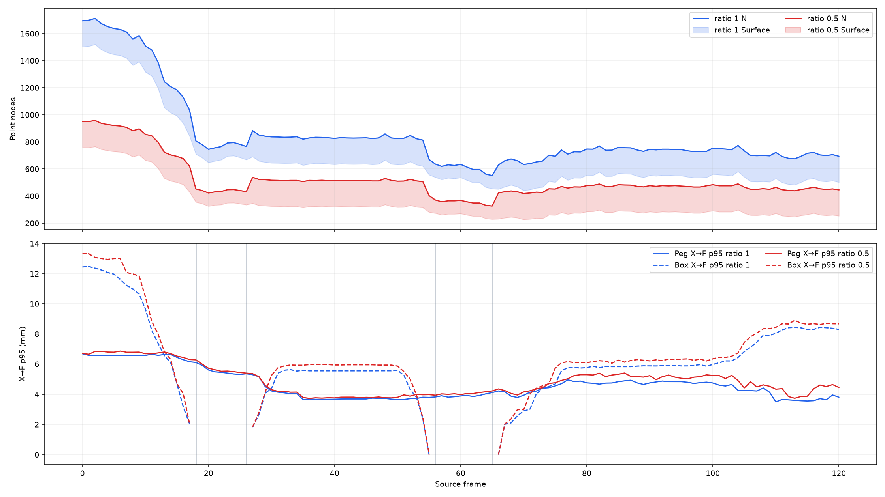
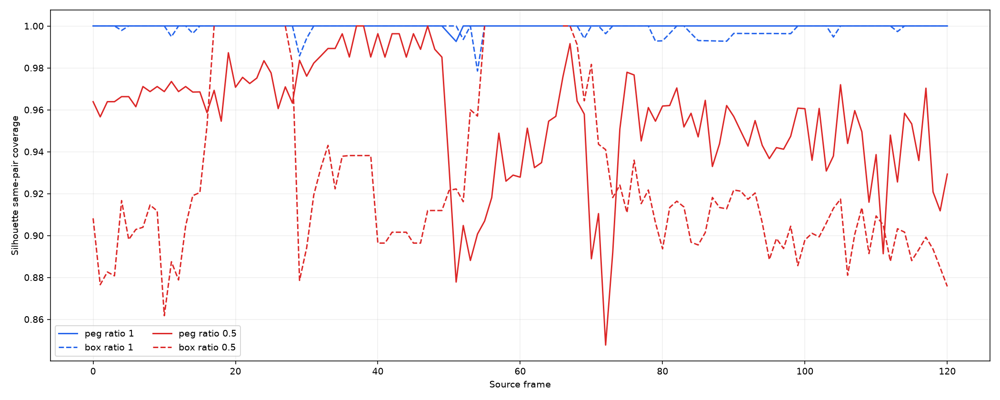
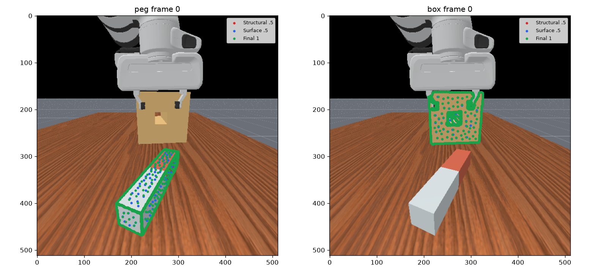
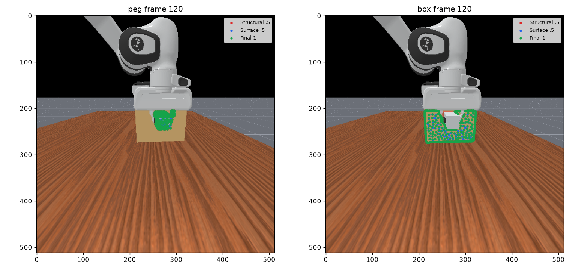
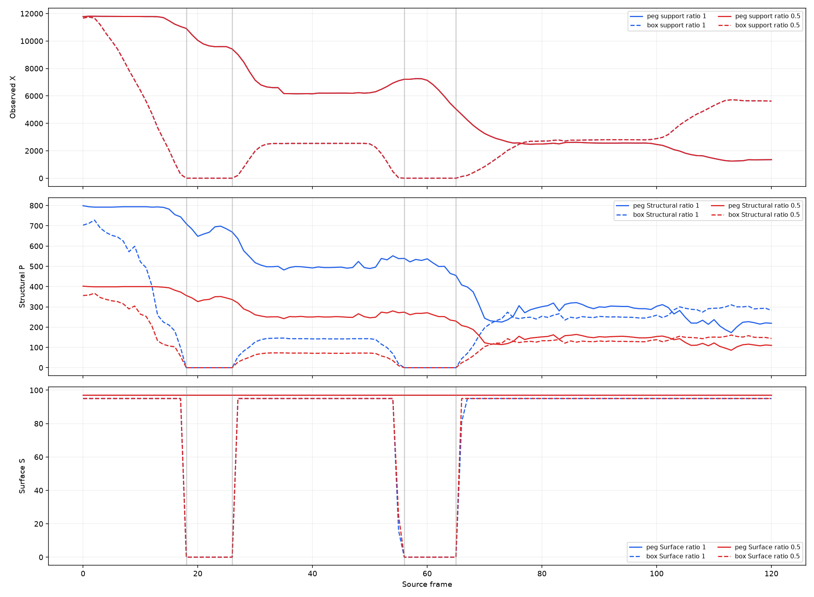
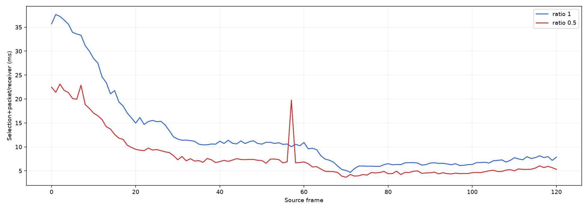

# Task03-K — Continuous-Frame Shape-First Sampling Validation

전체 HTML·NPZ·실행 소스와 원래 run 기록은 [HF 후속 게시 인덱스](../../visual/results/publications/sampling_followups.md)에 있다. Git에 포함한 핵심 그림·작은 수치는 아래 미리보기 링크로 확인할 수 있다.

Run UUID: `9185355a32b8433abc70f1738f983377`. 121 source frames, two fixed conditions; this is one episode, not 121 independent experiments.

[Static HTML](../../experiments/9185355a32b8433abc70f1738f983377/temporal_shape_first.html) · [JSON](../../experiments/9185355a32b8433abc70f1738f983377/temporal_shape_first.json) · [NPZ](../../experiments/9185355a32b8433abc70f1738f983377/frame_metrics.npz) · [Pre-GT selection hash](../../experiments/9185355a32b8433abc70f1738f983377/selection_before_gt.json)

## Input and freeze gates

AB cache full coverage: 121/121; RGB-D, masks, xyz, depth validity, overlap and observed support were checked. The source candidate contract came from original Task03 S3 per-frame NPZ. Frames 0, 45, and 80 exact reproduction passed for both ratios, source order and XYZ. Selection was frozen before GT; SHA-256 `198b9d1ffe965be49b81632f53fde5903dcc1e4dff0f934c2f94f74f2521e923`.

## Node counts

| ratio | mean | median | p95 | min | max |
|---:|---:|---:|---:|---:|---:|
| 1.0 | 851.83 | 750.0 | 1630.0 | 552 | 1712 |
| 0.5 | 519.42 | 476.0 | 917.0 | 327 | 958 |

Absolute frame-to-frame ΔN: mean 12.88, median 7.0, p95 47.4, max 168.0. The report does not interpret source-index overlap as physical identity.

## Geometry and temporal observations

All raw frame/object metrics, GT auxiliary results, source/provenance arrays, and timings are in the linked JSON/NPZ. GT metrics were computed after the immutable selection freeze. Empty observable GT references are reported N/A by the evaluator.

## Fixed representative frames

## Runtime and limits

Input/common preprocessing: 2980.3 ms total; GT/geometry evaluation: 21892.7 ms total. CPU offline sampling timings are recorded per frame-condition. This does not measure Graph/GNN throughput or establish 20 Hz. `feature_available` remains audit metadata and edge status remains `not_implemented`; no feature encoder, edges, EE integration, or model execution was added.

## Paired sequence results

| Metric | Ratio 1.0 | Ratio 0.5 |
|---|---:|---:|
| mean | 851.8347107438017 | 519.4214876033058 |
| median | 750.0 | 476.0 |
| p95 | 1630.0 | 917.0 |
| min/max | 552/1712 | 327/958 |

| Object | Mean P 1→.5 | Mean S 1→.5 | Mean paired N saving | X→F pooled mean/p95/max mm, ratio 1 | ratio .5 |
|---|---:|---:|---:|---:|---:|
| peg | 456.9→230.8 | 97.0→97.0 | 332.4 | 2.71/5.74/8.68 | 2.88/5.89/8.80 |
| box | 218.6→112.1 | 79.3→79.5 | 332.4 | 4.35/9.87/15.70 | 4.81/10.63/17.27 |

Mean paired node saving: 332.41 points/frame, or 39.02% of mean nodes. Per-frame ΔN and all source/candidate/P/S/F counts are in JSON.

Pooled X→F values combine all query points across the sequence; frame-mean p95 values remain separate in JSON. Candidate PCA5 and Silhouette C→P/F distances, exact selection fraction, same-pair 2px AND 3mm silhouette coverage, contour missing runs and Structural P versus final F are recorded frame by frame.

## GT auxiliary results

Selection was frozen before GT access. Peg seam and Box rim use the existing Task03 GT reference definitions. GT-visible coverage is separate from tracker-observable retention. Micro aggregates sum references; macro averages defined frames equally. The JSON retains actual matching node and unique reference counts at X/C/P/S/F stages. Zero observable reference frames remain N/A.

| Object | Ratio | GT visible micro coverage | Observable micro retention | Observable frame macro retention | Defined frames |
|---|---:|---:|---:|---:|---:|
| peg | 1.0 | 0.9540 | 0.9600 | 0.9365 | 121/121 |
| peg | 0.5 | 0.9162 | 0.9219 | 0.8869 | 121/121 |
| box | 1.0 | 0.6547 | 0.8527 | 0.7452 | 47/121 |
| box | 0.5 | 0.5495 | 0.7158 | 0.6235 | 47/121 |

## Box support loss/reacquisition

Arrays are ordered immediately before, first lost, last lost, immediately after; no stale geometry policy is implemented.

| Interval | frames | X | silhouette C | P | S | F | total N |
|---|---|---|---|---|---|---|---|
| 18–26 | [17, 18, 26, 27] | [290, 0, 0, 208] | [103, 0, 0, 72] | [56, 0, 0, 28] | [95, 0, 0, 95] | [151, 0, 0, 123] | [621, 453, 433, 539] |
| 56–65 | [55, 56, 65, 66] | [35, 0, 0, 125] | [23, 0, 0, 35] | [10, 0, 0, 24] | [25, 0, 0, 95] | [35, 0, 0, 119] | [403, 371, 327, 424] |

## CPU and provenance

Selection plus packet/receiver per-condition mean/median/p95/max: 9.98/7.27/24.57/37.67 ms. Stage-specific thinning, union, Surface FPS and receiver timings are in JSON. CPU offline timing does not establish 20 Hz. All provenance arrays align for variable N; receiver ran. Feature metadata remains audit-only and edges remain not implemented.

## Fixed representative overlays

### Input change versus selection change

For the loss intervals, raw Box mask area and valid observed X are both recorded. The raw mask area is [290, 0, 0, 209] around frames 18–26 and [35, 0, 0, 126] around frames 56–65 (before/start/end/after). X follows the same disappearance and returns with valid depth at the reacquisition frame. The saved PCA5/Silhouette candidate counts identify candidate loss separately; there is no stale geometry fallback.

### Common CPU preprocessing

The combined evidence load, geometry reconstruction, and common preparation took 2980.3 ms across the run. Per frame-object common helper time, mean/median/p95/max (ms): contour 0.260/0.262/0.377/1.062; nominal scale 0.046/0.046/0.075/0.154; voxel representatives 1.963/1.703/4.258/5.036. Selection-plus-packet worst cases are in the JSON. These timings describe offline CPU work only.

### Largest ratio 0.5 node-count changes

| Transition | ΔN | Peg F before→after | Box F before→after |
|---|---:|---:|---:|
| 17->18 | -168 | 470→453 | 151→0 |
| 26->27 | 106 | 433→416 | 0→123 |
| 54->55 | -104 | 377→368 | 130→35 |
| 65->66 | 97 | 327→305 | 0→119 |
| 12->13 | -75 | 497→496 | 301→227 |
| 16->17 | -56 | 479→470 | 198→151 |
| 11->12 | -47 | 497→497 | 348→301 |
| 9->10 | -40 | 497→497 | 399→359 |

Per-object final-node distributions and absolute frame-to-frame changes are available in JSON. The large Box transitions coincide with observed-mask/support disappearance or reacquisition where those intervals overlap; they are described as input-driven output changes, not sampling jitter.

## Silhouette coverage summary

Same-pair tolerance requires both ≤2 px and ≤3 mm for the same GT pair. Means are equal-weight across defined frames; per-frame curves and exact counts are in JSON.

| Object | Ratio | Exact selected silhouette mean | Same-pair 2px AND 3mm mean | Defined frames |
|---|---:|---:|---:|---:|
| peg | 1.0 | 0.8700 | 0.9999 | 121/121 |
| peg | 0.5 | 0.4618 | 0.9558 | 121/121 |
| box | 1.0 | 0.7464 | 0.9984 | 102/121 |
| box | 0.5 | 0.4442 | 0.9160 | 102/121 |
