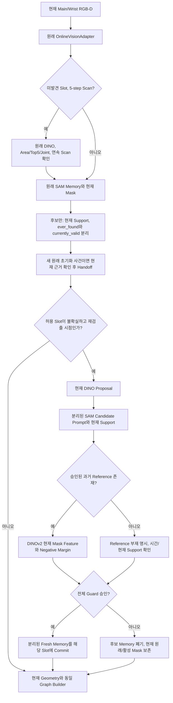

# Task10-I Stage4A-2 — DINO / DINOv2 / SAM2 integration investigation

**PAUSED_SCOPE_REVIEW — 사용자 요청에 따른 안전한 일시 중지.**

현재 후보는 **부분 개선 후보이며 Development 필수 안전 기준 미통과**다.
[범위 검토용 정리와 정확한 재개 지점](10i_stage4a2_paused_scope_review.md)을 우선 읽는다.
Internal 후보38/60 완료, 실행 중이던0858 full_task의21 Frame은 PARTIAL로 보존했다.
신규 Final·전수 Oracle·Detector Raw 재실행 및 대기 Runner의 자동 시작을 차단했다.

**아래 본문은 일시 중지 이전의 누적 연구 기록이다.** 과거의 “진행 중/자동 후속 실행”
설명은 현재 실행 권한을 뜻하지 않는다. 연구 전체 완료와 채택 판정은 미실시다.

2026-11-01. 이 문서는 현재까지 실제 실행한 감사 결과와 남은 연구를 기록한다.
최종 보고서나 완료 Receipt로 취급하지 않는다. Stage4A의 기존 NO_GO는 유지한다.
이번 Stage의 Independent Final 및 Stage4B Handoff는 아직 없다. Practical Correction은
실제 세 모델을 호출하는 Engineering과 Historical C/BC 평가를 통과했다.
새 Development36의 B0/A/P 및 Graph 평가는 완료했고, C_KEEP/BC_KEEP의 전수 마스크도
완료했다. 전체 C/BC 및 Main Box 제한 가설의 Graph/등록 평가는 완료했으며 기준을
충족하지 못했다. Wrist Peg/Main Box 보정과 후속 원래 초기화 Handoff를 결합한 후보의
Development Graph 평가도 완료했다. 후보 Source/Config와 기존 기준을 동결한 뒤
Internal30의 독립 실행을 시작했다. 신규 Final은 아직 수집하지 않았다. 최신 근거와
기존 수치의 정정은 문서 후반에 있다.

## 실행 환경과 보호 범위

Vast API로58576054가 running임을 확인하고 직접 SSH로 접속했다. Proxy SSH는
연결 종료됐으나 직접 접속은 성공했다. 원격 운영 지침을 읽었다. 실행 전 디스크
200GB 중 약172GB 여유, RTX3090 VRAM24576MiB 중1MiB 사용, 기존 연구 tmux 없음.
기존58576054의 Finalization/Completion/Posthoc Root와 원래 v5 Root가 존재함을
확인했다. 과거57987772를 실행 대상으로 사용하지 않았다.

Python3.12 환경 `/workspace/venvs/task10i-stage4a-cu130`을 사용했다.
실제 Package: Torch2.14.1+cu130, torchvision0.29.1+cu130,
Transformers5.19.0, tokenizers0.23.3, NumPy2.5.4, ManiSkill3.0.1, SAPIEN3.0.3.
이번 실행에서는 CUDA Model Forward, CPU Graph와 CPU PhysX/CUDA SAPIEN의 새 Render·
6 Frame Step 및 동시 GT Capture Engineering을 실행했다. GPU PhysX와 macOS Model
Forward는 실행하지 않았다. 새 Stress78/Collector104 Frame Engineering은 완료했다.

연구 Source는 기존 동등성 검증 Source의 독립 복사본에 새 모듈만 추가했다.
Production, 원래 Dataset/Checkpoint/Stage4A 결과, Task10-H는 수정하지 않았다.
Git Commit, Publishing, 새 유료 Instance, Stage4B 재캐시, 정책 학습은 하지 않았다.

## Input과 새 분할 — CONFIRMED

원본 Raw/GT712개 파일의 SHA를 Stage3 Manifest와 대조했다. 원본 복사 없이
읽기 전용 참조를 사용했다. Stage4A Reserve66을
`sha256('task10i-stage4a2-v1:'+parent_id)` 순서로 정렬해 Development36,
Internal Holdout30을 사전 동결했다. 기존 Development24/Internal24/Validation16과
충돌0이다. Internal30의 이미지나 성능은 아직 평가하지 않았다.
최종 신규 Seed Queue 등록·과거 Seed 충돌 감사는 후속 단계에서 완료했다.

[분할 Manifest](../../outputs/task10i/stage4a2/audit_v1/dataset_partition_manifest.json),
[입력·Runtime 검증](../../outputs/task10i/stage4a2/audit_v1/input_and_runtime_verification.json).

## Baseline과 실제 호출 — CONFIRMED, 한 Fixture 범위

원래 Fixture2000003 / Parent existing_30080의 Action Frame0–100을 재실행했다.
모든 Mask와 Graph5개 Tensor가 원래 F1 및 Stage4A 참조와 byte-equal이었다.
Mask/Graph/Gate 불일치 Frame은 각각0/101이다. Terminal은 과거 F1 참조가 없어
이 비교에 포함하지 않았다. 전체 모집단 동등성으로 확대하지 않는다.

Torch thread1, seed42, deterministic OFF, matmul TF32 OFF, cuDNN TF32 ON을
유지했다. 새 Observer는 반환값을 바꾸지 않았고 모델의 추가 Forward를 하지 않았다.
실제 DINO Forward4회, DINOv2 Forward0회, Adapter process202회,
detect_initial2회, SAM2 내부 `_run_single_frame_inference` 출력404건을 기록했다.
SAM2 Predictor 전체 `forward()` 호출 수와 내부 Frame Inference 수는 다르다.

실행 순서는 현재 Fixture에서 `RGB → DINO 초기화 → SAM2 → 기존 Geometry/Graph`다.
DINOv2가 중간에 실행된다고 볼 근거는 없다. Source에서도 OnlineVisionAdapter에
DINOv2 의존성/호출이 없다. `found`는 초기화 이력이고 현재 Mask의 유효성 상태가
아니다. 두 Slot이 found이면 scan이 멈추며, found Slot은 재검출하지 않는다.

[동등성 결과](../../outputs/task10i/stage4a2/audit_v1/baseline_forward_equivalence.json),
[실제 Call Graph](../../outputs/task10i/stage4a2/audit_v1/execution_call_graph.json),
[설치 Source와 Line](../../outputs/task10i/stage4a2/audit_v1/installed_source_audit.json).

## 초기 SAM2 출력 감사 — CONFIRMED

설치된 Predictor 내부 출력에서 pred_masks, obj_ptr, object_score_logits,
maskmem_features와 maskmem_pos_enc의 Shape/Type을 기록했다. 첫 Prompt Inference는
pred_masks[1,1,256,256], obj_ptr[1,256], object_score_logits[1,1]을 노출했고,
그 호출의 Memory Feature는 None이었다. 이후 전체404건은 별도 Trace에 있다.
Binary Tracker API는 logits>0 결과만 반환한다. 공식 Object Presence Logit을
보정된 확률이나 Mask Precision으로 취급하지 않는다.

이 초기 Trace 자체는 Memory 수정, Rollback 또는 Causal Trigger의 효과를 입증하지
않는다. 후속 API/Oracle Control 및 Practical Engineering은 아래 별도로 기록했다.
[SAM2 Trace](../../outputs/task10i/stage4a2/audit_v1/sam2_memory_state_trace.json).

## 실제 순서 — Baseline과 후보를 분리

아래 후보 순서는 검증된 Source의 실제 순서다. 후보의 DINOv2 입력은 SAM이 만든
현재 Mask에서 Robot/Depth Support를 정리한 영역이므로, 개념도와 달리 새 SAM Prompt
Inference가 Feature Matching보다 먼저 실행된다. B0는 이 보정 분기에 들어가지 않는다.
Reference가 없는 최초 누락에는 미래 Reference를 채우지 않고 현재 DINO/Support와
과거 후보의 시간 확인을 사용한다. 동시 Camera Feature 합의는 후보의 승인 규칙이 아니다.

## DINOv2 별도 경로와 실제 Feature 진단

별도 Visual `reanchor_v1.py:Dino`는 전체 RGB를448×448 bilinear resize하고,
ImageNet normalization 후 BF16 Forward의 CLS를 제외한 Patch Feature를 Mask로
가중 평균하고 L2 정규화한다. 기본 AutoImageProcessor의 Center Crop을 쓰지 않는다.
해당 클래스의 Feature Cache Key는 timestep 하나다. 이를 Camera/Episode 공유 시
안전하다고 가정하지 않는다. 현재 Baseline에서는 이 클래스 자체를 호출하지 않는다.
Reanchor의 DINOv2 선택은 cfg reid='dino'에서만 활성화되며 기본 cfg는 reid='sam'이다.

별도 Stage4A2 진단에서 정확한 `facebook/dinov2-small`을 읽기 전용 공개 다운로드했다.
Revision `ed25f3a31f01632728cabb09d1542f84ab7b0056`, model.safetensors SHA256
`ae1e99fcefd534ed978cdeb8326f08030c96e28b7a81ffcbc98a857c84d14be1`.
기존 다른 모델 Checkpoint를 교체하지 않았다. Processor 설정도 읽어 저장했다.
공식 [모델 카드](https://huggingface.co/facebook/dinov2-small)는 Feature Extraction
사용법 참고이며, Object Identity 분리 성능은 아래 실측으로만 판단한다.

과거 Development24에서 Parent마다 ID 정렬상 첫 Source 하나를 Mask 성공 여부와
무관하게 선택하고 t0/midpoint/terminal, 양 Camera를 조사했다. EXACT_GT만 사용했다.
1,866개 Embedding,10,445개 Pair를 생성했다. Prediction Mask와 Oracle GT Mask의
Feature Branch를 분리했다. 같은 Physical Parent/Actor를 Positive로,
같은 Scene의 다른 Actor를 Negative로 했다. Cross-parent 같은 종류 Peg를 Negative로
만들지 않았다. GT Support80% 미만의 Mixed/Background Crop은 Pair Label에서
제외하고 Provenance에 보존했다. 이 제한 때문에 전체 Background Hard-negative
성능으로 해석할 수 없다. Robot 내부 Link를 동일 물체 Positive로 사용하지 않았다.

첫 v1은 Pair Label에 Semantic Slot을 사용한 오류가 있어 결론에서 제외했다.
오류 Source/Output은 보존했고 실제 Actor Support를 사용하는 독립 v2로 재실행했다.
이는 평가 Label 수정이며 Internal/Final 결과를 본 튜닝은 아니다.

### 탐색적 결과 — SUPPORTED, 독립 검증 아님

아래는 각 조건의 탐색 ROC Grid에서 FPR≤1%인 점 중 TPR가 최대인 점이다.
후보 Threshold를 채택하거나 실사용 성능으로 주장하지 않는다. Pair는 독립 Parent가
아니고, 조건별 유효 Pair 수도 다르다. Parent CI와 전체 Hard-negative 확장은 남아 있다.

| Branch | Feature | Positive/Negative Pair | TPR | FPR |
|---|---|---:|---:|---:|
| Oracle Mask | 기존 full-image448 masked-patch |576/2232|.07465|.00851|
| Oracle Mask | bbox crop CLS |589/2268|.05093|.00882|
| Oracle Mask | padded crop CLS |589/2268|.05263|.00926|
| Predicted Mask | 기존 full-image448 masked-patch |211/430|.13270|.00930|
| Predicted Mask | bbox crop CLS |211/430|.14692|.00698|
| Predicted Mask | padded crop CLS |211/430|.13270|.00930|

Oracle 기존 Patch Feature의 같은 Camera Positive median cosine은.682,
다른 Camera Positive는.339였다. Negative median은 각각.558/.369였다.
단일 Similarity Threshold의 분리에는 큰 중첩이 있다. Padded Crop이 이 진단에서
문제를 해결했다는 근거는 없다. Crop과 Feature 종류가 함께 바뀐 CLS 조건이므로
그 차이를 Padding만의 인과 효과로 주장하지 않는다. Full Patch와 동일 Feature를
유지한 Crop Control, Reference 오염/갱신, 연속 Grasp/Occlusion별 Pair는 추가해야 한다.

[진단 Scope](../../outputs/task10i/stage4a2/dinov2_v2/matching/scope.json),
[전체 ROC/PR Grid](../../outputs/task10i/stage4a2/dinov2_v2/matching/dinov2_reidentification_metrics.csv),
[Pair](../../outputs/task10i/stage4a2/dinov2_v2/matching/dinov2_positive_negative_pairs.csv),
[Reference Provenance](../../outputs/task10i/stage4a2/dinov2_v2/matching/dinov2_reference_provenance.json),
[Processor](../../outputs/task10i/stage4a2/dinov2_v2/matching/dinov2_processor_readback.json).

원격 전달 Archive와 로컬 Archive SHA256은
`3dea51924f00145b24688824ed8cbec79b550645659c0804af6fef4162b08cff`로 일치했다.
이 검사는 최종 전수 Artifact Index/Readback을 대체하지 않는다.

## 운영·시험 및 미완료 사항

독립 tmux `task10i-stage4a2`에서 Python Coordinator를 사용했다. 공통
ExperimentLogger UUID 규칙과 Local Logging을 재사용했다. Baseline Coordinator
UUID b49efca8bf094d6b8c7a8c61885d6ef0, 원래 Verifier의 별도 UUID
439f089b12474730a4f441df853b81f5, DINOv2 v2 UUID23a7d359eb094deb947483140dce0310.
단계 Receipt에는 Source Digest와 Artifact SHA를 넣고 변경된 Source로 건너뛰기를
금지했다. 전체 연구의 Crash/Resume·OOM·Memory 복구 검증은 아직 끝나지 않았다.

로컬 새 Crop 계약2개와 기존 Stage4A 계약9개, 총11개가 통과했다.
이 시험은 Model CUDA 정확도, Simulator 또는 전체 Miniature E2E를 대체하지 않는다.

Raw DINO 전수 Query 감사는 별도 Root에서 완료했다.256개 t0 Object/Camera/Episode
행,230,400 Query행,96개 고유 Raw Forward Artifact를 보존된 출력에서 재구성했고
기존 Joint Assignment를 정확히 재현했다. 새 Forward는0이다. 원래 Token별 Logits는
중복 저장하지 않고 원본 NPZ SHA/Shape/Token IDs를 참조한다. Localization Funnel을
Semantic Identity 전체 감사가 끝난 것으로 해석하지 않는다.

[Raw Query CSV](../../outputs/task10i/stage4a2/dino_v2/dino_raw_queries_audit.csv),
[Funnel](../../outputs/task10i/stage4a2/dino_v2/dino_candidate_restriction_funnel.json),
[Scope](../../outputs/task10i/stage4a2/dino_v2/scope.json).
원격/로컬 전달 Archive SHA는
`04935fdc9e346625809e1a9384132cd28744b99c73c92466efef05ac232b4e21`로 일치했다.
첫 Source-only
Baseline 복사본에 후대 detector_audit helper가 없어 Import 실패한 Root를 보존하고,
작은 좌표 변환을 명시한 새 Root로 분리했다. 성공한 Stage로 세지 않는다.

아직 실질적인 Practical Candidate를 검증하지 않았다. 따라서 GO/NO_GO의 최종
채택 판정은 하지 않는다. Adoption 기준 사전 수치 등록, Development36,
Internal30, 새32+12 Final, 동시 GT Capture, Graph Safety/Latency, Gallery,
SAM2 Memory 통제, 최종20문항 답변·Completion Audit·Stage4B Handoff가 남아 있다.
현재까지의 진단만으로 전체 연구 완료나 독립 Reliability 개선을 선언할 수 없다.

## 후속 Prompt 통제와 새 Development 실행

동일한 사전 선택24 Parent의 t0 Main/Wrist에7개 Prompt,총336번 실제 DINO
Forward를 실행했다. Threshold.1, Area.25, Top5, Missing.3, Exclusion IoU.3은
유지했다. 새 Phrase는 새 Forward이며 동일 Raw 재정렬과 구별한다. Raw Query/Token
출력과 Tokenization은 원격에 전부 저장했고 작은 Summary를 로컬에 회수했다.

| Camera | Peg Prompt / Box Prompt=cardboard box | Peg localized / wrong accepted | Box localized / wrong accepted |
|---|---|---:|---:|
| Main | red and white block |22/0|21/3|
| Main | red and white peg |7/11|22/1|
| Main | peg |0/22|22/0|
| Main | rectangular rod |5/16|22/1|
| Wrist | red and white block |10/1|0/24|
| Wrist | red and white peg |14/0|0/24|
| Wrist | peg |8/16|0/24|
| Wrist | rectangular rod |7/0|0/24|

각 행24 Parent다. Localized는GT Box IoU≥.5의 위치 평가이며 Semantic Mask
Purity가 아니다. Raw Proposal 수와 최초 정답 Rank는 별CSV에 있다. Main에 새
Peg Prompt를 일괄 적용할 근거가 없고 Camera별 효과가 다르다. Episode0924는 어느
Peg Prompt도 양Camera 정답 채택을 복구하지 못했다. Wrist Box는 Graph 대상에서
계속 제외한다. 이 수치를 최종Graph 실패 수에 합산하지 않는다.

[Prompt CSV](../../outputs/task10i/stage4a2/prompt_v1/dino_prompt_comparison.csv),
[Joint Assignment](../../outputs/task10i/stage4a2/prompt_v1/prompt_joint_assignment.json),
[Scope](../../outputs/task10i/stage4a2/prompt_v1/scope.json).
Logger UUID e1e20443c9b6435f9fc2b1f9364452d7.

이 탐색 결과로 A조건을 Wrist Peg Prompt만 `red and white peg`로 바꾸는
독립Wrapper로 구현했다. Main, 기존Consumer, SAM2와Found Guard는 보존한다.
A단독 Ablation이며 DINOv2 활성화나 Memory 교정을 포함하는 ABC가 아니다.
새Development36 전체Sequence의 B0/A 비교 Python Orchestrator는
`/workspace/task10i_stage4a2_newdev_A_20261101_v1`에 있다. SAM2 통제 실험의 실제
PID와 완료Receipt를 확인한 뒤 Engineering3 Frame이 통과하면 전수 추론을 시작한다.
GT평가는 별도이며 실행 배치를 평가 완료로 세지 않는다. 미완료Episode는 suffix를
붙이지 않고 t0부터 재실행하며 이전Partial을 보존한다.

## 동시GT Capture Engineering 실측 — CONFIRMED,6 Frame 범위

`/workspace/task10i_stage4a2_gt_smoke_20261101_v1`에서 CPU PhysX/CUDA SAPIEN을
실제로 실행했다. Engineering Seed71300000에서 Reset후 Zero Action5회를 실행해
6연속Frame×2 Camera를 검사했다. Segmentation-only Readback 전후 RGB,Raw Depth,
Intrinsic,Extrinsic,cam2world_gl은 모두 array-equal이었다. Clock,Peg/Box Pose,
Robot qpos/qvel도 변하지 않았다. Segmentation과RGB/Depth Shape 및 Peg/Box/Robot
Actor ID비교차를 검사했다. 기존Observation/Sensor Config는 바꾸지 않았다.
이는 새Final자료가 아니며 Full-task/Stress 전체조건의 검증은 남아 있다.

공통Logger UUID516973a573ed4d3aa6533ae2af56fde6.
[Engineering GT Receipt](../../outputs/task10i/stage4a2/increment_v1/task10i_stage4a2_gt_smoke_20261101_v1/run/receipt.json).

## Final Seed 사전 등록 — CONFIRMED,수집Protocol 일부 미완

새Final Normal/Stress 각각1024개 유한Attempt Queue를 PCG64(1011202642)로
등록했다. 기존Stage1 conservative integer/Source range Inventory, Stage1 전체
등록Attempt Seed, 현재Stage3 Manifest, Task10-G Manifest 및 실제Final CSV Seed를
제외했다.2048 Seed 상호 및 제외집합과의 충돌은0이다. Stage2/3 Parent는 기존Parent
또는Stage1에서 왔으므로 양쪽을 제외했다. Final이미지는 아직 생성/열람하지 않았다.

Normal은 변경하지 않은Stage1 Visibility/Physical/Replay Gate를 통과하는 앞32 Parent,
Stress는 별도Queue의 앞12 Parent를 계획한다. Mask나Expert성공으로 선택하지 않는다.
Stress Intervention Geometry와 통계Power 검토는 아직 동결하지 않았으므로
`full_collection_protocol_ready=false`를 유지했다. Seed등록을 Final수집 완료나
전체Protocol 동결로 취급하지 않는다.
[Final Seed Protocol](../../outputs/task10i/stage4a2/increment_v1/task10i_stage4a2_benchmark_protocol_20261101_v1/run/new_final_benchmark_protocol.json),
[충돌 감사](../../outputs/task10i/stage4a2/increment_v1/task10i_stage4a2_benchmark_protocol_20261101_v1/run/seed_collision_audit.json).

## SAM2 통제 실험과OOM

기존0924 초기실패,0121의t95 Main Box Drift,2000003의t50 정상추적을 사전 등록했다.
B0,GT Box초기화,다른Actor의GT Box를 주는 잘못된 초기화,기존Memory에 정확한Box
추가,새Object Memory에 정확한Box초기화를 같은Prefix/Suffix에서 비교한다.
Oracle Trigger/Prompt이며 Practical개선으로 해석하지 않는다.

첫v1은 조건을 동시에 실행하다 긴Prefix에서 CUDA OOM이 났다. 실제 예외는
Allocated약18.44GiB와 Reserved4.72GiB를 보고했다. Source/Log/Partial을 보존했다.
모델 연산과Memory내용을 바꾸지 않고 조건을 순차 실행하는v2를 별도Root에 만들었다.
이후 `/workspace/task10i_stage4a2_sam_controls_20261101_v2`의 실행을 완료했다.
실패한v1의 부분결과를 완료Sequence나 채택 근거로 사용하지 않는다.

## Practical 상태 관리 구현 단계

`reanchor_state_machine.py`는 ever_found/currently_valid를 분리한다. 현재 예측Mask,
Depth Support,Robot제거 후Support 및 실제 노출되는 경우Object Logit만 받는다.
GT Actor/Mask/Pose,Expert Phase,미래Frame은 입력계약에 없다. 연속Uncertain의
Hysteresis,재검출 간격,Acceptance후Hold,Missing Reference명시,현재Frame의
Candidate Transaction과Rejection을 구현했다. 새Memory는 현재Frame검증을 통과하기
전까지 기존Memory에 Commit하지 않는 계약이다. Camera/Episode/Object/Clock
불연속은 거부한다.

이는 아직 모델 연결 전Development규칙으로,Threshold는 미검증이다. Runtime효과나
SAM2 Rollback을 실증한 후보로 취급하지 않는다. Healthy Sequence의 불필요한
재검출 거부,ever_found후Loss,Missing Reference,Commit실패,Camera/미래 불연속,
GT/Future Sidecar인자 거부,Query좌표,Crop 등11개 계약테스트가 로컬에서 통과했다.

새11개와 기존Stage4A9개를 함께 실행한 최종 로컬검사는20/20 PASS다.
보고서의 현재 로컬 Artifact 링크도 모두 실제 파일로 해석됐다.
별도 새Development Reference 실행은88 Sequence를 대상으로 시작했다
(`/workspace/task10i_stage4a2_newdev_reference_20261101_v1`,
Logger e8b0219c543446d4894cbda666adf17c). 첫 두 Sequence의 EXACT_GT는
각각79/91,30/33 Frame이었다. 일치하지 않는 Frame을 성공 또는정확GT로 승격하지
않는다. 이는 진행 중 일부 결과이며 전체Reference Accounting은 아직 없다.
모델 추론은 이 GT자료를 읽지 않는다.

## SAM2 초기화 오염과 교정 API 순서 — 추가 인과 실험

3개 Window,5개 조건,총3,980개 Object/Camera/Condition/Frame 행을 완료했다.
B0는 해당 Window 전체에서 기존Mask Cache와 정확히 일치했다. 기존Memory에
GT Box를 추가한 뒤 같은Frame을 재전파하는 조건은 오류를 복구하지 못했다.

Episode0121 Main Box의 t0 선택Box는 GT Box IoU0.328827이었다. SAM2는 이미
t0부터TP720/FP1215,Precision0.37209,IoU0.37133이었다. t95의Robot Mask를
깨끗한 초기화 후 발생한 순수Tracker Drift라고 설명할 수 없다. GT Box만으로
초기화를 바꾸면 t0 IoU0.97290, t95 IoU0.88832를 유지했다. 이 사례에서는
초기Prompt 오염이 장기오류의 결정적인 기여요인이라는 인과 근거다.
전체SAM2 실패가 이 원인이라는 일반화는 하지 않는다.

Episode0924 Main Peg t0의 B0는TP0/FP0이었다. GT Box 초기화 또는 새Memory를
GT Box로 초기화하면 TP819/FP5,IoU0.975가 됐다. 기존Memory 교정 조건은 해당
Object Slot이 없어 적용할 수 없었다. `NO_INITIALIZED_OBJECT_SLOT`을 SAM2 모델이
정상Prompt에서도 실패한 사례로 세지 않는다.

[통제 결과](../../outputs/task10i/stage4a2/sam_controls_v2/sam2_causal_recovery_metrics.csv),
[Memory Trace](../../outputs/task10i/stage4a2/sam_controls_v2/sam2_memory_state_trace.json),
[Scope](../../outputs/task10i/stage4a2/sam_controls_v2/scope.json).
Logger3453695024754e6cbb0f2b318b5f0626.
Archive SHA256334698f3627e102c4083e02c83e5551575cab8fe8a3d45783cccefa79a0cd55a는
원격/로컬 일치를 확인했다.

설치된SAM2 Source에서 `add_new_points_or_box`는 이미 추적된Frame을 기본적으로
non-conditioning 출력에 넣는다. 실제Flag는 `add_all_frames_to_correct_as_cond=false`,
`clear_non_cond_mem_around_input=false`였다. 이어서 같은Frame을 `propagate_in_video`에
주면 non-conditioning Frame을 Prompt 없이 다시 계산하고 덮어쓴다. 따라서 이 순서는
교정Prompt의 즉시Mask를 보존하지 못한다. 이 실패는 새 통제Wrapper에서 실증한
API사용 오류다. 원래Baseline은 교정API를 호출하지 않으므로, 원래Baseline에
같은교정코드가 있었다고 소급 설명하지 않는다.

별도 `sam2_correction.py`는 현재Frame Prompt의 반환Mask를 사용하고 Preflight로
Memory만 확정하며, 다음 실제 관측부터 전파하도록 구현했다. Mutable Container만
분기한 Candidate State에서 수행하고,원본State의 전체Tensor Byte SHA가 변하지
않았음을 실제Runtime에서 검사했다. 거부하면 원래State 객체를 그대로 유지한다.
Conditioning Frame으로 보존하는 조건도 별도로 비교하고 공유Predictor Flag는
호출 직후 복원했다. 원래Checkpoint/설치Source는 수정하지 않았다.

0121의 t95–106,같은12 EXACT_GT Frame에서 결과는 다음과 같다.

| 조건 | Mean Pixel Recall | Mean IoU |
|---|---:|---:|
| B0 / 거부된Transaction |.72082|.13264|
| 즉시Prompt Mask + Preflight |.92956|.16211|
| 위 방식 + Conditioning 유지 |.89789|.15593|
| GT Box의 새Object Memory |.9698|.8761|
| GT Box로 t0초기화 |.9646|.8914|

올바른API 순서만으로 오염된기존Mask/Memory 문제가 해결되지는 않았다. t95의
즉시교정도TP151/FP1230,IoU0.10724로 오염을 크게 남겼다. 새Memory 조건은
TP177/FP25,IoU0.87192였다. 이 비교는 기존Memory와 이전Mask Logit의 영향을 함께
바꾸므로 둘 중 어느Tensor 하나만의 원인이라고 단정하지 않는다. GT Trigger/Box를
사용한Oracle이며 Practical Reanchor 성공률이 아니다.

2000003의 기존 t50은 실제Pixel Precision이 약0.745여서 새정의의 깨끗한
Negative Control이라고 부를 수 없었다. 별도API 실험은 t5를 등록했고,그Frame의
B0는TP528/FP6,IoU0.96이었다. t5–25 Mean IoU는B0.92908,반환Mask+Preflight.93886,
Conditioning.92488이었다. 재초기화의 일괄 우위를 주장하지 않는다. 거부Transaction은
모든Frame에서 B0 Byte Equality를 유지했다. 실제Practical Trigger의 불필요한 교정
피해율과 동일한 지표로 취급하지 않는다.

[API 교정 Ablation](../../outputs/task10i/stage4a2/api_controls_v1/sam2_memory_correction_ablation.csv),
[Transaction Trace](../../outputs/task10i/stage4a2/api_controls_v1/sam2_correction_event_log.json),
[Scope](../../outputs/task10i/stage4a2/api_controls_v1/scope.json).
2개Episode,1,596행,Logger e006db44ade741de9ccc9b5f655accb0.
Archive SHA25676c8b1340ec92c6560dc63c259f247a3ed6c9546922b7f4ceba8ea2c2db1bd7f는
원격/로컬 일치를 확인했다.

## 실패 Gallery와 Readback

0924,0121,2000003의 전체Window를5fps MP4와 시간순PNG로 저장했다. Raw 양Camera,
GT 경계,기존Mask,GT Box초기화,의도적오초기화,교정실패,새Memory 결과를 함께
표시했다. MP4는 전체Frame을 재Decode해 길이를 검증했다. 0121의t94/t95 Strip을
직접 열어Robot 오점과Box 경계,정확한초기화 및Fresh Memory의 복구를 시각 확인했다.
이Gallery는Oracle Mask 진단이며 DINOv2 Rank/Graph Panel을 포함한 최종통합
Gallery는 아직 아니다.

[0121 시간순 Strip](../../outputs/task10i/stage4a2/sam_gallery_v1/10i_stage3_10i_s1_0121_full_task.png),
[0121 전체Window MP4](../../outputs/task10i/stage4a2/sam_gallery_v1/10i_stage3_10i_s1_0121_full_task.mp4),
[0924 Strip](../../outputs/task10i/stage4a2/sam_gallery_v1/10i_stage3_10i_s1_0924_full_task.png),
[Gallery Index](../../outputs/task10i/stage4a2/sam_gallery_v1/gallery_index.json).
Archive SHA256beadda673ca543466bb19d50f3f8e697597f7ed1e2abdbfc2260e2b9c775c86d는
원격/로컬 일치를 확인했다.

## 새Development의 진행,평가분모와 재개

Reference Replay는36 Parent/88 Sequence/5,845 Frame을 완료했다.
EXACT_GT5,234 Frame,GT_UNSUPPORTED611 Frame이다. 이611개를 Primary에 합치지
않는다. B0/A 추론은 GT를 읽지 않는 별도프로세스에서 계속 실행한다.

동일한원래 `CurrentGeometry.build`로 B0/A를 각각 처리하는 평가기를 실행했다.
Current-only,Box Main-only,Cap128,Graph21/Edge4,유한값,현재Source Provenance를
실제Builder에서 검사한다. 같은Mask면5개Graph Tensor가 Byte Equal이어야 한다.
Correct-source Coverage와Boundary,Peg Ends,실제관측Box Rim을 함께 계산한다.
Raw Actor Visibility와Valid-depth Coverage의 분모를 별도집계하고,Empty Precision은
미정의로 유지한다. Episode→Parent 평균과Parent Bootstrap2,000회를 구현했다.
새지표 및기존계약을 합쳐 로컬23개테스트가 통과했다.

첫Engineering Receipt는3 Frame만 평가하면서 전체Reference의EXACT_GT79개를
계수하는 Metadata 오류가 있었다. 이를 별도Source/Output에서Prefix로 제한해
3/3으로 재검증했다. 전체Episode의Graph연산/Pixel계산은 이Count 오류의 영향이
없으며,완료된Full Episode만 검증재사용한다.

Development 추론의첫OOM에서 상위Orchestrator는 유한Retry를 수행했으나,
Graph평가기v1은 Child의중간FAILED를 최종실패로 받아중단됐다. 실패Log와완료Graph는
보존했다. `resume_evaluation.py`는 Source Hash와평가함수AST의호환성,전체Episode의
입력/Reference/산출물SHA를검증하고완료Receipt만재사용한다. Supervisor가실제로
Retry중인지PID/Command로확인해일시적실패와최종실패를구별한다. 미완료Episode는
부분Graph를완료로세지않는다. 이재개를모델정확도개선으로계산하지않는다.

아직전체B0/A 지표,Practical C/BC/ABC,Internal30,새Final,정식Latency/완료Audit는
없다. 연구전체완료나후속Stage4B GO를선언할수없다.

[새Development Reference 완료Receipt](../../outputs/task10i/stage4a2/increment_v2/task10i_stage4a2_newdev_reference_20261101_v1/run/pipeline_state.json),
[수정된3 Frame Graph Engineering](../../outputs/task10i/stage4a2/increment_v2/task10i_stage4a2_graph_engineering_20261101_v2/run/engineering_barrier.json),
[평가기Source 호환성검증](../../outputs/task10i/stage4a2/increment_v2/task10i_stage4a2_paired_eval_20261101_v2/run/source_compatibility.json).
이Bundle SHA2564ac2f4ca7d4e0b176f7c5b256ec47370d8dde1a58e3cda1cac60497a78ca0731의
원격/로컬일치를확인했다. 재개평가기v2는10개완료Episode를검증재사용했고
추가Episode도실제처리중이다. 후속Summary도실제평가기PID를확인하며자동대기한다.

## 새 Development36 B0/A 완료 — 탐색 결과, 독립 Test 아님

88 Sequence/5,845 Frame의 모든 추론 및 동일 Builder Graph 평가를 완료했다.
Primary 평가에는 EXACT_GT5,234 Frame만 사용하고 Unsupported611 Frame은 제외했다.
Episode 평균 뒤 같은 Physical Parent의 Branch를 평균하고 Parent36개로 Bootstrap
2,000회를 수행했다. A는 기존 Consumer·SAM2를 유지하고 Wrist Peg Phrase만
`red and white peg`로 변경했다. Main Mask는 전체5,845 Frame에서 Byte Equal이었다.

| Parent-macro 지표 | B0 | A | Δ / 95% CI |
|---|---:|---:|---:|
| Wrist Peg Pixel Recall | .69027 | .83978 | +.14951 / [.07000,.24402] |
| Wrist Peg IoU | .68797 | .83642 | +.14845 / [.06927,.24205] |
| Wrist Peg Correct-mask Availability | .68838 | .84777 | +.15940 / [.07470,.25744] |
| Peg Correct-source 3D Coverage | .45439 | .47153 | +.01714 / [.00030,.03714] |
| Peg Ends Coverage | .47402 | .45953 | −.01449 / [−.02991,−.00207] |
| Box Correct-source 3D Coverage | .50948 | .50948 | 0 / [0,0] |
| Both-visible-camera Peg Correct-pixel Missing | .02765 | .02497 | −.00268 / [−.00804,0] |

마지막 행은 모든 해당 Frame의 지표이며 t0 전용 실패율로 해석하지 않는다.
A를 이대로 채택하지 않았다. Mask Recall과 전체 Surface Coverage 이득이 있더라도
양 끝 표면의 손실은 실제 악화이며 Final을 통과한 개선으로 주장할 수 없다.

빈 Prediction의 Precision은 미정의로 유지했다. 기존 Paired-defined Precision은
B0가 빈 Frame을 제외하므로 그것만으로 신규 초기화의 안전성을 주장하지 않는다.
별도 분석에서 Wrist Peg의 Visible Wrong-mask Event(Nonempty 및Precision<.8)는
양쪽 모두 Parent-macro0이었다. FP/GT-visible-pixel 비율은 .002366→.003459,
Δ+.001093[.000488,.001797]이었다. Pooled Pixel Precision은 .998360→.998340이었다.
정확도 자체가 아니라 분모가 다른 지표라는 점을 보존한다.

[전체 Parent 비교](../../outputs/task10i/stage4a2/increment_v3/task10i_stage4a2_newdev_summary_20261101_v2/run/summary/paired_parent_metrics.json),
[Graph 지표](../../outputs/task10i/stage4a2/increment_v3/task10i_stage4a2_newdev_summary_20261101_v2/run/summary/final_graph_reliability_metrics.csv),
[Phase/Camera 결과](../../outputs/task10i/stage4a2/increment_v3/task10i_stage4a2_newdev_summary_20261101_v2/run/summary/per_camera_per_phase_results.csv),
[별도 FP 안전성](../../outputs/task10i/stage4a2/increment_v3/task10i_stage4a2_newdev_diagnostics_20261101_v1/run/false_positive_safety_audit.csv).

## Mask 개선과 Peg Ends 악화의 연결 — SUPPORTED

동일 Main Mask와 동일 Downstream Builder에서도 Wrist 점 Pool이 바뀌면 기존
`PlanA.budget(...,128)`의 선택 결과가 바뀐다. 새 Architecture를 넣지 않고 저장된
Graph·Source Pixel·GT Local End Band를 사후 대조했다. EXACT_GT 중 Mask가 달라진
1,981 Frame에서 Ends Coverage 손실 Frame768개가 있었고, 그중751개에서 기존 Main
Source Pixel이 최종 Graph에서 빠졌다. 이 Frame들의 추가 Wrist Source는 평균51.86개다.
이 관찰은 추가 Wrist Surface가 제한된 Point Budget에서 기존 Main 끝점을 대체하는
경로를 지지한다. 모든 손실의 유일 원인이라고 일반화하지 않는다.

대표적인2000058 / existing_30077, t95에서 B0는 Main127/Wrist0점, A는 Main65/Wrist63점이었다.
Main End-band Point는83→38, Ends Coverage .95294→.42353으로 낮아졌지만 전체 Surface
Coverage는 .10156→.70571로 높아졌다. 선택된 Point의 공간 End Band Count와
Correct-source Coverage는 서로 다른 평가량이다. GT는 선택 이후 진단에만 사용했다.
Graph Sampling을 변경해 이 악화를 숨기지 않았다.

[전수 선택 진단](../../outputs/task10i/stage4a2/increment_v3/task10i_stage4a2_newdev_diagnostics_20261101_v1/run/endpoint_selection_diagnostic.csv),
[최악 End 손실 사례 Manifest](../../outputs/task10i/stage4a2/increment_v3/task10i_stage4a2_newdev_diagnostics_20261101_v1/run/endpoint_case_manifest.json).

## Practical C/BC의 실제 실행 Engineering — CONFIRMED, 효능 일반화 불가

`tri_model_integration.CausalCorrection`은 현재 RGB-D, 로봇 Proprioception/FK,
기존 Mask와 과거 승인 Feature만 받는다. `ever_found`와 `currently_valid`를 분리하고
Depth/Nonrobot Support, Temporal Center Consistency, 두 번의 연속 불확실성,
5-step 재검출 간격, 과거 Proposal Confirmation을 사용한다. Candidate SAM2는 별도
Fresh Memory에서 생성·검증하고 승인 후에만 기존 Override와 교체한다. 거부한
Candidate는 닫고 기존 Memory를 보존한다. Wrist Box는 교정하지 않는다.

BC는 실제 DINOv2 Small의448 Masked Patch Pooling과 L2 Feature를 사용한다.
Episode/Camera/Timestep/RGB SHA/Mode/Crop SHA Cache Key를 사용한다. 같은 Camera에서
3회 연속 Support 및 Nonrobot Fraction≥.9인 최초 Reference를 고정하고, 이후 자가
갱신하지 않는다. Similarity .6 및 Opposite/Robot Hard-negative Margin .05는 Development
가설이며 검증된 Classifier 확률이 아니다. Reference가 없으면 없음을 기록하고
Temporal/Current Evidence만으로 판단한다. 미래 Reference를 t0에 소급하지 않는다.
현재 양 Camera 후보 Feature의 일치만으로 동시 초기 누락을 복구했다고 주장하지 않는다.

Engineering은 기존2000003의 실제21 Frame RGB-D로 원래 B0를 다시 실행해 Cache와
모든 Mask의 Byte Equality를 검사했다. t8–18 Main Peg Prediction을 의도적으로 비우는
사전 고정된 **Engineering Fault**로 Re-ID 경로를 실행했다. GT 오류 시점을 Trigger로
삼지 않았으며 이 Fault 결과는 Practical 성능 분모에서 제외한다. 실제 DINO7회,
DINOv2 Forward5회, SAM2 내부 Frame Inference188회, Image Encoder104회,
Memory Encoder/Mask Decoder 각각188회를 기록했다. BC에서 실제 Reference Similarity
Comparison3회와 Reanchor Acceptance1회를 확인했다. 저장된 추론이 완료된 뒤 별도로
GT·Graph 평가를 실행했고 Graph 산출물을 Readback했다.

[SAM/DINO/DINOv2 실제 Engineering Scope](../../outputs/task10i/stage4a2/increment_v3/task10i_stage4a2_causal_ablation_20261101_v1/run/engineering/scope.json),
[실제 BC Forward·Comparison Receipt](../../outputs/task10i/stage4a2/increment_v3/task10i_stage4a2_causal_ablation_20261101_v1/run/engineering/episodes/2000003/BC/receipt.json).
이는 통합 경로가 작동한다는 증거이며 독립 Reliability 개선의 증거는 아니다.
실제 무주입0924/0121/2000003의 C/BC Historical 평가가 뒤이어 실행 중이다.

## Internal/Final 전 수치 채택 기준 등록 — CONFIRMED

등록 UUID3e1f86f2cb844c88b36f472ebb235311,
Criteria SHA25658fa6ad548ec29c3e9707a2b4756b0411f2b3c10189a62253e4f5ceed2d7abc9.
Historical 및 Development B0/A를 관측했으며 Internal30/새 Final은 아직 열지 않은
상태임을 등록했다. 이후 Candidate Source/Config 동결은 별도다.

단일 Primary는 Graph-relevant Main Peg/Wrist Peg/Main Box의 Correct-mask Availability다.
GT-visible≥8 Frame에서 Precision≥.9 및IoU≥.5를 성공으로 정의하고 Episode→Parent,
Parent 내 Slot을 같은 비중으로 평균한다. 절대≥1.5%p, Baseline Error 대비≥5% 감소,
Parent Bootstrap95% Lower>0를 요구한다. Downstream은 두 Object의 Correct-source
Coverage 평균≥.3%p 및CI Lower≥0를 요구한다. Precision/오채택/오염/False Presence,
Boundary/Ends/Rim, Healthy Tracking Damage의 수치 안전 한계도 함께 고정했다.
Ends/Rim/Boundary CI Lower는−1%p 이상이어야 한다. A의 현재 Development End 결과는
이 한계를 충족하지 않는다. Development에서 확인한 사실이며 독립 Test 판정은 아니다.

동일 Runtime의 Observer-free Mean E2E≤1.5×B0, p95≤1.75×B0, 실제 Peak Allocated
GPU≤22GiB를 Runtime 상한으로 등록했다. 50ms 제어 주기나 Closed-loop20Hz를 충족했다고
주장하지 않는다. Formal 평가의 Bootstrap은 사전 등록된10,000회/Seed1011202643이다.

새 Development의 Primary Baseline은 .66350이고 Error Headroom은 .33650이었다.
A의 Parent-paired ΔSD는 .09682였으며, 단순 Normal Approximation에서32 Parent의
80% Power 효과 크기는 약4.79%p,12 Stress Parent에서는7.83%p다. 따라서1.5%p의
운영 기준이32 Parent에서 항상 유의하게 검출되는 것은 아니다.0 Failure의 단측95%
상한도 Normal32에서8.94%, Stress12에서22.09%다. 최소 규모를 충분성 보장으로
표현하지 않는다. Rare t0 실패 감소는 Headroom이 작을 수 있어 Secondary로 둔다.

[동결된 수치 기준](../../outputs/task10i/stage4a2/increment_v3/task10i_stage4a2_criteria_20261101_v1/run/adoption_criteria_frozen.json),
[등록 Receipt](../../outputs/task10i/stage4a2/increment_v3/task10i_stage4a2_criteria_20261101_v1/run/registration_receipt.json),
[Headroom/Power 검토](../../outputs/task10i/stage4a2/increment_v3/task10i_stage4a2_criteria_20261101_v1/run/development_headroom_and_power_review.json).

## 새 Benchmark Capture 구현과 남은 검증

`stress_capture`는 카메라 앞100mm의 실제 Visual-only Slab을 사용한다. Collision Shape0,
고정 t8–19 가림/t20 재등장, Main/Wrist/Both Stratum이며 물체 Pose/Mask로 위치를
조정하지 않는다. 비 Final Engineering Seed71300001–3에서26 Frame씩 실제 설치
API·Camera Convention·State 불변·GT 동시 정합을 검사하도록 tmux에 예약했다.

`final_capture`는 원래 Stage1 Visibility/Physical/Replay Gate를 호출하고, 등록 Queue의
처음32 Normal/12 Stress 유효 Parent를 순서대로 수집하도록 구현했다. Expert 성공이나
후속 Mask 품질로 선택하지 않고120 Action 고정 Horizon의 전체 관측을 보존한다.
RGB-D/Robot HDF5와 Actor Segmentation/Pose Sidecar는 별도 파일이다. Final Source,
Config,Criteria,Collection Design Hash가 동결되지 않으면 첫 Final Reset 전에 거부한다.
이 Collector는 아직 Final에 실행하지 않았다. 기존30080의 Normal/Main/Wrist/Both
각26 Frame Engineering이 Stress Engineering 뒤에 직렬 예약돼 있다. 설치 API를
실행하기 전에는 이 코드가 실제로 통과했다고 주장하지 않는다.

동일128 RGB의 JPEG 제거 통제 및 같은 Masked-patch Feature의4 Crop 통제도 C/BC 뒤에
자동 실행하도록 예약했다. CLS 대 Patch Pooling 차이와 Crop 효과를 혼합하지 않도록
기존 비교의 Confounding을 분리한다. 최신 로컬 계약27개(새18+기존9)가 통과했고,
Camera3x4 Transform 및 수정된 Freeze Receipt 차단을 포함한다. GPU PhysX/macOS의
모델 추론과 새 Final은 미실행이다.

새 Evidence Bundle200개 파일을 전수 SHA Readback했다. Archive SHA256
ad8efd88339dd1966382009394d9b9dd122b1b39786e0176fe2a668cf21822ab의 원격/로컬 일치를
확인했다. [Bundle Index](../../outputs/task10i/stage4a2/increment_v3/artifact_index.json).
전체 연구/독립 Test/Latency/Handoff/완료 Audit는 아직 남아 있으며 목표를 완료 처리하지 않는다.

## 무주입 Historical C/BC — 완료, 효과와 손상을 분리

기존 Development의3 Window에 Engineering Fault를 넣지 않고 실행했다. 실제 DINO
Forward18회, SAM2 Frame Inference512회, DINOv2 Forward26회였다. C/BC는 각각0121에서
2회,0924에서2회 승인했고2000003에서는0회였다. **BC의 실제 과거Reference Similarity
Comparison은 전체3 Window에서0회**였다. DINOv2는 Reference/Robot Feature를 계산했지만
이 Window의 승인 판단은 Reference가 없는 초기화·재확인 경로였다.26 Forward를26 Re-ID로
세지 않는다. C와BC의Mask/Graph 결과가 같으므로 Matching의 독립 효과를 주장하지 않는다.

다음 표는 각 Window의EXACT_GT 및 대상Visible≥8 Frame의 단순 평균이며, 모집단의
Parent-macro 독립 평가가 아니다. C/BC의 원래 Suppression 가설을 보존한 결과다.

| Window /대상 | B0 Mean IoU | C=BC Mean IoU | B0 Availability | C=BC Availability |
|---|---:|---:|---:|---:|
| 0121 Main Box /93 Frame | .16004 | .88176 | 0 | .82796 |
| 0121 Wrist Peg /107 Frame | .90009 | .93657 | .90654 | .94393 |
| 0924 Main Peg /21 Frame | .51227 | .69884 | .52381 | .71429 |
| 0924 Wrist Peg /21 Frame | 0 | .22869 | 0 | .04762 |
| 2000003 Main Box /56 Frame | .85280 | .63307 | .75000 | .55357 |

0121 Main Box의Correct-source Graph Coverage는.32239→.32056,2000003의Main Box는
.63439→.42038이었다. Mask IoU 개선이 자동으로 Graph 개선을 뜻하지 않는다.0924 Peg는
.13363→.17668이었다. t0를 나중에 얻은 Reference로 수정하지 않았다.

2000003의 손상은 잘못된 Reanchor가 아니었다. 승인0회였고 불확실 Mask의 강제 억제가
원인이었다. B0가Correct-mask Availability를 만족했는데 억제된11 Frame은 모두
Pixel/Depth/Nonrobot/Supported-pixel 조건을 통과하고 **Temporal Center Consistency만**
실패했다. t62의B0는GT147 Pixel,TP143/FP14,Precision.91083/IoU.88820이었으나 C는Empty로
바꿨다. Box의 관측 Surface Median 변화를 Identity 상실로 간주한 Integration 가설의
실패이며, SAM2가 해당Frame에서 물체를 잃었다는 증거가 아니다.

반면 t17/t20은 실제Box 가시Pixel이0이었고, B0가32/30 Pixel의Ghost를 남겼으나 C는
제거했다. 따라서 모든 Suppression을 끄는 것도 그대로 안전한 해법은 아니다.
기존 결과는 변경하지 않고 `preserve_current`의 별도Source/Output을 예약해, 승인까지
**현재Frame**의SAM2 출력을 보존하는 통제와 비교한다. 과거Mask를 재사용하지 않고
상태를Confident로 바꾸지도 않는다. 이 통제는 현재 독립 개선 후보로 채택하지 않았다.

BC의9개Reference는 평가GT Purity .98808–.99916으로, 이 제한된 집합에서는80% 미만의
오염이 없었다. 일반적인 오염 부재를 뜻하지 않는다. Baseline에는 이DINOv2 Bank가
없으므로 Baseline의 장기 오추적을 DINOv2 Reference 오염으로 설명하면 안 된다.
정상Reference가 있어도 Candidate Support Gate가 Feature 비교보다 먼저 탈락시키는
경로도 남아 있어 실제 Guard별 미비교 원인을 추가 감사한다.

JPEG/Crop/Stress/Collector/Keep-control은 tmux Python 의존 관계로 직렬 실행한다.
Internal/Final과 정식Latency는 미실행이며 로컬 계약28개가 통과했다.

[Historical C/BC Scope](../../outputs/task10i/stage4a2/increment_v4/task10i_stage4a2_causal_ablation_20261101_v1/run/historical/scope.json),
[Pixel 전수 결과](../../outputs/task10i/stage4a2/increment_v4/task10i_stage4a2_causal_ablation_20261101_v1/run/historical/tri_model_pixel_metrics.csv),
[동일 Builder Graph 전수 결과](../../outputs/task10i/stage4a2/increment_v4/task10i_stage4a2_causal_ablation_20261101_v1/run/historical/final_graph_control_metrics.csv),
[Reference 오염 감사](../../outputs/task10i/stage4a2/increment_v4/task10i_stage4a2_causal_ablation_20261101_v1/run/historical/reference_contamination.csv),
[실제 Candidate/Reference 비교 여부](../../outputs/task10i/stage4a2/increment_v4/task10i_stage4a2_causal_ablation_20261101_v1/run/historical/reid_candidate_outcomes.csv).
Source를 포함한 Bundle1,371개 파일의 전수SHA/Readback을 완료했고 Archive SHA256
1f512d0eb9c5169f04f21ea570fa2056b45e045c6badbf34cab39bb00850f2db의 원격/로컬 일치를
확인했다. [Index](../../outputs/task10i/stage4a2/increment_v4/artifact_index.json).

## 동일128 JPEG와 무손실 통제 완료 — SUPPORTED, 효과가 일관되지는 않음

3 Window에서 원래 JPEG B0를 다시 실행해 모든Mask의 Cache Byte Equality를 확인했다.
무손실 조건은 같은 원본RGB를 PNG Container로 전달하며 모델·DINO 입력·Prompt·선택·
SAM2 Memory 알고리즘·센서 해상도를 바꾸지 않았다. PNG Decode Pixel은 원본과 같았다.
추론 전체를 저장한 뒤 GT 평가를 수행했다. 다음은 두 조건의 동일 EXACT_GT Visible≥8
Frame 평균으로, GT 비가시/Empty 때문에 달라지는 IoU 분모를 섞지 않았다.

| Window /대상 | JPEG IoU | 무손실 IoU | 같은 Visible Frame |
|---|---:|---:|---:|
| 2000003 Main Peg | .85484 | .90009 | 71 |
| 2000003 Main Box | .85280 | .97874 | 56 |
| 0121 Main Peg | .86820 | .87930 | 107 |
| 0121 Main Box | .16004 | .14213 | 93 |
| 0924 Main Box | .90478 | .99401 | 21 |
| 0924 Wrist Peg | 0 | 0 | 21 |

이는 일부 SAM2 오류에 JPEG 입력 손실이 기여한다는 통제 근거다. 올바르지 않은
초기 Box/Identity와 최초 검출 누락은 해결하지 못하며 모든 물체에 유리하지 않다.
이 통제의 Graph는5-step/Terminal의 동일Builder Point Count/정답Source/Robot Count
진단까지다. 전체Frame Correct-source Coverage나 독립 효과를 아직 측정하지 않았으며
이 결과만으로 무손실 경로를 채택하지 않았다. 실제 고해상도 Render는 미실행이다.

## 같은 Patch Feature의 Crop 통제 완료 — SUPPORTED, Dataset 조건 한정

DINOv2 Small을 유지하고448 Masked Patch Pooling/L2를 같은 방식으로 적용한4 Crop을
비교했다.24 Parent,4,889 Embedding,14,887 Instance Pair,4,416 별도 Category Pair,
실제 Forward3,919회였다. 원래GT Mask/현재 Prediction Crop, 실제DINO Box Crop,
실제C/BC SAM Proposal을 구분했다. 동일Frame·동일Camera의 중복 Proposal Mask33개는
중복계산하지 않았다. 서로 다른 Parent의 같은 종류 물체를 Instance Negative로 세지 않았다.

이 진단 집합에서 FPR≤1%인 ROC Grid Point 중 최대TPR은 Oracle Mask Full-image Patch의
Same-camera .15284/Cross-camera .06916, Masked Padded의 .32479/.19437이었다.
Prediction Crop은 Full-image .21368/.08511, Masked Padded .38462/.04255였다.
Crop 개선은 Camera 조건에 따라 반대 결과를 보였고 보편적인 Re-ID 해결책은 아니다.
이 값은 **해당 진단 ROC의 Envelope**이며 Inference Threshold로 선택한 값이나
독립 Test 성능이 아니다. 실제SAM Proposal의Positive9/8개로 나온 높은TPR도 표본이
작고 선택된 실패 Window이므로 일반화하지 않는다.

실제DINO 사각형 Crop은 기존 전체Crop Purity≥80% Label 규칙에서 Positive Pair가0개였다.
예를 들어 올바른Peg를 포함해도 배경65.2%,Peg34.6%인 정상 Bounding Crop이 Unknown이 된다.
따라서 그 Branch의 ROC는 미정의이며 모델이Same-object Matching에 실패했다고 해석하면
안 된다. Crop Background와 물체 Identity Label을 분리하는 사후 Label Audit가 남아 있다.
원래 진단/규칙/배제된 Mixed Record는 보존하고 새 평가 프로토콜로 분리할 것이다.

## 새 Capture Engineering 완료 — CONFIRMED, Final 미사용

Stress Engineering은3 Seed×26 Frame=78 Frame을 실제 실행했다. Slab을 넣고 빼는 동안
Peg/Box/Robot State와 Clock·Calibration이 변하지 않았으며, 모든RGB-D/Segmentation은
동시Readback 정합을 통과했다. Main/Both의 해당Camera에서 Peg/Box가 실제0 Pixel이 됐고
t20에 새 물리시점의 관측으로 돌아왔다. Wrist Slab에서는 Peg가0 Pixel이 됐지만 일부Box
표면은 Slab보다 Camera에 가까워 남았다. 다른Main Camera의Box도 부분 가려졌다.
따라서 Intended Camera와 실제 GT-visible Stratum을 구분하며 모든Actor의 완전가림으로
표현하지 않는다. Mask 성공 여부로 개입을 선택하거나 Slab 위치를 물체에 맞추지 않았다.

Collector Engineering은 기존30080에서Normal/Main/Wrist/Both 각26 Frame,총104 Frame을
완료했다. 네 조건 모두 원래Stage1 초기Visibility/Physical/Replay Gate를 통과했다.
실제HDF5/GT Sidecar/Mesh/Source Hash/Frame Count Readback을 수행했고 동시GT는 전부
EXACT였다. UUIDf18d56dd96264857bfc934f43c8b9dfb. 새로운Final Seed나 원본R/D 데이터를
열거나 바꾸지 않았다.120 Action Final 전체길이는 아직 미실행이며 Final용Source/Config/
Collection Design 동결과 새 Benchmark 수집은 다음 단계다.

[동일128 전처리 통제 Scope](../../outputs/task10i/stage4a2/increment_v5/task10i_stage4a2_component_controls_20261101_v1/run/preprocessing/scope.json),
[전처리 Pixel 원본](../../outputs/task10i/stage4a2/increment_v5/task10i_stage4a2_component_controls_20261101_v1/run/preprocessing/preprocessing_pixel_metrics.csv),
[같은Patch Crop ROC](../../outputs/task10i/stage4a2/increment_v5/task10i_stage4a2_component_controls_20261101_v1/run/matched_crop/dinov2_crop_feature_ablation.csv),
[Crop/Label Provenance](../../outputs/task10i/stage4a2/increment_v5/task10i_stage4a2_component_controls_20261101_v1/run/matched_crop/dinov2_reference_provenance.json),
[Stress Capture Scope](../../outputs/task10i/stage4a2/increment_v5/task10i_stage4a2_stress_engineering_20261101_v1/run/scope.json),
[Collector Scope](../../outputs/task10i/stage4a2/increment_v5/task10i_stage4a2_capture_engineering_20261101_v2/run/scope.json).
Bundle201개 파일을 전수SHA Readback했고 Archive SHA256
1e62b0a4062dff0b68d5f1a342956235029743da05a4cbda56c85474a11f9248의 원격/로컬 일치를
확인했다. [Index](../../outputs/task10i/stage4a2/increment_v5/artifact_index.json).

Engineering Capture의 t7/t8/t19/t20 양Camera RGB에 동시GT 경계를 겹친3개PNG도 생성해
파일을 다시 열어 검증했다. [Wrist Slab Strip](../../outputs/task10i/stage4a2/capture_gallery_v1/wrist.png)을
직접 열어 남아 있는 근거리Box와 다른Main Camera의 부분가림,GT 경계 정합을 확인했다.
[Main Strip](../../outputs/task10i/stage4a2/capture_gallery_v1/main.png),
[Both Strip](../../outputs/task10i/stage4a2/capture_gallery_v1/both.png),
[Gallery Receipt](../../outputs/task10i/stage4a2/capture_gallery_v1/scope.json).
이 Gallery는 Final이나 모델 성공 사례가 아니라 비Final 센서/평가 Engineering이다.

## Current-mask 보존 통제 완료 — SUPPORTED, Ghost와 복구를 함께 봐야 함

별도 Root의 `preserve_current` 통제는2000003의 전체71 Frame에서C/BC Mask가B0와
Byte Equal이었다. 이전Suppression의11개 정상Box 손상이 사라졌고, Box Coverage도
.63439로B0와 같았다.0121의GT-visible93 Frame Box Mean IoU는.16004→.89995,
Episode Box Coverage는.32239→.32859였다.0121 t95에서 GT178 Pixel에TP175/FP19,
IoU.88832였고, B0의정답Graph Point0개를126개로 복구했다. 해당Frame의Correct-source
Coverage는0→.70787,Boundary Coverage는0→.74444였다. t6의Practical DINO 재확인이
Memory를 교정한 뒤 t95까지 유지됐으며, GT 오류 시점을 Trigger로 사용하지 않았다.
전체Episode 평균 이득이 작은 이유와 특정실패Frame의 복구를 구분한다.

반면2000003의실제완전가림 t17/t20에서는기존Ghost도 보존한다. 따라서정상Tracker
손상 방지가모든Ghost문제해결을의미하지않으며, 이통제만으로GO하지않는다.
C_KEEP/BC_KEEP는새Development36 전체를추가평가하고있다.

[보존 통제 Scope](../../outputs/task10i/stage4a2/increment_v6/task10i_stage4a2_keep_control_20261101_v1/run/historical/scope.json),
[실제 Pixel 결과](../../outputs/task10i/stage4a2/increment_v6/task10i_stage4a2_keep_control_20261101_v1/run/historical/tri_model_pixel_metrics.csv),
[실제 Graph 결과](../../outputs/task10i/stage4a2/increment_v6/task10i_stage4a2_keep_control_20261101_v1/run/historical/final_graph_control_metrics.csv).

DINOv2는이통제에서도40회Embedding 요청/26회Forward를실행했지만실제Re-ID 비교는0회였다.
저장된Mask SHA로승인Reference 생성과대조하면Reference 생성9회/Forward8회,
비교로이어지지않은Robot 또는Candidate Feature 요청31회/Forward18회였다.
이구간에는Reference가없는데도Candidate/Robot Feature를미리계산하는낭비가있다.
정확도이득과분리해서보고하며, event-driven Feature계산최적화시이경로를검토해야한다.
현재전체Development 실행의원래가설을뒤늦게바꾸지는않았다.

## Reference/Candidate Label 사후 감사 — CONFIRMED, Baseline Bank와 분리

기존4,889 Embedding을다시Forward하지않고7,934쌍을만들었다. 사각Crop은전체영역의
80%가Actor여야한다는규칙대신,비배경Actor의80%이상우세·Actor Pixel≥6·Peg/Box의
GT-visible≥8·GT Actor Coverage≥.5·BBox IoU≥.3을함께검사했다. GT는사후Label에만
사용했다. Full-image 모드실제DINO 사각형567개는Peg115,Box67,Robot180,Unknown205로
분류됐다. Background가많다는이유만으로잘위치한Peg를Unknown으로만들지않으며,
넓게Scene을덮기만하는Box는Coverage/IoU조건으로Unknown을유지한다.

이평가는같은물리Parent의같은Actor를대상으로하며,같은시점Cross-camera 진단과
엄격한과거Reference 비교를나눴다. 과거보다미래Reference를쓰는174개비교를제외하고,
동일이미지자기비교도제외했다. Baseline에는실제DINOv2 Bank가없었으므로
`HYPOTHETICAL_B0_T0`는가상의Reference 실험이다. Oracle Ideal t0 Reference288개,
가상B0 t0 Reference228개,실제BC 승인Reference9개를구분했다. 가상Reference의20개는
GT Purity<.8이었다.4 Crop모드를제외하면5개의Camera/Object Reference이며,
빈Prediction에대한60개가상Reference(15 Slot×4모드)는생성하지않았다.

과거Reference/같은Camera/Full-patch/.6 단일Cosine 조건에서Ideal은TP64/112,
FP44/118,가상B0는TP50/81,FP41/107이었다. 두행의분모가다르므로그차이를곧바로
Reference오염의인과효과라고해석하지않는다. 같은Candidate를맞춘추가통제도별도로
실행했다. 실제BC Bank를사용한저장Vector 진단은TP8/10,FP10/43이었다. 이는실제
Runtime의정리된Mask Crop·Temporal/Robot/Negative-margin 전체Guard 성능이아니다.
Runtime의실제Re-ID0회와이사후Cosine 계산을혼동하지않는다.

[Reference Label 감사](../../outputs/task10i/stage4a2/increment_v6/task10i_stage4a2_reference_pairs_20261101_v1/run/scope.json),
[과거/동시 Pair 원본](../../outputs/task10i/stage4a2/increment_v6/task10i_stage4a2_reference_pairs_20261101_v1/run/dinov2_positive_negative_pairs.csv),
[ROC/PR Grid](../../outputs/task10i/stage4a2/increment_v6/task10i_stage4a2_reference_pairs_20261101_v1/run/dinov2_reidentification_metrics.csv),
[Reference 오염/부재](../../outputs/task10i/stage4a2/increment_v6/task10i_stage4a2_reference_pairs_20261101_v1/run/dinov2_reference_contamination_audit.json).

## 고정 Tile Background/Robot Hard Negative 완료 — SUPPORTED

GT를보기전에4×4의32-pixel Tile을고정하고,24 Parent의t0/중간/Terminal·양Camera를
Forward했다. 원본128 RGB를사용해Full-patch와BBox-patch4,608 Embedding,
실제2,410 Forward,8,930 Pair를만들었다. GT Label은전체Embedding 저장이끝난뒤에만
열었다.5,476 Pair가실제Background였으며GT로잘나오는Background위치를고르지않았다.
실행은P 모델추론이끝나GPU를놓은뒤시작해모델작업간OOM위험을줄였다.

과거/같은Camera/Full-patch/.6 단일Cosine 조건의Background False Match는Ideal0/879,
가상B0 0/778이었다. Robot은Ideal49/554,가상B0 53/496이었다. 이는이상적인Reference라도
Robot Hard Negative를단일Similarity만으로안전하게제외하지못한다는진단이다.
독립표본수나Runtime전체FPR로해석하지않으며,Parent상관과관측0건의불확실성도유지한다.

[Background 통제 Scope](../../outputs/task10i/stage4a2/increment_v6/task10i_stage4a2_background_pairs_20261101_v1/run/scope.json),
[Actor별 Hard-negative 지표](../../outputs/task10i/stage4a2/increment_v6/task10i_stage4a2_background_pairs_20261101_v1/run/hard_negative_metrics.csv),
[실제 Forward/Cache Trace](../../outputs/task10i/stage4a2/increment_v6/task10i_stage4a2_background_pairs_20261101_v1/run/dinov2_call_trace.json).

Crop진단Trace의4,892개요청을별도로확인한결과,3,416개서로다른Cache Key에대해서로다른
Raw Image Shape가같은Key로겹친사례는0개였다. Context/Camera/Episode Cache문제와
Source가변할때의Cache재사용을현재관측오류와구분한다.

## 새 Development P/C/BC 자동 실행

P는동일128 RGB를원래Detector/Consumer/SAM2에주되SAM2 임시이미지만무손실로만든다.
CV2와설치Loader가사용하는PIL의Decode를모두원본Pixel과대조한다. 모델3개파일의SHA,
Source/Processor/Package,Schema/Robot Asset,숫자채택기준Hash를동결했다. Baseline/Challenger
파일을각각B0/P로기록하고A의Wrist Prompt 실험과이름을섞지않도록평가기Condition을
일반화했다.3 Frame의실제Raw→P→동일Graph→GT Readback이3/3 EXACT로통과했다.
P의88 Sequence/5,845 Frame 추론은완료했고,전체Paired Graph/요약이진행중이다.

C_KEEP/BC_KEEP는독립Source/Output에서3 Frame Engineering과각각동일Graph/GT 검증을
통과한뒤전체36 Parent/88 Sequence 추론을시작했다. SAM2의실제Decoder IoU·Object
Presence·Prompt Logits·추론반환시Memory Frame Key와Image Read Clock을기록한다.
Memory Key Snapshot은Caller가출력을Commit하기전시점이며최종Memory State라고
부르지않는다. Feature 비교와승인Reference는실제Condition별Trace로보존한다.

계산은tmux Python Orchestrator가Stage별SHA/Command/Source를검증하며재개한다.
미완료Temporal추론은반드시Episode t0에서다시시작하고20 Frame마다Partial Mask를
보존한다. OOM은1회만새Process로재시도한다. 새C 평가기는완료Episode의입력/Reference
Receipt SHA와모든Graph 산출물SHA를확인한뒤재사용한다. Actor ID/Mask/Pose,
Expert Phase,Future RGB가추론Data에들어오면실제PlanA Firewall이거부하는계약을포함해
로컬32개테스트가통과했다. 새C CUDA/Graph Engineering도실제로통과했다.

[새P Graph Engineering](../../outputs/task10i/stage4a2/increment_v6/task10i_stage4a2_newdev_P_20261101_v1/run/engineering_graph/engineering_barrier.json),
[새C Graph Engineering](../../outputs/task10i/stage4a2/increment_v6/task10i_stage4a2_newdev_C_KEEP_20261101_v1/run/engineering_graph_C_KEEP/engineering_barrier.json),
[새BC Graph Engineering](../../outputs/task10i/stage4a2/increment_v6/task10i_stage4a2_newdev_C_KEEP_20261101_v1/run/engineering_graph_BC_KEEP/engineering_barrier.json).
Bundle1,671개파일의전수SHA/Readback을수행했고 Archive SHA256
98e8178967aacde5b635d2cd3dc01b0e21af6da75dbe3ee8cce58ddefcfb4559의원격/로컬일치를
확인했다. [Index](../../outputs/task10i/stage4a2/increment_v6/artifact_index.json).

## Native Position Pixel 규약 추가 감사 — 가설 기각, 현재 경로 정합

별도Engineering Seed71300004에서CPU PhysX/CUDA SAPIEN의실제Position Texture와
원래RGB-D를3 Frame·2 Camera에서함께읽었다. 실제Position은OpenGL Camera좌표의
signed int16 mm였고,추가Readback 전후의RGB/Depth/Calibration/물리상태/Clock이같았다.
Texture를K로역투영한Pixel의중앙Offset은약+.5였다. 예를들어Main t0의u Median+.50026,
v Median+.49558이며mm단위XY 양자화오차가있다. Box317 Pixel의평균3D차이는정수가정
7.17mm에비해+.5 규약에서.74mm였다. Peg는1.75mm대비.59mm였다.

현재실제동결Source를다시확인한결과 `CameraObservation.camera_points`,
`visual.runtime.geometry`, `visual.runtime.pca`, `visual.scripts.pointcloud.backproject`가
**이미+.5 규약을사용**한다. 정수규약일수있다는초기의심과중간설명은현재Source에
해당하지않았다. Native검사는현재규약을지지하며좌표계버그를발견한결과가아니다.
이이유로Graph/평가기/Camera Calibration을바꾸지않았다. 다른Backend나새해상도는
실행하지않았으며,이결과를전체센서오차0의증명으로확대하지않는다.

## 동일 Raw Query의 Actor-support 및 첫 소실 지점 — CONFIRMED / 해석 범위 제한

새 감사는 기존 Forward를 다시 실행하지 않고 64 Episode/24 Parent의 256개
Camera/Object 행, 230,400 Query, 96개 Raw Artifact를 재사용했다. 모든 원래 Joint
Assignment를 다시 재현했다. IoU>=.5의 위치 후보, 해당 Actor를 충분히 포함하는
Rectangle, 실제 SAM Mask의 Actor Precision을 각각 따로 기록했다. Rectangle의
Actor-support는 모델이 해당 Phrase의 의미를 이해했다는 증거로 취급하지 않는다.
혼합 영역은 Unknown으로 남긴다. R/D 공통 Parent를 독립 표본으로 합산하지 않는다.

GT-visible>=8인 t0 행에서 Actor-support를 추가한 첫 소실 분류는 다음과 같다.

| Camera/Object | 채택된 위치·Actor 후보 | Joint Null | 다른 후보 채택 | Score | Area | Top-5 | Raw Actor 구분 불충분 |
|---|---:|---:|---:|---:|---:|---:|---:|
| Main Peg (64) | 60 | 4 | 0 | 0 | 0 | 0 | 0 |
| Main Box (64) | 56 | 0 | 6 | 2 | 0 | 0 | 0 |
| Wrist Peg (64) | 16 | 32 | 0 | 6 | 2 | 6 | 2 |
| Wrist Box (62, Graph 미사용) | 0 | 0 | 10 | 10 | 32 | 10 | 0 |

원래 IoU만 사용한 Main Box58/Wrist Peg20과 이 Actor-support 수치는 서로 다른
정의다. 기존 Stage4A 결과를 수정하거나 새 성공률로 대체하지 않는다. 모든 위 행에는
IoU>=.5인 Raw Query가 적어도 하나 있었지만, Wrist Peg2건은 Actor-support를 통과한
후보가 없었다. 따라서 이 자료에서 위치 Raw Query 부재는0건이지만, 모델의 의미적
검출 실패가0이라는 결론은 낼 수 없다. 낮은 Score, 혼합 후보 및 GT-supported 후보의
존재를 구분해야 한다. Main Box의 채택56건 중 실제 올바른 SAM Mask는54건이었다.
Main Peg는60건 모두, Wrist Peg는 Actor-supported 채택16건 모두 t0 Correct-mask
Availability를 만족했다. 이 판정은 Precision>=.9 및 IoU>=.5를 함께 요구한다.

Episode0121 Main Box의 선택 Rectangle에는 Box724 Pixel과 Robot1,453 Pixel이
들어 있었다. SAM 출력은 TP720/FP1,215이고 Robot FP가1,210 Pixel이었다. 이 사례는
Box IoU만으로 정상 초기화라고 분류하면 안 되는 구체적인 혼합 Prompt 사례다.

Source의 Area/Top-5는 `visual/runtime/initialization.py:32`, Joint Exclusion은40,
Null 대안의 합산·비교는38/42–44, HF Score/Text Threshold 전달은
`visual/runtime/grounding.py:68–73`에 있다. **t0의 .3은 독립 Score Filter가 아니라
Joint Null 대안**이다. 과거 Funnel의 `beats_missing`은 설명용 수치이며, 첫 소실의
독점적 인과 분류로 사용하지 않는다. 기존 경로는 이미 HF Grounded Postprocess를
호출하지만 Text Label을 반환하지 않고 Box/Score만 Consumer에 전달한다.

동일 Raw Output에서 Null만0으로 바꾼 Oracle 진단은 Wrist Peg Actor-supported 채택을
16→24로 늘렸으나, 지원되지 않은 Non-null 선택도6→40으로 늘렸다. Exclusion만 제거한
경우는16/42 Null/6 Unsupported로 B0와 같았다. 그러므로 Null을 무조건 낮추는 해법은
이 자료에서 안전한 개선이 아니다. Oracle Counterfactual을 Practical 성능으로 세지 않는다.

[행별 오류 및 실제 SAM 의미 평가](../../outputs/task10i/stage4a2/increment_v7/task10i_stage4a2_dino_attribution_20261101_v1/run/dino_assignment_error_cases.json),
[첫 소실 Funnel](../../outputs/task10i/stage4a2/increment_v7/task10i_stage4a2_dino_attribution_20261101_v1/run/dino_candidate_restriction_funnel.csv),
[동일 Output의 Null/Exclusion 통제](../../outputs/task10i/stage4a2/increment_v7/task10i_stage4a2_dino_attribution_20261101_v1/run/dino_same_output_assignment_counterfactual.csv),
[전수 Query Actor-support](../../outputs/task10i/stage4a2/increment_v7/task10i_stage4a2_dino_attribution_20261101_v1/run/dino_raw_query_actor_support.csv).

## P 전체 Development36 및 사전 기준 적용 — 평균 이득, 안전 기준 미충족

P의 88 Sequence/5,845 Frame 추론·동일 Graph 평가·요약이 완료됐다. EXACT_GT5,234,
GT_UNSUPPORTED611이며 혼합하지 않았다. P는 원본128 RGB와 기존 DINO/Prompt/Consumer/
SAM Checkpoint/Memory를 유지하고, 임시 JPEG 경유만 Lossless PNG로 바꾼 조건이다.
실제 PIL Loader의 원본 RGB Pixel Equality도 확인했다. 고해상도 Render 개선이 아니다.

등록된 Primary의 Parent별 세 Slot 균등 평균은 B0 .66350→P .76978,
Δ+.10628, Parent Bootstrap95% CI[+.08315,+.13128]이었다. Peg/Box 균등
Correct-source Coverage는 .48194→.50932, Δ+.02738 CI[+.01868,+.03672]였다.
숫자 기준을 바꾸지 않고 등록된 Seed1011202643/10,000회 Bootstrap으로 계산했다.

개별 Correct-mask Availability는 Main Peg .65284→.74602, Main Box
.64928→.85812, Wrist Peg .68838→.70519였다. Peg Ends Coverage는
.47402→.48657, Box Observed Rim은 .37562→.41189였다. 기존 A의 Ends 악화와 달리
P의 평균 End/Rim은 개선됐다. 그러나 이것만으로 채택하지 않는다.

안전 검사의35개 항목 중28개 Pass,4개 Fail,3개 지원 부족이었다. Fail은 Box Robot
Point Fraction의 CI 상한 Δ+.01468(허용+.005), Peg Wrong-object Fraction 상한
Δ+.00697(허용+.005), 정상 B0 가용성 손상률의 Main Peg 상한 .02472 및 Main Box
상한 .03431(각 허용 .01)이었다. 오염 CI 상한 실패는 평균 오염 증가가 유의하다는
주장과 다르며, 등록된 악화 억제를 입증하지 못했다는 뜻이다.

실제 손상은 Main Peg35/3,167 및 Main Box24/3,054개의 정상 B0 Slot-frame에서
발생했다. Parent-macro 손상률은 각각 .01141 CI[.00260,.02472], .01263
CI[.00041,.03431]였다. Wrist Peg 손상은0/3,927이었다. 빈 Prediction의 Precision을
임의로0/1로 넣지 않고 별도 손상 분모를 사용했다. Main Box 전체 Pixel Pooled
Precision은 .47737→.49587에 머물렀다. 평균 마스크 품질이 좋아져도 큰 Robot 오인식
영역이 여전히 상당하다는 점을 함께 보존한다.

Development에는 Peg 완전 비가시 사례가 없어 Peg False Object Presence3개 제약은
INCONCLUSIVE다. 관측하지 않은 Negative의 안전성을0건으로 통과시키지 않는다.
이 결과는 Development 판정이며 최종 독립 효과/Runtime 또는 GO 판정이 아니다.
Internal30 및 Final은 여전히 미개봉이다.

[등록 기준 적용 Receipt](../../outputs/task10i/stage4a2/increment_v7/task10i_stage4a2_registered_eval_20261101_v1/run/P/statistical_gate_receipt.json),
[사전 Gate35개 원본](../../outputs/task10i/stage4a2/increment_v7/task10i_stage4a2_registered_eval_20261101_v1/run/P/registered_gate_results.csv),
[손상·미정의·Pixel Pooled 분모](../../outputs/task10i/stage4a2/increment_v7/task10i_stage4a2_registered_eval_20261101_v1/run/P/false_positive_safety_audit.csv),
[P 전체 Graph 지표](../../outputs/task10i/stage4a2/increment_v7/task10i_stage4a2_newdev_P_20261101_v1/run/summary/final_graph_reliability_metrics.csv).

## 실행 비용의 별도 최적화 및 다음 검증

진행 중인 C/BC의 완료73 Episode 집계에서 BC는523 DINOv2 Forward를 실행했지만
실제 과거 Reference와의 Similarity 비교는1회였다. Reference가 없어서 Re-ID 결정을
우회해도 Robot/Candidate Feature를 미리 계산하는 경로가 있다. 기존 Source는
보존하고 `lazy_matching`이라는 명시적 옵션을 추가했다. Reference 생성 규칙은
바꾸지 않고, Reference가 없는 결정에서 쓰지 않는 비교용 Feature만 건너뛴다.
이 변경의 실제 CUDA 동등성은 아직 검증 중이며 정확도 개선이라고 주장하지 않는다.

별도 `frozen_inference`는 Condition마다 독립 Process/Model/Memory를 사용해 실제
RGB-D→DINO→SAM2→필요 시 DINOv2/보정→동일 Graph를 실행하도록 구현했다.
B0/P/C/최적화BC를 과거 전체 Causal Prefix3개(199 Frame/Condition)에서 검증하는
독립 tmux Python Orchestrator가 현재 C 모델 작업의 종료를 기다린다. Mask와 Graph
5 Tensor의 Byte Equality를 확인한 뒤에만 이 Wrapper를 독립 평가에 사용한다.
기존 `CurrentRobotMemo`도 Operational Cache로 재사용하며, 거절된 Wrist Reanchor V2
알고리즘을 채택하는 것은 아니다. Engineering Timing은 병행 CPU 평가의 경합이
있을 수 있어 최종 공정 Latency로 쓰지 않는다.

등록 평가의 계층 가중치·빈 마스크·정상 손상·t0 양 Camera 분모·미지원 안전성,
DINO의 Actor Rectangle 경계·동일 Output Null/Exclusion, 기존 Source/Graph 계약,
Operational Cache 무효화를 포함한 로컬45개 테스트가 통과했다.

[동일 Candidate의 Practical/Ideal Reference 통제](../../outputs/task10i/stage4a2/increment_v7/task10i_stage4a2_paired_refs_20261101_v1/run/paired_reference_intervention.csv),
[Native Pixel 정합 실측](../../outputs/task10i/stage4a2/increment_v7/task10i_stage4a2_pixel_alignment_20261101_v1/run/alignment_metrics.json).
추가 Bundle1,437개 파일을 원격/로컬 SHA와 Readback으로 확인했다. Archive SHA256은
`f9f868ebbbaca8f0936a1f1d8796235c0cb81c37e7d1389861e9b3b681eb579b`다.
[Index](../../outputs/task10i/stage4a2/increment_v7/artifact_index.json).

## C/BC 전수 호출·Reference·후보 감사 — CONFIRMED, Development36 범위

88 Sequence/5,845 Frame 모두에서 C_KEEP와 BC_KEEP의 마스크가 byte-equal이었다.
각 조건의 보정 승인은44회, 추가 SAM Single-frame Inference는3,484회였다.
BC는636 DINOv2 Forward를 했으나, 실제 과거 Reference와의 Similarity 비교는1회였다.
457개 재탐지 Event 중165개는 Reference가 없어 Matching을 우회했다. Reference가 있는
나머지 경로에서도713개 Proposal 중712개는 Usable Embedding 전에 Support/입력 조건을
통과하지 못했다. Forward 횟수를 Re-ID 결정 횟수라고 해석하지 않는다.

실제 비교는 Parent0909 Full-task t105 Main Peg의 Post-rank2였다. Peg Reference(t2)에
대한 Cosine은 .6309856으로 .6을 넘었지만, Negative Similarity .7908444 때문에 Margin
조건에서 거부됐다. GT는 TP0/FP133이며 Box130/Robot2/Background1 Pixel로 판정했다.
같은 후보는 Temporal Confirmation도 없었다. 따라서 이 Hard Negative에서 Margin이
작동한 것은 확인했으나, C 대비 추가 정확도 이득을 냈다고 주장하지 않는다. 실제 비교
1건으로 일반적인 ROC/TPR/FPR을 확정할 수 없다. 앞의 별도 Crop/Pair 진단과 구분한다.

실제 BC Reference263개 중247개는 EXACT_GT에서 평가했고 Purity<.8인 오염은0개였다.
16개는 GT_UNSUPPORTED로 남겼다. 가상 B0-t0 Bank의 오염5 Slot 결과를 실제 Bank에
옮겨 적용하지 않는다. Bank는 첫 Support 확인 Reference를 동결하며 자기 갱신하지 않았다.
따라서 이 조건에서 장기 오염 Reference의 인과효과는 확인하지 못했다.

재검출 Consumer의 Wrist Peg 후보를 전수 재구성한 결과 Peer인 Wrist Box와의 Exclusion으로
제거된 것은32개였으나, 이 중 GT BBox IoU>=.5인 후보는0개였다. Wrist Box가 Graph에
직접 들어오지 않아도 Peer Filter에는 사용된다는 Source 사실과, 이 Development에서
그 Filter가 유효 Peg를 버렸다는 인과 주장은 서로 다르다. 후자는 뒷받침되지 않았다.
위치 후보의 Area 제거150/Score 제거60건은 별도로 남겼으며 의미적 정답이라고 부르지 않는다.

44개 승인 중40개가 EXACT_GT이고, 즉시 올바른 Mask로 회복한 것은26개, 그 시점의
정상 B0를 즉시 손상시킨 것은0개였다. 하지만 이후 Tracking의 지연된 손상은 아래처럼
별도 발생했다. 즉시 Reanchor 품질만으로 장기 안전을 통과시키지 않는다.

[실제 Forward와 Guard](../../outputs/task10i/stage4a2/increment_v8/task10i_stage4a2_correction_diagnostics_20261101_v1/run/dinov2_call_trace.json),
[유일한 실제 Similarity 비교 및 Actor Label](../../outputs/task10i/stage4a2/increment_v8/task10i_stage4a2_correction_diagnostics_20261101_v1/run/actual_reid_comparisons.json),
[Reference 오염/미지원](../../outputs/task10i/stage4a2/increment_v8/task10i_stage4a2_correction_diagnostics_20261101_v1/run/dinov2_reference_contamination_audit.json),
[승인 시점과 t..t+5 고정 평가](../../outputs/task10i/stage4a2/increment_v8/task10i_stage4a2_correction_diagnostics_20261101_v1/run/sam2_reanchor_event_details.json),
[재탐지 첫 Consumer Drop](../../outputs/task10i/stage4a2/increment_v8/task10i_stage4a2_correction_diagnostics_20261101_v1/run/redetection_consumer_first_drop.csv).

## C/BC의 새로운 실패와 Main Box 제한 가설

전수 Mask Primary는 .66350→.72530, Δ+.06180, 등록10,000회 Parent Bootstrap
CI[+.02247,+.10637]이었다. Main Box의 Pixel Pooled Precision은 .47737→.89101이었다.
Main Peg/Main Box의 정상 B0 손상은0/3,167 및0/3,054였으나, Wrist Peg는100/3,927이었다.
Wrist Parent-macro 손상률 .03460의 CI는[0,.10381]로 안전 허용 .01을 넘는다.
이 값은100개의 독립 Parent 실패가 아니다.

실제100 Frame은 Parent0250의 Full-task81 Frame와 Nominal19 Frame이다. 양 Branch에서
Wrist Peg가 t6에 Reanchor됐고, t16에는 GT Peg2,194 Pixel 중1,095 Pixel만 남았다.
Precision은1.0이나 Recall/IoU .49909로 Correct-mask Availability를 잃었다. 이 시점 이후
B0가 정상인 Frame에서도 부분 Mask가 유지됐다. 현재 Support 규칙은 Depth/Nonrobot/
최소 Pixel/Temporal/Presence를 검사하지만 물체 전체 영역을 보장하지 않으므로,
부분 Peg도 `currently_valid`가 될 수 있다. 명시적인 상태 머신 도입만으로 이 문제가
해결됐다고 주장하지 않는다. 더 정확한 Prompt의 인과 통제는 아직 추가 확인 대상이다.

Full C/BC 결과를 보존한 채 Main Box만 보정하는 `BC_MAIN_BOX` 가설을 독립 Source/Output에
동결했다. Peg Main/Wrist 및 Wrist Box 마스크는 B0를 유지하며, 세 모델 Checkpoint와
채택 숫자 기준은 유지한다. Source의 Correction Slot Switch와 실제 Out-of-scope Mask
Byte Equality를 검사한다. 이 제한은 Development에서 확인한 Main Box의 이득과 Wrist
손상을 근거로 한 새 실험이며, Internal/Final 결과를 본 제한이 아니다. Main Box 연구가
통과해도 전체 Pipeline GO를 선언하지 않는다. 현재 전체36 Parent 평가가 실행 중이다.

[전수 Mask Primary](../../outputs/task10i/stage4a2/increment_v8/task10i_stage4a2_temporal_diagnostics_20261101_v1/run/registered_primary_mask_metrics.json),
[조건별 정상 손상 분모](../../outputs/task10i/stage4a2/increment_v8/task10i_stage4a2_temporal_diagnostics_20261101_v1/run/false_positive_safety_audit.csv),
[Empty/Ghost/Identity/Reappearance 시간 기록](../../outputs/task10i/stage4a2/increment_v8/task10i_stage4a2_temporal_diagnostics_20261101_v1/run/sam2_causal_recovery_metrics.json),
[Main Box Scope 동결](../../outputs/task10i/stage4a2/increment_v8/task10i_stage4a2_newdev_MAIN_BOX_20261101_v1/run/source_config_frozen.json).

## 실행 비용 최적화의 실제 동등성 및 신규 수집 경로 Engineering

B0/P/C/BC를 각기 독립 Process의 Live 모델로 과거3 Prefix199 Frame씩 실행했다.
모든 마스크가 참조와 byte-equal이었고, B0/C/BC는 Graph5 Tensor도 전 Frame 일치했다.
P의 Graph도 검증기를 통과했지만 이 과거 전체 Prefix의 P Graph 참조와 전수 비교한
것은 아니므로 별도 동등성 주장에 포함하지 않는다.

실제 Re-ID가 발생하는0909의 전체111 Frame에서도 별도 비용 최적화를 검증했다.
Reference가 없거나 지원 후보가 없을 때 쓰지 않는 비교 Embedding을 만들지 않고,
필요할 때만 Robot Negative를 계산하도록 했다. 원래17 Forward가3 Forward로 줄었으며
모든 마스크, Graph5 Tensor, t105의 양 Similarity 및 거부 결과가 정확히 같았다.
이는 Forward 중복 비용 감소이지 Matching 정확도 개선이 아니다. 아직 독립 Runtime
Gate를 통과했다는 뜻은 아니며 Engineering 병행 CPU 경합을 최종 Latency로 사용하지 않는다.

기존 Collector Engineering의26 Frame RGB-D를 실제 독립 B0/BC 모델에 통과시키고,
GT를 예측 완료 뒤 별도로 변환해 Paired Graph/평가/등록 지표/Readback까지 통과했다.
26/26이 EXACT_GT였고, Live Graph와 사후 Graph의5 Tensor가 두 조건52 Frame에서 모두
같았다. 이 검사는 신규 Final Seed를 사용하지 않았다. Internal/Final 경로의 동결 Barrier,
조건별 Mask 결합, GT-sidecar 변환, Terminal 포함 Phase Clock 처리를 구현했다.
현재 로컬52개 계약 테스트가 통과했다.

[Live Prefix 동등성](../../outputs/task10i/stage4a2/increment_v8/task10i_stage4a2_live_engineering_20261101_v1/run/scope.json),
[실제 Re-ID 비용 최적화 동등성](../../outputs/task10i/stage4a2/increment_v8/task10i_stage4a2_lazy_control_20261101_v1/run/scope.json),
[Collector→모델→Graph→GT 전체 검사](../../outputs/task10i/stage4a2/increment_v8/task10i_stage4a2_final_path_engineering_20261101_v1/run/scope.json).

신규 Final 수집 Design은32 Normal/12 Stress/120 Action, 기존 Seed Queue 순서와 Stage1
Gate, 성공/Mask 품질 필터 금지, t8–19 고정 비충돌 Occluder, 실제 달성 Visibility 별도
평가로 동결했다. Design SHA는 `f7bf5100707a27e8af3485e0cb22f8df8928d9aed8e680e4e73d5ae6d0b9a34b`,
등록 UUID는 `12ba8a0617bc4fada6dbdf99a0b61c65`다. Candidate Source/Config의 별도
동결 전에는 Final 수집을 시작하지 못한다. 아직 Internal30/Final은 미개봉이다.
[수집 Design](../../outputs/task10i/stage4a2/increment_v8/task10i_stage4a2_collection_protocol_20261101_v1/run/final_collection_design.json).

## Practical Gallery 완료 — 성공·누락·실패 대조

0924/0121/2000003의 전체 Prefix MP4와 시간순 Strip을 생성하고 모든 Frame을 다시
Decode했다. Raw 양 Camera, GT Actor, DINO Top-5와 실제 선택/Null, SAM B0/C_KEEP,
실패한 C_SUPPRESS, 현재 Source Graph를 포함한다. 실제 Re-ID 비교가0인 이 Historical
Window에는 Similarity Rank를 만들어 넣지 않고 NOT_EXECUTED로 표시했다. 재탐지를
요청하지 않은 Frame에는 과거 Box를 현재 검출처럼 그리지 않는다. Cache 사용 가능성도
표시한다.0121 t95를 시각적으로 확인했고, t6의 보정 이후 B0 Box TP0/FP1,217이
C_KEEP TP175/FP19로, 올바른 Graph Source Point0개가126개로 회복된 것을 확인했다.

Gallery v1은 렌더/Decode 이후 Index의 중복 Keyword 오류로 종료했다. Source를 별도
v2로 수정해 전부 다시 생성·Decode했으며 실패한 v1도 보존했다.2000003은 승인 Reanchor가
0개인 사례이므로, 실패한 Suppression을 잘못된 재초기화 사건이라고 부르지 않는다.

[Gallery Index와 MP4](../../outputs/task10i/stage4a2/increment_v8/task10i_stage4a2_practical_gallery_20261101_v2/run/gallery_index.json),
[0924 초기 누락/지연 회복 Strip](../../outputs/task10i/stage4a2/increment_v8/task10i_stage4a2_practical_gallery_20261101_v2/run/10i_stage3_10i_s1_0924_full_task.png),
[0121 초기 오염/보정/후반 유지 Strip](../../outputs/task10i/stage4a2/increment_v8/task10i_stage4a2_practical_gallery_20261101_v2/run/10i_stage3_10i_s1_0121_full_task.png),
[정상 B0를 손상시킨 Suppression 대조](../../outputs/task10i/stage4a2/increment_v8/task10i_stage4a2_practical_gallery_20261101_v2/run/2000003.png).

추가 Bundle1,178개 파일의 원격/로컬 전수 SHA와 Readback을 확인했다. Archive SHA는
`426b8becb451215237b6bf86ba6d84cbe7a36141727f00634e71c068f54081cd`다.
[Index](../../outputs/task10i/stage4a2/increment_v8/artifact_index.json).

## 실제 SAM 결과에 따른 DINO Funnel 정정

Rectangle의 Actor Support와 실제 SAM 마스크의 성공은 다르다. 혼합 Rectangle에서
SAM이 올바른 Peg만 분리한 사례2000081/3000116을 보수적 Rectangle 분류가 놓쳤다.
과거 역사적64 Episode의 t0 Correct-mask Availability는 Main Peg60/64,
Main Box54/64, Wrist Peg18/64, Wrist Box0/62였다. 원래 Localized Detection 수
60/58/20/0은 별도 정의로 유지한다. Wrist의 실제 마스크 실패는46/64이며,
Actor-support Funnel의48/64를 실제 실패율로 해석하면 안 된다.

실제 Wrist 실패46건을 Localization 경로로 분해하면 Joint/Null38, Top5 제거4,
Area 제거2, Localized Prompt 채택 후 잘못된 SAM 마스크2건이다. 마지막2건은
Semantic Identity/Prompt와 SAM 모델 실패를 아직 분리하지 못하므로 Foundation Model
실패2건으로 확정하지 않는다. 각 Row에 실제 첫 Drop Source File/Line/Hash를 연결했다.
모델을 호출하지 않은 Frame을 Proposal 부재로 세지 않았다.

## 전체 C/BC 및 Main Box 제한 조건 — 채택 실패 보존

C_KEEP/BC_KEEP의5,845 Frame 마스크는 전부 동일했다. 전체 Graph/등록 기준까지
완료한 결과 Primary Δ+.0618003, CI[+.0224686,+.1063654]였지만 Downstream
Δ+.0103778의 CI는[−.0025561,+.0247077]였다. 전체35 Gate 중28 PASS,
4 FAIL,3 INCONCLUSIVE다. Downstream 하한, Main Peg Wrong-mask 증가 상한,
Peg End Coverage 하한, Wrist 정상 Tracking 손상 상한을 통과하지 못했다.

Main Box만 보정한 별도 조건은 Primary Δ+.0297189, CI[+.0060314,+.0604298],
Downstream Δ+.0016314, CI[−.0001549,+.0048604]였다. 등록된 Downstream 최소
+.003 및 CI 하한0을 만족하지 못했고, Box Background/다른 Object 오염의 CI 상한도
각각+.0053015/+.0057459로 허용+.005를 넘었다. 제한 Scope를 근거로 이를
성공으로 바꾸지 않는다. 두 조건 모두 독립 Test 전의 Development 결과다.

## 부분 Prompt 인과 통제와 후속 초기화 이벤트 — CONFIRMED,0250 범위

Parent0250의 Wrist Peg Practical Anchor는 t6 Box
[81.3210,47.9156,105.5108,90.7394]였다. 같은 현재 GT의 완전한 Box는
[75,49,105,128]이었다. Practical t6 Prompt를 별도 SAM 실행에서 재현하자 모든
Suffix 마스크가 원래 C와 byte-equal이었다. t6 이후 평균 IoU는 B0 .900588,
C .310786, GT Complete Box t6 초기화 .987065, t16 Fresh GT Box 보정 .936763이었다.
후자의 평균에는 t6–15의 실패 Prefix도 포함한다. t95의 IoU는 각각 .989219,
.264531,.985000,.985625였다. Oracle 시간/Box는 평가 실험에만 쓰였다.

원래 B0는 이 사례의 Wrist Peg를 t15에 처음 초기화한다. 기존 C는 t6의 부분
Anchor를 계속 우선해, 나중에 확보된 이 실제 새 초기화 결과를 버렸다. 이는
`ever_found` 불리언만 전달하면서 새로운 초기화 사건의 의미가 소실된 연결 문제다.
새 옵션은 조기 Anchor 이후의 원래 false→true 초기화 사건을 감지하고 현재 Depth,
Nonrobot Support, 기존 Support와의 겹침, 면적 및 과거 Reference Re-ID를 확인한다.
승인 시 기존 실험 Override를 닫고 이미 실행 중인 원래 SAM Memory로 넘긴다.
특정 t15/t16 숫자나 GT 실패 시점은 Practical 코드의 Trigger가 아니다.

실제 t15에서 Overlap .9681275, Clean Pixel1004→1969, Peg Cosine .8239314,
Robot Negative .6136497로 승인됐다. 이후 Wrist 마스크는 B0와 전 Frame byte-equal이었다.
이는 한 사건의 인과적 복구 증거이며 새로운 Parent 전체의 성능 증명은 아니다.
해당 옵션은 기본 OFF이며 독립 조건 `BC_WB_HANDOFF`에서만 Wrist Peg와 Main Box에
적용한다. Main Peg와 Wrist Box는 B0를 유지한다. Reference Bank는 최초 승인 후
갱신하지 않아 자기 오염의 반복 갱신을 막지만, 잘못된 최초 Reference 위험은 남는다.

## 인과 Prefix, 원시 Detector 동등성 및 독립 검증 직전 Engineering

실제 같은 Parent의188 Branch Pair에서 동일한 RGB-D/Robot Prefix3,521 Pair-frame을
찾아 B0/C/BC/새 Scope 마스크가 모두 같은지 확인했다. Pair는 서로 상관돼 있으므로
188개의 독립 표본으로 세지 않는다. 원래 Graph FPS는 Episode ID에 따라 RNG Seed가
달라진다. 서로 다른 Branch ID의 Graph 숫자 불일치를 미래 누출로 부르지 않고,
별도 Engineering 공통 ID를 사용한18개 Paired Graph 통제에서5 Tensor 동등성을
검증했다. Primary 평가의 원래 Episode ID는 바꾸지 않았다.

동등성 Fixture의 실제 Detector 호출4건에서 Stage4A Completion Baseline과 이번
Baseline의 Logits, Boxes, Token IDs, Pixel Shape, Postprocessed Boxes/Scores가
Shape/Dtype/Byte까지 일치했다. 원래 F1 Raw Query Cache가 있다고 가정하지 않았다.
따라서101 Action Frame F1 Mask/Graph 동등성과4-call Stage4A Raw 동등성은 별도 주장이다.

새 Profiler Wrapper는16 Frame에서 마스크/Graph5 Tensor, 후보 내부의 B0 마스크,
실제 t15 Handoff 결과가 원본과 일치했다. Start/Track/Reset 전체 API와 내부 SAM
Frame Inference, DINO Forward/전후처리, DINOv2 Forward/전체 Feature Request를
분리 계측한다. 이어 Collector Engineering26 Frame을 Live B0/새 후보로 실행하고
Strict Baseline Isolation, 별도 GT 변환, Paired Graph/등록 통계/Re-ID Outcome/
Runtime Readback까지 통과했다. 두 조건52 Frame의 Graph5 Tensor가 Live/사후 평가에서
모두 일치했다. 이 Engineering은 Final Seed를 쓰지 않았으며 성능/Latency 채택 근거가 아니다.

독립 자동화는 이 완료 Receipt와 Development 완료를 기다려 한 후보만 Source/Config로
동결하고 Internal30을 한 번 평가한 뒤 같은 Source로 신규 Normal32/Stress12를
수집·평가하도록 구성했다. Development/내부/Final 실패를 그대로 남기며 Test 결과를
보고 Threshold, Prompt, Candidate 또는 GO 기준을 변경하는 분기는 없다.

## 공식 구현과 설치 구현의 구분

공식 Grounding DINO는 기본900 Box와 Text Token Score를 설명하며, Token 수와 단어
수가 다를 수 있다. 여기서의 실제900 Query/Token Shape는 원격 Tensor Readback으로
별도 확인했다. [공식 Grounding DINO](https://github.com/IDEA-Research/GroundingDINO).
HF는 Grounded Postprocess와 Target Image Size 전달을 문서화한다. 현재 Baseline도
설치된 Transformers5.19.0의 해당 API를 이미 호출하므로, 공식 API 도입 자체를 새
개선으로 주장하지 않는다. [HF Grounding DINO](https://huggingface.co/docs/transformers/model_doc/grounding-dino).

DINOv2 공식 구현은 Feature Backbone을 제공한다. 이 모델의 Feature가 물리 Actor
Identity 판별기로 보정됐다는 뜻은 아니므로 본 실험의 물리 Actor Pair/Hard-negative
성능을 별도로 평가했다. [공식 DINOv2](https://github.com/facebookresearch/dinov2),
[지정 Small Checkpoint](https://huggingface.co/facebook/dinov2-small).

공식 SAM2 Video Predictor에는 Correction Frame의 Conditioning 취급 및 주변
Non-conditioning Memory 처리 옵션이 있다. 최신 웹 Source의 기능을 고정 Runtime이
자동 지원한다고 가정하지 않았다. 실제 설치 Source의 Signature/Config/Memory
Readback과 별도 API 실행 결과가 본 보고서의 근거이며 공식 코드는 비교 자료다.
[공식 SAM2 Video Predictor](https://github.com/facebookresearch/sam2/blob/main/sam2/sam2_video_predictor.py).
공식 자료의 웹 확인 시점은2026-11-01이며 이 확인을 이유로 모델/Package를 갱신하지 않았다.

## 정상 Tracker의 불필요 보정 Negative Control 해석

기존 SAM 통제에는2000003 Main Peg의 정상 Tracking 중 t50에 추가 보정하는 조건도
포함됐다. t50–70 EXACT_GT21 Frame의 평균 IoU는 B0 .740512, 기존 Memory에 단순
Prompt를 넣고 같은 Frame을 다시 Propagate한 조건 .740512, Fresh GT Box Memory
조건 .768883이었다. 해당 정상 통제에서는 불필요한 정확한 GT Prompt가 손상을
만들지 않았다. 단순 API 조건의 무변화는 같은 Frame 재전파가 보정 출력을 다시
덮는 API-order 문제와 분리해야 한다. Oracle 초기화에서 Peg/Box를 바꾼 조건의 같은
구간 IoU는0이었다. 이는 Wrong Identity에 대한 민감도 통제이며 Practical 발생률이 아니다.

따라서 모든 재초기화가 해롭다거나, 정상 Sequence를 한 번 검사해 안전이 증명됐다고
주장하지 않는다. Practical C/BC에서는 즉시 정상 손상0/40 EXACT 승인과 별개로,
0250의 조기 Anchor 이후 지연된 정상 B0 손상100 Frame이 발생했다. 사전 등록한
정상 B0 Slot-frame 분모 및 Parent-macro 손상률을 최종 독립 평가에도 적용한다.

## 추가 근거 Readback 및0250 시각 확인

추가 Bundle v9의56,992개 파일과 v10의723개 파일은 원격/로컬 Archive SHA 및 파일별
SHA/크기를 전수 확인했다. v9 SHA는
`7791977a26f680e8b5c8669d6ffba74f724357fdbfd19f636e28f007b9a9ff37`,
v10 SHA는 `e8e6c5eaffb3f6d1b88ad90899f55cf08e9f8b03fb2da69c9b31cf205383fb6e`다.
원본 RGB-D는 복사하지 않았다. 원래 Remote에 남긴 파일은 Index의 선택 범위와
각 Stage Receipt로 구분하며, 전송하지 않은 파일의 로컬 보유를 주장하지 않는다.

과거 부분 Prompt Oracle Scope의 내부 `files.pipeline_state.json`은 종료 전 상태의
Hash를 담고 있었다. 모델/마스크/지표 불일치는 없었고, 종료 후 전체 파일의 실제
Hash는 v9의 새 Artifact Index로 고정했다. 원래 Receipt는 수정하지 않았다. 이 Scope의
일시 상태 Hash를 완료 Cache의 증거로 사용하지 않는다. 보조 직접 상대 경로 감사에서
55,296건은 일치했고 이 상태 항목1건만 달랐다. Coordinator-root 상대 경로와 원격
절대 Metadata는 이 보조 검사 범위 밖이며, 별도의 Commit/Bundle 검사가 담당한다.
[보조 감사 범위와 실제 차이](../../outputs/task10i/stage4a2/nested_receipt_readback_v9.json).

0250 Gallery는112 Frame을 Decode했다.94개는 EXACT_GT,18개는 GT_UNSUPPORTED로
구분하며, 미지원 Frame에는 GT 오류 색/수치를 표시하지 않는다. 초기 v1은 전체가
Exact라는 잘못된 가정을 Assert 단계에서 거부했고 결과를 만들지 않았다. 별도 v2로
수정해 보존했다. t15 Wrist를 직접 확대 확인했으며, B0/새 후보는 TP1969/FP0/IoU .983,
실패한 이전 BC는 TP1004/FP0/IoU .501, Oracle Complete Box6은 TP1994/FP1/IoU .995였다.
원래 B0와 새 후보의 현재 Wrist Graph Source는 각88개이며 오염0이었다. 이 한 Frame의
시각적 회복을 전체 Parent의 채택 근거로 확대하지 않는다.

[실제 SAM 결과로 정정한 DINO Funnel](../../outputs/task10i/stage4a2/increment_v9/task10i_stage4a2_dino_outcomes_20261101_v1/run/dino_operational_outcome_funnel.csv),
[Partial Prompt Oracle](../../outputs/task10i/stage4a2/increment_v9/task10i_stage4a2_partial_prompt_20261101_v1/run/scope.json),
[실제 Handoff와 Similarity](../../outputs/task10i/stage4a2/increment_v9/task10i_stage4a2_handoff_engineering_20261101_v1/run/scope.json),
[공통 Prefix 검사](../../outputs/task10i/stage4a2/increment_v9/task10i_stage4a2_causal_prefix_WB_20261101_v1/run/causal_prefix_suffix_invariance.json),
[Raw Detector 동등성](../../outputs/task10i/stage4a2/increment_v9/task10i_stage4a2_raw_equivalence_20261101_v2/run/baseline_raw_forward_equivalence.json),
[Profiler 동등성](../../outputs/task10i/stage4a2/increment_v9/task10i_stage4a2_profile_engineering_20261101_v2/run/scope.json),
[Main Box 조건의 실패 Gate](../../outputs/task10i/stage4a2/increment_v9/task10i_stage4a2_newdev_MAIN_BOX_20261101_v1/run/registered/statistical_gate_receipt.json),
[26 Frame 최종 직전 전체 경로](../../outputs/task10i/stage4a2/increment_v10/task10i_stage4a2_final_path_engineering_20261101_v2/run/scope.json),
[0250 영상/Strip Index](../../outputs/task10i/stage4a2/increment_v10/task10i_stage4a2_handoff_gallery_20261101_v2/run/gallery_index.json),
[0250 Strip](../../outputs/task10i/stage4a2/increment_v10/task10i_stage4a2_handoff_gallery_20261101_v2/run/0250_partial_prompt_handoff.png).

## 단일 후보 동결과 Internal30 개봉

`BC_WB_HANDOFF`의 Development36/88 Sequence/5,845 Frame 평가가 끝났다.
EXACT_GT5,234 및 미지원611 Frame을 구분했다. 등록 Primary는
.6634979→.7213640, Δ+.0578661, CI[+.0274031,+.0923996]였으며,
Correct-source Coverage는 .4819355→.4960055, Δ+.0140699,
CI[+.0051873,+.0244537]였다. 정상 Wrist 손상 Gate는 이제 통과했지만 전체35개 중
29 PASS,3 FAIL,3 INCONCLUSIVE였다. Fail은 Box Background/다른 Object 오염의 CI 상한
+.0053015/+.0057459와 Peg End Coverage의 CI 하한−.0247103이었다. 허용은 각각
+.005/+.005 및−.01이다. Peg 비가시성 제약3개는 Development 지원 부족이다.

평균 이득과 Source 수준 복구가 관찰됐으므로 한 후보를 독립적으로 확인/반증하기 위해
동결했다. Development Gate 실패를 채택 성공으로 바꾸거나 기준을 완화하지 않았다.
Freeze UUID는 `3d30805423554b1e9df9649223117204`,
Source Receipt SHA는 `f8dbe5eb7673508ada7482172c578e3f1542802d623315f60b8c62603a3731bc`,
Config SHA는 `6d8e202926c236c18171f521405b45fff37c09bced5f358a484f2342bd39a4c9`,
기준 SHA는 기존 `58fa6ad548ec29c3e9707a2b4756b0411f2b3c10189a62253e4f5ceed2d7abc9`다.

동결 후 Internal30의4,066 Frame을 B0와 후보의 별도 모델/메모리 Process로 순차
실행하기 시작했다. 모든 추론이 끝난 뒤에만 Internal GT/지표를 연다. 같은 Source/Config로
신규 Final32+12까지 진행하도록 사전에 정했으며, Internal 결과에 따라 재튜닝하거나
Final 후보를 교체하는 분기는 없다. 아직 독립 성능 결과나 최종 판정은 없다.

## DINOv2 ROC/PR 시각 자료

이미 완료한 동일448 해상도 Crop/Feature 진단 CSV에서 ROC/PR을 정적 PNG/SVG로
그렸다. Oracle과 Predicted Mask, 같은 Camera와 Cross-camera를 나눴다. Masked/Padded
Crop의 이득이 실제 Cross-camera에서는 유지되지 않는 모습을 함께 보존했다. Pair는
물리 Parent 내 상관이 있고 선택된 Positive/Negative 비율에 영향을 받으므로 Curve의
Precision을 모집단의 보정 확률이나 실제 통합 Matcher 전체의 Precision으로 해석하지
않는다. 실제 Runtime의 Depth/Robot/Temporal/Negative-margin Guard도 이 단일 Cosine
Curve에는 포함되지 않는다. Threshold를 여기서 새로 선택하지 않았으며 Final 자료는
읽지 않았다. Threshold 순서에 따라 ROC의 FPR/TPR 단조성을 검증했다.

[ROC PNG](../../outputs/task10i/stage4a2/matching_figures_v2/dinov2_crop_ROC.png),
[PR PNG](../../outputs/task10i/stage4a2/matching_figures_v2/dinov2_crop_PR.png),
[ROC SVG](../../outputs/task10i/stage4a2/matching_figures_v2/dinov2_crop_ROC.svg),
[원본 CSV와 Figure SHA](../../outputs/task10i/stage4a2/matching_figures_v2/verification.json).

## t0와 후속 Scan의 서로 다른 계약

`visual/runtime/initialization.py:detect_initial`에서 t0는 단일 Scan의 Joint Assignment를
바로 채택한다. t0에서 누락된 Slot을 나중에 찾을 때만5-step Scan, Score>=.3 및 연속
두 후보의 IoU>=.5를 요구한다. t0의 `.3`은 Joint Null 대안이고, 후속 Scan의 `.3`은
명시적인 Score 제한이다. 이 둘을 하나의 Threshold로 합치지 않는다.

후속 Scan의 `other` Box는 해당 호출의 t0 Assignment에서 고정된다. Camera가 움직이면
현재 다른 물체 Mask의 BBox와 같다고 볼 수 없다. 이는 Source-confirmed 잠재 연결
위험이며, 이번 t0 Funnel의 실패 건수에 소급 합산하지 않는다. 그 독립적인 전체 영향은
NOT_TESTED다. 후보의 재탐지 Peer Exclusion은 현재 예측 Mask의 BBox를 사용한다.
이 차이만의 인과 이득도 별도 Ablation 없이 확정하지 않는다.

동결 및 완료된 Development 근거 Bundle v11의5,985개 파일도 원격/로컬 SHA와
Readback을 완료했다. Archive SHA는
`bb41ea30bbec3df3de6dc61e283a45ac23ec683947958a1b1bba4401735b9023`다.
선택한 Forward/Evaluator/Collector Source Tree와 설치 SAM2 Python/Config Snapshot,
Small Download Identity를 포함한다. 원래 모델 Weight/RGB-D 및 Internal 이미지·성능은
복사하지 않았다. [Index](../../outputs/task10i/stage4a2/increment_v11/artifact_index.json),
[단일 후보 동결 Receipt](../../outputs/task10i/stage4a2/increment_v11/task10i_stage4a2_independent_20261101_v1/run/freeze/candidate_selection_receipt.json),
[Source Hash](../../outputs/task10i/stage4a2/increment_v11/task10i_stage4a2_independent_20261101_v1/run/freeze/candidate_source_frozen.json),
[Config](../../outputs/task10i/stage4a2/increment_v11/task10i_stage4a2_independent_20261101_v1/run/freeze/candidate_config_frozen.json),
[Development의 실제 Gate 결과](../../outputs/task10i/stage4a2/increment_v11/task10i_stage4a2_newdev_WB_HANDOFF_20261101_v1/run/registered/statistical_gate_receipt.json).

## Practical 입력의 정확한 범위

세 모델의 영상 입력은 현재 관측 RGB이며, 보정의 Support 판단은 현재 Depth,
Camera Calibration, 기존 Pipeline이 이미 보유하는 현재 Robot Proprioception/FK와
Robot URDF Geometry를 사용한다. Graph 생성도 같은 현재 Robot 관측 계약을 따른다.
이를 물체 인식용 GT Actor Mask/ID/Peg·Box Pose를 쓰는 경로로 해석하지 않는다.
Robot 제거는 Simulator Robot Segmentation이 아니라 기존 FK/Depth 추정이다.
따라서 센서·Robot 상태 계약 전체를 명시하며 순수한 RGB 영상 하나만의 알고리즘이라고
주장하지 않는다. Expert Phase, 미래 RGB-D 및 물체 GT Sidecar 값은 Practical 함수에
전달하지 않는다. GT Pose를 사용하는 Box Rim/Peg End 평가는 예측이 끝난 뒤의 별도
평가 함수에서만 수행한다.

## 요구사항 대조에서 보강한 사후 진단 —2026-11-02, 동결 후보 변경 없음

Graph의 Geometry Drift를 Coverage와 별도로 확인하는 지표가 빠져 있어 추가했다.
현재 GT-visible RGB-D 표면에 대한 선택 Point의 평균/p95/최대 거리, 올바른 Source
Point만의 거리, 보이는 표면 중심의 오차 및 연속 두 Frame의 중심 이동 잔차를 계산한다.
이는 물체 Pose 추정 오차가 아니며, 시야·가려짐·표면 Coverage 변화에 영향을 받는다.
빈 Prediction/보이는 Reference가 없는 경우는 미정의로 두고, 미지원/끊긴 Frame을
시간적으로 이어 붙이지 않는다. 이 사후 지표는 기존 채택 기준을 대체하지 않는다.

추가 Matching 분석은 실제 과거 Trace의 `physical.is_grasping`이 Action i 이후,
즉 Observation i+1의 값이라는 Clock 계약을 따른다. 새 Final Collector가 기록하는
Expert Phase는 실제 Grasp 판정과 분리해 Proxy로만 표시한다. GT 비가시 이후 비교,
Visible Support, Phase, 실제 Reference-matched 승인 사건과 Mask 회복 지연을 별도로
집계한다. 미래 Label은 사후 분석에만 쓰고 Practical Trigger로 전달하지 않는다.
실제 비교가 없는 Stratum에 TPR/FPR을 만들어 넣지 않는다.

세 CPU 사후 분석을 별도26 Frame Engineering에서 실행해 Geometry Residual,
Request/Recovery Event, Grasp/Occlusion Matching 분류가 끝까지 통과했다. 추가8개
수학·Clock·빈 분모·혼합 Rectangle·회복 Censoring 계약 테스트도 통과했다. 기존53개
Practical/원래 계약 테스트와 별도이며, 새 GPU Oracle 통제의 실행 증거로 취급하지 않는다.

독립 시퀀스의 GT Box t0 초기화 후 RGB-only SAM 추적을 추가 Oracle 통제로 예약했다.
현재 GT에서8 Pixel 이상 보이는 Graph 관련 Slot만 초기화하며, 원래 JPEG/Native SAM
Video State를 사용하고 이후 GT Prompt는 주지 않는다. 초기화되지 않은 Slot 때문에
Oracle의 Tracking 성능을 잘못 낮추지 않도록 최초 GT-visible Slot을 따로 보고한다.
이 결과는 Practical 개선량이나 Production Latency에 포함하지 않는다.

Live Final Latency 경로는 원시900-query Tensor를 저장하지 않았으므로, 그 Tensor가
원래 저장됐다고 주장하지 않는다. 동결된 동일 Detector와 입력을 재실행해 원래
Postprocessed Box/Score와 정확히 대조하는 별도 진단을 예약했다. 이 Raw는 명시적인
`RECOMPUTED_DIAGNOSTIC`이며, 원래 Threshold 아래 Tensor의 Byte Equality를 입증하는
것이 아니다. Prompt Token/Raw Query/Actor Rectangle Support 및 실제 t0 Assignment를
보존한다. Forward가 없었던 Frame은 Raw Proposal Missing으로 세지 않는다.

추가 GPU 진단은 독립 B0/후보의 모든 실행과 Latency 측정이 끝난 뒤에만 시작한다.
독립 지표·Source/Config/기준 Hash가 진단 전후 같은지도 검사한다. 새 Source/Output은
`/workspace/task10i_stage4a2_supplemental_20261102_v1/`이며,
기존 Forward/Evaluator/Collector Root는 수정하지 않았다. 현재 이 추가 GPU 진단은
대기 중이고, 전체 연구의 최종 판정/완료는 아직 아니다.

보조 CPU QA 보관: Bundle v12의342개 파일은 원격/로컬 SHA/Readback을 확인했다.
Archive SHA는 `8d8f8995e55bdb798a4a33d7677fe9a81fd553e736185e0b9bed746826065655`。

[보조 Source/QA Index](../../outputs/task10i/stage4a2/increment_v12/artifact_index.json),
[Geometry Residual 검사](../../outputs/task10i/stage4a2/increment_v12/task10i_stage4a2_supplemental_qa_20261102_v1/geometry/scope.json),
[Matching Phase/Grasp 검사](../../outputs/task10i/stage4a2/increment_v12/task10i_stage4a2_supplemental_qa_20261102_v1/matching_phase/scope.json),
[추가 진단 사전 Protocol](../../outputs/task10i/stage4a2/increment_v12/task10i_stage4a2_supplemental_20261102_v1/run/protocol_frozen.json).

역사적14,887 Pair Row 중4,747개는 관측된 실제 Grasp의 이전→이후 비교였고,
2,817개는 해당 Camera/Actor에서 앞선 GT Visibility0이 있었던 비교다. Crop Mode와
동일 Parent의 반복 Pair가 포함돼 독립 표본 수가 아니다.4,896개는 Native Grasp
기록이 없어 GRASP_NOT_RECORDED로 보존했다. Visibility0은 시야 이탈도 포함할 수
있으므로 모두 물리 Occlusion 사건이라고 단정하지 않는다. 이 분류는 Threshold나
Practical Event 선택에 사용되지 않았다.

추가 진단은 실행 전에 v2로 확장했다. 새 Root는
`/workspace/task10i_stage4a2_supplemental_20261102_v2/run`이며, 기존 Internal의
Corrective Prefix→Disturbance→Recovery도 Matching/Temporal/Geometry/Recovery 사후
집계에 포함한다. 원래 독립 평가 디렉터리에 파일을 추가하지 않고 별도 읽기 전용
View를 사용한다. v1은 대기 상태에서 실행 없이 보존·대체했다. 이 확장은 추론·후보·
Threshold·Primary 판정을 바꾸지 않는다. 현재 Internal 후보 추론이 진행 중이고,
GT/신규 Final은 아직 시작하지 않았다. 전체 Source Compile과 추가8개 테스트가 통과했다.

## 완료 계약과 집계 단위 보강

요청된39개 이름의 산출물과 별도 Static HTML,20개 질문,12개 실패 유형,8개 통제,
분할/누출/Graph/운영 불변조건을 `completion_contract.json`에 명시했다. 이는 완료
증거가 아니라 최종 대조 목록이다. 파일 존재만으로 해당 요구사항의 광범위한 완료를
인정하지 않는다.

추가 Stratified Evaluator는 t0/이후, Corrective/Full-task, Phase/Segment,
Visibility0·1–7·8–31·32–127·128–511·512+ 및 Positive/Negative별로 같은 Frame을
Paired 비교한다. Normal/Stress는 분리한다. Frame-weighted, Episode-macro,
Parent-macro를 각각 저장하고 Parent Bootstrap을 유지한다. 빈 Precision의 미정의
값은 성공/0으로 대입하지 않는다. Wrist Box 행은 진단용으로만 구분하며 Primary나
Graph에 합산하지 않는다. 채택 기준은 기존 동결 파일을 그대로 사용한다.

서로 다른 길이의 Episode와 같은 Parent의 반복 Branch, 빈 Precision의 Paired 분모를
검사하는 추가2개 테스트가 통과했다. 기존53개 및 보강8개와 합해63개 로컬 계약
검사가 통과했다. 새 Stratified Evaluator는 실제26 Frame Engineering에서도 실행과
Readback을 통과했다. 전체 Internal/Final 집계는 추가 진단이 끝난 뒤 독립 tmux Python
Coordinator `/workspace/task10i_stage4a2_strata_20261102_v1/run`에서 실행한다.
후보 추론 Source·Threshold·Prompt·Primary 및 안전 기준은 변경하지 않았다.

추가 집계 QA와 현재 대기 Protocol의 Bundle v13은177개 파일의 원격/로컬 SHA와
Readback을 통과했다. Archive SHA는
`824af1a5c2fef871a5b36571e0247a892f6a75dada38e6448ac0b477d8b5bdf4`다.
Internal/Final 지표는 이 Bundle에 포함하지 않았다.
[Index](../../outputs/task10i/stage4a2/increment_v13/artifact_index.json),
[실제26 Frame 집계 QA](../../outputs/task10i/stage4a2/increment_v13/task10i_stage4a2_strata_20261102_v1/qa/scope.json).

## 추가 완료 감사 도구 — 구현 검증 완료, 실제 전체 Readback 대기

독립 실행의 필수26단계, Reporting2, Supplemental15, Stratification3 Receipt를
정확한 목록과 대조하는 별도 `independent_evidence_readback.py`를 추가했다.
존재하는 PASS Receipt만 순회하는 검사에서 빠질 수 있는 단계 누락을 거부한다.
모든 Stage 파일 SHA256, Parent/Episode/Frame 수, Baseline Memory Isolation,
Live/Posthoc Graph 일치 Receipt, 추가 진단 후 원래 등록 Metric 불변 및 Named
Artifact Index를 읽는다. 이 도구는 모델이나 후보 판정을 실행하지 않는다.

세 Negative Control(필수 단계 누락, 공유 파일의 상충 해시, 다른 Root 파일로 대체)을
실행해 모두 통과했다. 로컬 계약 검사는 총66개다. **전체 독립 결과에 대한 실제
Readback은 아직 실행하지 않았다.** 추후 이 검사 PASS만으로 연구 전체 완료를
주장하지 않으며, 시각 QA·20개 질문·Requirement Audit를 별도로 수행한다.

[감사 도구](../../graph/task10i_stage4a2/independent_evidence_readback.py),
[도구 QA](../../outputs/task10i/stage4a2/completion_readback_tool_QA.json).

추가로 실제26-Frame Miniature의 Parent/Episode/Frame 수, 두 조건의 진행
Receipt, 동일 Raw SHA, Practical GT 미입력 Flag, Baseline Memory Isolation과
Live/Posthoc Graph 일치 Receipt를 새 Helper로 대조해 PASS했다. 이는 전체
독립 실행의 Stage SHA 전수 Readback과 구분한다. Frozen Remote Source는 수정하지
않았다. 운영 상태로는 Internal 후보30/60 Episode 완료를 확인했다.
